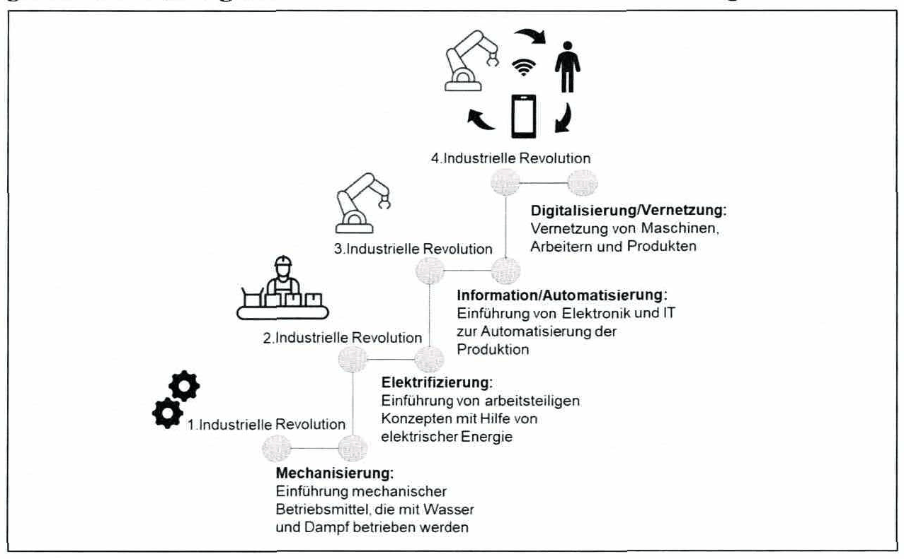
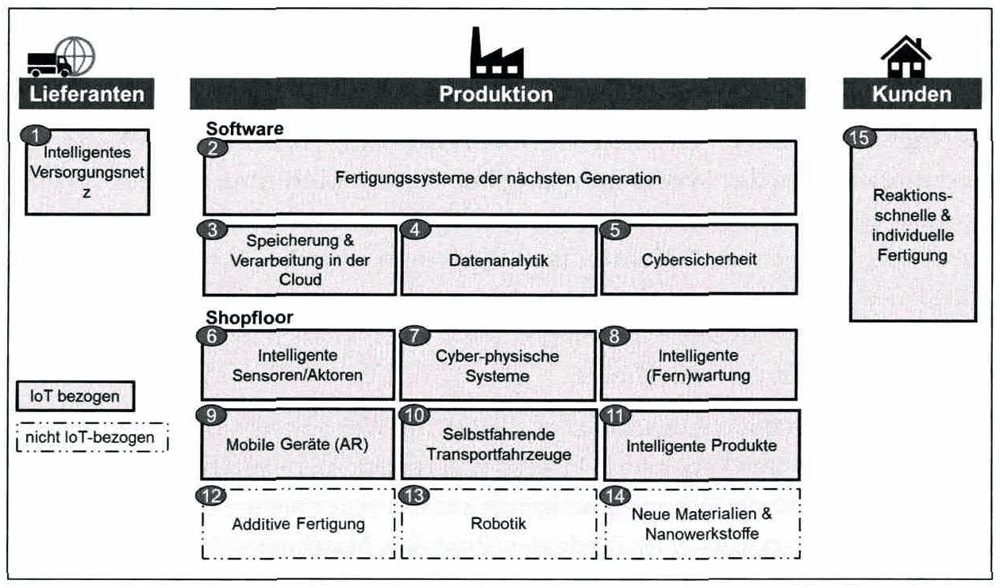

<!-- Seite 1 (PDF 11) -->

# 1.1 Historische Entwicklung der Industrie[^1]

- **Erste industrielle Innovation**

Die **erste industrielle Revolution** begann um 1750, angetrieben durch die Entwicklung der **Dampfmaschine** (Abbildung 1, Seite 4). Mitarbeiter und Antriebsmaschinen haben die Industrialisierung ermöglicht und wesentlich dazu beigetragen, dass seither keine strukturellen Hungerskatastrophen in den Industrieländern aufgetreten sind. Diese Entwicklung führte zu einer **Bevölkerungsexplosion**. Einerseits konnte die Bevölkerung mit Kleidung und Lebensmitteln versorgt werden, da das Transportsystem (Dampfschiff und Eisenbahn) verbessert wurde, andererseits verbesserte sich die Produktivität bei der Herstellung von Grundversorgungsgütern enorm, z.B. in der Landwirtschaft.

Die strukturellen Veränderungen während der 1. Industriellen Revolutionen (sowie den darauffolgenden Revolutionen) hatten weitreichende Auswirkungen auf die Gesellschaft. So nahm beispielsweise das traditionelle Handwerk und die Landwirtschaft auf der Beschäftigungsseite stark ab, während sich mit den Fabrikarbeitern und den Fabrikbesitzern zwei neue Schichten entwickelten. In den Anfängen der Industrialisierung standen den wenigen, die an der rasch wachsenden Wertschöpfung verdienten, eine große Zahl ausgebeuteter Fabrikarbeiter gegenüber. Kinderarbeit wurde betrieben und die Belegschaft hatte eine geringe Lebenserwartung. Auch wenn die Arbeitsbedingungen damals sehr schlecht waren, zogen immer mehr Menschen in die Städte, was zu einer strukturellen Armut der Fabrikarbeiter, dem sogenannten Pauperismus, führte. Diese Entwicklung führte schließlich zu einer bürgerlichen Revolution am Ende der zweiten industriellen Revolution. Die zweite industrielle Revolution wurde von der Massenproduktion geprägt, wobei die Arbeit mit Hilfe von elektrischer Energie unterstützt wurde.

<!-- Seite 2 (PDF 12) -->

- **Zweite industrielle Revolution**

Die **zweite industrielle Revolution** wird oft als organisationsgetriebene Revolution beschrieben. Beispiele für Entwicklungen in dieser Zeit sind die **Produktionslinie von Henry Ford** (Fließbandfertigung) und die wissenschaftliche Managementtheorie nach Frederic W. Taylor.

Gleichzeitig wurden aber auch **elektrische Antriebe und Verbrennungsmotoren** entwickelt. Insbesondere die elektrifizierten Antriebssysteme ermöglichten es, die Maschinen nicht über zentrale Motoren, sondern dezentral zu betreiben. Darüber hinaus gewann **Erdöl als Grundstoff** der chemischen Industrie und auch als neuer Kraftstoff für mobile Systeme - **vor allem für Automobile** - zunehmend an Bedeutung.

Die dadurch ermöglichte **Großindustrielle Massenproduktion** ist vor allem in der chemischen und elektrischen Industrie sowie natürlich im Maschinenbau und in der Automobilindustrie vorangekommen. Die Bevölkerung wuchs weiter und es wurde der Gesellschaft bewusst, dass Fabrikarbeiter nicht ausgebeutet werden können, sondern dass der **allgemeine Wohlstand** vermehrt berücksichtigt werden muss, um soziale Spannungen abzubauen. Diesen Bedarf konnte die großindustrielle Massenproduktion erfüllen, da sie es ermöglichte, Produkte aufgrund des Skaleneffektes sehr kostengünstig herzustellen. In dieser Zeit wuchs die **Bedeutung der Gewerkschaften** sehr stark an. Während des Übergangs der ersten zur zweiten Industriellen Revolution entstand die Sozialdemokratie. Die Idee des Kommunismus verbreitete sich und entsprechende Systeme entstanden. Damals wurde der Grundstein für unseren heutigen, verbraucherorientierten Wohlstand gelegt.

- **Dritte industrielle Revolution**

Unterbrochen durch die zwei Weltkriege kam es Anfang der 60er Jahre zur **dritten Industriellen Revolution**. Getragen wurde diese Revolution von der **Elektronik**, die eine fortschreitende **Automatisierung der Produktionsprozesse** (z.B. durch Industrieroboter) ermöglichte. In diese Zeit fällt die Entwicklung der **speicherprogrammierbaren Steuerung** sowie die Einführung von auf **Halbleitern** basierende Antriebsregler, Sensorik und Aktorik.

**Mikroelektronik, Satellitentechnik**, sowie andere **Informations- und Kommunikationstechnologien** schufen eine **neue Industrie**: den **IT-Sektor**. Die technologischen Errungenschaften reichen vom Personal Computer, der Mobiltelefonie bis hin zum Internet, Dies führte letztlich zu einem **starken Wandel in der weltweiten Kommunikation**. Im Bereich der Energieträger sind neben den bestehenden nun **auch erneuerbaren Energien** hinzugekommen.[^2]

<!-- Seite 3 (PDF 13) -->

Während des Übergangs der Wirtschaftswunderjahre in den 1980er Jahre waren viele Märkte gesättigt, da viele Grundbedürfnisse der Wohlstandsgesellschaft befriedigt waren. Die Absatzmärkte wurden mehr und mehr zu Käufermärkten. Es ging also nicht nur mehr um die Herstellung und um die Grundeinstellung, dass alles was produziert wurde, sowieso verkauft werden würde. Die **Kunden wurden immer differenzierter**, die Wünsche immer individueller. Sie wurden sehr wählerisch in Bezug auf **Qualität und Individualität**. Die **variantenreiche Serienfertigung** rückte immer mehr in den Vordergrund. Gleichzeitig hat sich die Marktwirtschaft, insbesondere die soziale Marktwirtschaft in Deutschland, weiterentwickelt. Es bestand eine **weltweite Verfügbarkeit von Wissen**, angetrieben durch Informations- und Kommunikationstechnologien und später durch das Internet. Darüber hinaus haben die Industriegesellschaften begonnen, über ihre eigenen Verhältnisse hinaus zu leben. In den 70er und 80er Jahren wurde der Grundstein für die Verschuldung der Volkswirtschaften gelegt. Nach dem Fall des Eisernen Vorhangs konnte die **Globalisierung** ungehindert fortschreiten. Wir befinden uns noch heute in dieser Phase der Globalisierung, in der Unternehmen ihre Produkte weltweit verkaufen und Mitarbeiter weltweit beschäftigen.

Im Zuge der dritten Industriellen Revolution verlor der Anteil des wertschöpfenden Gewerbes am Bruttoinlandsprodukt (BIP) zunehmend an Bedeutung, während das BIP des **Dienstleistungssektors** stieg. Damals glaubten international anerkannte Ökonomen, dass der Fertigungssektor auf nur 10 Prozent des BIP sinken würde. Diese Entwicklungen wurden vor allem in Frankreich, England und den USA beobachtet. Eine Ausnahme bildet hier Deutschland. Deutschland ist es gelungen, seinen Industrieanteil seit der Wiedervereinigung in den 90er Jahren auf rund 25 Prozent des Bruttoinlandsprodukts stabil zu halten. Dies wurde nur durch die Finanzkrise unterbrochen, währenddessen der Anteil unter 20 Prozent fiel. Nach der Krise erholte sich Deutschland sehr schnell und das verarbeitende Gewerbe trägt heute wieder mehr als 25 Prozent zum BIP bei.

Insbesondere die angelsächsischen Volkswirtschaften, die sich in Richtung Dienstleistungsunternehmen entwickelten, legten den Finger in die Wunde und kritisierten Deutschland dafür, dass es keinen Wandel in der Wissens- und Dienstleistungsgesellschaft bewirkt habe. Der relativ hohe Industrieanteil, die Sparkassen und Volksbanken, die Struktur ihres Finanzsektors, die mittelständischen Strukturen und die relativ starken gesetzlichen Sozialleistungen differenzierten sie von den Volkswirtschaften der USA und Großbritannien. Aufgrund der Auswirkungen der Finanzmarktkrise 2007/08 haben viele Ökonomen ihre Modelle überdacht und ihre Ansichten geändert.

<!-- Seite 4 (PDF 14) -->

- **Vierte industrielle Revolution**

Getrieben von der **rasanten Entwicklung der Elektronik und Digitalisierung in Verbindung mit den immer weiter sinkenden Preisen dieser Technologien**, erhoffen sich Unternehmen den nächsten Produktivitätsgewinn durch den Einsatz von cyberphysikalischen Systemen in ihrer Produktionsumgebung, die **Analyse großer Datenmengen oder das industrielle Internet der Dinge**.

*Abbildung 1: Historische Entwicklung innerhalb der Industrie – Skript S. 4 (PDF 14)* · [Rekonstruktion](../../figures/reconstructed/abb-01.svg) · [Zeichenübung](../../learning/drawing-exercises/abb-01-zeichenuebung.md)

„Industrie 4.0" war ursprünglich als Zukunftsprojekt der deutschen Bundesregierung gedacht, dass die digitale Vernetzung der klassischen Fertigungsindustrie vorantreiben soll. Es geht um den Auf- und Ausbau wettbewerbsfähiger Industriestrukturen, um die deutsche Wirtschaft auf die Zukunft der Produktion vorzubereiten. In Deutschland haben sich um 2011 mehrere Industrieverbände (BITKOM, VDMA und ZVEI) zu einer "Plattform Industrie 4.0" unter Federführung des Bundeswirtschaftsministeriums und des Bundesforschungsministeriums zusammengeschlossen und folgendes konzeptionelles Verständnis verkündet:

Der Begriff „Industrie 4.0“ steht für die vierte industrielle Revolution, **eine neue Stufe in der Organisation und Steuerung der gesamten Wertschöpfungskette über den Lebenszyklus von Produkten**. Dieser Kreislauf orientiert sich an immer individuelleren Kundenanforderungen und reicht von der Idee über die Entwicklung und Fertigung, der Lieferung eines Produktes an den Endkunden bis hin zum Recycling und den damit verbundenen Dienstleistungen (Abbildung 2). **Basis ist die Verfügbarkeit aller relevanten Informationen in Echtzeit durch die Vernetzung aller an der Wertschöpfung beteiligten Einheiten** sowie die Möglichkeit, aus den Daten jederzeit den optimalen Wertfluss abzuleiten. Durch die **Vernetzung von Menschen, Objekten und Systemen** entstehen dynamische, echtzeitfähige und selbstorganisierende, unternehmensübergreifende Wertschöpfungsnetzwerke, die nach verschiedenen Kriterien wie Kosten, Verfügbarkeit und Ressourcenverbrauch optimiert werden können.

<!-- Seite 5 (PDF 15) -->

Die **Digitalisierung** ermöglicht dabei, die Art und Weise zu revolutionieren, wie Produkte tatsächlich zum Leben erweckt werden. Es entstehen **neue Geschäftsmodelle** und neue Wege für die Wissensgenerierung aus den gesammelten Daten über den **gesamten Lebenszyklus** eines Produktes. Produkte, Maschinen, Transportmittel und weitere Produktionsfaktoren werden zu "intelligenten" Objekten. Die Arbeiter werden durch assistierende Technologien unterstützt und Roboter übernehmen Aufgaben, die die Menschen nicht erfüllen wollen oder können. Tatsächlich wird der Anteil der Technologie in Industrieunternehmen steigen, um die Produktivitätssteigerung zu unterstützen und die Vision einer Einzelfertigung von hochindividuellen Produkten direkt nach Bedarf und nach den spezifischen Bedürfnissen jedes einzelnen Kunden realisieren zu können.

<!-- Seite 6 (PDF 16) -->

*Abbildung 2: Mögliche Elemente eines Betriebs der Industrie 4.0 – Skript S. 6 (PDF 16)* · [Rekonstruktion](../../figures/reconstructed/abb-02.svg)

Zu den wichtigsten Enablern der Industrie 4.0 zählen:

- Preisverfall industrieller Hard- und Software
- Weiterentwicklung von Hard- (z.B. Sensorik, Embedded Systems) und Software
- Ausbreitung des Internets
- (Neue) Technologien (z.B. Künstliche Intelligenz, Cloud-Computing)

[^1]: Vgl. Voigt (2008), S. 5
[^2]: ? Vgl. Schwab (2017)
