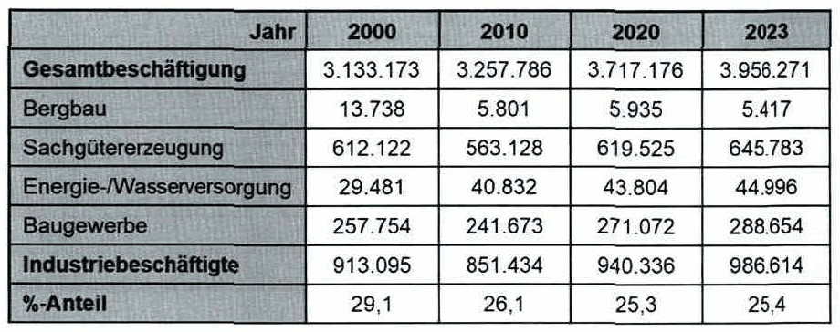
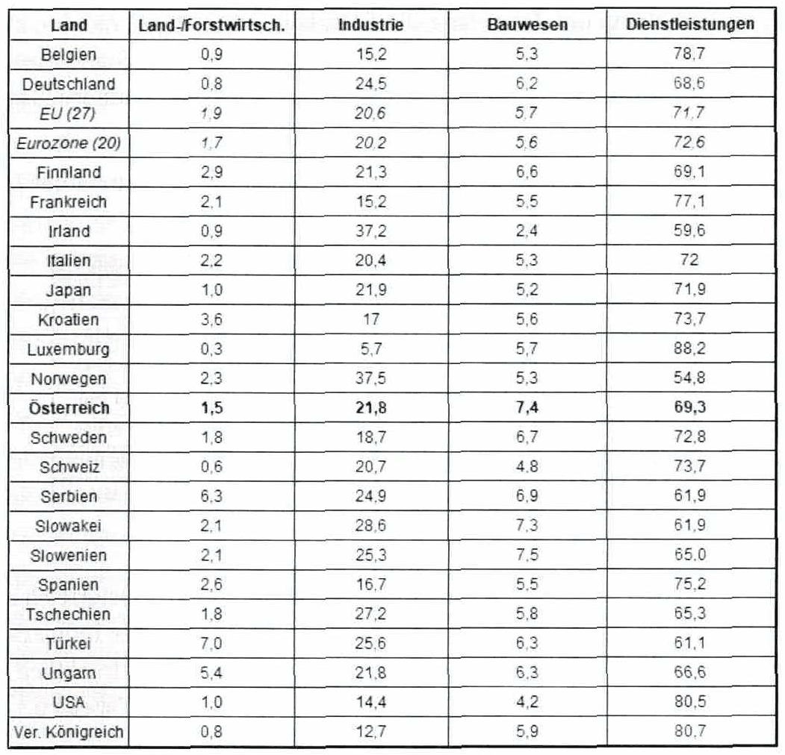
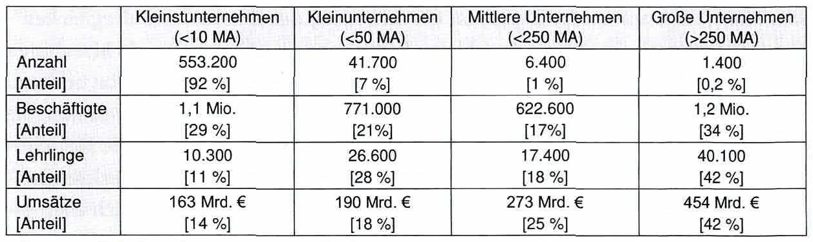
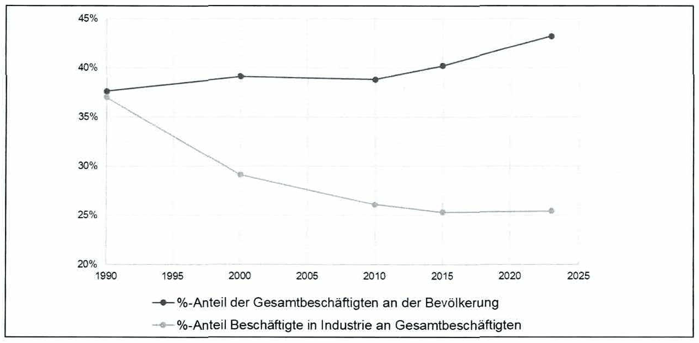

<!-- Seite 6 (PDF 16) -->

# 1.2 Wirtschaftliche Bedeutung der Industrie

## 1.2.1 Zahlen und Fakten

Wie bereits oben erläutert, profitierten Deutschland aber auch Österreich während der letzten Wirtschaftskrise stark von einem durchschnittlich **höheren Anteil der Industrie** und ihre Wirtschaft erholte sich deutlich schneller als in Ländern, in denen der Anteil der Industrie deutlich geringer war. Die Vereinigten Staaten von Amerika haben daher eine Initiative ins Leben gerufen, um die Fertigungsindustrie in den USA wiederherzustellen und den Trend zur Auslagerung der Produktion in Niedrigkostenregionen zu stoppen. Nicht nur das steigert die Beschäftigung und das BIP, auch die Innovationsfähigkeit ist eng mit den Produktionskapazitäten eines Unternehmens verbunden. Wenn das Wissen, wie man ein Produkt tatsächlich produziert, nach Übersee wandert, verliert man auch langfristig die Fähigkeit, innovative Produkte zu entwickeln. Ein höherer Anteil an Fertigungskapazitäten in der Nähe des Standortes, an dem die Waren oder Produkte entwickelt werden, ist daher für Industrieunternehmen sinnvoll.

<!-- Seite 7 (PDF 17) -->

Ein Blick auf Beschäftigtenzahlen in der Industrie zeigt die Bedeutung der Industrie für den Arbeitsmarkt (siehe Tabelle 1).

*Tabelle 1: Unselbständig Beschäftigte in Österreich – Skript S. 7 (PDF 17)*

Auch bei der Wertschöpfung spielen die Industrieunternehmen in Österreich nach wie vor eine große Rolle. In jüngerer Vergangenheit lag der Beitrag der Industrie an der Gesamtwertschöpfung in Österreich stets über 28 Prozent, was beträchtlich ist. Wie Österreich im weltweiten Vergleich positioniert ist, ergibt sich aus Tabelle 2.

<!-- Seite 8 (PDF 18) -->

*Tabelle 2: Prozentualer Anteil der Sektoren an der Gesamtwertschöpfung im Jahr 2023 – Skript S. 8 (PDF 18)*

Seit 2010 sind BIP und der Gesamtwert der während eines Jahres herstellten Waren jeweils um circa 40% gestiegen. 2021 war das erste Jahr, in dem die österreichische Industrie über 100 Milliarden Euro zum BIP beigetragen hat. Bemerkenswert ist, dass der als Sekundärbereich bezeichnete Industriesektor weniger stark von der COVID-19- Pandemie erfasst wurde.

Etwa 55% des österreichischen BIP werden durch Exporte generiert. Der produzierende Bereich (ohne Bauwesen) erwirtschaftet 57% ihrer Umsätze mit dem Export. Den größten Anteil an den Warenexporten haben der Maschinenbau (24%), die Chemieerzeugnisse (15%), Eisen, Stahl und Metallwaren (14%), sowie Fahrzeuge (11%).[^6]

**Österreich ist die Heimat von mehr als 160 sogenannter „Hidden Champions**“ (Unternehmen, die entweder eine Top 3-Position auf dem Weltmarkt belegen oder Nummer 1 auf einem Kontinent sind; „hidden“ da diese Unternehmen meist der breiten Öffentlichkeit nicht bekannt sind). Bezogen auf die Landesgröße ist dies ein

<!-- Seite 9 (PDF 19) -->

Spitzenwert. **Drei von vier dieser „Hidden Champions“ kommen aus der Industrie**.[^7] Der Exportanteil der Hidden Champions liegt bei 85%.°

Auch die Lehrlingsausbildung hat einen hohen Stellenwert in der Industrie: Sie zählt zu den **wichtigsten Lehrlingsausbildnern** des Landes und investiert hier mehr als alle anderen Wirtschaftssparten. Zudem kommt fast die Hälfte aller Forschungsausgaben in Österreich aus der Industrie.7

Österreichs Industrie ist maßgeblich von **kleinen und mittleren Unternehmen (KMU)** geprägt. In der statistischen Praxis gelten Unternehmen mit weniger als 50 Mitarbeitern als Kleinunternehmen; mittlere Unternehmen haben 50 bis 250 Beschäftigte. 2023 waren 88% der österreichischen Industriebetriebe KMU. **Der Großteil der Industriebeschäftigten** (75%) **ist jedoch für große Unternehmen (>250 Mitarbeiter) tätig**.[^8]

*Tabelle 3: Prozentualer Anteil der Sektoren an der Gesamtwertschöpfung im Jahr 2023 – Skript S. 9 (PDF 19)*

## 1.2.2 Zentrale Bedeutung der Fertigung für die Wirtschaft

Das Roosevelt Institute hat 2011 sechs Gründe veröffentlicht, warum die Fertigung für die Wirtschaft von zentraler Bedeutung ist[^10]:

1. **Die Produktion war der Grund für die wirtschaftliche Entwicklung**

Es war die strategische Errungenschaft der reichen Nationen in den letzten hundert Jahren, einen qualitativ hochwertigen Produktionssektor zu schaffen, um nationalen Reichtum und Macht zu entwickeln. Vom Aufstieg Englands im 19. Jahrhundert über den Aufstieg der USA, Deutschlands, Japans und der damaligen UdSSR im 20. Jahrhundert bis hin zu den Schwellenländern wie Korea, Taiwan und jetzt China war die Produktion der Schlüssel zum Wohlstand.

2. **Die Produktion ist das Fundament der globalen “Großmächte**”

<!-- Seite 10 (PDF 20) -->

Die mächtigsten Nationen der Welt - die "Großmächte" - sind diejenigen, die den Großteil der globalen Produktion von Fertigungstechnologie kontrollieren. Das heißt, es reicht nicht aus, lediglich Fabriken zu besitzen und mehr Waren zu produzieren, es gilt auch zu wissen, wie man die Maschinen herstellt, die die Waren herstellen. Der Schlüssel zur Macht liegt also darin, die "Produktionsmittel" herzustellen.

In der gleichen Weise wie sich die Maschinenindustrie entwickelt, entwickelt sich auch eine Großmacht. Etwa 80 Prozent der weltweiten Produktion von Fabrikmaschinen wird von den "Großmächten" kontrolliert.

3. **Fertigung dient als wichtigster Grund für Wirtschaftswachstum**

Das Wachstum der Produktion von Fertigungsmaschinen und deren technologische Verbesserungen sind die Haupttreiber des Wirtschaftswachstums. Gäbe es keine Maschinenindustrie, so gäbe es auch kein nachhaltiges, langfristiges Wirtschaftswachstum. Man denke nur an die Explosion des Internets, der iPhones und dergleichen - alles möglich durch eine kleine Anzahl von Produktionsmaschinen, die als Maschinen für die Herstellung von Halbleiter bezeichnet werden und die ihrerseits von anderen Formen von Produktionsmaschinen abhängig sind, wie den Werkzeugmaschinen, die die Linsen schleifen, die sie verwenden, oder den M etalllegierungen, die die Metallindustrie produziert. Das technologische und produktive Potenzial von Werkzeugmaschinen und Maschinen für die H erstellung von Halbleitern beeinflussen sich auch gegenseitig und führten zu einem explosiven Wirtschaftswachstum in den letzten Zweihundert Jahren.

4. **Globaler Handel basiert auf Waren, nicht auf Dienstleistungen**

Ein Land kann für die meisten seiner Waren nicht im Gegenzug mit Dienstleistungen handeln. Nach Angaben der WTO sind 80 Prozent des Welthandels zwischen den Regionen Warenhandel, d.h. nur 20 Prozent des Welthandels fallen auf Dienstleistungen. Wenn eine Wirtschaft im Extremfall nur aus Dienstleistungen bestehen würde, dann wäre sie sehr arm, weil sie nicht mit Waren handeln könnte und ihre Währung wäre somit sehr wenig wert.

**Se Dienstleistungen sind abhängig von Industriegütern**

Eine Dienstleistung beinhaltet meist die Verwendung von Industriegütern. Man kann die Erfahrung, wie man etwas nützt, nicht exportieren. Der Einzelhandel und Großhandel, die etwa 11 Prozent der Wirtschaft ausmachen, besteht aus dem Kauf und Verkauf von Industriegütern. Das Gleiche gilt für Immobilien, welche weitere 13 Prozent der Wirtschaft ausmachen, also den Kauf und Verkauf eines "realen" oder physischen Vermögenswertes, eines Gebäudes. Auch der Gesundheitssektor, der etwa 8 Prozent der Wirtschaft ausmacht, beinhaltet die Verwendung von medizinischen Geräten und

<!-- Seite 11 (PDF 21) -->

Medikamenten Der Finanzsektor beinhaltet die Umleitung überschüssiger Ressourcen, die der nichtfinanzielle Sektor der Wirtschaft produziert, was bedeutet, dass indirekt auch die Finanzierung vom verarbeitenden Gewerbe abhängig ist. Der Kreislauf von Aufstieg und Niedergang verläuft in der Regel wie folgt: Eine entwickelte Gesellschaft findet heraus, wie sie die gegenwärtigen Produktionstechnologien nutzen kann, um riesige Überschüsse zu erzielen, die sich entweder die Finanzkräfte, die Vermögende oder das Militär dann für ihren eigenen Reichtum und ihre eigene Macht aneignen. Fazit: Die Gesundheit der Wirtschaft hängt entscheidend von der Gesundheit des verarbeitenden Gewerbes ab.

6. **Fertigung schafft Arbeitsplätze**

Die meisten Arbeitsplätze hängen direkt oder indirekt vom verarbeitenden Gewerbe ab - und die Wiederbelebung des Sektors könnte Dutzende Millionen neuer Arbeitsplätze schaffen. Im Jahr 2005 betrug der Anteil des verarbeitenden Gewerbes in Japan 20,2 Prozent in Deutschland 23,2 Prozent und in den USA 13,4 Prozent, so die OECD. Wenn die USA den gleichen Prozentsatz wie Japan hätten, hätten sie 7 Millionen zusätzliche hochwertige, langfristige und gut bezahlte Arbeitsplätze gehabt. Nach Angaben des Instituts für Wirtschaftspolitik unterstützt jeder Arbeitsplatz im verarbeitenden Gewerbe fast drei weitere Arbeitsplätze in der Wirtschaft.

## 1.2.3 Merkmalausprägungen und Bedeutung der Industrie in Österreich

Die Industrie hat für Österreich eine übergeordnete Bedeutung. Die Merkmale der Industrie in Österreich umfassen folgende Punkte:

1. **Österreich ist im internationalen Vergleich als hochindustrialisiert zu bezeichnen**.

Je weiter die Industrialisierung fortgeschritten ist, umso geringer ist der Anteil jener, die in der Landwirtschaft tätig sind. Während der Anteil der in der Landwirtschaft unselbstständigen Beschäftigten in Österreich im Jahr 1961 noch fast 5% ausgemacht hat, sind es heute nur noch in etwa 0,7%. [^12]

2. **Österreich erlebt einen Prozess der Entindustrialisierung seit 1970**.

Bis zum Ende der fünfziger Jahre wurde die Industrialisierung Europas begleitet von einer zunehmenden Bindung von Arbeitskräften in der industriellen Produktion. Seither sinkt die Anzahl der Industrie tätigen Mitarbeiter, während die Beschäftigtenzahl in den Bereichen Dienstleistung und Verwaltung ansteigt. Abbildung 3 zeigt die Beschäftigten in der Industrie im zeitlichen Verlauf. Im Jahr 2019 hatte Österreich rund

<!-- Seite 12 (PDF 22) -->

8,85 Millionen Einwohner und fast 950.000 Mitarbeiter\*Innen in der Industrie (25% der Gesamtbeschäftigten).

*Abbildung 3: Entwicklungen des %-Anteils der Beschäftigten an der Gesamtbevölkerung sowie des %-Anteils der Industriebeschäftigten an den Gesamtbeschäftigten in Österreich – Skript S. 12 (PDF 22)*

3. **Österreich verzeichnet einen verstärkten Prozess des Eindringens industrieller Methoden und Techniken in nichtindustrielle Bereiche**.

Zunächst rein industriell angewandte Methoden und Techniken, finden vermehrt auch in nichtindustriellen Bereichen — vor allem im Freizeit-, Wohlfahrts- und Verwaltungsbereich und auch im Dienstleistungssektor — Anwendung.

4. **Österreich befindet sich, wie viele Industrieländer, in einem Prozess der Umstrukturierung**.

Durch die weltwirtschaftliche Arbeitsteilung bedingt, wird die Konkurrenzsituation für die klassischen Industrieländer Westeuropas gegenüber Schwellenländern (insbesondere den „low cost areas“ Asiens) immer schwieriger. Zukunftsorientierte Strategien bedingen deshalb den vermehrten Einsatz bildungsintensiver Prozesse und Produkte.

5. **Österreich hat im internationalen Vergleich kleine Industriebetriebe**

Neben Großunternehmen und Konzernen, wie der OMV AG oder der voestalpine AG (wobei diese international gesehen ebenfalls nicht groß sind), sind Klein- und Mittelbetriebe (KMUSs), mit einer Mitarbeiteranzahl bis zu 249 Mitarbeiter für die Beschäftigung aber auch den Umsatz in Österreich von großer Bedeutung. Der überwiegende Anteil der Unternehmen in Österreich fällt in die Kategorie der KMUs. Im Jahr 2023 zählten ca. 99 % der österreichischen Unternehmen zu diesen Betrieben (siehe Tabelle 3).

<!-- Seite 13 (PDF 23) -->

6. **Österreich hat einen kleinen Inlandsmarkt und eine hohe Energie- so- wie Rohstoffabhängigkeit vom Ausland**.

Die Aufnahmefähigkeit des österreichischen Inlandsmarktes für industrielle Produktion ist beschränkt. Die hohen Exportanteile sind eine notwendige Konsequenz daraus.

Diesem Sachverhalt steht ein hoher Anteil von Rohstoff- und Energieimporten (ausgenommen bei elektrischer Energie) gegenüber. Rund 94% der in Österreich benötigten Energie muss heute importiert werden, während dieser Anteil 1990 74% ausmachte. Daraus ergibt sich eine hohe Abhängigkeit von Währungsproblemen im internationalen Umfeld.

7. **Österreich wird von einer allgemein kritischen Haltung gegenüber dem technischen Fortschritt und einem hohen Umweltbewusstsein geprägt**.

Die Sorge vor möglichen Fehlentwicklungen und den damit verbundenen Konsequenzen führte zu einer allgemein kritischen Haltung gegenüber dem technischen Fortschritt. Als Beispiele dazu können das immer größer werdende Umweltbewusstsein weiter Bevölkerungsteile im Allgemeinen und der Widerstand gegen Großprojekte (z.B. Wasserkraftwerk Hainburg) im Speziellen genannt werden.

8. **Österreich hat von seinen Ressourcen her gute Voraussetzungen, die Probleme der (nach-)industriellen Gesellschaft im ganzheitlichen Sinn zu lösen**.

Trotz aller Schwierigkeiten erscheinen die Voraussetzungen Österreichs zur Problembewältigung gut. Diese kann aber nur im ganzheitlichen Sinne gesehen werden. Ökonomie und Ökologie müssen einander nicht widersprechen, ein Zusammenspiel muss angestrebt werden. Die Grundlagen für die Problemlösungskapazität wie

- Bildungsniveau: Ausbildungsstätten, -systeme
- Leistungsbereitschaft: Motivation zur Arbeit, Leistung
- Sozialer Friede: Sozialpartnerschaft sind vorhanden und müssen entsprechend zur Anwendung gebracht werden.

**Die Merkmale von Industriebetrieben** (und letztlich für den gesamten Sektor) ergeben sich aus 8 7 der österreichischen Gewerbeordnung:

1. hoher Einsatz von Anlage- und Betriebskapital;

<!-- Seite 14 (PDF 24) -->

2. Verwendung andersartiger als der dem Handwerk und den gebundenen Gewerben gemäßen Maschinen und technischen Einrichtungen oder Verwendung einer Vielzahl von Maschinen und technischen Einrichtungen gleichen Verwendungszweckes:;
3. Einsatz von Maschinen und technischen Einrichtungen überwiegend in räumlich oder organisatorisch zusammenhängenden Betriebsstätten:

4- serienmäßige Erzeugung, typisierte Verrichtungen;

5. weitgehende Arbeitsteilung im Rahmen eines vorbestimmten Arbeitsablaufes;
6. größere Zahl von ständig beschäftigten Arbeitnehmern und Überwiegen der nur mit bestimmten regelmäßig wiederkehrenden Teilverrichtungen beschäftigten Arbeitskräfte oder automatisierte Betriebsweise:
7. organisatorische Trennung in eine technische und eine kaufmännische Führung, wobei sich die Mitarbeit des Gewerbetreibenden im Wesentlichen auf leitende Tätigkeiten beschränkt.

Es ist nicht zwingend erforderlich, dass alle Punkte erfüllt sind. Sobald vier dieser Merkmale erfüllt sind, kann bereits von einem Industriebetrieb gesprochen werden, andernfalls handelt es sich einen Gewerbebetrieb.

[^6]: WKO / Außenwirtschaft Austria
[^7]: Industriellenvereinigung
[^8]: https://www.wko.at/oe/industrie/bsi-kennzahlen-2024.pdf
[^10]: Rynn (2011)
[^12]: ” https://www.wko.at/statistik/jahrbuch/jahrbuch-2024.pdf

## Fußnoten ohne sicheren Textanker

Diese Fußnoten stehen auf den Seiten dieses Abschnitts, ihr Verweiszeichen im Text ließ sich aus dem Scan aber nicht eindeutig zuordnen (oft Quellenangaben zu Abbildungen).

- **3** – Seite 6 (PDF 16): https://iot-analytics.com/industrial-internet-disrupt-smart-factory/
- **4** – Seite 7 (PDF 17): https://www.wko.at/statistik/jahrbuch/jahrbuch-2024.pdf
- **5** – Seite 8 (PDF 18): https://www.wko.at/statistik/eu/europa-wertschoepfung.pdf
- **9** – Seite 9 (PDF 19): https://www.kmuimfokus.at/
- **11** – Seite 11 (PDF 21): Ausführlich im Vorlesungsskript „Industriebetriebslehre“
- **13** – Seite 12 (PDF 22): http://wko.at/statistik/jahrbuch/2019_ Deutsch.pdf, Zugriffsdatum:16.06.2020
