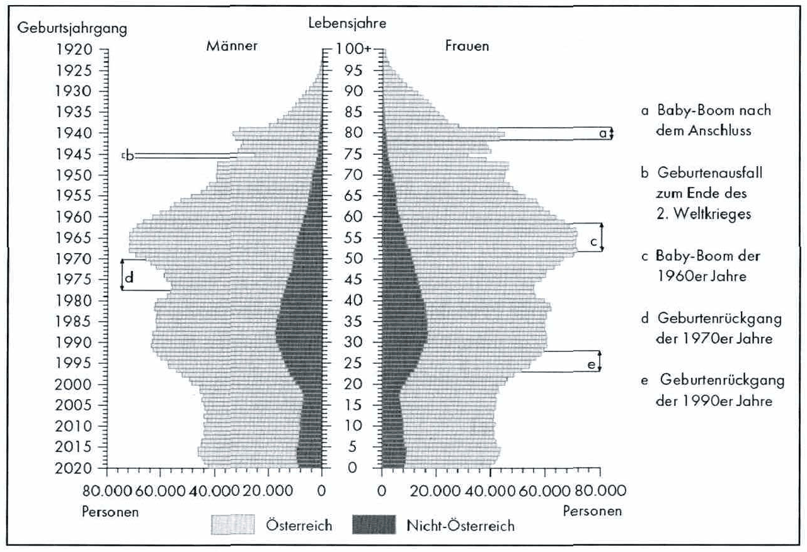

<!-- Seite 14 (PDF 24) -->

# 1.3 Aktuelle Herausforderungen der Industriebetriebe

Die Produktion ist noch immer das Rückgrat des österreichischen Wohlstandes. Aufgrund von vielen Veränderungen der Rahmenbedingungen steht Österreich als Produktionsstandort unter Druck und ist mit zahlreichen Herausforderungen, wie der Globalisierung, dem demographischen Wandel oder der Nachhaltigkeit konfrontiert. Ausgewählte Herausforderungen sind im Folgenden genauer beschrieben:

## 1.3.1 Globalisierung

Unter Globalisierung versteht man die zunehmenden weltweiten Verflechtungen in den Bereichen Politik, Wirtschaft und Kultur. Die Beziehungen können dabei sowohl auf der Ebene von Individuen und Unternehmen als auch von Gesellschaften und Staaten entstehen, Die wirtschaftliche Globalisierung spielt in der Industriebetriebslehre eine besondere Rolle und beinhaltet das Wachstum des Welthandels, die Zunahme der globalen Unternehmenskooperationen und das Wachstum der ausländischen Direktinvestitionen. In Österreich wurden in den vergangenen Jahrzehnten viele (Produktions-) Arbeitsplätze durch den Export aufgebaut — vor allem im Maschinen- und Fahrzeugbau. Damit einhergehend sind in dieser Zeit auch beachtliche Produktionsnetzwerke entstanden. Die Globalisierung birgt damit einige Risiken. Der

<!-- Seite 15 (PDF 25) -->

Export der Produkte führt dazu, dass einige Unternehmen anderer Länder, die Produkte mit gleichem Aussehen nachbauen und als Plagiate verkaufen. Des Weiteren nutzen Unternehmen die weltweit hohen Lohnunterschiede unterschiedlicher Länder aus und produzieren zu weitaus geringeren Kosten, was unter Umständen zu Dumping-Preisen und zu Arbeitsplatzexport führen kann. Während in den vergangenen Jahrzehnten, aufgrund von geringeren Faktorkosten die Produktionsarbeit in Niedriglohnländer verlagert wurde, versucht man heute diese wieder nach Österreich zurückzuholen. Darüber hinaus führt die Globalisierung auch zu einer Verkürzung der Produktlebenszyklen, was in besonderen Herausforderungen an den Produktentstehungsprozess resultiert.[^14]

## 1.3.2 Durchdringung neuer Technologien

Im Maschinenbau und besonders in der Fahrzeugindustrie hat beispielsweise die Integration von Mechanik, Elektronik sowie Informatik zu neuartigen Produkten und Produktionsprozessen geführt. Die Ermöglichung einer effizienten und effektiven Durchdringung mit neuen Technologien wird deshalb zu einem entscheidenden Baustein für zukunftsweisende Produkte und Produktionsprozesse. Herausforderungen ergeben sich in diesem Zusammenhang vor allem mit neuen Formen der Kollaborationen und Arbeiten in interdisziplinären Teams.[^15]

## 1.3.3 Demografischer Wandel

Unter dem demografischen Wandel werden Tendenzen in der Bevölkerungsentwicklung verstanden, die eine grundlegende Änderung der Altersstruktur einer Gesellschaft beschreiben. Dieser Effekt steht in Österreich vor allem mit der steigenden Lebenserwartung und der niedrigen Geburtenrate in Verbindung. Unternehmen werden vom demografischen Wandel in vielfacher Weise beeinflusst. Zum einen müssen sie sich auf eine Veränderung der Struktur ihrer Belegschaft einstellen: so wird der Anteil der älteren Erwerbstätigen deutlich steigen, während sich die Akquirierung jüngerer Mitarbeiter zunehmend schwierig gestaltet.

Im Jahr 2024 lag das Durchschnittsalter in Österreich bei 43,4 Jahren, über 61% der Bevölkerung war im erwerbsfähigen Alter. Für das Jahr 2050 ist ein Durchschnittalter von 46,7 Jahren prognostiziert; der erwerbsfähige Bevölkerungsanteil wird dann etwa 54% betragen.[^16]

<!-- Seite 16 (PDF 26) -->

Industriebetriebe müssen ihre Arbeits- und Arbeitsplatzgestaltung anpassen, um ältere Personen länger im Unternehmen und an ihrem Arbeitsplatz zu halten und vermehrten Krankenständen sowie einer frühen Arbeitsunfähigkeit entgegen zu wirken.

Darüber hinaus wird es in Zukunft notwendig sein, das gesamte Erwerbspotenzial verstärkt zu nutzen. Das betrifft insbesondere Frauen, ältere Bevölkerungsschichten und Personen mit Migrationshintergrund,

*Abbildung 4: Alterspyramide Österreichs (Stand 2021) – Skript S. 16 (PDF 26)*

Der demografische Wandel erzwingt des Weiteren Maßnahmen zur Förderung des produktionstechnologischen Qualifikations- und Kompetenzniveaus. Gerade vor dem Hintergrund der sich rasch verändernden Produktionstechnologien stellt lebenslanges Lernen eine große Herausforderung dar. Daneben stehen Unternehmen vor der Herausforderung die alternde Belegschaft mit (digitalen) Technologien in ihrer täglichen Arbeit auch physisch zu unterstützen. [^18]

<!-- Seite 17 (PDF 27) -->

## 1.3.4 Nachhaltigkeit

Nachhaltigkeit wird mehr und mehr zu einem zentralen Wirtschaftsfaktor, der alle unternehmerischen Bereiche gleichermaßen betrifft.[^19] Sowohl die europäische als auch die nationale Energiepolitik zielt auf eine emissionsarme, ressourceneffiziente und umweltverträgliche Wirtschaft und Produktion ab. Ziel ist es, dass die Industrie wächst und zugleich den ökologischen Fußabdruck ihrer Produkte reduziert. Die energieeffiziente Produktion stellt eine Win-Win Situation dar: die Wettbewerbsfähigkeit von Unternehmen wird gesteigert, indem Energiekosten reduziert werden und damit die Umwelt geschont wird. Die Verbesserung der Energieeffizienz ist dabei eine zentrale Herausforderung. Mit Hilfe innovativer (digitaler) Technologien optimieren österreichische Industriebetriebe ihre Produktionsprozesse, um die Energiekosten zu senken, ihre Wettbewerbsfähigkeit zu stärken sowie den Verbrauch natürlicher Ressourcen zu reduzieren und einen Beitrag zu Umwelt- und Klimaschutz zu leisten.[^20]

## 1.3.5 Innovation für Wettbewerbsfähigkeit

Unternehmen sind mit immer komplexeren Problemen konfrontiert. Daraus ergeben sich Herausforderungen denen Manager gegenübertreten müssen. Die zunehmende Komplexität hat ihren Ursprung in einem sich ständig wandelnden und vermeintlich kaum beeinflussbaren Innovationsumfeld. Innovative Umgebungen befinden sich in einem stetigen Wandel und in Veränderung. Das führt zu zentralen Herausforderungen innerhalb des Unternehmens.[^21]

Es gilt Innovationsvorhaben effizient und effektiv umzusetzen und Widerständen entgegenzuwirken. Widerstand gegen Innovation kann unternehmensintern, durch Wettbewerbspartner oder durch Kunden entstehen.[^22] Das Management muss sich diesen Herausforderungen stellen und Innovationen umsetzen. Herausforderungen können außerhalb oder innerhalb des Unternehmens entstehen (Komplexitätstreiber).[^23] Unternehmen stehen im Innovationsmanagements vor Herausforderungen wie verkürzten Produktlebenszyklen, zunehmender Komplexität der Systeme, dem Technologiewandel und individualisierten Kundenforderungen gegenüber, Herausforderungen und Widerstände sollen im Innovationsmanagement überwunden werden und zukünftig erfolgreiche Innovation hervorbringen.[^24]

<!-- Seite 18 (PDF 28) -->

Umwelteinflüsse im Innovationsprozess sind: die Gesellschaft, die Politik, die Ökologie, die Ökonomie und die Technologie. Veränderungen in diesen Bereichen haben Einfluss auf die Unternehmensplanung und damit auf die Entwicklung und Innovation neuer Produkte.

[^14]: Vgl. Arnold et al. (2019), S. 28
[^15]: Vgl. Abele / Reinhart (2011), S. 12f sowie Niemann / Westkämper (2017), S. 411f
[^16]: Statistik Austria
[^18]: Vgl. Abele / Reinhart (2011), S. 19
[^19]: Zukunftsinstitut (2022)
[^20]: Vgl. Abele / Reinhart (2011), S. 11; Niemann / Westkämper (2017), S. 411f; Wolf et al. (2023)
[^21]: Vgl. Bleicher (2004), S. 90
[^22]: Vgl. Hauschildt und Solomo (2011)
[^23]: Vgl. Riezler (2003)
[^24]: Vgl. Hauschildt und Solomo (2011)

## Fußnoten ohne sicheren Textanker

Diese Fußnoten stehen auf den Seiten dieses Abschnitts, ihr Verweiszeichen im Text ließ sich aus dem Scan aber nicht eindeutig zuordnen (oft Quellenangaben zu Abbildungen).

- **17** – Seite 16 (PDF 26): Statistik Austria
