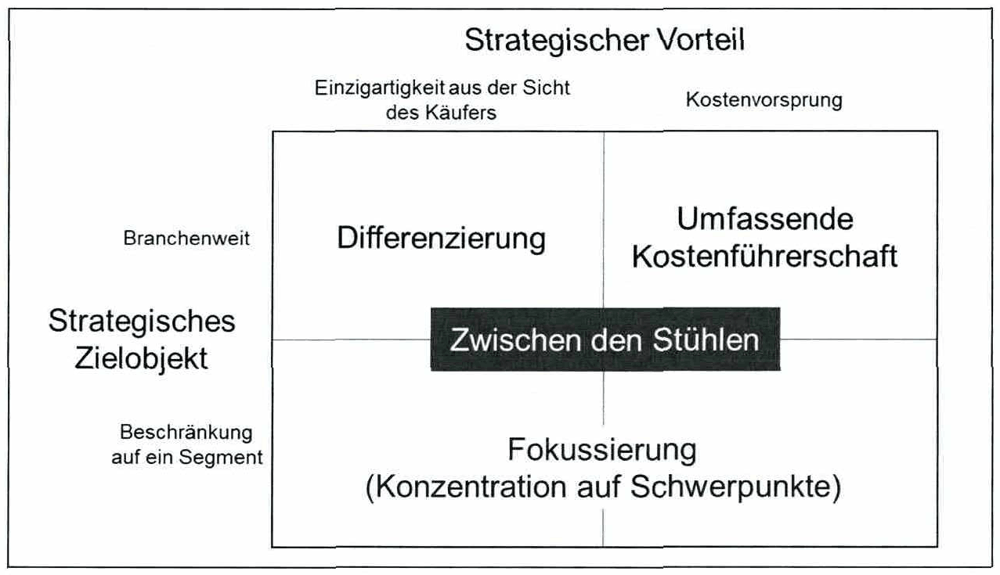
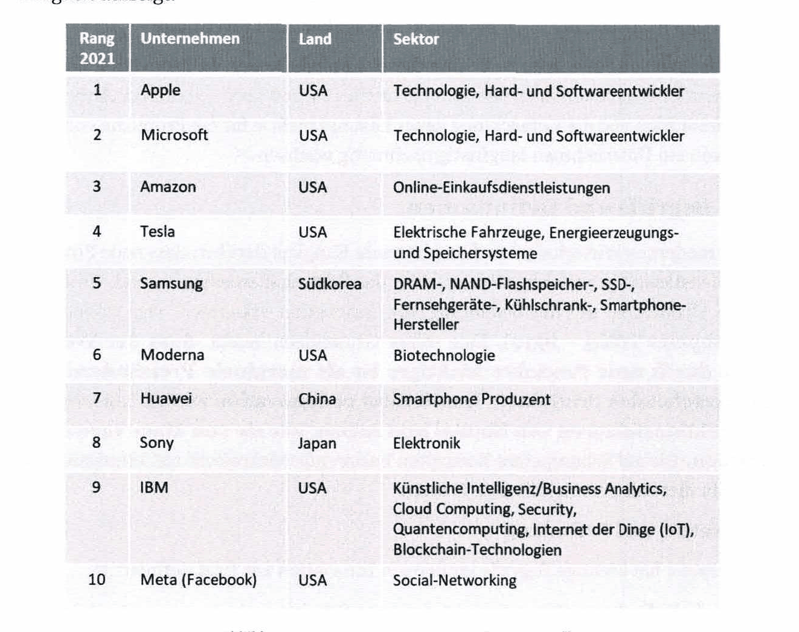

<!-- Seite 21 (PDF 31) -->

# 2.1 Innovation als Voraussetzung für Fortbestand und Wachstum

“Innovation distinguishes between a leader and a follower.”

**Steve Jobs**

Innovation ist eine Grundlage dafür, langfristig das Fortbestehen und das Wachstum von Unternehmen sicherzustellen.[^25] Unabhängig davon ob ein Unternehmen seinen Kunden Produkte oder Dienstleistungen anbietet, die Innovation dieser Leistungen führt mit Abstand zur stärksten Form der Differenzierung vom Wettbewerb und damit zu nachhaltigen Wettbewerbsvorteilen. Grundsätzlich kann ein Unternehmen auf Basis von drei fundamental unterschiedlichen Strategien konkurrieren:[^26]

- Umfassende Kostenführerschaft
- Fokussierung (Konzentration auf Schwerpunkte)
- Differenzierung

Je nach Branche und Markt, den spezifischen Ressourcen, Stärken und Schwächen so- wie der strategischen Ausrichtung der Wettbewerber muss jedes Unternehmen entscheiden, welchen strategischen Ansatz es verfolgt.

Unternehmen, die sich auf eine Kostenführerschaft als Strategie konzentrieren, zeichnen sich durch den aggressiven Aufbau von effizienten Produktionsanlagen, die konsequente Verfolgung von Kostensenkungen, eine strikte (Gemein)Kostenkontrolle, die Vermeidung von marginalen Kundenkonten und die Minimierung von Kosten in Bereichen wie F&E, Service, Vertrieb oder Werbung aus. Eine starke Kostenkontrolle ist notwendig, um Produkte im Vergleich zu Wettbewerbern zu niedrigeren Preisen anbieten zu können, wobei Qualität, Service und andere Bereiche nicht außer Acht gelassen werden dürfen.

Entscheidet sich das Unternehmen, die Strategie der Fokussierung zu verfolgen, ist sein Augenmerk auf eine spezifische Käufergruppe, spezifische Produktliniensegmente oder geografische Märkte gerichtet. Fokusstrategien sind typische Nischenstrategien. Sie erlauben dem Unternehmen, seine Kenntnisse, Kompetenzen und Fähigkeiten auf ein ganz bestimmtes Gebiet zu konzentrieren und sich zu spezialisieren. Das Unternehmen tut dies in einer effektiveren und effizienteren Art und Weise als Wettbewerber, die auf breiter Front konkurrieren.

<!-- Seite 22 (PDF 32) -->

Gerade in Hochlohn-Regionen wie Europa oder den USA verfolgen die meisten Unternehmen eine Strategie der Differenzierung vom Wettbewerb. Ein Unternehmen kann seine Produkte z.B. durch hervorragende Qualität oder spezielle Serviceangebote differenzieren. Auch durch spezifisch auf die Kundenbedürfnisse zugeschnittene Produkte, welche die Probleme der Kunden auf drastische Weise lösen oder durch innovative Produkte können sich Unternehmen differenzieren.

*Abbildung 5: Drei generische Strategien, die Unternehmen verfolgen können – Skript S. 22 (PDF 32)*

Da die Personalkosten ein entscheidender Faktor für die Gesamtkosten der meisten industriell gefertigten Produkte sind, nutzen Niedriglohn-Regionen wie China oder Indien ihr niedrigeres Durchschnittseinkommen und die sinkenden Kosten des weltweiten Warenversands und „überschwemmen“ den Markt mit Massenprodukten zu sehr niedrigen Preisen.[^27] Unternehmen in Hochlohen-Regionen investieren daher vielfach größere Teile ihres Umsatzes in Forschung und Entwicklung, um Wettbewerbern voraus zu sein sowie neue und innovative Produkte oder Dienstleistungen auf den Markt bringen zu können. Verschiedene Studien, wie z. Bsp. die „Global Innovation 1000 Study“ von PWC strategy&[^28] oder der „Annual Innovation Report“ von BCG?% (siehe Abbildung 6) bewerten in regelmäßigen Abständen die innovativsten Unternehmen weltweit. Im Mittel sind 7 der 10 innovativsten Unternehmen der Welt in den USA angesiedelt, was die Dominanz westlicher Unternehmen hinsichtlich ihrer Innovationsfähigkeit aufzeigt.

<!-- Seite 23 (PDF 33) -->

*Abbildung 6: Die innovativsten Unternehmen 2022 – Skript S. 23 (PDF 33)*

Die BCG-Rangliste der innovativsten Unternehmen basiert zu einem großen Teil auf einer Umfrage unter mehr als 1.500 Führungskräften aus dem Bereich Innovation, die im Dezember 2021 und Januar 2022 befragt wurden. BCG bewertet die Leistung eines Unternehmens anhand von vier Dimensionen und bildet dann einen Durchschnitt aus den normalisierten Werten, um die Gesamtwertung zu berechnen. Diese vier Dimensionen sind: [^31]

- Global Mindshare: die Anzahl der Stimmen, die von allen globalen Innovationsführungskräften abgegeben wurden
- Industry Peer View: die Anzahl der Stimmen, die von Führungskräften aus der eigenen Branche erhalten wurden

<!-- Seite 24 (PDF 34) -->

- Industry Disruption: der Diversity Index (nach Herfindahl-Hirschman) über alle Branchen hinweg
- Wertschöpfung: Gesamtrendite für Aktionäre, einschließlich Aktienrückkäufe vom 31. Dezember 2018 bis zum 31. Dezember 2021 (drei Jahre) Wie das Zitat von Steve Jobs zu Beginn dieses Kapitels besagt, ist Innovation notwendig, wenn Unternehmen innerhalb einer Branche führend sein wollen. Nur durch ständige Innovation und die Entwicklung neuer Lösungsansätze für die Probleme von Kunden kann ein Unternehmen langfristig nachhaltig wachsen.[^32]

[^25]: Vgl. Dodgson et al. (2014), S. 3
[^26]: Vgl. Porter (1980), S. 35
[^27]: Vgl. Abele et al. (2008), S. 9
[^28]: Vgl. PWC strategy& (2018): The 2018 Global Innovation 1000 study
[^31]: Vgl. BCG (2022): Most Innovative Companies 2022
[^32]: Vgl. MacFarland (2013)

## Fußnoten ohne sicheren Textanker

Diese Fußnoten stehen auf den Seiten dieses Abschnitts, ihr Verweiszeichen im Text ließ sich aus dem Scan aber nicht eindeutig zuordnen (oft Quellenangaben zu Abbildungen).

- **29** – Seite 22 (PDF 32): Vgl. BCG (2022 b): Most Innovative Companies 2022 & BCG (2022 a): 15 Years of The Most Innovative Companies
- **30** – Seite 23 (PDF 33): Vgl. Forbes (2020)

## Prüfungsfragen zu diesem Abschnitt

2 Fragen aus der [Prüfungsfragen-Datenbank](../../exams/questions.md): `frage-2024-03-14-1`, `frage-2025-10-15-1`
