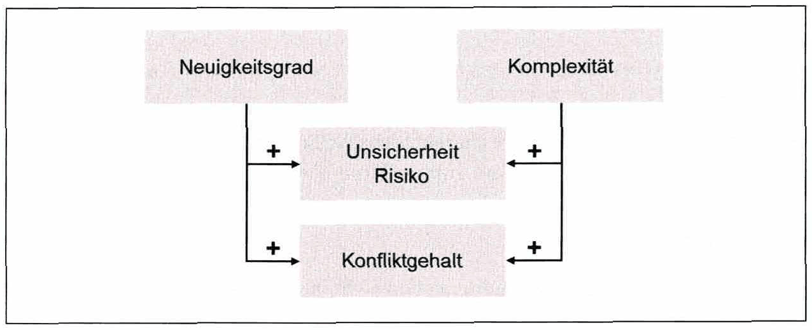

<!-- Seite 24 (PDF 34) -->

# 2.2 Begriffe und Definitionen

In der modernen Wirtschaftsforschung herrscht Einigkeit darüber, dass neue Produkte und Dienstleistungen wichtige Faktoren für das Wirtschaftswachstum sind. Unter den ersten Ökonomen, die die Bedeutung von Innovation erkannten, war **Joseph A. Schumpeter (1883 - 1950)**. Eine seiner Grundideen besagt, **dass der Wettbewerb durch neue Produkte wichtiger ist als marginale Preisänderungen bei bestehenden Produkten. Damit zählt er Innovation zu den klassischen Produktionsfaktoren von Kapital und Arbeit, wie sie von Marx verwendet wurden**. Die auf Schumpeters Konzepten basierende Makrosicht auf Innovation beschreibt diese als einen zyklischen Prozess.

**Innovation und Erfindung** Schumpeter hat wichtige Begriffe im Bereich Innovation wie folgt definiert:[^33]

- "**Erfindung** (Invention) ist der erste Schritt zu einem neuen Produkt oder Verfahren..."
- "... **Innovation**, das ist der Prozess der wirtschaftlichen Anwendung der Erfindungen ..."
- "„..**Imitation**, das ist der Prozess, durch den Innovation in der Industrie oder der Wirtschaft verbreitet wird..." Unter „**Invention**“ wird demnach die **Erfindung an sich** verstanden. Es ist wichtig die Begriffe Innovation und Erfindung richtig zu unterscheiden da viele Menschen dazu neigen diese Begriffe zu verwechseln.[^34] Die folgende Definition von Innovation wird häufig in den Wirtschaftswissenschaften verwendet:

<!-- Seite 25 (PDF 35) -->

“**Innovation** befasst sich mit der kommerziellen und praktischen Anwendung von Ideen oder Erfindungen. ”[^35]

Das Vorgehen bei der Umsetzung von Ideen in neue Produkte ist ein wesentliches Merkmal jeder Innovation. Der Innovationsprozess endet jedoch nicht mit der Entwicklung eines neuen Produkts, sondern erfasst ebenso die wirtschaftliche Verwertung neuer Produkte. Eine Innovation ist somit ein kompletter Prozess, der alle Phasen der Produktentwicklung von der Idee bis zur Markteinführung eines neuen Produktes umfasst. Dies wird am besten durch die folgende umfassende Definition von Innovation abgebildet:[^36]

“**Innovation** ist das Management aller Aktivitäten, die mit den Prozessen der Ideengenerierung, Technologieentwicklung, Herstellung und Vermarktung eines neuen (oder verbesserten) Produkts oder Herstellungsverfahrens bzw. — Ausrüstung verbunden sind.”

Darüber hinaus stellte Steve Jobs folgendes fest:

“**Innovation** ist der Unterschied zwischen einem Anführer und einem Mitläufer”,

Darüber hinaus sind zwei weitere charakteristische Eigenschaften zu betrachten: Zum einen die **Neuheit** („novelty“) und zum anderen der **Wert** („value“). Neuheit plus Wert, definieren gemeinsam die Innovation.[^37]

**Modifikation**

Modifikation ist im Gegensatz zu Innovation nicht die Schaffung eines neuen Produktes, sondern die Veränderung oder Erweiterung eines bestehenden Produktes. Dies kann die Verbesserung der Qualität, sowie die Änderung der Ausstattung oder des Erscheinungsbildes beinhalten. Produktmodifikationen können dafür sorgen, die letzte Phase des Produktlebenszyklus zu verlängern, dessen Ende jedoch langfristig nicht verhindern. Innovation und Modifikation unterscheiden sich in erster Linie darin, dass die Modifikation ein geringeres Risiko und meist auch geringere Investitionskosten mit sich bringt.[^38]

**Imitation**

In diesem Fall wird die ursprüngliche Innovation von jemand anderem betrieben und es wird eine Imitation (=Nachbildung) erzeugt, die jedoch oft von geringerer Qualität ist. Diese Nachbildungen basieren normalerweise auf erfolgreichen Produkten. Wenn es gelingt, diese Nachbildungen in die eigenen Produkte und Prozesse zu integrieren und möglicherweise sogar zu verbessern, ist es möglich, auch ohne Innovation einen wirtschaftlichen Erfolg zu erzielen.[^39]

<!-- Seite 26 (PDF 36) -->

**Merkmale einer Innovation**

Innovationen können zudem durch die Merkmale Neuigkeitsgrad und Komplexität gekennzeichnet werden. Abbildung 7 zeigt die Verknüpfung der Merkmale einer Innovation. Unabhängig von anderen Merkmalen gelten Neuigkeitsgrad und Komplexität als ursächlich für Unsicherheit, Risiko und den Konfliktgehalt. Der Neuigkeitsgrad und die Komplexität sind Hürden, welche bei Innovationen mit vermehrten Unsicherheits- und Risikopotential sowie Konfliktpotential entstehen.[^40]

*Abbildung 7: Typischen Merkmale einer Innovation – Skript S. 26 (PDF 36)* · [Rekonstruktion](../../figures/reconstructed/abb-07.svg) · [Zeichenübung](../../learning/drawing-exercises/abb-07-zeichenuebung.md)

[^33]: Schumpeter (1997)
[^34]: Vgl. Trott (2005), S. 14f
[^35]: Vgl. Trott (2005), S. 15
[^36]: Vgl. Trott (2005), S. 15
[^37]: Hinterhuber (1975)
[^38]: Vgl. Ramsauer (2024) S. 8
[^39]: Vgl. ibidem
[^40]: Vgl. Thom (1980), S.31f

## Prüfungsfragen zu diesem Abschnitt

3 Fragen aus der [Prüfungsfragen-Datenbank](../../exams/questions.md): `frage-2024-06-20-1`, `frage-2024-10-15-1`, `frage-2026-01-22-2`
