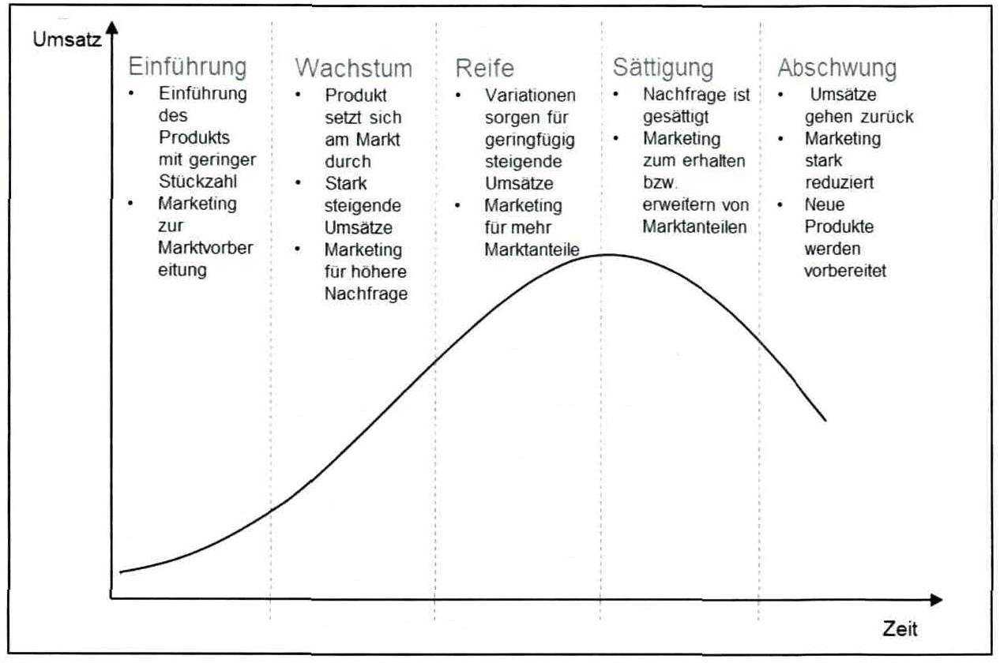
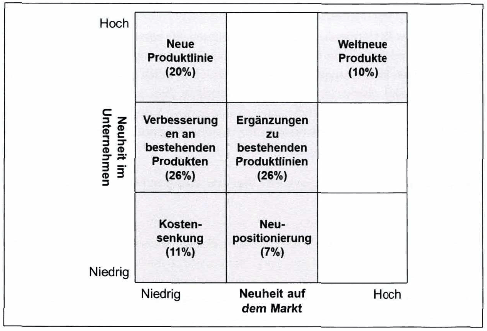
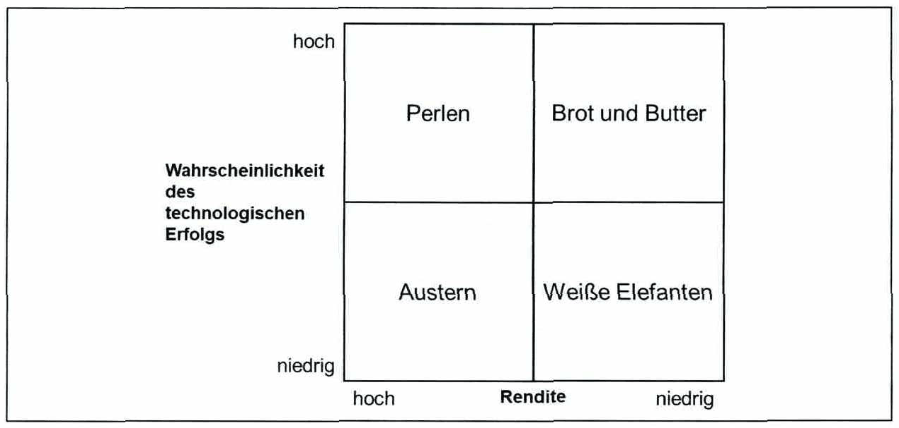
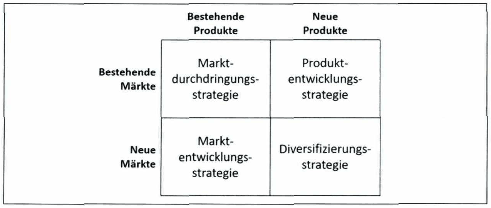

<!-- Seite 29 (PDF 39) -->

# 2.5 Arten der Innovation

Es existieren verschiedene Arten der Innovation, welche die inhaltliche Dimension der Innovation reflektieren. Hier kann die Frage gestellt werden „Was ist neu?“ Um diese Frage zu beantworten wird Innovation in verschiedene Arten eingeteilt.

Diese Arten der Innovation werden unterschieden in: [^47]

- Produktinnovation
- Prozessinnovation
- Innovation von Systemeigenschaften
- Innovation jenseits der Technik
- Postindustriellen Innovation

## 2.5.1 Produktinnovation[^48]

Produktinnovation meint die Entwicklung neuer oder verbesserter Produkte und stellt den Kundennutzen in den Mittelpunkt. **Ziel dieses Innovationstyps ist** es, (im Gegensatz zur Prozessinnovation) die Effektivität zu erhöhen was einer marktorientierten Anwendung der Produktinnovation entspricht. Sie ermöglicht es dem Nutzer, neue

<!-- Seite 30 (PDF 40) -->

Zwecke zu erfüllen oder bestehende Zwecke auf eine völlig neue Art und Weise zu erfüllen.

**Produktlebenszyklus**

Die Nachfrage nach einem Produkt durchläuft unterschiedliche Phasen ab seiner Einführung am Markt. Der Produktlebenszyklus beschreibt jene Phasen welche wie folgt gegliedert sind: [^49]

**Einführungsphase**: In dieser Phase sind die Unsicherheiten bezüglich des Markts besonders hoch. Dies gilt im Besonderen dafür, wie der Markt das Produkt des Unternehmens aufnimmt. Gegebenenfalls muss ein etabliertes Produkt verdrängt werden. Die Produkteinführung erfolgt in kleinen Stückzahlen und wird eher von neugierigen Kunden (z. B. Tech-Freaks) gekauft.

**Wachstumsphase**: Der Markt akzeptiert das Produkt, der Umsatz steigt sehr stark an. Ab dieser Phase können bereits die ersten Imitat-Produkte auf den Markt kommen. Letztendlich wird sich ein Standard durchsetzen.

**Reifephase**: Der Kampf um Marktanteile ist das zentrale Merkmal dieser Phase. Stellhebel, über die diese Phase in die Länge gezogen werden kann sind Preispolitik und Produktvariationen.

**Sättigungsphase**: Umsatzhöhepunkt. Durch Marketingmaßnahmen wird versucht, die Nachfrage noch zu steigern oder Kunden zum Wechsel des Anbieters zu bewegen. Zentrales Merkmal dieser Phase ist der harte Kampf um die Marktanteile.

**Abschwung**: Der Umsatz des Produkts geht zurück. Neue Entwicklungen substituieren oder überholen das Produkt. Die Marketingaktivitäten werden stark reduziert, da sich Investitionen in das Produkt nicht mehr rechnen.

Die Umsatzentwicklung über den Lebenszyklus wird dabei ideal als S-förmige Kurve dargestellt (siehe Abbildung 8 ).

<!-- Seite 31 (PDF 41) -->

*Abbildung 8: Produktlebenszyklus – Skript S. 31 (PDF 41)* · [Rekonstruktion](../../figures/reconstructed/abb-08.svg) · [Zeichenübung](../../learning/drawing-exercises/abb-08-zeichenuebung.md)

**Kategorien neuer Produkte**

Um Produktinnovationen zu verstehen gilt es zu klären, was unter einem "neuen Produkt" zu verstehen ist.

Es ist nicht immer einfach, ein neues Produkt umfassend zu definieren, da Menschen mit unterschiedlichem Hintergrund (z.B. Marketingexperten, Ingenieure) ein unterschiedliches Verständnis davon haben, was an einem Produkt neu ist. Beispielsweise haben Forscher oder Entwicklungsingenieure unterschiedliche Vorstellungen was als ein neues Produkt zu betrachten ist, welches auch eine Art von wissenschaftlicher oder technischer Neuheit mit sich bringt. Ein wissenschaftlicher Durchbruch ist in diesem Sinne also ein wichtiges Merkmal neuer Produkte. Ein Marketingexperte hingegen wird höchstwahrscheinlich argumentieren, dass jedes Produkt, das neu auf dem Markt ist, ein neues Produkt ist, auch wenn es sich lediglich um eine umgepackte Version eines bereits bestehenden Produkts handelt. Das ist verständlich, denn aus Sicht des Marketings ist es mindestens ebenso wichtig, die Bedürfnisse der Verbraucher zu bedienen und innovative Produkte zu entwickeln, die auf dem Markt akzeptiert werden, wie wissenschaftliche Durchbrüche oder technische Raffinessen. Solche Beispiele zeigen, dass es schwierig ist, eine allgemeine Definition dessen zu erstellen, was ein neues Produkt ist.

<!-- Seite 32 (PDF 42) -->

Aus wissenschaftlicher Sicht ist es unerlässlich, eine solche Definition zu kennen, um statistische Daten über neue Produkte zu generieren. Ohne ein klares Verständnis dafür, was ein neues Produkt ist, ist es unmöglich, aktuelle Trends in der Produktentwicklung zu analysieren, zu bewerten und zuverlässige Modelle zu generieren.

Für diesen Kurs können neue Produkte in zwei Kategorien gegliedert werden:

- **Neu für das Unternehmen**: Das betreffende Unternehmen hat dieses Produkt noch nie zuvor hergestellt oder verkauft, andere Unternehmen möglicherweise aber schon
- **Neu auf dem Markt bzw. "innovativ**": Das Produkt ist das erste seiner Art auf dem Markt. Diese sehr allgemeine Definition kann noch verfeinert werden. Eine häufig verwendete Klassifizierung neuer Produkte wurde von Booz und Hamilton bereits im Jahr 1982 vorgestellt und gilt nach wie vor. Die Kategorien ihrer Klassifizierung sind in Abbildung 9 dargestellt. Diese Klassifizierung umfasst sechs Kategorien neuer Produkte. Die einzelnen Kategorien sind in einem zweidimensionalen Array angeordnet, wobei die Koordinatenachse die beiden Aspekte der obigen Definition darstellt. Die Abszisse steht für die Neuheit auf dem Markt und die Ordinate für die Neuheit für das Unternehmen. Die sechs Kategorien der neuen Produkte wurden von mehreren Autoren diskutiert und sind im Folgenden zusammengefasst:

<!-- Seite 33 (PDF 43) -->

*Abbildung 9: Kategorien neuer Produkte – Skript S. 33 (PDF 43)*

**Kategorie 1: Weltneuheiten**

Diese neuen Produkte sind die ersten ihrer Art und schaffen einen völlig neuen Markt. Es sind Innovationen, die in der Regel eine bedeutende technologische Entwicklung beinhalten oder bestehende Technologien auf eine ganz andere Weise nutzen und zu revolutionären neuen Designs führen. Beispiele sind der Sony Walkman, 3M's Post-It Notes oder Kodak's Digitalkamera. Diese Kategorie repräsentiert nur 10% des gesamten Marktes für neue Produkte.

**Kategorie 2: Neue Produktlinien**

Diese Produkte sind neu für ein bestimmtes Unternehmen, aber nicht neu auf dem Markt. Solche Produkte ermöglichen einem Unternehmen den Einstieg in einen bereits etablierten Markt. Diese Kategorie deckt etwa 20% des Marktes für neue Produkte ab. So hat Canon nicht als erster eine Office-Version eines Laserdruckers auf den Markt gebracht; diese Auszeichnung ging an Hewlett-Packard mit dem LaserJet-Drucker. Andere Beispiele sind Samsung, LG und Sony, die nicht die ersten Mobiltelefone eingeführt haben, sondern Nokia und Motorola.

<!-- Seite 34 (PDF 44) -->

**Kategorie 3: Ergänzungen zu bestehenden Produktlinien**

Produkte dieser Kategorie sind neu im Unternehmen. Sie passen jedoch in eine bereits bestehende Produktlinie des Unternehmens. Das Produkt unterscheidet sich deutlich vom derzeitigen Produktangebot (es kann auch ein ziemlich neues Produkt auf dem Markt selbst sein), aber es ist nicht so unterschiedlich, dass es eine neue Produktlinie schafft. Rund 26% aller Neueinführungen passen in diese Kategorie. Beispiele sind der Hewlett-Packard Color Tintenstrahldrucker, der eine Ergänzung zu den bereits bestehenden Tintenstrahldruckern war.

**Kategorie 4: Verbesserungen und Überarbeitungen bestehender Produkte**

Diese Kategorie umfasst Produkte, die in erster Linie als Ersatz für bestehende Produkte in der Produktlinie eines Unternehmens dienen. Solche Produkte sind im Vergleich zu den oben genannten Kategorien "nicht mehr so neu". Die Produkte zeichnen sich jedoch durch eine verbesserte Performance oder einen Mehrwert gegenüber den "alten" Produkten aus. Diese Kategorie stellt einen signifikanten Anteil von 26% aller Neueinführungen dar. Beispiele sind der Hewlett-Packard-Tintenstrahldrucker, der im Laufe der Zeit viele Überarbeitungen und Verbesserungen erfahren hat. Die Weiterentwicklung von Produkten in dieser Kategorie ist sehr oft eine Antwort auf veränderte Kundenanforderungen oder Wettbewerbsbedrohungen.

**Kategorie 5: Neupositionierung**

Bei der Neupositionierung geht es vor allem darum, neue Anwendungen für "alte" Produkte zu finden. Tatsächlich zielen die Aktivitäten in dieser Kategorie darauf ab, bereits bestehende Produkte auf neue Marktsegmente oder andere Anwendungen auszurichten. Der Fokus liegt daher eher auf der Wahrnehmung der Nutzer und dem Branding als auf der technischen Entwicklung. Ein Beispiel für eine erfolgreiche Neupositionierung ist Aspirin: Nachdem es durch neuere und sicherere Wirkstoffe aus dem Markt für Kopfschmerzen verdrängt wurde, wird es heute als Präventivmittel für Blutgerinnsel, Schlaganfälle und Herzinfarkte verkauft. Die Neupositionierung trägt mit einem relativ geringen Anteil von 7% zu allen Produktneueinführungen bei.

**Kategorie 6: Kostensenkungen**

Schließlich gibt es die Gruppe der "neuen" Produkte, die die gleichen Eigenschaften und Leistungen wie bestehende Produkte bieten, nur dass sie billiger sind. In diesem Sinne sind sie die am wenigsten "neuen" Produkte in dieser Klassifizierung. Sie sind aus Marketing-Sicht sicherlich nicht neu, aber Kostenreduzierung wird oft durch technologische Veränderungen, z.B. in Produktionsprozessen, erreicht, die für ein Unternehmen natürlich neuartig sein können. Diese Kategorie macht 11% aller Neueinführungen aus.

<!-- Seite 35 (PDF 45) -->

**Portfoliomanagement**

Mittels der Kategorien konnte geklärt werden was unter einem "neuen Produkt” zu verstehen ist. Nun bedarf es eines Werkzeuges zur **Auswahl und Priorisierung** welches „neue Produkt“ zur Erreichung der Geschäftsziele beiträgt. Es hilft auch bei der Zuordnung von Ressourcen zu Projekten, um die Geschäftsziele zu erreichen, und es gibt einen guten Überblick über die Gesamtheit der Projekte, Produkte oder Geschäftseinheiten im Allgemeinen. Im Buch "Portfoliomanagement für neue Produkte" wird Portfoliomanagement wie folgt erläutert:[^52]

Das Portfoliomanagement für neue Produkte ist ein dunamischer Entscheidungsprozess, In dem die Liste der aktiven neuen Produkte und F&E-Projekte ständig überarbeitet wird. Dabei werden neue Produkte bewertet, ausgewählt und priorisiert. Bestehende Projekte können beschleunigt, beendet oder depriorisiert werden, und die Ressourcen werden neu zugewiesen bzw. aktiven Projekten zugeteilt.

Eine sehr gebräuchliche und häufig verwendete Darstellung im Portfoliomanagement ist das Bubble Diagramm. Im Bubble Diagramm werden geeignete Parameter zur Kategorisierung der Produkte ausgewählt und diese Parameter in einem zweidimensionalen X-Y-Diagramm dargestellt. Mögliche Parameter wären z.B.:

- Übereinstimmung mit der Geschäfts- oder Unternehmensstrategie
- Erfinderische Leistung
- Strategische Bedeutung für das Unternehmen
- Langlebigkeit des Wettbewerbsvorteils
- F&E-Kosten bis zur Fertigstellung
- Zeit bis zur Fertigstellung

Im Plot werden die Produkte als Bubbles (Blasen) platziert, wobei Größe, Form, Farbe und Schattierung der Bubble verwendet werden kann, um zusätzliche Informationen über das Projekt zu liefern. Die Größe kann z.B. Auskunft über die benötigten Ressourcen geben und die Farbe kann das Projekt einer bestimmten Produktlinie zuordnen. Außerdem muss die zusammengefasste Größe aller Bubbles in einem Chart konstant sein. Mit anderen Worten, wenn eine neue hinzugefügt wird, müssen die bestehenden Bubbles entsprechend reduziert werden.

<!-- Seite 36 (PDF 46) -->

*Abbildung 10: Portfolio Management für neue Produkte – Skript S. 36 (PDF 46)*

Das ursprüngliche Portfolio verwendet Geschäftsstärke und Marktattraktivität als Beschreibungen für die Achse, während neuere Risiko-Rendite-Diagramme den Barwert oder den Ertrag (Rendite) und die Wahrscheinlichkeit des technologischen Erfolgs verwenden. Dieser Barwert ist der zukünftige Ertragsstrom (Cash-Flow) aus dem Produkt abzüglich aller verbleibenden Entwicklungs-, Kapital- und Anlaufkosten.

In der neueren Literatur werden diese Begriffe auch als Perlen, Austern, Brot und Butter sowie als weiße Elefanten bezeichnet, wie in Abbildung 10 dargestellt.

1. **Perlen**: Das sind Produkte mit großem Erfolgspotenzial. Aus diesem Grund sollten sie so gefördert werden, dass eine potentiell hohe Rendite erzielt werden kann. Das sind oft sehr neue Produkte, die die Stars der Zukunft werden sollen, aber auch etwas Geld brauchen, um sich zu entwickeln.
2. **Brot und Butter**: Projekte die Aktualisierung, Modifikation oder Erweiterung bestehender Produkte beinhalten gehören zu dieser Kategorie. Sie haben eine sehr hohe Erfolgswahrscheinlichkeit, aber die erzielbare Rendite ist relativ gering.
3. **Austern**: Diese Projekte haben einen hohen zu erwarteten Gewinn, ähnlich den Perlen, aber die technologische Basis zur Umsetzung fehlt. Nur durch neue technologische Entwicklungen können diese Produkte erfolgreich sein und sich in Perlen verwandeln.

<!-- Seite 37 (PDF 47) -->

4. **Weiße Elefanten**: Sie mögen als vielversprechende neue Projekte begonnen haben, wurden aber im Laufe der Zeit immer unattraktiver. Sie haben eine geringe Chance auf Erfolg und auch eine geringe Chance auf einen hohen Gewinn. Wenn möglich, sollten diese Projekte so schnell wie möglich beendet werden.

**Faktoren einer Produktentscheidung**

Es wurden bestimmte Projektmerkmale identifiziert, die es ermöglichen, Gewinner und Verlierer konsequent voneinander zu trennen und als Kriterien im Score Card-Format für die Auswahl und Priorisierung von Produktentwicklungen zu verwenden:

- **Strategisch**: Wie gut das Produkt zur Geschäftsstrategie passt und welche strategische Relevanz es besitzt.
- **Wettbewerbs- und Produktvorteile**: Ob das Produkt sich abhebt, einen einzigartigen Kundennutzen bietet und dem Anwender einen überzeugenden Mehrwert bietet.
- **Marktattraktivität**: Wie groß und expandierend der Markt ist und ob die Wettbewerbssituation positiv ist (nicht intensiv; nur wenige und schwache Wettbewerber).
- **Hebelwirkung**: Ob das Produkt die geschäftlichen Kernkompetenzen wie Marketing, Technologie und Fertigung optimal ausschöpft.
- **Technische Machbarkeit**: Die Wahrscheinlichkeit, das Produkt entwickeln und herstellen zu können.
- **Risiko und Ertrag**: Die finanziellen Aussichten für das Produkt (z.B. Barwert, Return on Investment, Amortisationszeit) im Vergleich zu den Risiken.

**Strategien nach Ansoff**

Neben der Einordnung nach Kategorien können bestehende und neue Produkte jeweiligen Märkten zugeordnet werden. Die Ansoff-Matrix, als eine der wichtigsten Methoden im Innovationsmanagement, stellt zwei wichtige Variablen gegenüber, die für das Wachstum eines Unternehmens, von Märkten sowie Produkten verantwortlich sind. Das Ergebnis dieser Gegenüberstellung sind vier verschiedene Strategieoptionen, die sich auf die möglichen Produkt-Markt-Kombinationen beziehen, wie in Abbildung 11 dargestellt.

<!-- Seite 38 (PDF 48) -->

*Abbildung 11: Ansoff Matrix – Skript S. 38 (PDF 48)* · [Rekonstruktion](../../figures/reconstructed/abb-11.svg) · [Zeichenübung](../../learning/drawing-exercises/abb-11-zeichenuebung.md)

Der **Vorteil der Ansoff-Matrix** liegt in der Ausrichtung auf die Zukunft. Außerdem wird, wenn die aktuelle Situation des Unternehmens in der Matrix festgehalten wird, nur eines der vier Felder ausgefüllt. Dies schafft einen positiven psychologischen Anreiz für die Einführung weiterer Maßnahmen. Es wurde jedoch die **Kritik** geäußert, dass die Ansoff-Matrix ein Umfeld zeigt, welches von einem großen Wachstumspotenzial ausgeht, das vielleicht nicht der Realität entspricht. Deshalb ist es wichtig, andere Faktoren wie beispielsweise Einsparungen zu berücksichtigen. Außerdem sollten die Ergebnisse nicht als Allheilmittel gesehen werden, sondern als Strategievorschläge. Es sollte daher nicht der Fehler gemacht werden, nur in Produkten zu denken, sondern auch in Strategien.

Im Folgenden werden die vier Strategien kurz erklärt:

1. **Marktdurchdringungsstrategie**: Im Mittelpunkt steht dabei die Steigerung des Absatzes in bestehenden Märkten mit bestehenden Produkten. Durch weitgehende Nutzung des Marketing-Mix wird versucht, den Marktanteil des Produktes zu erhöhen. Ein Beispiel für eine solche Strategie ist die Firma Kelloggs, die den Konsum von Cornflakes erhöht hat, indem sie diese als Snack, der nicht nur zum Frühstück gegessen wird, anpreist.
2. **Marktentwicklungsstrategie**: Diese Strategie macht die Produkte für neue Märkte verfügbar, so dass das Unternehmen auf die bestehenden Produkte zurückgreifen kann, jedoch versucht, neue Märkte zu erschließen und neue Segmente zu erschließen. So entschied sich die Firma Mercedes, die sich lange Zeit nur auf das Luxussegment für Automobile konzentriert hatte, für den Einstieg in den Kleinwagenmarkt. Auch die Erschließung neuer geografischer Gebiete durch den Export wäre hier eine geeignete Variante.

<!-- Seite 39 (PDF 49) -->

3. **Produktentwicklungsstrategie**: Dieser Teil wird im Innovationsmanagement immer wichtiger, weil es um die Schaffung neuer oder verbesserter Produkte geht - aber auch um bestehende Märkte. Für fast alle Unternehmen ist dies eine permanente Aufgabe, da es wichtig ist, ständig neue Produkte zu entwickeln, um wettbewerbsfähig zu bleiben.
4. **Diversifizierungsstrategie**: Es reicht nicht aus, neue Produkte als Wachstumschancen zu betrachten. Die Diversifizierungsstrategie sucht darüber hinaus auch nach neuen Märkten. Einige Unternehmen versuchen, ihr vorhandenes Wissen und ihre technischen Fähigkeiten für die Diversifizierung zu nutzen, andere kombinieren es mit dem Zukauf von Firmen. Ein Beispiel für die Diversifizierung durch Akquisition sind privatisierte Elektrizitätsunternehmen im Vereinigten Königreich welche privatisierte Wasserunternehmen gekauft haben. Dadurch konnten Sie ihre Erfahrungen bei der Erbringung von Versorgungsleistungen auch in den zugekauften Betrieben nutzen.

Darüber hinaus werden verschiedene Arten der Diversifikation unterschieden:

- Die **vertikale Diversifikation** erweitert in der Regel die Fertigungstiefe und kann durch Vorwärts- und Rückwärtsintegration weiter unterschieden werden. Vorwärtsintegration bedeutet, Bereiche der bisherigen Kunden zu infiltrieren. (z.B. Eigenvertrieb durch Eröffnung einer Filiale) Ein Beispiel für die Rückwärtsintegration ist ein Hersteller, der damit beginnt, Komponenten zu produzieren, die er zuvor von einem externen Anbieter bezogen hat.
- **Die horizontale Diversifikation** erweitert das bestehende Produktionsprogramm um neue Produkte, die mit den bestehenden verbunden sind, also Ähnlichkeit aufweisen.
- **Die seitliche Diversifikation** erweitert das bestehende Produktionsprogramm um neue, nicht markt- oder kundenbezogene Produkte. (führt häufig zur Akquisition/Fusion)

Je neuer der Markt und das Produkt, desto größer das Risiko und der Aufwand und desto weniger Synergieeffekte können genutzt werden. Deshalb birgt Diversifikation immer das größte Risiko und die geringste Marktdurchdringung. Dennoch ist es ein gutes Instrument, um mögliche Strategien für neue Produkte zu identifizieren.

**Erfolgsfaktoren von Produktinnovationen**

<!-- Seite 40 (PDF 50) -->

Neue Produkte treiben die Unternehmenserträge, Marktanteile, Gewinne und sogar Aktienkurse in die Höhe. Es liegt auf der Hand, dass neue Produkte eine potentielle Möglichkeit sind, bessere Leistung zu erzielen - das Ziel jedes CEOs. Aus diesem Grund sollte es einen internen Antrieb zur Entwicklung neuer Produkte geben, um dieses Ziel zu erreichen. Die wichtigsten Treiber für Produktinnovationen kommen jedoch vom Markt selbst. **Cooper identifiziert vier Haupttreiber für die Produktinnovation**:[^55]

1. **Technologischer Fortschritt**

Die Wissensbasis der Welt wächst exponentiell. Der enorme Know-how-Gewinn ermöglicht neue technische Lösungen, die Quellen für innovative neue Produkte sein können.

2. **Veränderte Kundenanforderungen**

Die Kundenbedürfnisse ändern sich in der heutigen Welt rasant. Der Kunde erkennt schnell, was möglich und auf dem Markt verfügbar ist und will es haben. Auch große und erfolgreiche Unternehmen sind bestrebt, mit den neuen Entwicklungen des Marktes Schritt zu halten. Sie sind anfällig für Fusionen und Übernahmen, wenn es ihnen nicht gelingt, sich an den Markt anzupassen.

3. **Kürzere Produktlebenszyklen**

Als unmittelbare Folge des technologischen Wandels und der sich ändernden Marktanforderungen haben neue Produkte keine Lebensdauer von fünf bis zehn Jahren mehr. Bereits nach kurzer Zeit auf dem Markt werden sie durch Konkurrenzprodukte abgelöst.

4. **Globaler Wettbewerb**

Die internationalen Märkte verschmelzen immer mehr. Dies bedeutet, dass einerseits die Unternehmen Zugang zu neuen Märkten haben, andererseits aber auch ausländische Wettbewerber in die lokalen Märkte drängen. Für innovative Produktentwickler ergeben sich dadurch Vorteile auf globaler Ebene, da sie mit ihrem neuen Produkt Zugang zu globalen Märkten erhalten und auch auf dem heimischen Markt Wettbewerbsvorteile haben.

**Erfolgsfaktoren von Innovationen**

Neben Innovationstreibern ist es auch wichtig die Erfolgsfaktoren von Innovationen zu bewerten. Ein neues Produkt erfolgreich auf den Markt zu bringen, ist jedoch keine leichte Aufgabe. Selbst die besten und innovativsten globalen Unternehmen können scheitern. Viele Studien zeigen, dass die wichtigste Voraussetzung für eine erfolgreiche Produktplatzierung ein "einzigartiges und überlegenes Produkt" ist. Die meisten Produkteinführungen scheitern an einem der folgenden Gründe:[^56]

<!-- Seite 41 (PDF 51) -->

**Der Markt hat keinen Bedarf für das Produkt**

Es gibt einen Bedarf für ein neues Produkt auf dem Markt, aber das neue Produkt entspricht diesem Bedarf nicht

Das Produkt bietet dem Anwender keinen signifikanten Mehrwert im Verhältnis zu den Kosten für Anschaffung und Nutzung

Im Gegensatz dazu können sieben **kritische Erfolgsfaktoren** für Produktinnovationen genannt werden:[^57]

Ein **einzigartiges, überlegenes Produkt**: Ein differenziertes Produkt, das den Kunden oder Anwendern einzigartige Vorteile und einen überzeugenden Mehrwert bietet. Dies ist der wichtigste Faktor für die Rentabilität neuer Produkte.

**Marktorientierung**, mit Fokus auf Kundenbedürfnissen: Ein marktgerechtes und kundenorientiertes neues Produkt ist entscheidend für den Erfolg.

Der Schlüssel zum Erfolg liegt in der Durchführung der Hausaufgaben und dem **Frontloading** des Produkts. Dabei ist Frontloading definiert als "eine Strategie, die darauf abzielt, die Entwicklungsleistung zu verbessern, indem die Identifizierung und Lösung von Problemen in frühere Phasen des Produktentwicklungsprozesses verlagert wird". Eine sorgfältige Projektprüfung vor Beginn der Produktentwicklung zahlt sich aus.

Eine **klare und frühe Produktdefinition**: Die Vermeidung von Abweichungen und unbeständigen Spezifikationen bedeutet höhere Erfolgsraten und eine schnellere Time-to-Market.

Spiralentwicklung —- **bauen, testen, Feedback generieren und überarbeiten** — etwas so früh wie möglich den Kunden zu präsentieren, hilft oft, das Produkt zu verbessern.

Eine gut durchdachte, korrekt durchgeführte **Markteinführung** ist der Schlüssel zum Produkterfolg. Darauf aufbauend sollte bereits vor der Markteinführung ein solider Marketingplan vorliegen.

<!-- Seite 42 (PDF 52) -->

- **Geschwindigkeit zählt**! Es gibt viele gute Möglichkeiten, Entwicklungsprojekte zu beschleunigen, aber keine davon darf zu Lasten der Ausführungsqualität gehen.

## 2.5.2 Prozessinnovation

Prozessinnovation bezeichnet die Entwicklung neuer Fertigungs- und Herstellungsverfahren, um eine schnellere, sicherere und/oder kosteneffizientere Fertigung zu erreichen. Das Ziel dieser Innovationsart ist die Steigerung der Effizienz. Im Gegensatz zu Produktinnovationen, welche in Hinblick auf den Umsetzungsaspekt jedenfalls in einem Markt durchzusetzen sind, werden Prozessinnovationen in der Regel innerbetrieblich durchgesetzt.

## 2.5.3 Innovation von Systemeigenschaften

Die Betrachtung der Innovationsinhalte kann durch systemtheoretische Berücksichtigung der Zahl und der Verzahnung der Elemente von Produkt- oder Prozessinnovationen erweitert werden.

**Das System selbst wird unterschieden in**

- innovative Systemkomponenten
- innovative Systeme
- innovativer Systemverbund

Die systemorientierte Sichtweise von Innovation erlaubt eine differenziertere Bestimmung von Ort und Gegenstand der Innovation als dies mit der Unterscheidung Produkt- und Prozessinnovation möglich wäre.

## 2.5.4 Innovation jenseits der Technik

Laut Schumpeter besteht das Wesen der Innovation in der diskontinuierlichen, also der unstetigen, Durchsetzung neuer Kombinationen.

Diese nach wie vor maßgebliche Klassifikation zeigt, dass Innovation nicht nur ein technisches bzw. naturwissenschaftliches Problem ist, sondern auch für die Bereiche Ökonomie und Management Relevanz besitzt. Innovationen lassen sich demnach auch nach den funktionalen Bereichen der Unternehmensführung ordnen, in welche sie fallen. Es kann somit, nebst anderen, zwischen Absatz-, Beschaffungs-, Logistik-, Produktions-, Finanz-, Personal- und Sozialinnovationen unterschieden werden.

<!-- Seite 43 (PDF 53) -->

## 2.5.5 Postindustrielle Innovation

Die aktuelle Betrachtung von Innovationen geht einen Schritt weiter und sagt, dass Innovationen nicht nur als Problem industrieller Unternehmen oder als innerbetriebliche Entscheidungsprobleme gesehen werden dürfen. Vielmehr können Innovationen auch in nicht-industriellen Unternehmen wie z.B. Banken, Versicherungen, Handelsunternehmen oder der öffentlichen Verwaltung stattfinden. Konkrete Beispiele sind Kreditkarten, Leasing, Barcodes oder e-business.

[^47]: Vgl. Hauschildt (2011), S. 6 ff.
[^48]: Vgl. Hauschildt (2011), S. 6 ff.
[^49]: Schawel und Billing (2012), S. 208 f.
[^52]: Cooper et al. (2002)
[^55]: Vgl. Cooper (2001), S. 369
[^56]: Crawford und Di Benedetto (2006)
[^57]: Vgl. Cooper (2001), S. 84

## Fußnoten ohne sicheren Textanker

Diese Fußnoten stehen auf den Seiten dieses Abschnitts, ihr Verweiszeichen im Text ließ sich aus dem Scan aber nicht eindeutig zuordnen (oft Quellenangaben zu Abbildungen).

- **50** – Seite 31 (PDF 41): Schawel und Billing (2012), S. 208
- **51** – Seite 33 (PDF 43): Vgl. Cooper (2001), S.16
- **53** – Seite 36 (PDF 46): Vgl. Cooper und Edgett (2001), S. 77
- **54** – Seite 38 (PDF 48): Vgl. Trott (2005), S. 387
- **58** – Seite 41 (PDF 51): Thomke und Fujimoto (2000), S.129

## Prüfungsfragen zu diesem Abschnitt

9 Fragen aus der [Prüfungsfragen-Datenbank](../../exams/questions.md): `frage-2024-12-10-1`, `frage-2024-12-10-2`, `frage-2025-02-04-1`, `frage-2025-03-18-1`, `frage-2025-04-09-2`, `frage-2025-12-11-1`, `frage-2026-01-22-2`, `frage-2026-04-29-1`, `frage-2026-04-29-2`
