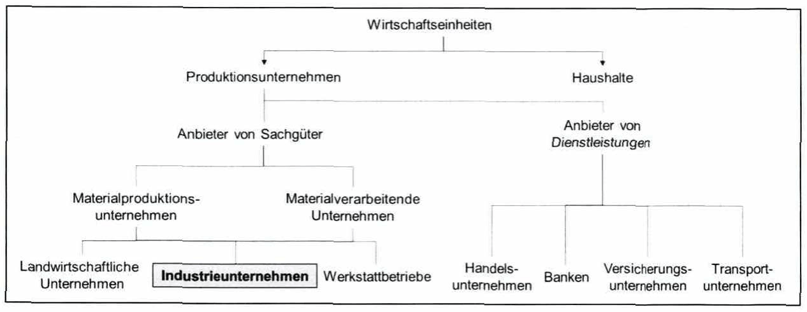
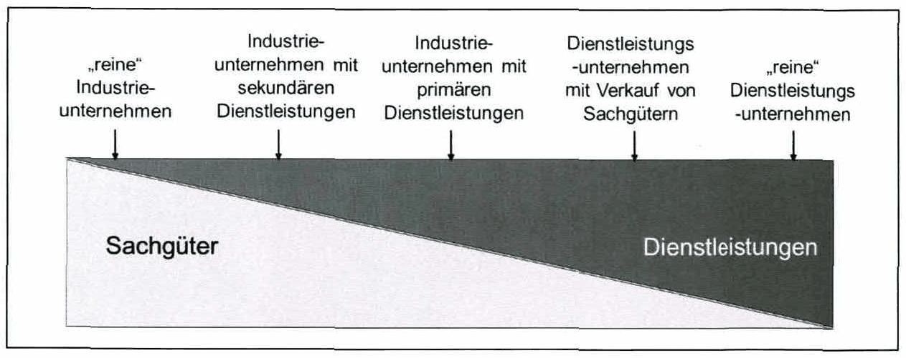
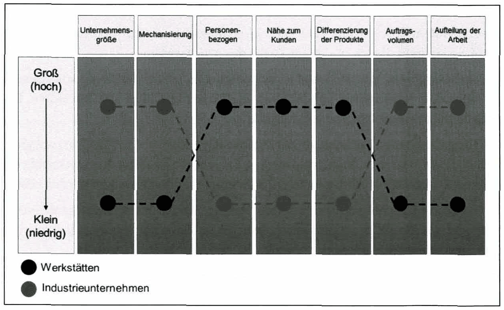
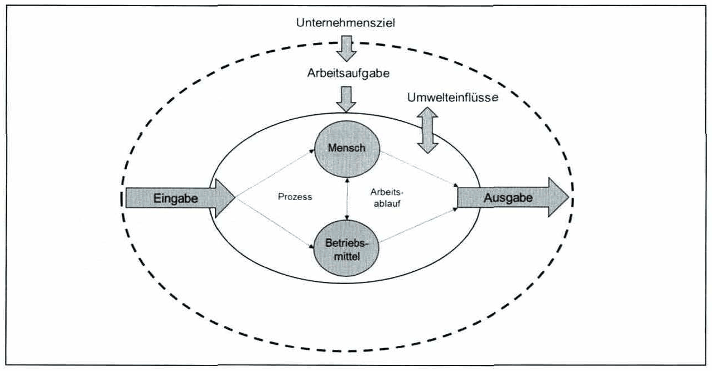

<!-- Seite 47 (PDF 57) -->

# 3.1 Begriffe und Definitionen

Bevor das Industrie Management im Detail erläutert werden kann, ist ein tieferes Verständnis der verschiedenen Begriffe notwendig. Es liegen folgende zugrundeliegenden Definitionen für den Ausdruck „Industrie Management“ vor:

**Industrie:**

Als Industrie wird die kommerzielle Produktion von Waren innerhalb eines Fabriksystems bezeichnet.

Dabei können Unternehmen in unterschiedlichen Bereichen oder Branchen, wie z.B. in der Automobilindustrie oder der chemischen Industrie, agieren.

**Industrieunternehmen:**

Ein Industrieunternehmen (siehe Abbildung 12) ist eine technische, soziale, wirtschaftliche und umweltbezogene Einheit zur kommerziellen Produktion von Waren innerhalb eines Fabriksystems mit dem Ziel, externe Bedürfnisse zu befriedigen, indem es unabhängige Entscheidungen trifft und Risiken eingeht.

*Abbildung 12: Industriebetriebe im System der Wirtschaftseinheiten – Skript S. 47 (PDF 57)*

<!-- Seite 48 (PDF 58) -->

Industriebetriebslehre:

Die Industriebetriebslehre versteht sich als ein Teilgebiet der Wirtschaftswissenschaften, die sich mit den besonderen betriebswirtschaftlichen Problemen im Industriebetrieb (im Sinne des Industrial Management) befasst, Dabei orientiert sie sich — durch ihre Ansiedlung an einer Technischen Universität noch unterstrichen — deutlich zu den Ingenieurwissenschaften hin. Es handelt sich damit um eine Zielsetzung im Sinne des klassischen Industrial Engineering, das nach Maynard in der „Anwendung der ingenieurmäßigen Betrachtungsweise auf alle Faktoren — einschließlich des menschlichen Faktors —, die bei der Herstellung und Verteilung von Erzeugnissen und Leistungen beteiligt sind“, besteht.[^59]

**Industrie Management:**

Unter Management versteht man die Koordination von Aktivitäten innerhalb eines Unternehmens mit dem Zweck, vorgegebene Ziele zu erreichen.

Malik definierte die drei Dimensionen des Managements. Dabei ist die erste Dimension die funktionale Dimension, die das Management als eine bestimmte Art eines Handelns von Menschen beschreibt und für ein Unternehmen notwendig ist. Zweitens die institutionelle Dimension, die die organisatorisch definierten Organe einer Organisation, wie Vorstand oder Geschäftsführer umfasst und als Dritte, die personelle Dimension, welche die Personen hinter den genannten Organen beinhaltet.

Somit kann das Industrie Management folgendermaßen definiert werden:

Industrie Management ist eine Wirtschaftsdisziplin, die sich mit der Organisation und Kommerzialisierung von Industrieunternehmen beschäftigt. Das Industrie Management untersucht dabei ganzheitlich die Funktionsbereiche eines Industrieunternehmens.

## 3.1.1 Abgrenzung von Industriebetrieben

Ein Industriebetrieb ist ein Unternehmen, das vorwiegend Sachgüter produziert und vertreibt und steht damit im Gegensatz zum Dienstleistungsbetrieb (siehe Abbildung 13), der vor allem Services entwickelt und verkauft. Im Industriebetrieb erfolgt die Produktion dabei hauptsächlich unter dem Einsatz maschineller Anlagen, bei weitgehender Arbeitsteilung und Spezialisierung der Beschäftigten (im Unterschied zu einem Handwerksbetrieb — siehe Abbildung 14). Ein Industriebetrieb kann Produkte in

<!-- Seite 49 (PDF 59) -->

Großserien- oder Massenprodukte für anonyme Endkunden, aber auch als Kleinserien- oder in Einzelfertigung für konkrete Kunden erstellen.

*Abbildung 13: Abgrenzung zwischen Industrie- und Dienstleistungsbetrieb – Skript S. 49 (PDF 59)*

*Abbildung 14: Abgrenzung zwischen Industriebetrieben und Werkstätten – Skript S. 49 (PDF 59)*

## 3.1.2 Industriebetrieb als Arbeitssystem

Das Arbeitssystem nach REFA (Abbildung 15) dient der Erfüllung von Arbeitsaufgaben in einem Industriebetrieb. Hierbei wirken Mensch und Betriebsmittel mit der Eingabe unter Umwelteinflüssen zusammen.

<!-- Seite 50 (PDF 60) -->

*Abbildung 15: Industriebetrieb als Arbeitssystem – Skript S. 50 (PDF 60)* · [Rekonstruktion](../../figures/reconstructed/abb-15.svg) · [Zeichenübung](../../learning/drawing-exercises/abb-15-zeichenuebung.md)

Eine Arbeitsaufgabe ist eine Aufforderung an Menschen, Tätigkeiten auszuüben, die der Zielerreichung dienen. Sie ist der Zweck des Arbeitssystems.

Der Arbeitsablauf bzw. Prozess ist das Geschehen bei der Erfüllung von Arbeitsaufgaben. Der Arbeitsablauf vollzieht sich im Zusammenwirken von Menschen, Betriebsmittel bzw. Arbeitsmittel und Eingabe.

Die Eingabe eines Arbeitssystems besteht im Allgemeinen aus Arbeitsgegenständen, aber auch aus Menschen, Informationen und Energie, die im Sinne der Arbeitsaufgabe in ihrem Zustand, ihrer Form oder ihrer Lage verändert oder verwendet werden sollen.

Die Ausgabe eines Arbeitssystems besteht im Allgemeinen aus Arbeitsgegenständen, aber auch aus Menschen und Informationen, die im Sinne der Arbeitsaufgabe verändert oder verwendet wurden.

Mensch und Betriebsmittel bzw. Arbeitsmittel sind die Kapazitäten des Arbeitssystems, die gemäß der Arbeitsaufgabe die Eingabe in die Ausgabe verändern.

Die Umwelteinflüsse unterteilt man in physikalische und organisatorische sowie soziale Einflüsse, die auf das Arbeitssystem wirken oder unter Umständen auch von diesem erzeugt werden. Die physikalischen Umwelteinflüsse werden häufig auch Umgebungseinflüsse (z.B. Klima, Lärm, Licht) genannt.

Aus der gezeigten „Eingabe-Ausgabe“-Betrachtung einer Industrieunternehmung werden in ökonomisch geprägter Sicht spezifische und gleichzeitig besonders typische Kenngrößen abgeleitet:

<!-- Seite 51 (PDF 61) -->

**Produktivität**

Sie bezeichnet als Kenngröße der technischen Leistungsmessung das Verhältnis von mengenmäßigem Output und mengenmäßigem Input an Ressourcen. Beispiele dafür umfassen Arbeitsproduktivität und Materialproduktivität.

$$
\text{Produktivität} = \frac{\text{Mengenmäßiger Output}}{\text{Mengenmäßiger Input}}
$$

*Formel: Produktivität – Skript S. 51 (PDF 61)* · [Original](../../figures/originals/formel-produktivitaet.png)

Hier muss auf die unmittelbare Analogie zu dem in der Technik verwendeten Begriff des Wirkungsgrades verwiesen werden. Der Kehrwert dieser Produktivitätskennziffer wird als spezifischer Mitteleinsatz bezeichnet.

$$
\text{Spezifischer Mitteleinsatz} = \frac{\text{Mengenmäßiger Input}}{\text{Mengenmäßiger Output}}
$$

*Formel: Spezifischer Mitteleinsatz – Skript S. 51 (PDF 61)* · [Original](../../figures/originals/formel-spezifischer-mitteleinsatz.png)

**Wirtschaftlichkeit**

In dieser Kenngröße wird durch monetäre Bewertung der erstellten Leistung (Output) und der Einsatzfaktoren (Input) das Wirtschaftlichkeitsprinzip („Erwirtschaften“ statt „Verwirtschaften“) konkret gefasst.

$$
\text{Wirtschaftlichkeit} = \frac{\text{Leistungsbedingte Erlöse}}{\text{Kosten}}
$$

*Formel: Wirtschaftlichkeit – Skript S. 51 (PDF 61)* · [Original](../../figures/originals/formel-wirtschaftlichkeit.png)

Leistungsbedingte Erlöse ergeben sich aus dem mengenmäßigen Output, bewertet mit am Absatzmarkt erzielbaren Preisen; ebenso resultieren die Kosten als Werteinsatz zur Leistungserstellung aus dem mengenmäßigen Einsatz, bewertet mit den durch den Beschaffungsmarkt gegebenen Preisen.

$$
\text{Spezifische Kosten} = \frac{\text{Kosten}}{\text{Mengenmäßiger Output}}
$$

*Formel: Spezifische Kosten – Skript S. 51 (PDF 61)* · [Original](../../figures/originals/formel-spezifische-kosten.png)

Werden (wiederum als Kehrwert) die angefallenen Kosten dem mengenmäßigen Output gegenübergestellt, so ergeben sich daraus die spezifischen Kosten je Output-Mengeneinheit. Der Begriff der Wirtschaftlichkeit kann auch als Quotient des Ist-Einsatzes zum Soll-Einsatz formuliert werden und wird damit zum Ausdruck der Sparsamkeit als Effizienzgröße; die Frage der Zweckmäßigkeit führt auf die Kenngröße der Effektivität zurück.

<!-- Seite 52 (PDF 62) -->

**Die Rentabilität**

Rentabilität ist das Verhältnis des Gewinnes einer Rechnungsperiode zum eingesetzten Kapital (Kapitalrentabilität), bzw. lässt sich allgemein die Überlegung herleiten: „Welchen Erfolg hat man erzielt und wie viel hat man einsetzen müssen, um diesen Erfolg zu erreichen.“

$$
\text{Rentabilität} = \frac{\text{Gewinn}}{\text{Kapital bzw. Umsatz}}
$$

*Formel: Rentabilität – Skript S. 52 (PDF 62)* · [Original](../../figures/originals/formel-rentabilitaet.png)

**Die Liquidität**

Unter Liquidität versteht man die Fähigkeit, den einzelnen Zahlungsverpflichtungen fristgerecht zu entsprechen. Eine maßgebliche unternehmerische Aufgabe liegt darin, jenes Maß an Liquidität herzustellen, das Zahlungsstockungen ausschließt, jedoch auch Liquidität mit Barreserven vermeidet, welche die Rentabilität unvertretbar hemmen. Ein über die Erfordernisse hinausgehender Bestand an nicht ertragbringend angelegten liquiden Mitteln mindert die Rentabilität.

$$
\text{Liquidität} = \frac{\text{Verfügbare Mittel}}{\text{Verpflichtungen}}
$$

*Formel: Liquidität – Skript S. 52 (PDF 62)* · [Original](../../figures/originals/formel-liquiditaet.png)

[^59]: Maynard (1956)

## Fußnoten ohne sicheren Textanker

Diese Fußnoten stehen auf den Seiten dieses Abschnitts, ihr Verweiszeichen im Text ließ sich aus dem Scan aber nicht eindeutig zuordnen (oft Quellenangaben zu Abbildungen).

- **60** – Seite 49 (PDF 59): Vgl. Voigt (2008), S. 3

## Prüfungsfragen zu diesem Abschnitt

5 Fragen aus der [Prüfungsfragen-Datenbank](../../exams/questions.md): `frage-2024-03-14-4`, `frage-2025-03-18-3`, `frage-2025-12-11-2`, `frage-2026-01-22-1`, `frage-2026-04-29-4`
