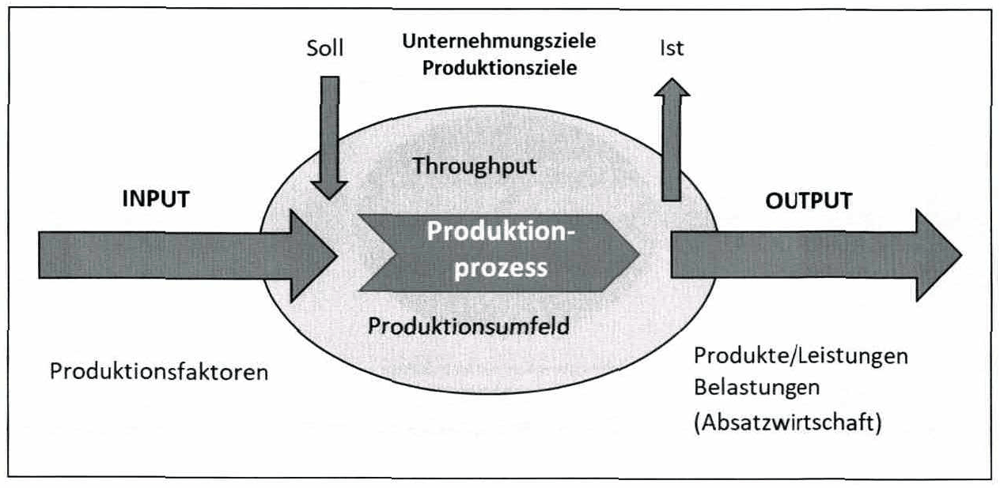
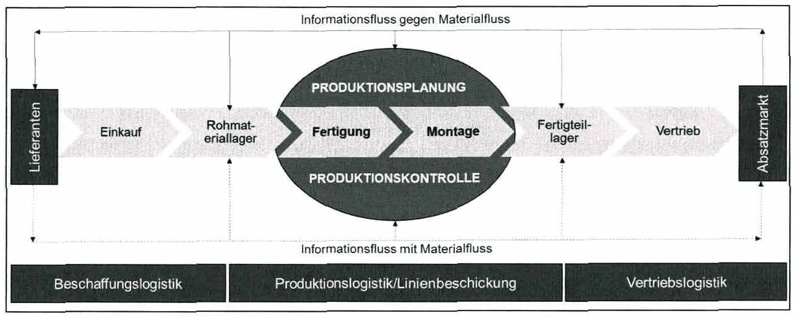

<!-- Seite 53 (PDF 63) -->

# 3.2 Produktion als Kernaufgabe von Industriebetrieben

Wie in KAPITEL 1 beschrieben, ist ein Industriebetrieb durch die Erzeugung eines Outputs (= Produktion von Sachgütern) gekennzeichnet. Der Prozess der Leistungserstellung durch Anwendung der Prinzipien Arbeitsteilung, Automatisierung, Mechanisierung usw. gehört demnach zu den Kernkompetenzen eines Industriebetriebs.[^61]

Mit Produktion (lat. producere: etwas hervorbringen, erzeugen) wird die Erzeugung von Gütern durch Kombination von Produktionsfaktoren verstanden. Die dabei erzeugten Güter werden als Produkte beziehungsweise, je nach Kombinationsfortschritt, auch als Halbfertigprodukte oder Fertigprodukte bzw. Endprodukte bezeichnet.

Produktion ist somit ein transformierender Prozess, der sich in die Elemente Input (Produktionsfaktoren), Throughput (Kombination und Erzeugung) und Output (Güter) gliedern lässt (siehe Abbildung 16).

*Abbildung 16: Der Produktionsprozess – Skript S. 53 (PDF 63)*

Produktionsfaktoren stellen den Input eines Produktionsprozesses dar.

Diese sind nach REFA[^62]:

- Mensch (Arbeit)
- Kapital (Betriebsmittel, Finanzmittel, Material und Energie)
- Information

<!-- Seite 54 (PDF 64) -->

Bzw. nach Heinen[^63] und Schneeweiß[^64]:

- Potenzial- und Humanfaktoren (Gebäude, Betriebsmittel, Menschen): Stellen Nutzungspotenzial für Wiederholungen zur Verfügung
- Repetitivfaktoren (Rohstoffe, Hilfs- und Betriebsstoffe): Gehen im Leistungsprozess zur Gänze auf müssen und wiederbeschafft werden Der Input wird vom Produktionsbereich als Throughput zu Output transformiert. Mit dem Produktionsprozess ist die innerbetriebliche Logistik verbunden, welche die Verfügbarkeit von Material mithilfe von Transport-, Umschlag- und Lagertätigkeiten über den Produktionsprozess hinweg sicherstellt.

Die Absatzwirtschaft strebt nach dem Verkauf (auch Vermietung, Leasing etc.) des erzeugten Outputs am Markt. Um dies zu bewirken, beschäftigt sich die Absatzwirtschaft mit dem sogenannten „Marketing-Mix“, der sich aus den Elementen Produkt-, Preis-, Kommunikations- und Distributionspolitik zusammensetzt.[^65]

Eine Übersicht über die allgemeinen Elemente des Produktionsprozesses befindet sich in nachfolgender Abbildung 17.

*Abbildung 17: Elemente des Produktionsprozesses – Skript S. 54 (PDF 64)*

[^61]: Vgl. Voight (2008), S. 217
[^62]: REFA (1985)
[^63]: Vgl. Heinen (1965)
[^64]: Vgl. Schneeweiß (2002)
[^65]: Vgl. Kellner et al. (2018), S. 2ff
