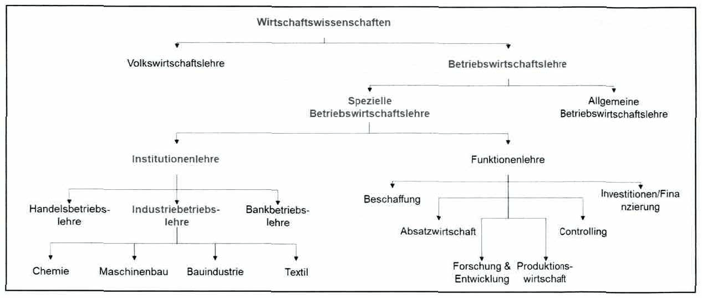

<!-- Seite 55 (PDF 65) -->

# 3.3 Abgrenzung des Industrie Managements im Kontext der Wirtschaftswissenschaften

Industrie Management ist ein Teil der Wirtschaftswissenschaften (siehe Abbildung 18), der sich mit der Ökonomie von Anlagen bzw. Unternehmen unter Berücksichtigung ihrer Wechselwirkungen mit anderen Unternehmen und ihrer Umwelt beschäftigen. Während die allgemeinen Wirtschaftswissenschaften versuchen, Fragen zu beantworten, die sich in allen Unternehmensformen gleichermaßen stellen, konzentriert sich das Industrie Management auf das Industrieunternehmen als Untersuchungsgegenstand.

Entsprechend kann das Industrie Management (bzw. die Industriebetriebslehre) als Teil der Betriebswirtschaftslehre gesehen werden, dass sich mit dem **Wirtschaften von Betrieben unter Berücksichtigung des Unternehmensumfelds** beschäftigt.[^66]

Wie bereits erwähnt, untersucht das Industrie Management dabei ganzheitlich die Funktionsbereiche eines Industrieunternehmens. Die Abgrenzung des Industrie Managements im Kontext der Wirtschaftseinheiten ist in Abbildung 18 dargestellt.

*Abbildung 18: Abgrenzung des Industrie Management im Kontext der Wirtschaftseinheiten – Skript S. 55 (PDF 65)*

[^66]: Vgl. Voigt (2008), S. 12

## Fußnoten ohne sicheren Textanker

Diese Fußnoten stehen auf den Seiten dieses Abschnitts, ihr Verweiszeichen im Text ließ sich aus dem Scan aber nicht eindeutig zuordnen (oft Quellenangaben zu Abbildungen).

- **67** – Seite 55 (PDF 65): In Anlehnung an Voigt (2008), S. 12

## Prüfungsfragen zu diesem Abschnitt

1 Frage aus der [Prüfungsfragen-Datenbank](../../exams/questions.md): `frage-2025-03-18-3`
