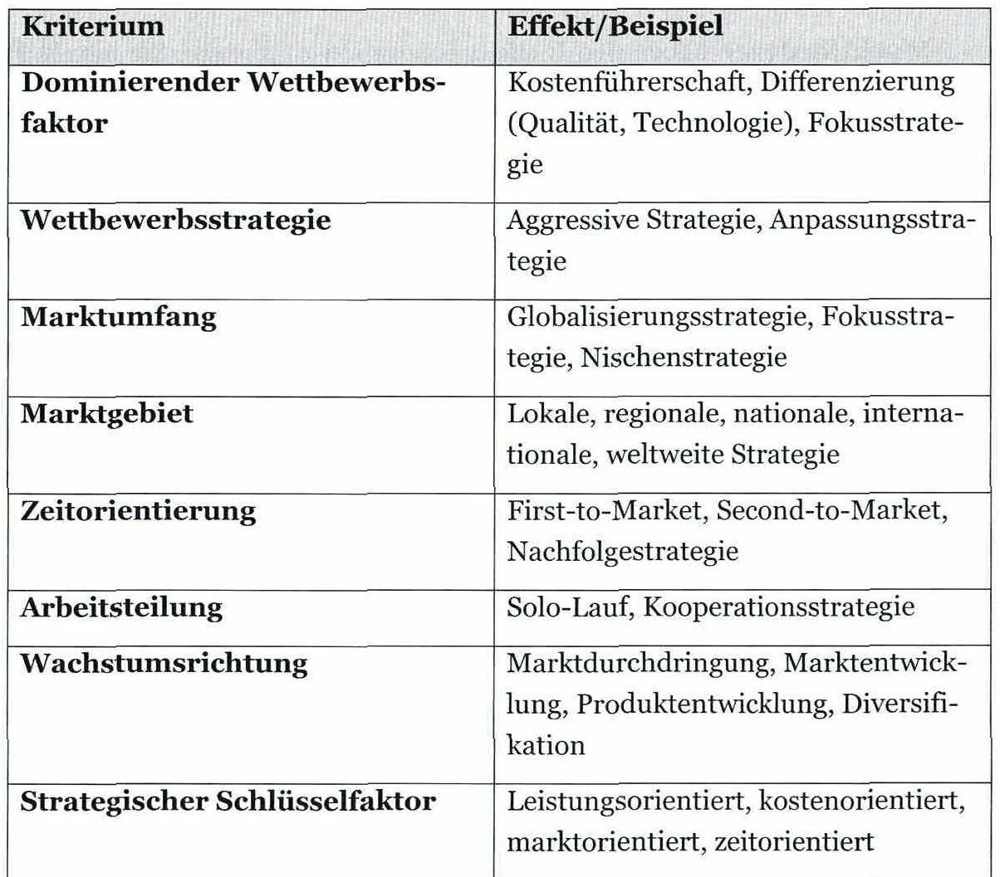
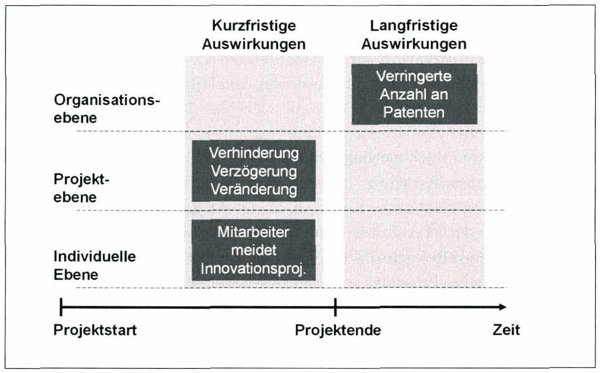

<!-- Seite 59 (PDF 69) -->

# 4.1 Innovation und Strategie

Um Innovationen in Unternehmen sinnvoll einzubringen, braucht es Management und Strategie. Innovationsmanagement innerhalb eines Unternehmens verbindet Aspekte und Funktionen des Managements durch Rekombination der Ressourcen. Innovationsorganisationen unterscheiden sich von normalen operativen Organisationen nicht nur im Bilden der betroffenen Einheiten, sondern auch in ihren Neuheits- und Flexibilitätsanforderungen. Gleichzeitig besteht die Notwendigkeit einer soliden Grundstruktur, die sich im Innovationsprozessmodell widerspiegelt.[^68] Strategische Entscheidungen innerhalb eines Unternehmens sind maßgeblich dafür ob die gesetzten Ziele erreicht werden. Innovationsstrategien sind in direkter Abhängigkeit zu den übergeordneten Unternehmensstrategien[^69] und stellten den Ausgangspunkt dar, um Innovationsprozesse umzusetzen.

## 4.1.1 Innovationsmanagement

Innovationsmanagement zählt zu den Kerntätigkeiten von Industriebetrieben und ist ein systematisch geplanter, gesteuerter Prozess. Dieser Prozess stellt die Innovation sowie deren Durchsetzung am Markt oder im Unternehmen sicher.[^70]

Im weiteren Verlauf des Skriptums wird die Definition nach Hauschild und Salomo (2011) angewandt:

<!-- Seite 60 (PDF 70) -->

„Innovationsmanagement ist die bewusste Gestaltung des Innovationsportfolios.7?! Neben einzelnen Prozessen werden auch Institutionen betrachtet, innerhalb jener diese Prozesse ablaufen.[^72]

Der Zweck des Innovationsmanagements innerhalb eines Betriebs zielt auf die Wertsteigerung eines Unternehmens ab. Dies kann durch folgende Kombinationen von Zweck und Mitteln erreicht werden:[^73]

- Gestaltung eines neuen Produktes
- Gestaltung eines neuen Prozesses, im Sinn eines technischen Verfahrens
- Gestaltung einer neuen Dienstleistung
- Gestaltung einer neuen internen wie externen Organisation, etwa eines Unternehmensnetzwerks
- Gestaltung einer Kombination aus den Vorgenannten Bereits Schumpeter erkannte diese Zweck-Mittel-Kombinationen — und bezeichnete daher das Innovationsmanagement auch als „kreative Zerstörung“ (ablösen des Bestehenden durch etwas Besseres).

Beispiel Werkzeugmaschinenindustrie: Diese Unternehmen beschäftigten sich früher meist mit Produktinnovationen und positionierten diese am Markt. In dieser Branche spielen heutzutage etwa Auslastungsgarantien oder Fernwartung eine bedeutende Rolle. Das bewirkte wiederum eine Umstellung des Innovationsmanagements in vielen Unternehmen.[^74]

Die Definition von Innovation durch Schumpeter kann nun mit der Funktion des dynamischen Unternehmens erweitert werden. Ein dynamisches Unternehmen trifft neue Entscheidungen und setzt diese Kombinationen aus Zweck und Mittel unabhängig und zeiteffizient durch. Sowohl das Treffen als auch das Durchsetzen einer Entscheidung sind wichtig.[^75] Somit steht jener einzelne Innovationsprozess im Zentrum der Betrachtung, der in das System der Unternehmung zu integrieren ist.[^76]

Das Innovationsmanagement sollte klar vom Management von Forschung und Entwicklung (F&E) unterschieden werden. F&E ist zweifellos ein Teil von Innovation, aber das zählt nicht zwangsläufig auch umgekehrt. F&E-Projekte beziehen sich auf Wissenschaft und Technik, während Innovationen auch administrative Prozesse umfassen können.

<!-- Seite 61 (PDF 71) -->

Im Innovationsmanagement treten verschiedene Akteure auf. Als Innovationsmanager ist eine besondere Kombination aus unternehmerischer, betriebswirtschaftlicher und technologischer Kompetenz gefragt.

Beispielsweise können folgende drei Akteure nach Witte beschrieben werden: Technologie-, Macht- und Prozessförderer”[^77].

- Technologieförderer haben die Fähigkeiten ein Problem zu lösen. Sie beschaffen oder erstellen die erforderlichen Informationen.
- Machtförderer haben den Einfluss Innovation zu fördern. Sie nutzen Führungsinstrumente, um den Widerstand zu überwinden und setzen materielle und immaterielle Anreize, um Innovation zu unterstützen.
- Prozessförderer sind für die Administration und die Organisation verantwortlich, stellen relevante Verbindungen her und unterstützen die Interaktion der Teilnehmer.

## 4.1.2 Innovationsstrategie

Strategien sind Methoden, um ein bestimmtes Unternehmensziel zu erreichen. Innovationsstrategien beschreiben und gestalten die Wege, wie diese Ziele erreicht werden können. Dabei werden sowohl die geplanten Kosten als auch die vorgesehene Zeit berücksichtigt. In der Regel umfassen Strategien je nach Zielsetzung einen Zeitraum von fünf bis zehn Jahren und berücksichtigen die folgenden Punkte:

1. Die aktuelle Lage an den Beschaffungs- und Absatzmärkten, das Marktpotenzial und das Wachstumstempo

Technische Entwicklungen bei relevanten Produktionsverfahren S Die möglichen Strategien der Wettbewerber in Bezug auf den Markt

Das System der sozialen Beziehungen, in welches das Unternehmen passt Y > Die Produktivität des Unternehmens und die verfügbaren kritischen Ressourcen

<!-- Seite 62 (PDF 72) -->

6. Die möglichen Auswirkungen neuer Produkte auf das bestehende Produktportfolio innerhalb des Unternehmens, sowie auf potenzielle Kunden und deren Anforderungen

Eine Innovationsstrategie kann durch die Beantwortung folgender drei Fragen definiert werden:

- Wo sind wir jetzt? (Ausgangssituation)
- Wo wollen wir hin? (Ziele)
- Wie kommen wir dorthin? (Strategieentscheidung)

Tabelle 4 zeigt einen Überblick über mögliche Kriterien von Innovationsstrategien:

*Tabelle 4: Kriterien für Innovationsstrategien – Skript S. 62 (PDF 72)*

## 4.1.3 Innovationsbarrieren und deren Überwindung

Die Implementierung von Innovation bedeutet für viele Mitarbeiter eines Unternehmens eine erhebliche Veränderung in deren gewohnten Arbeitsweisen. Die Betroffenen empfinden dies oft als Störung, Ärgernis oder auch sinnlose Turbulenz oder Kritik an ihrer bisherigen Arbeitsweise. Im Zweifelsfall sind Innovationen daher nicht wirklich erwünscht. Auch wenn die Mitarbeiter ihre Bereitschaft zur Innovation bekunden, folgen in vielen Fällen dann nicht die erforderlichen Taten.[^78]

<!-- Seite 63 (PDF 73) -->

Man darf sich Innovationsbarrieren jedoch nicht als geschlossene oder geöffnete Schranken vorstellen. Innovationsbarrieren sind vielmehr ein gradueller Widerstand, welcher auch schrittweise überwunden werden kann.[^79]

Ausgewählte Innovationsbarrieren:[^80]:[^81]

Fehlende Motivation zur Zusammenarbeit — kann als aktiver oder passiver Widerstand auftreten. Aktiv bedeutet, dass Mitarbeiter Innovationsprojekte sabotieren. Bei passivem Widerstand schränken Mitarbeiter die Kommunikation ein, beziehungsweise stellen Informationen nicht zur Verfügung oder nehmen nicht an Projektmeetings teil. Aufgabenunsicherheit — entsteht, wenn Mitarbeiter aufgrund von unklaren Projektzielen nicht in der Lage sind, die für die Erfüllung der Innovationsvorhaben erforderlichen Informationen zu erzeugen oder zu verarbeiten. Ressourcenallokation — beschreibt das Problem der Ressourcenzuteilung. Tritt häufig bei Prioritätskonflikten zwischen Projekten auf und kann zu Reibungen zwischen bestehenden und neuen Projekten bzw. Projektteams führen. Prozessbedingte Einschränkungen -— beschreiben rigide, strikt regulierte Prozesse innerhalb eines Projektes, welche die Arbeitsschritte genau vorschreiben und die Handlungsfreiheiten der Mitarbeiter zu sehr einschränken. Barriere des Nicht-Wissens - tritt auf, wenn Mitarbeiter nicht in der Lage sind, die intellektuellen Aufgaben der Innovation (Neues erlernen, Begreifen von unbekannten Ursache-Wirkungs-Ketten, Aufbau neuer Denkbahnen, etc.) zu bewältigen. Barriere des Nicht-Wollens — beschreibt den Unwillen, Innovation zuzulassen. Mögliche Ursachen sind z.B. weltanschauliche Gründe, sachliche Gründe, machtpolitische Gründe oder persönliche Gründe.

Auswirkungen von Innovationsbarrieren[^82]

Die Auswirkungen von Innovationsbarrieren sind auf unterschiedlichen Ebenen eines Unternehmens erkennbar und in Relation zur Projektzeit unterschiedlich. Abbildung

<!-- Seite 64 (PDF 74) -->

19 zeigt einen Überblick über die kurzfristigen und langfristigen Auswirkungen auf den unterschiedlichen Ebenen.

Kurzfristige Auswirkungen von Innovationsbarrieren sind schon während des Innovationsprozesses erkennbar und beeinflussen sowohl Projekte als auch Individuen. Unternehmen, die auf organisatorischer Ebene viele Innovationsbarrieren feststellen, patentieren langfristig weniger.

*Abbildung 19: Auswirkung von Innovationsbarrieren – Skript S. 64 (PDF 74)*

Überwindung von Innovationsbarrieren[^83]

Eine Innovationsbarriere kann dann als überwunden bezeichnet werden, wenn sie im Innovationsprozess nicht mehr als hemmender Faktor wahrgenommen wird.

Zur Überwindung von Innovationsbarrieren ist ein starker normativer Einfluss von Seiten der Unternehmensführung erforderlich. Alle Bereiche eines Unternehmens müssen auf gemeinsame Ziele ausgerichtet werden und innovationsförderliches Verhalten muss unterstützt werden. Es ist zudem erforderlich, dass die Unternehmensziele informativ und deutlich zwischen allen Unternehmensebenen kommuniziert werden und Mitarbeiter nicht das Gefühl haben übergangen zu werden.

Detaillierte Maßnahmen zur Überwindung von spezifischen Innovationsbarrieren gestalten sich unterschiedlich.

[^68]: Möhrle (2022)
[^69]: Möhrle und Specht (2018)
[^70]: Möhrle (2022)
[^72]: ? Hauschildt und Salomo (2011)
[^73]: Möhrle (2022)
[^74]: Möhrle (2022)
[^75]: Vgl. Hauschild und Salomo (2011), S. 23, 34
[^76]: Vgl. Hauschildt und Salomo (2011), S. VI, 143
[^77]: Vgl. Witte (1973), S. 15
[^78]: Vgl. Hauschildt, Salomo (2011), S. 99
[^79]: Vgl. Witte (1973), S. 73
[^80]: Vgl. Mirrow (2010), S. 125 ff.
[^81]: Vgl. Hauschildt, Salomo (2011), S. 107 ff,
[^82]: Vgl. Mirrow (2010), S. 27 ff.
[^83]: vgl. Mirrow (2010), S. 27 ff.

## Fußnoten ohne sicheren Textanker

Diese Fußnoten stehen auf den Seiten dieses Abschnitts, ihr Verweiszeichen im Text ließ sich aus dem Scan aber nicht eindeutig zuordnen (oft Quellenangaben zu Abbildungen).

- **71** – Seite 60 (PDF 70): Vgl. Hauschild und Salomo (2011), S. 17
- **84** – Seite 64 (PDF 74): vgl. Mirrow (2010), S. 10 ff.

## Prüfungsfragen zu diesem Abschnitt

3 Fragen aus der [Prüfungsfragen-Datenbank](../../exams/questions.md): `frage-2024-10-15-4`, `frage-2025-02-04-4`, `frage-2025-04-09-1`
