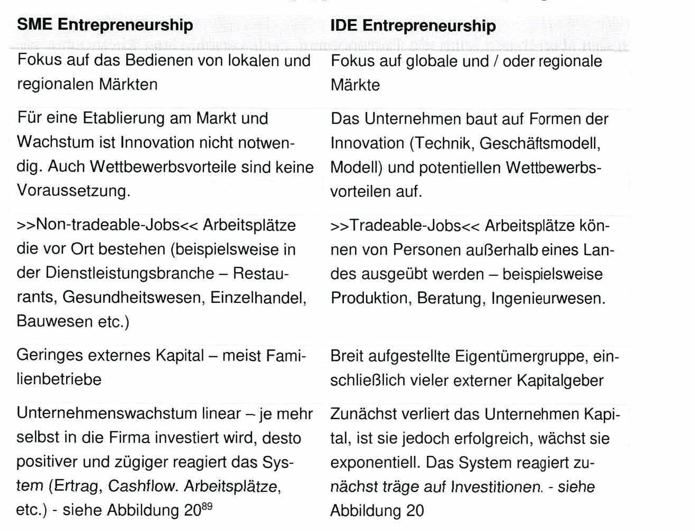
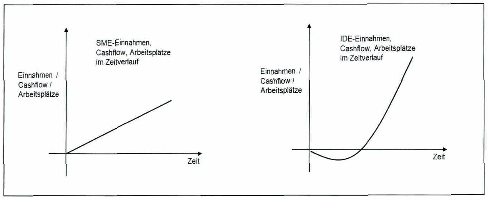
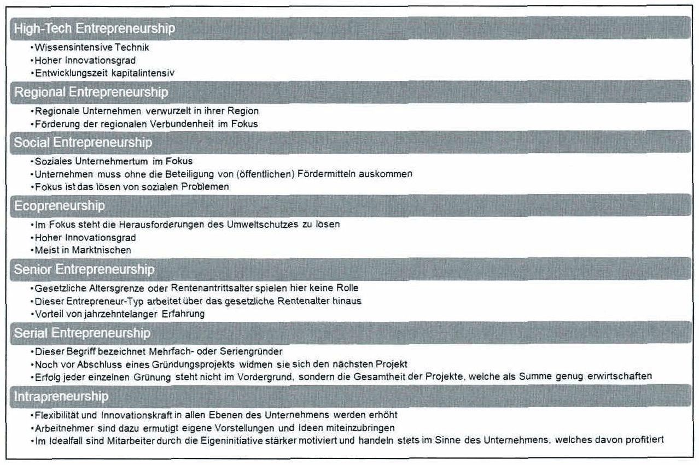
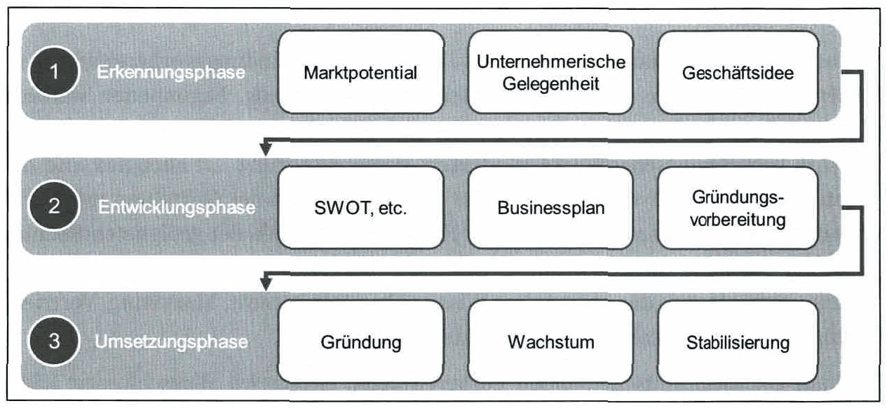

<!-- Seite 65 (PDF 75) -->

# 4.2 Innovation und Entrepreneurship

Entrepreneurship stellt den entscheidenden Impuls für die Gründung von Unternehmen dar und beinhaltet die Transformation einer Idee in eine Geschäftsmöglichkeit. Dabei kann es sich um ein neues Produkt, einen Prozess oder ein ganzes Geschäftsmodell handeln. Diese Ideen werden dann als Innovation bezeichnet, wenn sie einen Bedarf gewinnbringend stillen, und somit einen gewissen Wert darstellen. Unternehmerische Initiative beginnt folglich mit Innovation — und ist mit Verantwortung und einem gewissen Maß an Risiko verbunden.

Um sich weiterzuentwickeln, auf wechselnde Marktanforderungen oder regulatorische Vorgaben zu reagieren, müssen sowohl etablierte als auch neu gegründete Unternehmen Innovation vorantreiben. Unternehmerinnen und Unternehmer zeichnen sich durch spezifische Persönlichkeitsmerkmale aus, die es ihnen ermöglichen, Chancen zu erkennen und diese unter (einschätzbarem) Risiko umzusetzen.

## 4.2.1 Definition

Entrepreneurship (Unternehmertum) ist eine Teildisziplin der Wirtschaftswissenschaften. Dabei bezeichnet Entrepreneurship das Ausnutzen unternehmerischer Gelegenheiten sowie den kreativen und gestalterischen unternehmerischen Prozess zum Aufbau neuer Organisationen. 8

Die Rolle von Unternehmern wurde erstmals Ende des 18. Jahrhunderts erwähnt, ökonomische Definitionen dazu finden sich aber erst im Laufe des 20. Jahrhunderts wieder. Aus den verschiedenen Vertretern der wirtschaftlichen Schulen entstanden vielfältige Definitionen. Das moderne Verständnis von Entrepreneurship wird maßgeblich von der Arbeit österreichischer Ökonomen beeinflusst, insbesondere von Joseph Schumpeter, Carl Menger, Ludwig von Mises und Friedrich von Hayek. Da in diesem Skript Innovation im Zusammenhang mit Entrepreneurship im Vordergrund steht, gilt die Definition nach Schumpeter (1934). Schumpeters Bild beschreibt vor allem das innovative Verhalten der Unternehmer und das Konzept der „kreativen Zerstörung“ eines Marktgleichgewichts.[^85]

Entrepreneurship ist jedenfalls mehr als die Schaffung von Organisationen und die effiziente Nutzung von Ressourcen. Es beinhaltet kreative Elemente wie die Identifizierung von Marktchancen, die Suche nach neuen Geschäftsideen und deren Umsetzung in Form von neuen Geschäftsmodellen. Entrepreneurship ist nicht zwingend mit der

<!-- Seite 66 (PDF 76) -->

Eigentümerfunktion verbunden. Dies bedeutet, dass Entrepreneurship auch in bestehenden Unternehmen von Nicht-Eigentümern ausgeübt werden kann (Intrapreneurship).

## 4.2.2 Unternehmertätigkeit und Existenzgründung

Entrepreneurship besteht aus den folgenden vier Komponenten:

1. Chancen entdecken: Unternehmer\*innen müssen in der Lage sein, systematische Geschäftsideen zu generieren, zu bewerten und auszuwählen sowie persönliche Chancen wahrzunehmen und umzusetzen.
2. Innovationen durchsetzen: Neue Geschäftsideen müssen entwickelt, in Modelle und Prototypen umgesetzt und schließlich vermarktet werden. Dies gilt auch für Prozesse, Dienstleistungen und komplette Geschäftsmodelle.
3. Entwicklung und Nutzung von Ressourcen: Unternehmer \*innen müssen in der Lage sein, Schlüsselressourcen zu identifizieren, zu erschließen, zu kombinieren und angemessen zu nutzen.
4. Risikobereitschaft: Unternehmer\*innen müssen bereit sein, Risiken für ihre Geschäftstätigkeit einzuschätzen und gegebenenfalls zu übernehmen.

Darüber hinaus beinhaltet Entrepreneurship auch die Fortführung eines bestehenden Unternehmens, aber auch die Reaktion auf Krisen, Veränderungen und Wettbewerber, die Beobachtung des Umfelds, die Bewertung externer Geschäftsideen, -modelle und - prozesse und deren Anpassung unter bestimmten Umständen. Unternehmerisches Handeln bedeutet auch, die eigenen Fehler so früh wie möglich zu erkennen und zu korrigieren oder zu beenden.

Ein Start-up ist ein junges Unternehmen, das sich in einer frühen Phase der Geschäftsentwicklung mit unsicherer Markt- und Produktentwicklung befindet. Ziel ist es, innovative Produkte oder Dienstleistungen zu schaffen — ohne etabliertes Geschäftsmodell oder gesicherte Marktnachfrage. Wesentliche Merkmale sind schnelles Wachstum, hohe Skalierbarkeit und das Streben nach Chancen über verfügbare Ressourcen hinaus. Um ein möglichst wiederholbares und skalierbares Geschäftsmodell zu entwickeln, sind Agilität und schnelle Umsetzung von Ideen entscheidend. [^87]

Diese Anforderungen sind eng an die Unternehmer\*innen gebunden, die in dieser frühen Phase außerdem viel Überzeugungsarbeit leisten müssen. Neben einer guten Geschäftsidee, und deren Verwirklichung durch ein kompetentes und überzeugtes Gründerteam, ist die Finanzierung des Start-ups eine grundlegende Voraussetzung, sowohl für den Erfolg als auch die Fortdauer des Unternehmens. [^88]

<!-- Seite 67 (PDF 77) -->

## 4.2.3 Haupttypen des Entrepreneurship

Die zwei Haupttypen des Entrepreneurship sind

- SME: Small and Medium Size Enterprises und
- IDE: Innovation-driven Enterprises

Die Unterschiede zwischen den Haupttypen werden in Tabelle 5 dargestellt.

*Tabelle 5: Unterschiede zwischen SME und IDE Entrepreneurship – Skript S. 67 (PDF 77)*

<!-- Seite 68 (PDF 78) -->

*Abbildung 20: Vergleich zwischen SME- und IDE-Entrepreneurship – Skript S. 68 (PDF 78)*

Neben den Haupttypen kann ein Entrepreneur auch verschiedene Richtungen einschlagen. Diese sind in Abbildung 21 beschrieben 9°.

*Abbildung 21: Richtungen des Entrepreneurship – Skript S. 68 (PDF 78)*

<!-- Seite 69 (PDF 79) -->

## 4.2.4 Entrepreneurship-Prozess

Der Entrepreneurship-Prozess kann in drei Hauptphasen unterteilt werden: Erkennungsphase, Entwicklungsphase und Umsetzungsphase, wie in Abbildung 22 dargestellt.

*Abbildung 22: Entrepreneurship-Prozess – Skript S. 69 (PDF 79)*

Während der Erkennungsphase ist es wichtig, dass ein angehender Gründer ein mögliches Marktpotenzial erkennt. Es muss ein Ungleichgewicht zwischen einer erwarteten und der aktuellen Marktnachfrage bestehen: ist die erwartete größer, besteht Potenzial. Als Marktnachfrage wird dabei die Nachfrage der potenziellen Kunden in einem bestimmten Markt bezeichnet. Dieses Ungleichgewicht ist die Grundlage für jeden weiteren Schritt im unternehmerischen Prozess.

Wird eine unternehmerische Chance erkannt, versuchen Unternehmer, das vorhandene Potenzial durch die Entwicklung und Umsetzung einer geeigneten Geschäftsidee auszuschöpfen. In den meisten Fällen erfolgen die ersten drei Schritte der Erkennungsphase des Entrepreneurship-Prozesses innerhalb eines sehr kurzen Zeitraums. Häufig werden Marktpotenziale indirekt durch eine unbefriedigende Situation erkannt ("zufällige Entdeckung"). Die Lösungsidee zur unbefriedigenden Situation stellt in solchen Fällen das Potenzial dar. Schließlich ist die entwickelte Geschäftsidee die Lösung des eigenen Problems, aber auch anderen Menschen mit dem gleichen Problem wird geholfen.

In der Entwicklungsphase wird die Machbarkeit der Geschäftsidee untersucht. Die Idee von Unternehmern wird durch Schätzung eines realistischen Maßes an Kosten, Aufwand, Absatz und Gewinn auf Profitabilität geprüft. Um jedoch eine konkrete Idee im Detail zu untersuchen, wird ein Businessplan erstellt, in dem Unternehmer\*innen aus verschiedenen Perspektiven (Fähigkeiten, Marktumfeld und Wettbewerb etc.) prüfen und damit klären, ob die Geschäftsidee umsetzbar ist. Darüber hinaus wird der Businessplan von Institutionen wie Banken oder Start-up-Beratern benötigt, um sich ein eindeutiges Bild von den Vorstellungen des potenziellen Gründers machen zu können.

<!-- Seite 70 (PDF 80) -->

Ist das Ergebnis des Businessplans positiv, kann mit der Gründungsvorbereitung, dem letzten Schritt vor der eigentlichen Unternehmensgründung, begonnenen werden. Während der Gründungsvorbereitung sollte sich jeder Unternehmer relevantes Wissen (z.B. betriebswirtschaftliche Grundlagen, Personalführung, ...) aneignen und die Voraussetzungen dafür schaffen, dass das Unternehmen ab der Gründung möglichst reibungslos arbeiten kann. Dazu gehören Fragen wie die Wahl der geeigneten Rechtsform, die Organisation des Unternehmens, der Abschluss eines möglichen Gesellschaftsvertrages sowie das notwendige Wissen über Arbeitsrecht, Marketing, Vertrieb, Buchhaltung, Preisgestaltung von Produkten, und mehr.

Sind alle gründungsentscheidenden Vorbereitungen erfolgreich abgeschlossen, kann die eigentliche Gründung in der Umsetzungsphase durchgeführt werden. Dabei geht es um die formale Institutionalisierung des gewünschten Unternehmens. Je nach Rechtsform müssen unterschiedliche Anforderungen erfüllt werden. Während für einzelne Unternehmen oft eine Gewerbeanmeldung ausreicht, benötigen Kapitalgesellschaften einen notariell beurkundeten Gesellschaftsvertrag und eventuell weitere Formerfordernisse.

Nach der Unternehmensgründung folgen zwei weitere Schritte, die individuell vom Unternehmen abhängig sind: Wachstum und Stabilisierung. Verschiedene Unternehmer haben andere Ziele mit ihrem Unternehmen. Manche möchten ein kleines mittelständisches Unternehmen etablieren, andere verfolgen das Ziel zu einem überregionalen, nationalen oder internationalen Unternehmen zu wachsen. Wichtig ist, dass in dieser Umsetzungsphase klare Strukturen und eine gute Organisation im Unternehmen implementiert und beibehalten werden.

<!-- Seite 71 (PDF 81) -->

## 4.2.5 Persönlichkeitsmerkmale für erfolgreiches Entrepreneurship

Für erfolgreiches Entrepreneurship sind spezifische Persönlichkeitsmerkmale, Verhaltensweisen und Einstellungen erforderlich: [^92]

Motivation: Unternehmer\*innen haben eine Vision, die begeistert. Die Vision ist die treibende Kraft für ein Unternehmen und Unternehmer\*innen sind bereit, Aufgaben anzupacken und die eigenen Fähigkeiten herauszufordern. Für unternehmerisches Handeln ist eine hohe Motivation erforderlich.

Eigeninitiative und Wunsch nach Unabhängigkeit: Unternehmer\*innen entwickeln mit Ausdauer und Entschlossenheit Strategien, um ihre Vision zu verwirklichen. Unternehmer\*innen streben nach Selbstständigkeit und Unabhängigkeit und vertrauen auf die eigenen Fähigkeiten,

Realismus und Fähigkeit zur Zusammenarbeit: Unternehmer\*innen kennen die Grenzen genau und sind in der Lage, potenzielle Partner\*innen zu identifizieren und Partnerschaften aufzubauen. Insbesondere ist eine Kenntnis des Umfelds essentiell, um redundante Entwicklungen zu vermeiden.

Kreativität: Unternehmer\*innen sollten ein schöpferisch denkender und entscheidungsfreudiger Mensch sein, der assoziativ in seinen Vorstellungen und lebhaft in seiner Phantasie ist.

Durchhaltevermögen: Ein hohes Maß an Kreativität kann zu oft und zu früh zu einem Strategiewechsel führen, bevor Erfolge oder Misserfolge deutlich werden.

Risikobereitschaft: Unternehmerische Aufgaben bieten Chancen und Risiken. Unternehmer\*innen müssen diese einschätzen und überschaubare Risiken eingehen, indem sie Kosten, Markt- und Kundenbedürfnisse bewerten. Unternehmer\*innen tragen die Verantwortung, ihre Idee zum Erfolg zu führen.

**Emotionale Stabilität, Durchsetzungsvermögen sowie Empathie:** Unternehmer\*innen müssen in der Lage sein, schnell mit Fehlern umzugehen und in kritischen Situationen einen klaren Kopf zu bewahren. Ebenfalls müssen sie kooperativ sein und Einfühlungsvermögen haben, um sich in z.B. Teammitglieder, Investoren oder Kunden hineinversetzen zu können und in Zusammenarbeit mit ihnen etwas zu erreichen.

<!-- Seite 72 (PDF 82) -->

- Problemlösungsfähigkeit: Viele Aufgaben des Unternehmertums sind keine Routine-Aufgaben. Unternehmer\*innen müssen imstande sein in unbekanntem Feld zu operieren und Wege finden, handlungsfähig zu bleiben.
- Fähigkeit zum Umgang mit Unsicherheit: Unternehmer\*innen müssen in der Lage sein, mit großer Informationsunsicherheit und schlecht definierten Situationen umzugehen.
- Unternehmerische Selbstwirksamkeitserwartung: Die Erwartung, dass das eigene Handeln entscheidenden Einfluss auf das Gelingen der Vorhaben — in diesem Fall des Gründungsvorhabens — hat und dabei nicht von Dritten abhängig ist.

All diese Fähigkeiten und Talente sind selten in einer Person zu finden. Darüber hinaus sind Einstellungen und Fähigkeiten, die eine nachhaltige Unternehmensgründung fördern, nicht immer gleich. Dies gilt z.B. für hohe Risikobereitschaft. Die Gründungsneigung wird zwar erhöht, der langfristige Erfolg aber nicht unbedingt unterstützt. Daher sind, je nach Phase des Geschäftslebenszyklus, unterschiedliche Einstellungen und Fähigkeiten erforderlich.

[^85]: Kollmann (2018)
[^87]: Friessnig (2019)
[^88]: Hahn (2018)
[^92]: Vgl. Fallgatter (2007), S. 36

## Fußnoten ohne sicheren Textanker

Diese Fußnoten stehen auf den Seiten dieses Abschnitts, ihr Verweiszeichen im Text ließ sich aus dem Scan aber nicht eindeutig zuordnen (oft Quellenangaben zu Abbildungen).

- **86** – Seite 65 (PDF 75): Kollmann (2018) basierend auf Schumpeter (1934)
- **89** – Seite 67 (PDF 77): Vgl. Aulet (2016), S. 6
- **90** – Seite 68 (PDF 78): Gründer.de (2022)
- **91** – Seite 69 (PDF 79): Pott und Pott (2012), S.6.

## Prüfungsfragen zu diesem Abschnitt

1 Fragen aus der [Prüfungsfragen-Datenbank](../../exams/questions.md): `frage-2025-06-16-3`
