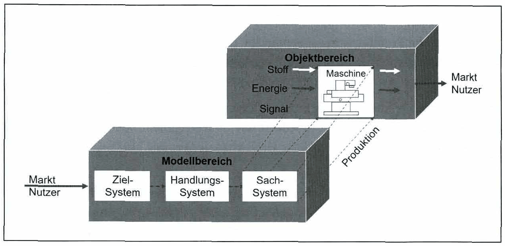

<!-- Seite 76 (PDF 86) -->

# 5.1 Ziele der Produktentstehung

Ziel des Produktentstehungsprozesses ist es, ein Zielsystem (alle Ziele, die ein neues Produkt anstrebt) mit einem Handlungssystem (z.B. ein Unternehmen mit allen verfügbaren Ressourcen) in ein geeignetes Sachsystem (z.B. Simulationsmodelle, Prototypen, serienreife Produkte) zu transformieren.

<!-- Seite 77 (PDF 87) -->

Die Handlungen zielen auf die Erreichung der Ziele ab. Beispielsweise kann bei technischen Handlungen die Schaffung eines Sicherheitsmechanismus ein Ziel sein. Ein Handlungssystem verfolgt jedoch nicht immer nur ein Ziel, sondern eine Mehrzahl von miteinander verknüpften Zielen. Das Zielsystem stellt dabei die zusammengefassten Zielvorgaben dar.

Ein Handlungssystem ist ein ausführendes System und enthält strukturierte Aktivitäten, die z.B. zur Zielerfüllung eines zu erstellenden Sachsystems benötigt werden. Es transformiert dabei bestimmte Inputs, Zustände und Zielvorgaben, die die Ausgangssituation beschreiben, in Zustände und Ergebnisse der Endsituation, so dass die Ziele erfüllt werden.

Das Sachsystem ist vom Menschen geschaffen. Technologisch betrachtet umfasst das Sachsystem technische Gebilde, die aus der Arbeit von Ingenieuren, Technikern etc. hervorgehen, wie z.B. Maschinen, Maschinenteile, Geräte, Apparate, zusammengefasst technische Systeme.

*Abbildung 25: Zielsystem, Handlungssystem und Sachsystem – Skript S. 77 (PDF 87)*

## Fußnoten ohne sicheren Textanker

Diese Fußnoten stehen auf den Seiten dieses Abschnitts, ihr Verweiszeichen im Text ließ sich aus dem Scan aber nicht eindeutig zuordnen (oft Quellenangaben zu Abbildungen).

- **94** – Seite 76 (PDF 86): Vgl. Gausemeier et al. (2000), S. 3; Albers/Gausemeier (2012), S.19;
