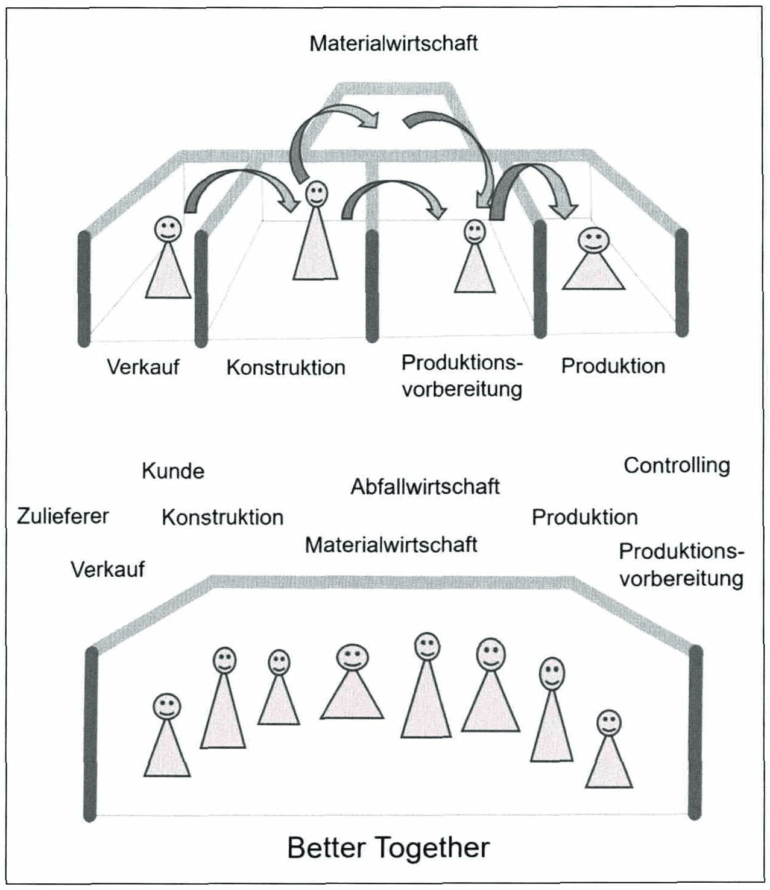
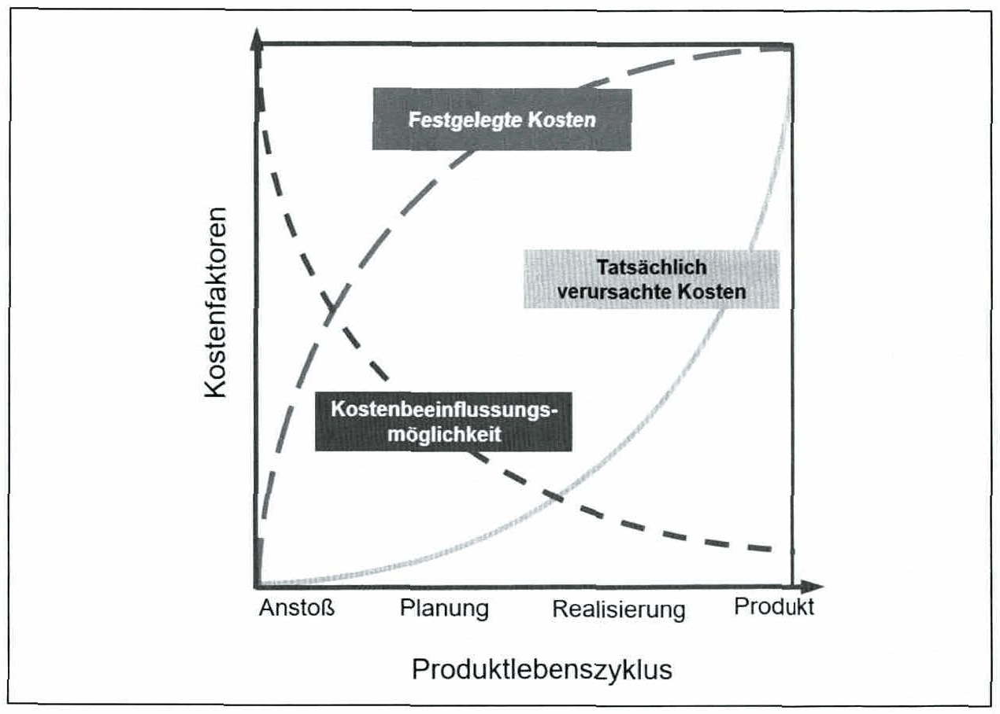
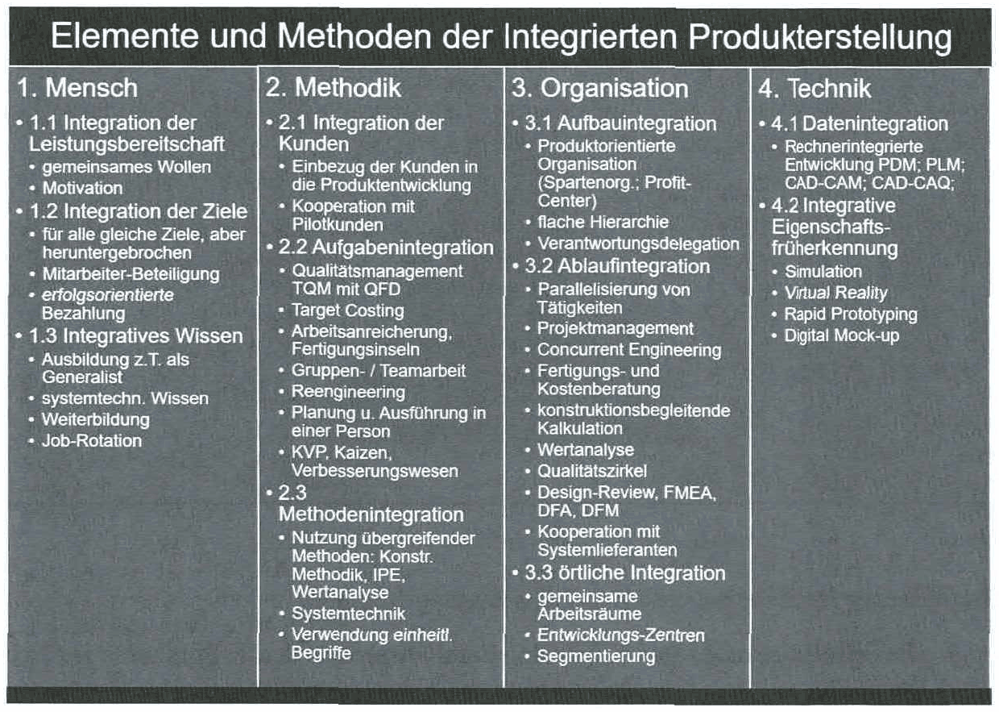
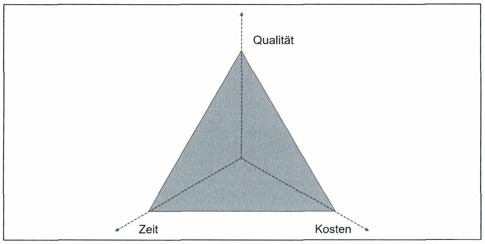
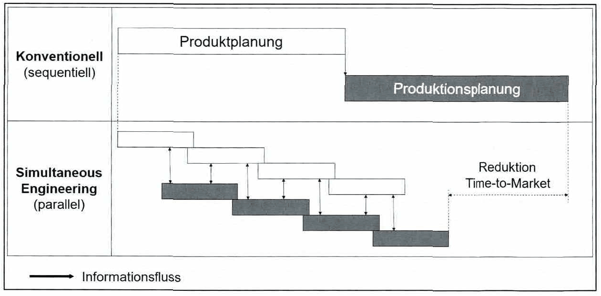
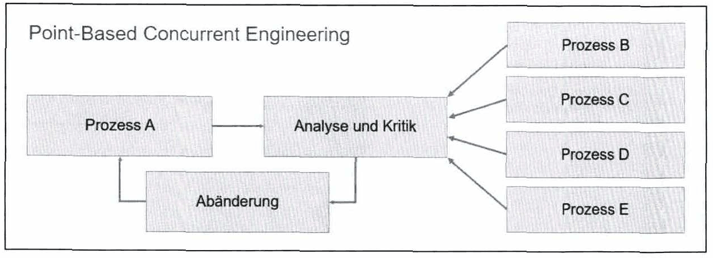
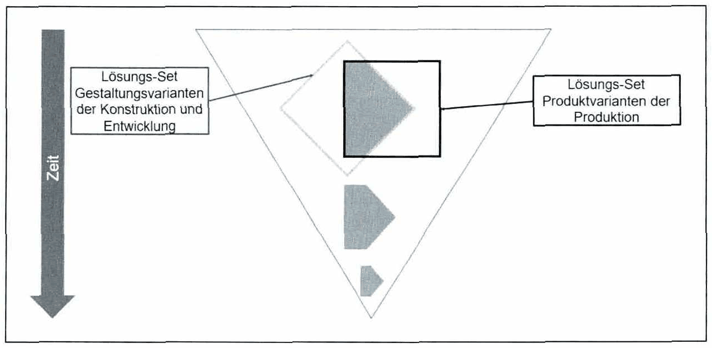
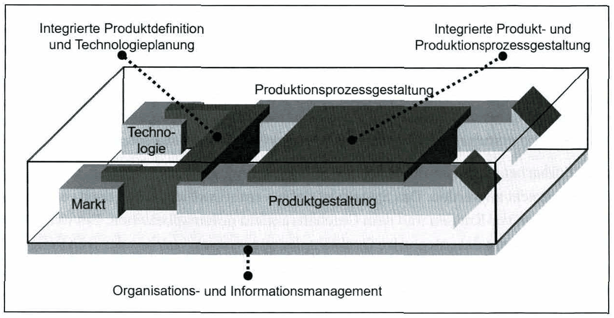
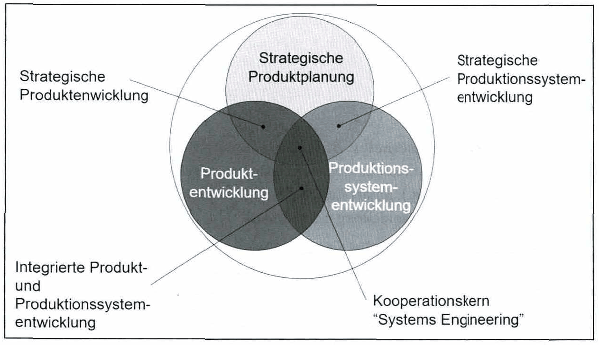

<!-- Seite 79 (PDF 89) -->

# 5.6 Integration im Produktentstehungsprozess

Integration bedeutet hierbei die Kombination einzelner Teilbereiche zu einem Ganzen. Ein integrierter Produktentstehungsprozess zeichnet sich durch eine enge Zusammenarbeit aller Beteiligten aus, welche gemeinsame Ziele hinsichtlich Qualität, Zeit und Kosten verfolgen. Ein weiteres Merkmal ist die Parallelisierung erforderlicher Abläufe.

<!-- Seite 80 (PDF 90) -->

*Abbildung 26: Integrierte Produktentstehung 2013 – Skript S. 80 (PDF 90)*

Die Kostenfestlegung in der Produktentstehung erfolgt sehr früh im Prozess. In einer frühen Phase, in der erst 5% der Kosten tatsächlich verursacht wurden, sind bereits ca. 80% der Kosten festgelegt. Speziell in diesem Zusammenhang ist ersichtlich, dass ein integrierter Produktentstehungsprozess unerlässlich ist, um Effizienz und Effektivität in der Produktentstehung zu gewährleisten.

<!-- Seite 81 (PDF 91) -->

*Abbildung 27: Festgelegte und verursachte Kosten in der Produktentstehung – Skript S. 81 (PDF 91)*

Die Integration in der Produktentstehung kann in verschiedenen Formen realisiert und angewendet werden. Beispiele hierfür sind unter anderem die menschliche, methodische, organisatorische als auch die technische Integration.

**Menschliche Integration**

Die wichtigsten Aspekte sind nicht die Methoden oder Techniken, sondern der Wunsch des Menschen, zusammenzuarbeiten und Spaß darin zu finden. Weitere Ziele können in Folge dessen "vom Menschen selbst" erreicht werden. Mitarbeiter sind erfolgreich, wenn sie über Freiraum verfügen und aufgrund ihrer Arbeit motiviert sind.

Nur der Mensch, als kreativer Problemlöser, ist in der Lage Wissen zu generieren und dieses auf strukturelle Probleme wie auch auf Aufgaben anzuwenden. Unter anderem erfolgt dies durch Entwicklung einer Organisationsstruktur, dem Erarbeiten geeigneter Lösungen und der Anwendung neuester Technologien.

Die Integration der an der Produktentstehung beteiligten Personen in eine ganzheitliche Denkeinheit ist hierbei ein wesentlicher Schritt. Die Integration muss durch interdisziplinäre Zusammenarbeit innerhalb des Unternehmens sowie in Zusammenarbeit mit Kunden und Lieferanten realisiert werden.

Menschliche Integration kann unterteilt werden in Integration der Leistungsbereitschaft, Integration der Ziele und integratives Wissen.

<!-- Seite 82 (PDF 92) -->

Die Integration der Leistungsbereitschaft beteiligter Personen ist gekennzeichnet durch den gemeinsamen Wunsch und die Motivation, ein gemeinsames Ziel zu erreichen, welches wiederum eine gemeinsame Handlungsrichtung festlegt. Integratives Wissen kann durch die Vermittlung von Wissen an ein Gesamtsystem von Spezialisten oder durch die Ausbildung von Generalisten umgesetzt werden. Dies kann durch Jobrotation unterstützt werden.

**Methodische Integration**

Der Bereich der methodischen Integration umfasst die Anwendung von Methoden zur Unterstützung der integrativen Idee in der Produktentwicklung wie Design for X-Methoden (z.B. DFM = Design for Manufacturing, DFA = Design for Assembly). Weitere Schwerpunkte sind die Integration der Kunden und die Aufgabenintegration. Kundenintegration kann durch Einbindung der Kunden in die Produktentwicklung oder durch Kooperation mit Pilotkunden erfolgen.

**Organisatorische Integration**

Organisatorische Integration umfasst Aufbauintegration, Ablaufintegration und örtliche Integration. Ziel ist es, die Zusammenarbeit und das Verständnis zwischen den Abteilungen und den Arbeitsgruppen zu erleichtern. Die Aufbauintegration bietet Organisationsstrukturen, wie z.B. produktorientierte Organisation (z.B. Profit Center) oder die Realisierung flacher Hierarchien. Die Ablaufintegration erfolgt durch den Einsatz von integrativen Ansätzen wie Simultaneous / Concurrent Engineering. Die örtliche Integration erfolgt unter anderem durch die Bereitstellung gemeinsamer Arbeitsräume oder die Schaffung von Entwicklungszentren. Ziel hierbei ist es, die Kommunikationswege zu verkürzen. Aufgrund des dynamischen Charakters der Produktentwicklung durch sich verändernde Rahmenbedingungen, ist eine sinnvolle organisatorische Integration besonders wichtig.

**Technologische Integration**

Technologische Integration ermöglicht eine einheitliche, digitale Entwicklung, Produktion und Distribution, z.B. Datenintegration und integrative Eigenschaftsfrüherkennung. Datenintegration kann durch die Implementierung von PDM-Systemen (Product Data Management) und die Bereitstellung von gängigen Schnittstellen wie CAD-CAM erfolgen. Eine integrative Eigenschaftsfrüherkennung kann durch Simulation oder Rapid Prototyping realisiert werden.

<!-- Seite 83 (PDF 93) -->

*Abbildung 28: Arten der Integration – Skript S. 83 (PDF 93)*

**Concurrent / Simultaneous Engineering**

Die Begriffe Simultaneous Engineering (SE) und Concurrent Engineering (CE) werden in der Literatur oft synonym verwendet. SE und CE dienen der organisatorischen Integration im Rahmen der Produktentstehung.

Ein möglicher, grundsätzlicher Unterschied zwischen SE und CE ergibt sich im Anwendungsfokus. Während sich Concurrent Engineering in erster Linie auf die Integration von technologischen und organisatorischen Schnittstellen im Produktentstehungsprozesses konzentriert, steht beim Simultaneous Engineering die Parallelisierung der einzelnen Schritte während des Produktentstehungsprozess im Vordergrund.

Der Einsatz von SE beabsichtigt die Optimierung des sogenannten "magischen Dreiecks" der Produktentstehung - **Kosten, Zeit** und **Qualität**. Die Optimierung kann durch Verkürzung der Time-to-Market-Prozesse (Entwicklungszeit), Reduzierung der Entwicklungs- und Produktionskosten sowie Verbesserung der Produkt-, Prozess- und Planungsqualität realisiert werden.

<!-- Seite 84 (PDF 94) -->

*Abbildung 29: Magisches Dreieck der Produktentstehung – Skript S. 84 (PDF 94)*

Simultaneous Engineering basiert auf drei Grundprinzipien:

**Parallelisierung**: Der Fokus der Parallelisierung der Teilprozesse im Produktentstehungsprozess liegt auf der Reduzierung der Gesamtzeit für den gesamten Prozess (siehe Abbildung 30). Teilprozesse, die voneinander unabhängig sind, können parallel durchgeführt werden, innerhalb des Produktentstehungsprozesses bestehen jedoch häufig Abhängigkeiten zwischen den Teilprozessen. Bei Abhängigkeiten beginnen die Teilprozesse in der Parallelisierung mit unvollständigen Daten und Informationen, was jedoch nicht zwangsläufig zu einer schlechteren Ergebnisqualität des nachgelagerten Prozesses führen muss, da oft nicht alle Ergebnisse des vorgelagerten Prozesses am Anfang benötigt werden. Durch eine gute Kommunikation zwischen den beteiligten Personen und eine koordinierte Festlegung von Vorannahmen kann in diesem Fall ein wesentlicher Beitrag zum nachgelagerten Prozess geleistet werden.

<!-- Seite 85 (PDF 95) -->

*Abbildung 30: Systematik des Simultaneous Engineering – Skript S. 85 (PDF 95)*

Aufgrund der Parallelisierung von abhängigen Teilprozessen entstehen häufiger komplexere Entscheidungssituationen, da ein erhöhter Informations- und Kommunikationsbedarf sowie ein teilweise unsicherer und unvollständiger Datenbestand besteht. Durch die parallele Abwicklung einzelner Teilprozesse kann in späteren Phasen des Produktentstehungsprozesses zusätzlich zur Zeitersparnis eine Reduzierung der Nacharbeitskosten durch intensivere Abstimmung der beteiligten Akteure erfolgen.

**Integration**: Die Teilbereiche der Integration wurden in diesem Kapitel bereits behandelt und sind sinngemäß im Bereich des SE/CE gültig.

**Standardisierung**: Standardisierung kann über die Strukturierung der Prozesse oder die Strukturierung des Produktes erreicht werden.

Standardisierung lässt sich in technisch-strukturelle (Module, Komponenten und Schnittstellen), prozessuale (Phasen und Ablauforganisation), sowie Gesichtspunkte der Organisationsstruktur (Schnittstellen von Abteilungen und Projekten) unterscheiden. Standardisierung unterstützt die Vermeidung von Nacharbeit bzw. unnötigem Aufwand und ist die wesentliche Grundlage für die erfolgreiche Umsetzung von Parallelisierung und Integration im Rahmen von SE durch Gewährleistung von Transparenz und Stabilität.

Ein SE-Ansatz in der Produktentstehung muss immer an die spezifische Situation angepasst werden - es gibt keine Universallösung,

<!-- Seite 86 (PDF 96) -->

**Point-based Concurrent Engineering**

Der Begriff “Point-based Concurrent Engineering” steht für den ursprünglichen, iterativen Ansatz von CE, der aus dem sequentiellen Ansatz der Produktentstehung hervorgegangen ist.

"Point-based"” Ansätze sind gekennzeichnet durch die Entwicklung von einem Punkt/einer Lösung zum nächsten Punkt/zur nächsten Lösung im Lösungsraum (siehe Abbildung 31).

In einem punktbasierten seriellen Ansatz werden in verschiedenen Phasen des Entwicklungsprozesses Lösungen entwickelt, basierend auf Lösungen der jeweils früheren Phasen. Nachgelagerte Prozesse haben keinen Einfluss auf vorgelagerte Prozesse. Falsche Entscheidungen können somit zu immensen Iterationsschleifen über mehrere Phasen des sequentiellen Prozesses führen.

*Abbildung 31: Point-based Serial Engineering – Skript S. 86 (PDF 96)*

Nachgelagerte Prozesse können auf Grundlage der Erfahrungen im „Point-based Concurrent Engineering“ (PBCE) die vorgelagerten Aktivitäten beeinflussen (Abbildung 32). Feedback-Schleifen in frühen Phasen ermöglichen es, mit geringerem Aufwand und geringeren Kosten, Änderungen durchzuführen. Somit wird auch im PBCE iteriert, um die Lösung Schritt für Schritt zu verbessern.

<!-- Seite 87 (PDF 97) -->

*Abbildung 32: Point-based Concurrent Engineering – Skript S. 87 (PDF 97)*

**Set-based Concurrent Engineering**

Ein wesentliches Merkmal des „Set-based Concurrent Engineering“ (SBCE) ist die Berücksichtigung sogenannter Lösungs-Sets über mehrere Phasen des Entwicklungsprozesses hinweg und die späte Ermittlung der endgültigen Lösung.

An einem einfachen Beispiel veranschaulicht Abbildung 33 das Basislevel von SBCE für die Koordination der Disziplinen Produktdesign und Produktion. In einem ersten Schritt wird das Lösungs-Set der Gestaltungsvarianten von Konstruktion und Entwicklung mit dem Lösungs-Set der Produktvarianten der Produktion verglichen. Die Überlappung beider Sets begrenzt den für beide Seiten möglichen Lösungsraum. Weitere Einschränkungen werden nacheinander mit dem Projektablauf und nach den folgend beschriebenen Prinzipien festgelegt. Dies führt zu einer Einschränkung des Lösungsraumes bis zur endgültigen Designlösung unter Berücksichtigung der Bedürfnisse der beteiligten Disziplinen.

<!-- Seite 88 (PDF 98) -->

*Abbildung 33: Set-based Concurrent Engineering – Skript S. 88 (PDF 98)*

Die Grundprinzipien des „Set-based Concurrent Engineering“ setzen sich wie folgt zusammen: [^102]

- **Prinzip** 1: Abbildung des Design-Raums
- Definieren machbarer Bereiche
- Untersuchen von Kompromissen, durch Entwicklung mehrerer Alternativen
- Kommunizieren der möglichen Lösungs-Sets
- **Prinzip** 2: Integration durch Überschneidung
- Suche nach Schnittpunkten von möglichen Lösungs-Sets
- Mindestanforderungen festlegen
- Überprüfen auf konzeptionelle Stabilität
- **Prinzip** 3: Machbarkeit vor Ausführung prüfen
- Schmale Lösungs-Sets mit zunehmender Detailtiefe
- Bei Festlegung innerhalb des Lösungs-Sets bleiben
- Kontrolle durch Steuerung der Unsicherheit an Prozess-Gates

<!-- Seite 89 (PDF 99) -->

SBCE führt zu einer effizienteren Kommunikation der Beteiligten, fördert die Parallelisierung von Prozessen und unterstützt frühe Entscheidungen auf Basis von Daten durch Prüfung möglicher Lösungsansätze. Es unterstützt das interorganisatorische Lernen und führt zu einer tieferen Sicht auf verschiedene Lösungsvarianten im Projektprozess.

**Integrierte Produkt- und Prozessentwicklung**

Eversheim/Schuh/Assmus (2005) gliederten die Rahmenstruktur der integrierten Produkt- und Prozessgestaltung in 3 Hauptbereiche (siehe Abbildung 34):

- Organisations- und Informationsmanagement
- Integrierte Produktdefinition und Technologieplanung
- Integrierte Produkt- und Produktionsprozessgestaltung

*Abbildung 34: Rahmenstruktur-Konzept für integrierte Produkt- und Prozessgestaltung nach EVERSHEIM/SCHUH/ASSMUS – Skript S. 89 (PDF 99)*

Dabei liegt der Fokus auf den frühen Phasen der Produktentwicklung, von der Erfassung erster Informationen bis zur Produktionsplanung des entwickelten Produktes.

**Organisations- und Informationsmanagement:** Diese bilden die Basis für die Rahmenstruktur und beschreiben die Abläufe der integrierten Produkt- und Prozessentwicklung. Die Organisation von Entwicklungsteams ist in der integrierten Produkt- und Prozessgestaltung unerlässlich und beeinflusst maßgeblich die Effizienz. Das Risikomanagement muss im Rahmen des Projektmanagements sicherstellen, dass Projektentscheidungen evaluiert werden und geeignete Maßnahmen hinsichtlich Zeit, Kosten und Kapazität getroffen werden.

<!-- Seite 90 (PDF 100) -->

Das Projektmanagement gewinnt insbesondere bei externer Beteiligung an Bedeutung, wobei die Schwerpunkte auf der Bewertung potenzieller Partner und der Gestaltung von Kooperationsnetzwerken liegen. Dies erfolgt durch die Planung und Gestaltung von Kooperationsprojekten, die Planung von Projektinhalten samt Zuordnung zu verschiedenen Kooperationspartnern und die Festlegung eines organisatorischen Rahmens.

Das Informationsmanagement basiert auf dem integrierten Produkt- und Prozessmodell sowie auf dem Kommunikationssystem und dient unterstützend dem Projektmanagement. Das integrierte Produkt- und Prozessmodell generiert und speichert Daten und Informationen. Das Kommunikationssystem ist für die Verteilung von Informationen und Daten verantwortlich sowie für die Überwachung ihrer Verteilung, um Wartezeiten und Zeiten der Beschaffung von Daten und Informationen zu minimieren.

**Integrierte Produktdefinition und Technologieplanung:** Diese dienen der Zusammenführung von Markt-/Kundenbedürfnissen mit technologischen Innovationen. Kunden- und Umweltanforderungen müssen frühzeitig erfasst werden und systematisch in Form einer Produktdefinition umgesetzt werden.

Ein Früherkennungssystem wird eingesetzt, um langfristigen Trends des Geschäftsumfeldes gerecht zu werden. Das System ist dafür verantwortlich, strategisch relevante Informationen von Kunden und dem Geschäftsumfeld miteinzubeziehen. Ein wesentlicher Faktor ist ebenso das integrative Qualitätsplanungssystem, welches der frühzeitigen Definition und Sicherung von Produkteigenschaften sowie kosten- und umweltorientierten Perspektiven der frühen Phase der Produktentwicklung dient. Es stellt die Verbindung zwischen der Definition von Produkteigenschaften und der Konstruktion dar.

Die Produktdefinition umfasst die Produktstruktur und die Zuordnung von Merkmalen zu einzelnen Produktstrukturelementen. Dies kann zu komplexen Abhängigkeiten führen und erfordert besonderen Aufwand bei der Modellierung und Speicherung von Daten, um Konsistenz und Verfügbarkeit im Unternehmensnetzwerk zu gewährleisten.

In der Produktionstechnik müssen Innovationen aufgrund des erheblichen Einflusses auf die Produktstruktur und das Produktdesign frühzeitig in den Prozess der Produktentwicklung integriert werden. Informationen hierzu können intern in Form von unternehmensspezifischem Wissen oder extern von Technologieanbietern bereitgestellt werden. In diesem Zusammenhang besteht die besondere Herausforderung im Umgang mit unsicheren Informationen und die Entscheidung über deren Interpretation. Diese Herausforderung kann durch Einführung eines Technologiemanagementsystems bewältigt werden.

<!-- Seite 91 (PDF 101) -->

Wesentliche Ergebnisse der integrierten Produktdefinition und der Technologieplanung sind die Definition der Produktstruktur, die Definition des Elementdesigns mit Beschreibung ihrer Parameter und derer Zusammenhänge sowie die möglichen Fertigungstechnologien.

**Integrierte Produkt- und Produktionsprozessgestaltung:** Diese zielt auf eine frühzeitige Abstimmung von Produkten und Produktionsprozessen ab und kann durch eine frühzeitige Erkennung von Abhängigkeiten beider Bereiche unterstützt werden. Sie dient als Schlüsselstellung bei der integrierten Produktentstehung, da die Produktionskosten in den frühen Phasen der Produktentwicklung festgelegt werden. Die folgenden Aktivitäten können durchgeführt werden:

- Planung von entwurfsbegleitenden Prüfprozessen und Prüfanwendungen
- Bewertung von Produktionsabläufen
- Funktionsbewertung und Prototypenfertigung
- Arbeits- und Betriebsorganisation in den frühen Phasen des Produktdesigns
- Früher Entwurf eines Fertigungsleitsystems

Die Planung von Prüfprozessen und Prüfanwendungen ist darauf ausgerichtet, Toleranzen zu definieren, diese auf ihre Notwendigkeit hin zu bewerten und geeignete Prüfstrategien zu entwickeln. Unnötige bzw. zu geringe Toleranzen können die Auswahlmöglichkeiten von Produktionsprozessen und somit die Produktionskosten bestimmter Produktionsprozesse negativ beeinflussen.

Durch die Bewertung von Produktionsabläufen werden verschiedene Kombinationen von Abläufen und eingesetzten Produktionstechnologien entwickelt und beurteilt. Durch die Abstimmung von Produktdesign und Produktion kann mit den gewonnenen Erkenntnissen die Produktion hinsichtlich Zeit und Kosten optimiert werden.

Rapid-Prototyping-Technologie unterstützt den Prozess der Funktionsanalyse und kann den Optimierungsprozess von Materialien und Produktionsprozessen beschleunigen. Die Aufbauorganisation und die Prozesse werden durch den Einsatz neuer Produkte und Produktionstechnologien beeinflusst. Diese Auswirkungen müssen überwacht und bewertet werden, um notwendige Maßnahmen in der Arbeitsorganisation festzulegen. Revolutionäre Sprünge in der Produkt- und/oder Produktionstechnologie können massive Anpassungen der bestehenden Prozesse nach sich ziehen. Eine frühzeitige Anpassung des Fertigungsleitsystems dient zur Unterstützung eines reibungslosen Produktionsstarts.

<!-- Seite 92 (PDF 102) -->

**Kooperatives Produktengineering**

GAUSMEIER et al. fassen die Bereiche strategische Unternehmensplanung, Produktentwicklung, Prozessentwicklung sowie deren inhaltliche und zeitliche Verknüpfungen unter dem Begriff Produktengineering zusammen. Ziel des kooperativen Produktengineerings ist die effiziente und zeitnahe Erstellung von Produkten und Dienstleistungen entsprechend den zukünftigen Bedürfnissen des Marktes.

**Kooperatives Produktengineering verfolgt 3 Ziele:**

- Früherkennung von Produkten und Dienstleistungen für den zukünftigen Markt (strategische Unternehmensplanung)
- Entwicklung neuer Problemlösungen für neue Produkte oder zur Verbesserung des Preis-Leistungs-Verhältnisses heutiger Produkte durch Integration von Technologien (z.B. Mechatronik) bzw. neuen Technologien wie Miniaturisierung (Produktinnovation, Produktentwicklung).
- Sicherung des Produkterfolgs und Steigerung der Umsetzungsrate durch frühzeitige Einbeziehung aller Aspekte und Schlüsselpersonen des Produktlebenszyklus

Durch Integration der beteiligten Disziplinen können die drei genannten Ziele erreicht werden. Kooperatives Produktengineering basiert auf Verhaltens- und Prozessinnovationen. Verhaltensinnovationen entwickeln Fähigkeiten des kreativen Denkens und Handelns und fördern eine zielorientierte, effiziente Zusammenarbeit zwischen einzelnen Disziplinen, Abteilungen und dem gesamten Unternehmen. Dieser Aspekt ist mitunter eine wesentliche Voraussetzung für Produktinnovation und Umsetzungsstärke. Prozessinnovation stärkt die Methodenkompetenz. Verhaltens- und Prozessinnovationen können signifikante Alleinstellungsmerkmale im Vergleich zu Wettbewerbern sein, da sie im Vergleich zu Produktinnovationen weniger greifbar und imitierbar sind.

Die Produktentstehung ist Teil des Produktlebenszyklus und beschreibt den grundsätzlichen Ablauf von Produkt- bzw. Geschäftsidee bis zum Serienanlauf. Sie umfasst die drei Hauptaufgabenbereiche strategische Produktplanung, Produktentwicklung und Produktionssystementwicklung.!°4

Die beschriebenen Teilbereiche der Produktentstehung werden nicht als bestimmte, aufeinander folgende Phasen verstanden, sondern sind vielmehr als Gesamtbild zu verstehen. Die Integration der Phasen erfolgt in den Integrationsbereichen Strategische Produktentwicklung, Strategische Produktionssystementwicklung, Integrierte Produkt- und Produktionssystem-entwicklung sowie Systems Engineering als Kooperationskern (Abbildung 35).

<!-- Seite 93 (PDF 103) -->

*Abbildung 35: Integrationsbereiche der Themen Innovationsprozess & Produktentwicklung – Skript S. 93 (PDF 103)* · [Rekonstruktion](../../figures/reconstructed/abb-35.svg) · [Zeichenübung](../../learning/drawing-exercises/abb-35-zeichenuebung.md)

Strategische Produktentwicklung: Gegenstand der Schnittmenge aus strategischer Produktplanung und Produktentwicklung ist die Entwicklung von Produkten und ergänzenden Dienstleistungen nach einem Businessplan, welcher auf Geschäfts-erfolgspotenzialen basiert.

**Strategische Produktionssystementwicklung:** Ziel der strategischen Produktionssystementwicklung ist ein langfristiger, zielorientierter Aufbau bzw. die Entwicklung von technischen Kernkompetenzen in der Produktion. Hierzu muss das technische Entwicklungspotenzial der Produktion aufgezeigt werden und eine Anpassung der Unternehmensziele erfolgen. Im Bedarfsfall muss eine Erweiterung der Prozessfähigkeiten erfolgen.

**Integrierte Produkt- und Produktionssystementwicklung:** Mithilfe der integrierten Produkt- und Produktionssystementwicklung sollen strukturintegrierte Lösungen für Entwicklungsaufgaben in abteilungs- und unternehmensübergreifenden Projektteams gefunden werden. Zur Gewährleistung einer proaktiven Entwicklung von Produkten und Prozessen findet ein übergreifender Austausch von Informationen sowie technischen und technologischen Anforderungen und Potenzialen statt.

[^102]: Sobek Ii/Ward/Liker (1999), S. 73

## Fußnoten ohne sicheren Textanker

Diese Fußnoten stehen auf den Seiten dieses Abschnitts, ihr Verweiszeichen im Text ließ sich aus dem Scan aber nicht eindeutig zuordnen (oft Quellenangaben zu Abbildungen).

- **96** – Seite 80 (PDF 90): % Ehrlenspiel/Meerkamm 2013
- **97** – Seite 83 (PDF 93): Vgl. Ehrlenspiel/Meerkamm (2013), S. 209
- **98** – Seite 85 (PDF 95): Vgl. Eversheim/Bochtler/Laufenberg (1995), S.2
- **99** – Seite 86 (PDF 96): Vgl. Sobek Ii/Ward/Liker (1999), S. 69; eigene Darstellung
- **100** – Seite 87 (PDF 97): Vgl. Sobek Ii/Ward/Liker (1999), S. 69; eigene Darstellung
- **101** – Seite 88 (PDF 98): In Anlehnung an Sobek Ii/Ward/Liker (1999), S. 70;
- **103** – Seite 89 (PDF 99): Eversheim/Schuh/Assmus (2005), S.11
- **104** – Seite 93 (PDF 103): Albers/Gausemeier (2012), S. 18
- **105** – Seite 93 (PDF 103): Comp. Gausemeier et al. (2000), S.18; Comp. Albers/Gausemeier (2010), S. 251;

## Prüfungsfragen zu diesem Abschnitt

3 Fragen aus der [Prüfungsfragen-Datenbank](../../exams/questions.md): `frage-2025-03-18-2`, `frage-2025-04-09-5`, `frage-2025-10-15-4`
