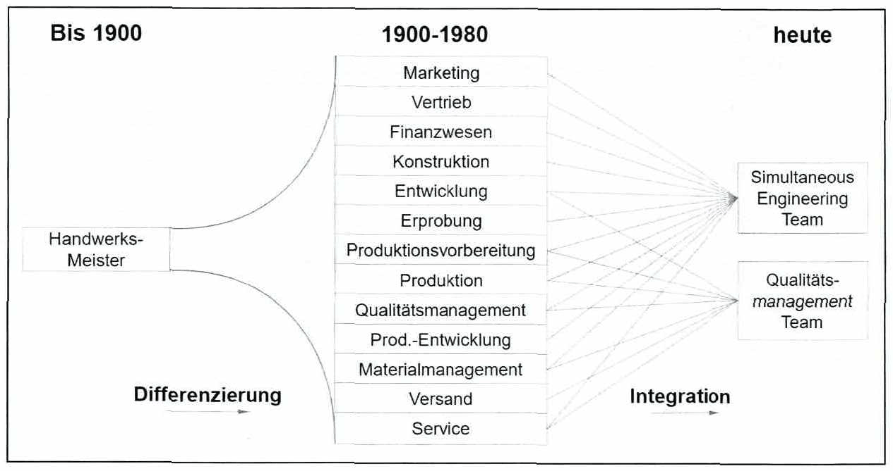
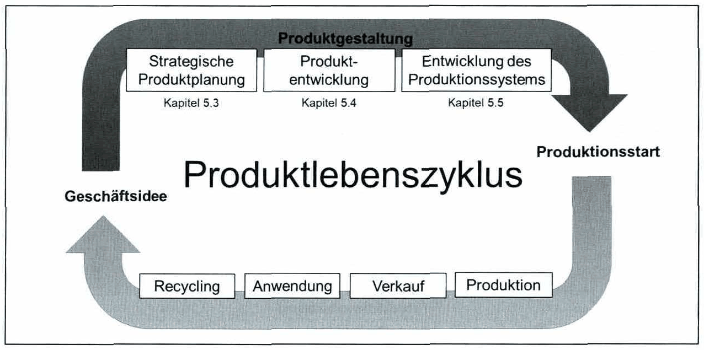

# Kapitel 5: Produktentstehung

## Einleitung des Kapitels (Skripttext)

<!-- Seite 75 (PDF 85) -->

Die Produktentstehung war und ist aufgrund von sich verändernden Bedingungen anfällig für eine ständige Veränderung. Bis zum Ende des 19. Jahrhunderts verfügten Handwerks-Meister über das benötigte Wissen für die Produktentstehung und die ausführenden Arbeiten wurden vollständig von Handwerkern übernommen. Mit dem Beginn der Industrialisierung kam es zur Trennung von Planungs- und Ausführungsaufgaben. Dieser Ansatz entspricht jedoch nicht mehr den Anforderungen der heutigen Produktentstehung.

Beispiele für derzeitige sowie bevorstehende Veränderungen und Herausforderungen in der Produktentstehung sind kürzere Produktlebenszyklen, erhöhte Komplexität von Produkten und deren Produktion, verstärkte Ausbildung der Mitarbeiter, die Entwicklung vom Absatz- zum Abnehmermarkt sowie die Globalisierung von Produktion und Entwicklung.

Abbildung 23 zeigt den Wandel von der gebündelten Kompetenz der Handwerks-Meister über die Differenzierung in Fachgebiete und deren Integration beispielsweise in Simultaneous Engineering Teams oder Qualitätsmanagement Teams

*Abbildung 23: Geschichte der Produktentstehung – Skript S. 75 (PDF 85)*

<!-- Seite 76 (PDF 86) -->

Eine nicht integrierte Produktentstehung wird den heutigen Anforderungen oft nicht gerecht. Mögliche Problemfelder sind hierbei organisatorische und techno-ökonomische Probleme sowie Herausforderungen innerhalb des Produktentstehungsprozesses.

Im Hinblick auf den Produktentstehungsprozess und im speziellen auf den integrierten Produktentstehungsprozess werden verschiedene Begriffe verwendet und eine Vielzahl von Modellen, Methoden und Prozessen beschrieben. Im ersten Schritt werden Grundbegriffe definiert und in den folgenden Abschnitten ausgewählte Modelle und Rahmenstrukturen vorgestellt.

Der Produktlebenszyklus beschreibt den gesamten Prozess von der Geschäftsidee bis hin zur Verwendung eines Produktes durch den Kunden. Als Teil des Produktlebenszyklus bildet die Produktentstehung den grundlegenden Prozess von der Produkt- bzw. Geschäftsidee bis zum Produktionsstart (SOP — Start of Production) ab. Diese Definition der Produktentstehung (siehe Abbildung 24) findet sich in den folgenden Kapiteln wieder.

*Abbildung 24: Produktentstehung als Teil des Produktlebenszyklus – Skript S. 76 (PDF 86)*

## Fußnoten ohne sicheren Textanker

Diese Fußnoten stehen auf den Seiten dieses Abschnitts, ihr Verweiszeichen im Text ließ sich aus dem Scan aber nicht eindeutig zuordnen (oft Quellenangaben zu Abbildungen).

- **93** – Seite 75 (PDF 85): Ehrlenspiel/Meerkamm (2013), S. 200; eigene Darstellung

## Inhalt

- [5.1 Ziele der Produktentstehung](5.1-ziele-der-produktentstehung.md) · S. 76–77 – 1 Abb./Formeln
- [5.2 Effektivität und Effizienz in der Produktentstehung](5.2-effektivitaet-und-effizienz-in-der-produktentstehung.md) · S. 77–78
- [5.3 Strategische Produktplanung](5.3-strategische-produktplanung.md) · S. 78
- [5.4 Produktentwicklung](5.4-produktentwicklung.md) · S. 78
- [5.5 Produktionssystem-Entwicklung](5.5-produktionssystem-entwicklung.md) · S. 79
- [5.6 Integration im Produktentstehungsprozess](5.6-integration-im-produktentstehungsprozess.md) · S. 79–93 – 10 Abb./Formeln, 3 Prüfungsfragen
- [Literatur](literatur.md)
