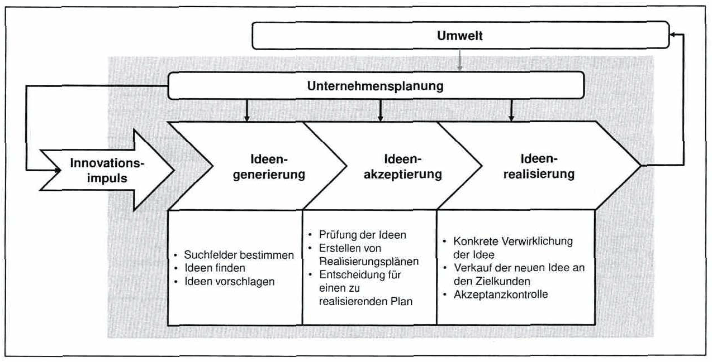

<!-- Seite 97 (PDF 107) -->

# 6.1 Nach Thom[^106]

*Abbildung 36: Innovationsprozess von Thom – Skript S. 97 (PDF 107)* · [Rekonstruktion](../../figures/reconstructed/abb-36.svg) · [Zeichenübung](../../learning/drawing-exercises/abb-36-zeichenuebung.md)

Abbildung 36 stellt den von Thom in den 1980er Jahren eingeführten Innovationsprozess dar. Die Hauptphasen dieses Innovationsprozesses sind sehr gut strukturiert und in einzelne Schritte unterteilt. Auch die Rolle des Umwelteinflusses und der Unternehmensplanung wird berücksichtigt. Umwelteinflüsse können die Gesellschaft, Politik, Ökologie/Wirtschaft und Technik sein. Dies bedeutet, dass Veränderungen in diesen Bereichen einen Einfluss auf die Unternehmensplanung und damit in weiterer Folge auf die Entwicklung und Innovation neuer Produkte im Allgemeinen haben können.

<!-- Seite 98 (PDF 108) -->

*Abbildung 36: Innovationsprozess von Thom – Skript S. 98 (PDF 108)* · [Rekonstruktion](../../figures/reconstructed/abb-36.svg) · [Zeichenübung](../../learning/drawing-exercises/abb-36-zeichenuebung.md)

Ein weiterer wichtiger Aspekt in diesem Prozess ist der Innovationsimpuls, der ein gemeinsamer Nenner aller Innovationsprozesse ist. Impulse oder Ideenquellen können aus verschiedenen Richtungen kommen. Die 3 Hauptphasen des Innovationsprozesses von Thom lauten wie folgt:

1. **Ideengenerierung** a) Suchfelder bestimmen b) Ideen finden c) Ideen vorschlagen
2. **Ideenakzeptierung** a) Prüfung der Ideen b) Erstellen von Realisierungsplänen c) Entscheidung für einen zu realisierenden Plan
3. **Ideenrealisierung** a) Konkrete Verwirklichung der Idee b) Verkauf der neuen Idee an Zielkunden c) Akzeptanzkontrolle

[^106]: Vgl. Thom (1980), S.45ff

## Fußnoten ohne sicheren Textanker

Diese Fußnoten stehen auf den Seiten dieses Abschnitts, ihr Verweiszeichen im Text ließ sich aus dem Scan aber nicht eindeutig zuordnen (oft Quellenangaben zu Abbildungen).

- **107** – Seite 98 (PDF 108): Thom (1980), S. 45
