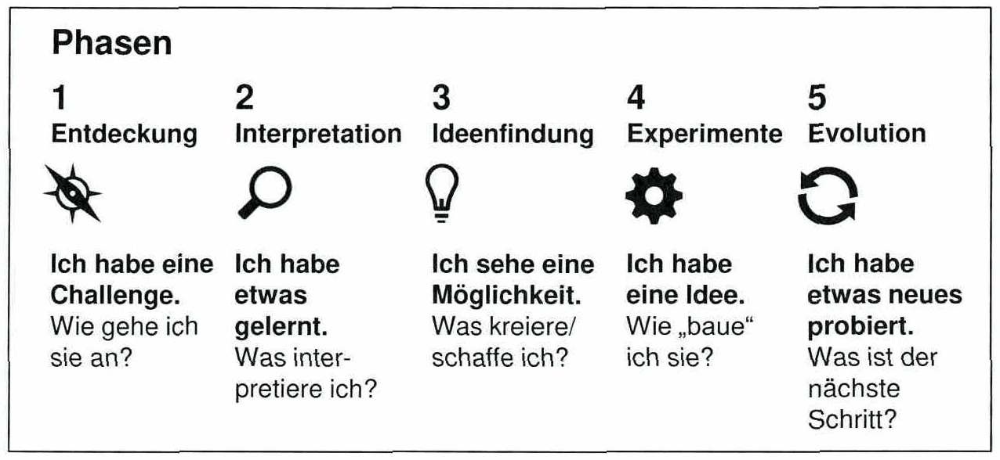

<!-- Seite 101 (PDF 111) -->

# 6.3 Nach Design Thinking Methode

Design Thinking ist eine **systematische Herangehensweise an komplexe Problemstellungen** aus allen Lebensbereichen. Der methodische Prozess geht weit über klassische Design-Disziplinen wie Formgebung und Konstruktion hinaus. Im Gegensatz zu den meisten Entwicklungsmethoden in Wissenschaft und Praxis, die Problemstellungen von Seiten der technischen Lösbarkeit angehen, stehen beim Design Thinking **Nutzerwünsche und -bedürfnisse sowie nutzerorientiertes Erfinden im Zentrum des Prozesses**. Der gesamte Prozess baut auf Input und Feedback von Kunden und Anwendern auf - dies kann als Kern der Methode bezeichnet werden.

Anwender des Design Thinkings begeben sich in die Rolle des Nutzers und blicken aus seiner Perspektive auf das Problem. Die Methode wurde vom 1991 gegründeten Unternehmen IDEO entwickelt und im Laufe der Jahre erfolgreich angewendet. Als Bespiele für entwickelte Produkte und den Erfolg des Unternehmens mit dieser Methode können die erste Apple Maus oder der Handheld PC Palm V genannt werden.

<!-- Seite 102 (PDF 112) -->

*Abbildung 39: 5-Step Prozess des Design Thinking – Skript S. 102 (PDF 112)*

1. **Entdeckung**: Das Verständnis des Nutzers dient als Grundlage für die Ideenfindung. In dieser Phase wird Empathie gewonnen, um sich für Lösungen zu begeistern. **Interpretation**: Gesammelte Daten sowie Einfühlungsvermögen für den Nutzer sind nicht ausreichend um detaillierte Produktanforderungen abzuleiten. Bevor mit der Ideenfindung begonnen werden kann, ist es erforderlich, das erworbene Wissen zu analysieren und auf dessen Basis sinnvolle Anforderungen abzuleiten. Beim Sichten des gesammelten Materials wird ein besseres Verständnis für das Thema aufgebaut. **Ideen finden**: Vor dem Start der Ideenfindung ist eine Vorbereitung erforderlich. Brainstorming-Einheiten sollten genutzt werden, um mögliche Lösungen für ein definiertes Problem zu finden. Vor Beginn der Sitzung muss entschieden werden, für welches Problem Ideen gefunden werden sollen. Eine Auswahl von "How might we...?" - Fragen zum Problem kann hier helfen. Für das Brainstorming sollte ein geeigneter Raum und ein definierter Zeitrahmen (IDEO empfiehlt 45 bis 60 Minuten) eingeplant werden. Ein weiterer Erfolgsfaktor bei der Ideenfindung ist eine interdisziplinäre Gruppe von Menschen, da man somit unterschiedliche Sichtweisen auf die Themenstellung erhält, was im Regelfall in einer Vielzahl von unterschiedlichen Ideen resultiert.

<!-- Seite 103 (PDF 113) -->

4- **Experimentieren**: Die in der vorhergehenden Phase entwickelten Ideen werden nun mit Prototypen umgesetzt. Dieser Schritt ist notwendig, um die wichtigsten Konzepte und Funktionen zu zeigen, diese zu erklären und Feedback zu erhalten. Nutzer können mit dem Prototyp interagieren und ein Gefühl dafür bekommen wie das Produkt aussehen wird. Mit dem Feedback der Nutzer können die Ideen und Konzepte weiterentwickelt und verfeinert werden. Ein Prototyp ist nicht zwangsläufig eine erste funktionierende Version eines Serienprodukts. Es gibt mehrere Möglichkeiten um Ideen zu testen.

5. **Evolution**: Diese Phase beschäftigt sich mit der Weiterentwicklung des Konzeptes. Sie beinhaltet die Planung der nächsten Schritte, die Vermittlung der Idee an Personen, die bei der Umsetzung helfen können und die Dokumentation der Prozesse.

Die erarbeiteten Konzepte können durch mehrere Iterationszyklen verbessert werden um das bestmögliche Ergebnis zu erreichen.

Weitere wichtige Faktoren sind das Arbeitsumfeld und die Zusammensetzung des Projektteams. Der physische Raum, in dem das Projekt durchgeführt wird, hat ebenso Einfluss auf die Projektmitarbeiter. Dave Kelley schlägt vor, so wenig Regeln wie möglich für die Gestaltung eines Raumes zu haben. Die Gestaltung sollte Aufgabe des Projektteams selbst sein. Wie im gesamten Prozess des Design Thinking sollte sich auch der Arbeitsbereich im Laufe des Projekts weiterentwickeln. Bei IDEO sind die Arbeitsplätze personalisierte und funktionale Bereiche, die sich leicht in Besprechungsräume verwandeln lassen. Für das Projekt selbst sollte ein eigener Raum vorhanden sein, in dem alle Informationen gesammelt und wichtige Daten für das gesamte Team oder auch für Außenstehende sichtbar gemacht werden können.

## Fußnoten ohne sicheren Textanker

Diese Fußnoten stehen auf den Seiten dieses Abschnitts, ihr Verweiszeichen im Text ließ sich aus dem Scan aber nicht eindeutig zuordnen (oft Quellenangaben zu Abbildungen).

- **110** – Seite 101 (PDF 111): Cooper (2001), S. 132
- **111** – Seite 101 (PDF 111): Vgl. Kelley, Littmann (2004)
- **112** – Seite 102 (PDF 112): Ideo - Design Thinking Toolkit

## Prüfungsfragen zu diesem Abschnitt

3 Fragen aus der [Prüfungsfragen-Datenbank](../../exams/questions.md): `frage-2024-06-20-2`, `frage-2024-12-10-3`, `frage-2025-10-15-5`
