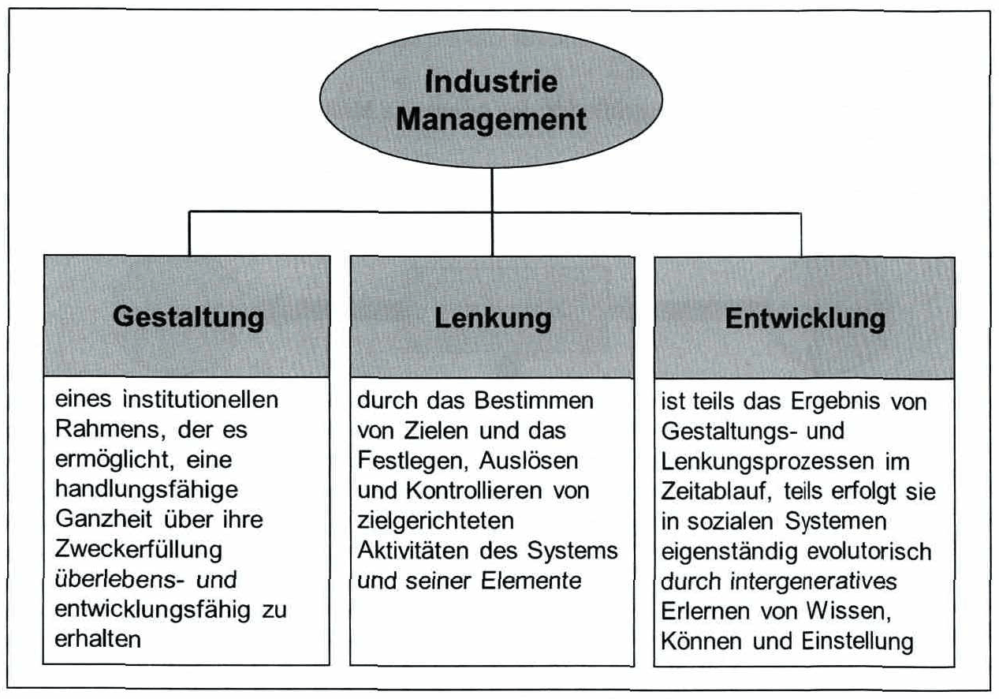
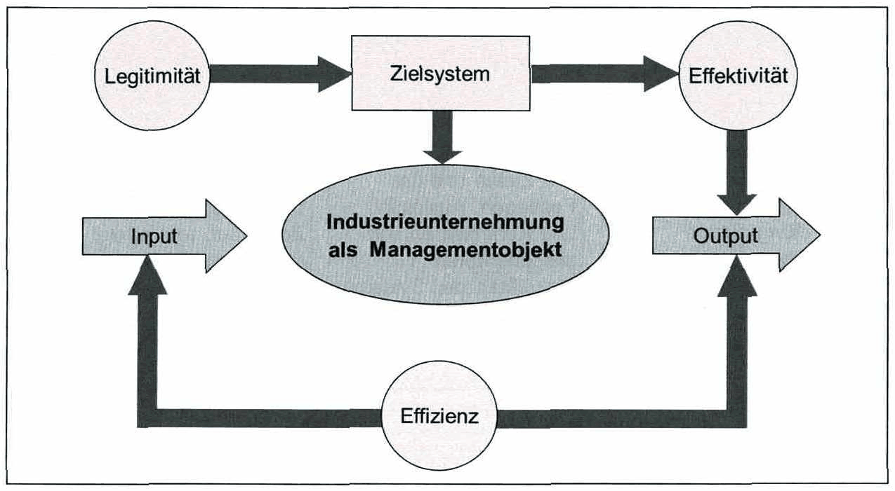

<!-- Seite 107 (PDF 117) -->

# 7.1 Begriffe und Ziele[^113]

Das Industrie Management beschäftigt sich mit der Effizienzsteigerung über alle Wertschöpfungsstufen hinweg. Dabei ist das Industrie Management als interdisziplinär zu betrachten. Industriemanager müssen Aufgaben und Ziele der Produktentwicklung, des Ramp-up-Managements, des Produktionsmanagements sowie der Distributionslogistik und des Marketings berücksichtigen. Laut Bleicher (1999) sind die Funktionen des Industriemanagements (siehe Abbildung 40) folgende: 13

- Entwurf der Rahmenbedingungen, die eine Erzeugung von Entwicklungskapazitäten ermöglicht
- Kontrolle der Ziele und Umsetzung der gewünschten Aktivitäten
- Entwicklung und Initiierung von Veränderungsprozessen

*Abbildung 40: Funktionen des Industrie Management – Skript S. 107 (PDF 117)*

Gestaltung bedeutet demnach die Festlegung eines Rahmens, der die Ausbildung von Entwicklungsfähigkeiten ermöglicht.

<!-- Seite 108 (PDF 118) -->

Entwicklung umfasst insbesondere das Einleiten und Bewältigen von Veränderungsprozessen.

Die Funktion der Lenkung beinhaltet das Ausformulieren von Zielen und das Realisieren daraus abgeleiteter Aktivitäten.

Industriemanager müssen dafür sorgen, dass die entwickelten Produkte aus der Innovationsabteilung in eine serienreife Version überführt werden, dass die benötigten Ressourcen zum richtigen Zeitpunkt zur Verfügung stehen und die Produkte zu den richtigen Kosten produziert sowie zum Kunden gebracht werden. Dieses breite Aufgabenspektrum macht die industrielle Führung sehr komplex und erfordert die Integration unterschiedlicher Standpunkte und Zielwerte, wodurch Kompromissentscheidungen unumgänglich sind.

Folgende Kenngrößen des Managements können genannt werden !!4:;

- Die Legitimität als Kenngröße für das Normative Management („Die Gesamtaufgabe erfüllen“)
- Die Effektivität als Kenngröße für das Strategische Management („Die richtigen Dinge tun“)
- Die Effizienz als Kenngröße für das operative Management („Die Dinge richtig tun‘) Die Zusammenhänge dieser Kenngrößen sind in Abbildung 41 ersichtlich.

*Abbildung 41: Zusammenhang der Kenngrößen des Managements – Skript S. 108 (PDF 118)*

<!-- Seite 109 (PDF 119) -->

Die Orientierung an der Effektivität hat die Pflege bzw. den Ausbau der strategischen Erfolgspositionen im Wettbewerb zum Ziel. Die Effizienz strebt nach der Einhaltung des Rationalprinzips im operativen Management. Die Gesamtaufgabe zu erfüllen, dabei die richtigen Dinge zu tun und gleichermaßen die Dinge richtig zu tun, wird zur aktuellen Herausforderung eines zukunftsorientierten Managements.

Als Kenngröße für das operative Management kann in allgemeiner Form die Effizienz herangezogen werden. Sie ist als Ausdruck zu verstehen, dass „die Dinge richtig getan werden“. Dies bedeutet insbesondere, dass das Rationalprinzip - als allgemeines Prinzip des vernunftgemäßen Handelns — eingehalten wird. Siehe hierzu auch die Definition von Minimal- und Maximalprinzip in Kapiel 5.2.

[^113]: Bleicher 1999, S. 54

## Fußnoten ohne sicheren Textanker

Diese Fußnoten stehen auf den Seiten dieses Abschnitts, ihr Verweiszeichen im Text ließ sich aus dem Scan aber nicht eindeutig zuordnen (oft Quellenangaben zu Abbildungen).

- **114** – Seite 108 (PDF 118): Pümpin & Prange (1991)

## Prüfungsfragen zu diesem Abschnitt

1 Fragen aus der [Prüfungsfragen-Datenbank](../../exams/questions.md): `frage-2025-12-11-4`
