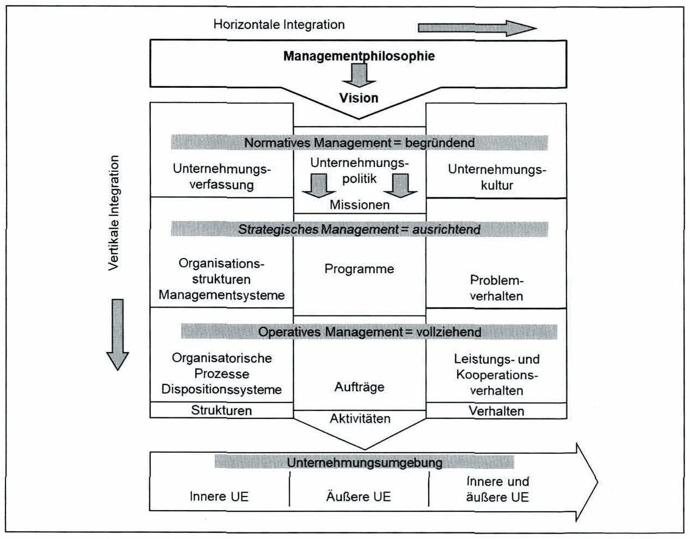

<!-- Seite 109 (PDF 119) -->

# 7.2 Konzept des integrierten Managements

Eine besondere Herausforderung stellt die Berücksichtigung von Komplexität und Dynamik in Management-Systemen dar. Im „Konzept Integriertes Management“ (von Bleicher, 2004) wird dazu eine gesamthaft angelegte Struktur geschaffen:

*Abbildung 42: Das Konzept Integriertes Management (UE = Unternehmensumgebung) – Skript S. 109 (PDF 119)*

<!-- Seite 110 (PDF 120) -->

Dabei wird zwischen drei Management-Ebenen unterschieden:

- der Normativen Management-Ebene
- der Strategischen Management-Ebene
- der Operativen Management-Ebene

Das Normative Management ist auf die Ausformulierung der Grundsätze für das nachfolgende Strategische und Operative Management gerichtet. Als generelles Unternehmungsziel kann „die Erfüllung der Gesamtaufgabe“ und damit die Erhaltung der Lebensfähigkeit bzw. Entwicklungsfähigkeit der Unternehmung angesehen werden. Das Normative Management legt die Vision, Unternehmensphilosophie und Unternehmenspolitik fest. Dabei ist die Vision die Wunschvorstellungen in Hinblick auf eine zukünftige Unternehmungsentwicklung. Das industrielle Management beginnt mit der Planung und Implementierung der Unternehmensstrategie des Industriebetriebes, was als „Strategisches Management“ bezeichnet. Porter definierte eine Strategie als „...eine in sich stimmige Anordnung von Aktivitäten, die ein Unternehmen von seinen Konkurrenten unterscheidet ...“."[^116] Das Operative Management vollzieht auf der Basis des Normativen Managements die im Strategischen Management vereinbarten Ziele bzw. (Produktions-) Programme. Es beschäftigt sich mit der Erarbeitung des konkreten Handlungsprogramms sowie die Implementierung, Überwachung und Sicherung der zielentsprechenden Aktivitäten auf der Prozessebene.

[^116]: u6 Porter (1996)

## Fußnoten ohne sicheren Textanker

Diese Fußnoten stehen auf den Seiten dieses Abschnitts, ihr Verweiszeichen im Text ließ sich aus dem Scan aber nicht eindeutig zuordnen (oft Quellenangaben zu Abbildungen).

- **115** – Seite 109 (PDF 119): Vgl. Bleicher (2004), S. 77
