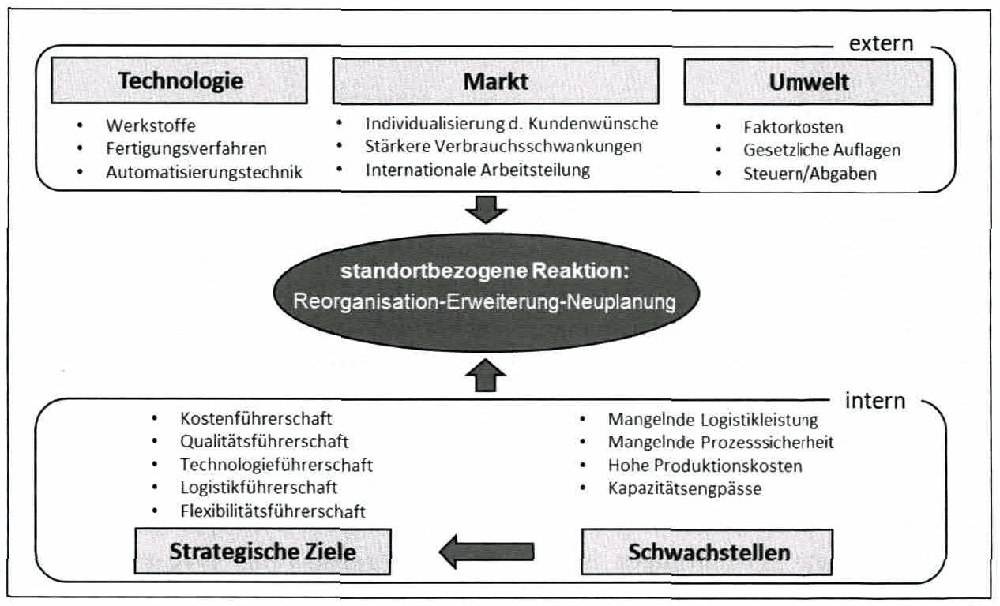

<!-- Seite 114 (PDF 124) -->

# 8.1 Standortplanung[^118]

Ein Unternehmen verfügt über einen oder mehrere **Standorte** als geographischen Ort der betrieblichen Leistungserstellung. Der Standort hat vielfältige Einflüsse auf die Wettbewerbsfähigkeit eines Unternehmens. Er bestimmt z.B. die räumliche Verknüpfung der Produktion innerhalb der Wertschöpfungskette.18

Die Produktionsstrategie eines Unternehmens bestimmt, in welchem Umfang und mit welcher strategischen Ausrichtung das Unternehmen seine Produkte herstellen will. Die Standortplanung ist eng mit der Produktionsstrategie verknüpft und betrachtet die Fragestellung wo und in welchem Ausmaß die Produktion erfolgen soll. Die Aufgabe der Standortplanung ist somit die Bestimmung geeigneter Produktionsstandorte aus einer globalen Perspektive. !9

Die Standortsuche aus strategischer Sicht ist keine primäre Aufgabe der im nachfolgenden Kapitel behandelten Fabrikplanung, sondern Aufgabe der Unternehmensführung. Für die Ausgestaltung eines vorhandenen oder neuen Standortes ist jedoch die Kenntnis der zugrundeliegenden wesentlichen Grundannahmen für den Fabrikplaner von großer Bedeutung, weil sich diese stark auf die späteren Fabrikmerkmale und insbesondere auf den notwendigen Grad der Wandlungsfähigkeit auswirken. [^120]

Die unterschiedlichen Ziele und Aufgabe der Standortplanung bewirkten in der Literatur die Betrachtung von zwei unterschiedlichen Sichtweisen. Die Standortplanung wird daher in zwei unterschiedliche Teilgebiete unterteilt: [^121]

- Strategische Standortplanung
- Standortplanung aus Raumsicht

<!-- Seite 115 (PDF 125) -->

## 8.1.1 Strategische Standortplanung

Die Treiber, die zu standortbezogenen Fragestellungen führen, sind vielfältig. Oft bewirkt erst das gleichzeitige und manchmal fast unmerkliche Auftreten mehrerer Faktoren (intern und extern) ein schleichendes Absinken der Unternehmensergebnisse. Dies kann zu der Erkenntnis führen, dass der vorhandene Standort einen dauerhaften Erfolg in wirtschaftlicher, ökologischer und sozialer Sicht eventuell nicht mehr gewährleisten kann. Abbildung 43 zeigt die wesentlichen internen und externen Treiber, die einen Standort als Ganzes infrage stellen können und somit Auslöser für eine Standortplanung sind.[^122]

*Abbildung 43: Interne und externe Treiber für standortbezogene Reaktionen – Skript S. 115 (PDF 125)*

Von größter Bedeutung ist, dass die Entscheidung für eine Standortveränderung (Reorganisation, Erweiterung, Neuplanung) nicht impulsiv gefällt und durch einen einzigen Faktor, z. B. Kostendruck oder geographische Nähe zu einem Großkunden bestimmt wird, sondern vorher eine sorgfältige strategische Planung stattfindet. Für nähere Ausführungen ist auf die Lehrveranstaltung 371.317 Manufacturing and Supply Chain Network am Institut für Innovation und Industrie Management zu verweisen.

<!-- Seite 116 (PDF 126) -->

## 8.1.2 Standortplanung aus Raumsicht

Hier gilt es, den geplanten Standort auf lokaler Ebene unter dem Gesichtspunkt der Raumplanung zu analysieren. Wesentliche Faktoren für die Standortplanung aus Raumsicht sind:[^125]

= Erschließung (internes Produktionsnetzwerk, LKW, Bahn, Flugzeug, Schiff, etc.) = Ver- und Entsorgung von Medien (Elektrizität, Gas, Telekommunikation, Abwasser, etc.) =" Grundstück (Geometrische Eigenschaften, Bodenbeschaffenheit, etc.) = Gesetze und Auflagen

[^118]: s Vgl. Pawellek (2014) S.111
[^120]: o Vgl. ibidem (2014) S. 397
[^121]: Vgl. ibidem (2014) S. 381ff.
[^122]: Vgl. Wiendahl et al. (2014) S. 397
[^125]: Vgl. ibidem S. 38ıff.

## Fußnoten ohne sicheren Textanker

Diese Fußnoten stehen auf den Seiten dieses Abschnitts, ihr Verweiszeichen im Text ließ sich aus dem Scan aber nicht eindeutig zuordnen (oft Quellenangaben zu Abbildungen).

- **119** – Seite 114 (PDF 124): Vgl. Wiendahl et al. (2014) S. 33
- **123** – Seite 115 (PDF 125): Vgl. ibidem (2014), S. 397 ff.
- **124** – Seite 115 (PDF 125): Vgl. Wiendahl et al. (2014)

## Prüfungsfragen zu diesem Abschnitt

1 Frage aus der [Prüfungsfragen-Datenbank](../../exams/questions.md): `frage-2025-10-15-2`
