<!-- Seite 116 (PDF 126) -->

# 8.2 Fabrikplanung

Die Fabrikplanung gilt als eine vielschichtige Aufgabe für Produktionsingenieurinnen und -ingenieure. Oftmals wird diese komplexe Aufgabe fälschlicherweise mit der Layoutplanung gleichgesetzt. Die Layoutplanung mit dem Ziel einer geeigneten Anordnung von Flächen in einem Fabrikgebäude liefert mit dem geplanten Fabriklayout zwar das Hauptergebnis der Fabrikplanung. Klassische Fabrikplanungsprojekte verlangen jedoch in den meisten Fällen eine integrale Betrachtung unterschiedlichster Felder des (Wirtschafts-)Ingenieurwesens wie z.B. Prozessplanung, Auslegung der Produktionssteuerung, Personalplanung, Kosten- und Investitionsrechnung, sowie Gebäudeplanung. In den folgenden Ausführungen wird versucht, diese Vielschichtigkeit anzudeuten, wobei der Schwerpunkt in diesem Übersichtskapitel auf der Layoutplanung liegt. Für detailliertere Ausführungen ist auf die Lehrveranstaltung 371.317 Factory Planning and Design am Institut für Innovation und Industrie Management zu verweisen.

Eine Fabrik ist ein Ort, an dem eine Wertschöpfung durch eine arbeitsteilige Produktion von industriellen Gütern unter Einsatz von Produktionsfaktoren stattfindet.[^126]

Sie stellt sich als eine lokale Bündelung der primären Produktionsfaktoren Personal, Betriebsmittel, Gebäude und Material, sowie den abgeleiteten Faktoren Wissen, Qualifikation und Kapital dar.[^127]

Die Fabrikplanung ist ein Prozess zur Planung einer Fabrik — angefangen bei der Zielfestlegung bis zum Hochlauf der Produktion. Der systematische, zielorientierte

<!-- Seite 117 (PDF 127) -->

Prozess ist in aufeinander aufbauenden Phasen strukturiert und wird unter Zuhilfenahme von Methoden und Werkzeugen durchgeführt. :[^128]

Der Verein Deutscher Ingenieure (VDI) definiert den Begriff der Fabrikplanung wie folgt:[^129]

„Fabrikplanung ist der systematische, zielorientierte, in aufeinander aufbauende Phasen strukturierte und unter Zuhilfenahme von Methoden und Werkzeugen durchgeführte Prozess zur Planung einer Fabrik von der ersten Idee bis zum Anlauf der Produktion. Sie kann ebenso die später folgende Anpassung im laufenden Betrieb beinhalten.“

Als übergeordnetes Ziel wird die Gestaltung innovativer, effizienter und umsetzbarer Logistik- und Produktionssysteme verfolgt.[^130] Hauptforderungen der logistikgerechten Fabrikplanung sind die Vermeidung von Transport- und Lageraufwänden.[^131]

**Planungsgrundfälle**

Grundfälle für die Fabrikplanung können in Strukturerneuerung / Restrukturierung und der Schaffung neuer, erweiterter Kapazitäten aufgeteilt werden. Letztgenannter Grundfall kann nochmals in „Um- bzw. Neuplanung bestehender Industriebetriebe“, sowie die Erweiterung von Industriebetrieben aufgeteilt werden. [^132]

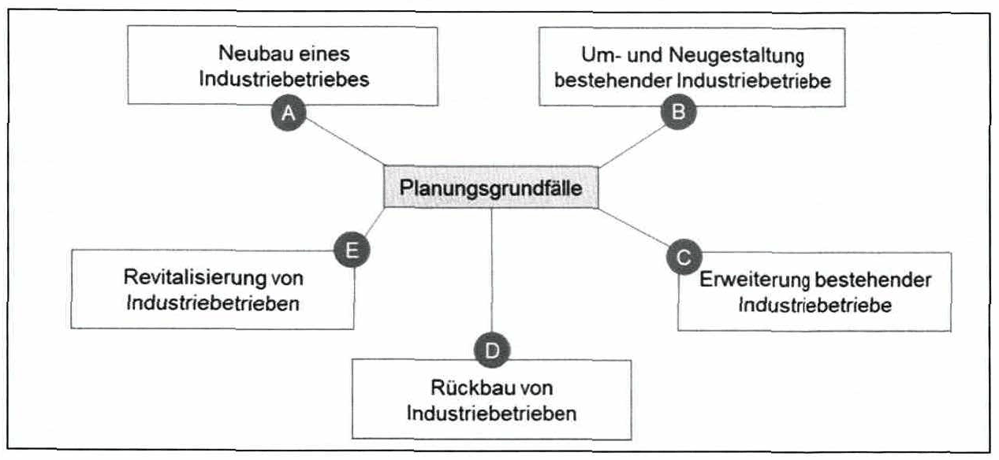

*Abbildung 44: Planungsgrundfälle nach Grundig – Skript S. 117 (PDF 127)* · [Rekonstruktion](../../figures/reconstructed/abb-44.svg) · [Zeichenübung](../../learning/drawing-exercises/abb-44-zeichenuebung.md)

<!-- Seite 118 (PDF 128) -->

**Grundfall A: Neubau eines Industriebetriebes**

Der Grundfall A bezeichnet die Errichtung einer Fabrik auf einem unbebauten Gelände. In der Literatur wird der Grundfall auch als „Planen auf der grünen Wiese“ oder „Greenfield-Planung“ bezeichnet.

**Grundfall B: Um- und Neugestaltung bestehender Industriebetriebe**

Die meisten Fabriken erfordern eine stetige Anpassung der Fertigungsprozesse an das sich verändernde Produktionsprogramm. Der Grundfall B stellt diese betriebliche Daueraufgabe dar. Zielsetzung dieses Grundfalls sind oftmals auch Rationalisierungen und Modernisierungen. Umfangreiche Projekte dieser Planungsaufgabe werden häufig auch als „Brownfield-Planung“ bezeichnet. In diesem Fall wird eine bestehende Fabrik umfangreich neugestaltet. Die Einhaltung gegebener Randbedingungen (z.B. Gebäudestruktur) verhindern meist die Umsetzung eines optimalen Lösungskonzeptes.

**Grundfall C: Erweiterung bestehender Industriebetriebe**

Der Grundfall C sieht eine Erweiterung der Kapazitäten vor, die zum Beispiel aufgrund von Umsatz- und Auftragswachstum benötigt werden. In der Regel erfordert die Kapazitätserweiterung einen Gebäudeausbau. Auch hier wird gegebenenfalls von einer „Brownfield-Planung“ gesprochen.

**Grundfall D: Rückbau von Industriebetrieben**

Der Rückbau von Industriebetrieben kann zum Beispiel durch einen Umsatzrückgang oder Reduzierung der Fertigungstiefe und Auslagerung von Fertigungsschritten herbeigeführt werden. Wesentlicher Inhalt dieses Grundfalls ist die Anpassung der Kapazitäten und Strukturen entsprechend den vorgegebenen Einschränkungen.

**Grundfall E: Revitalisierung von Industriebetrieben**

Der Grundfall „Revitalisierung von Industriebetrieben“ stellt einen Sanierungsprozess dar. Dabei werden stillgelegte Fabriken einer neuen industriellen Verwendung zugeführt.

## 8.2.1 Produktionssysteme - Grundlagen

Produktionssysteme sind sozio-technische Systeme, in denen Menschen (Arbeiter) und Geräte (Maschinen) interagieren, um Input (Rohmaterialien) in Output (Produkt oder Dienstleistung) umzuwandeln.

<!-- Seite 119 (PDF 129) -->

Einzelne Industriebetriebe weisen teilweise sehr große Unterschiede bezüglich der zu lösenden produktionswirtschaftlichen Aufgaben auf. So hat z.B. ein Automobilhersteller andere Herausforderungen als ein Textilhersteller. Um diese Unterschiede zu kategorisieren, werden in der Literatur verschiedene Vorschläge zur Typologisierung von Produktionssystemen beschrieben. Aus Organisationssicht kann ein Produktionssystem anhand der Produktionsart (nach mengenmäßigen Auftragsumfang und Wiederholhäufigkeit) und Fertigungsformen (nach der räumlichen Anordnung) charakterisiert werden. Die Fertigungsform gibt die allgemeine Struktur des Fertigungslayouts vor. Zur Vollständigkeit sei hier erwähnt, dass es für Montagesysteme eine ähnliche Einteilung gibt & siehe Montageformen.

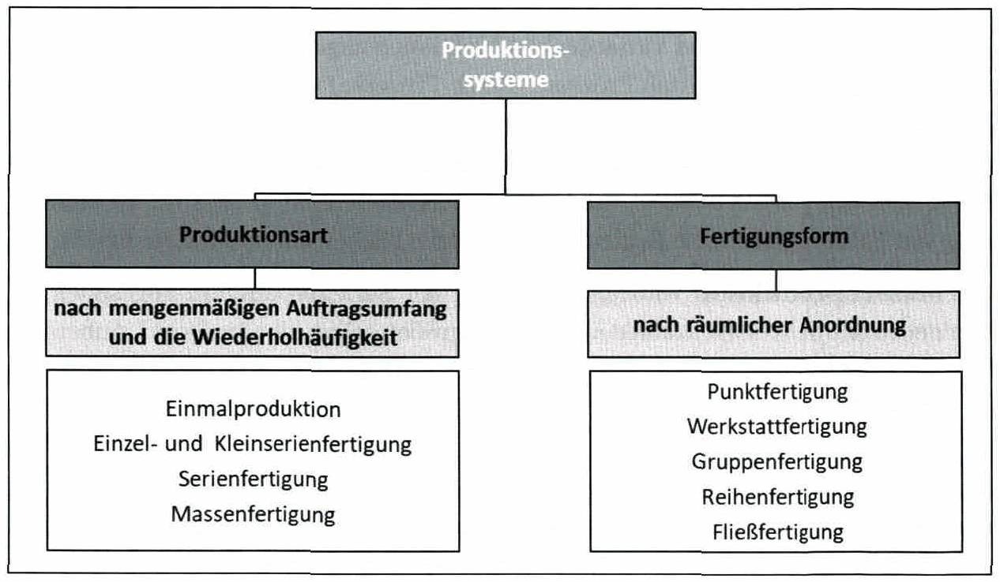

*Abbildung 45: Typologisierung von Produktionssystemen – Skript S. 119 (PDF 129)* · [Rekonstruktion](../../figures/reconstructed/abb-45.svg) · [Zeichenübung](../../learning/drawing-exercises/abb-45-zeichenuebung.md)

**Produktionsarten**

Die Einmalproduktion umfasst Projektprozesse zur Herstellung von Produkten mit der der Menge 1. Häufig werden diese verwendet, um ein bestimmtes Produkt nach genauen Kundenspezifikationen herzustellen. Die Charakteristik von Projektprozessen ist, dass jedes Projekt einen klar definierten Anfang und ein klar definiertes Ende hat. Das Zeitintervall zwischen dem Start verschiedener Projekte ist relativ lang und die transformierenden Ressourcen werden meistens speziell für jedes Produkt organisiert. Diese Produktionsart findet sich sehr häufig im Anlagenbau.

<!-- Seite 120 (PDF 130) -->

Einzel- und Kleinserienproduktion wiederum beschreibt die Mehrfachproduktion einzelner Werkstücke bzw. kleiner Losgrößen, beispielsweise die Herstellung von Werkzeugmaschinen. Für die durchgeführten Prozesse (veraltet auch „Jobbing“-Prozesse) mit geringen Wiederholungsgrad sind meist hochqualifizierte Mitarbeiter wichtig, die mit der geforderten Individualisierung (Variabilität) und den teilweise zur Herstellung verwendeten „Allzweckgeräten“ umgehen können. Die Auslastung der Maschinen ist im Allgemeinen gering, da eine hohe Anzahl von Maschineneinstellungen beim Wechsel von einem Produkt zum anderen erfolgt. Beispiele sind Feinmechanik und Maßanfertigungen.

Bei der Serienproduktion werden große Jahresstückzahlen gleicher Werkstücke bei mittlerer bis großer Wiederholhäufigkeit hergestellt. Dabei wird meist ein breites Spektrum an Volumen- und Variantenkombinationen abgedeckt. Die zur Herstellung von Produkten durchgeführten Prozesse (Batch-Prozesse) weisen eine mittlere bis geringe Variabilität auf. Aus Gründen der Standardisierung und Rüstzeitreduktion werden Produkte zu „Serien“ bzw. „Chargen“ zusammengefasst, wobei die Losgrößen zwischen zwei und einigen hundert Produkten liegen können. Beispiele sind die Herstellung von Fahrzeugteilen, die Bekleidungsindustrie, Bäckereien und Bücherdruck.

Die Massenproduktion wird als Extremfall der Serienproduktion angesehen, da hier neben den Jahresstückzahlen auch die Losgrößen selbst sehr groß sind. Außerdem liegt bei dieser Produktionsart eine hohe Wiederholhäufigkeit vor, weshalb lediglich stark spezialisierte Produktionsmittel zum Einsatz kommen. Eine wichtige Charakteristik der Massenproduktion ist, dass die Bewegung des Produktes oft mit einem Fördersystem automatisiert wird und der Produktionsprozess standardisiert in eine Reihe von kleinen und einfachen Aufgaben aufgeteilt wird. Um eine reibungslose Produktion zu gewährleisten, sollte die Prozesszeit an jedem Arbeitsplatz ähnlich sein. Dies wird durch eine Austaktung der Linie realisiert. Durch die geringe Vielfalt sind die Rüstzeiten gering und die Auslastung der Anlagen kann hochgehalten werden. Beispiele sind die Automobilproduktion und Computer- oder Fernsehbaugruppen.

Ein Spezialfall ist der kontinuierliche Produktionsprozess (meist in der Prozessindustrie), um ein sehr hohes Volumen eines Standardproduktes ohne jegliche Vielfalt zu produzieren. Die im Dauerbetrieb hergestellten Produkte sind in der Regel ein untrennbarer kontinuierlicher Materialfluss (z.B. Öl, Gas oder Stahl- oder Papierherstellung).

<!-- Seite 121 (PDF 131) -->

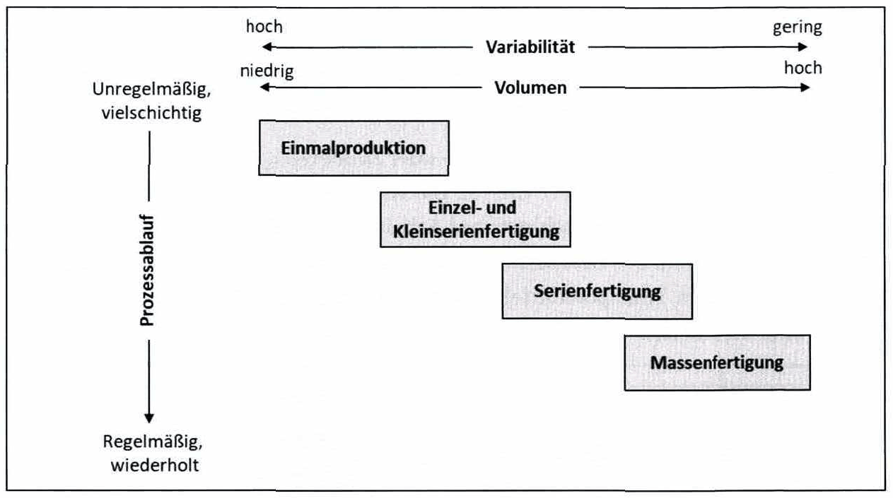

*Abbildung 46: Einordnung der Produktionsarten – Skript S. 121 (PDF 131)* · [Rekonstruktion](../../figures/reconstructed/abb-46.svg) · [Zeichenübung](../../learning/drawing-exercises/abb-46-zeichenuebung.md)

Fertigungsformen[^136]

Die vorliegende oder geplante Fertigungsform wird maßgeblich von der jeweiligen Produktionsart eines Produktionssystems vorgegeben.

Prägendes Merkmal der als Punktfertigung (stationäre oder Baustellenfertigung) bezeichneten Fertigungsform ist die fixe Ortsgebundenheit des Erzeugnisses bis zu seiner Fertigstellung. Fertigungsmittel werden am Bearbeitungsobjekt gebündelt und können sowohl ortsfest als auch ortsveränderlich sein. Die Punktfertigung kommt daher hauptsächlich bei Arbeitsgegenständen zum Einsatz, die schwer zu bewegen sind, also beispielsweise im Anlagen-, Großmaschinen- und Schiffsbau sowie bei Baustellenprozessen.

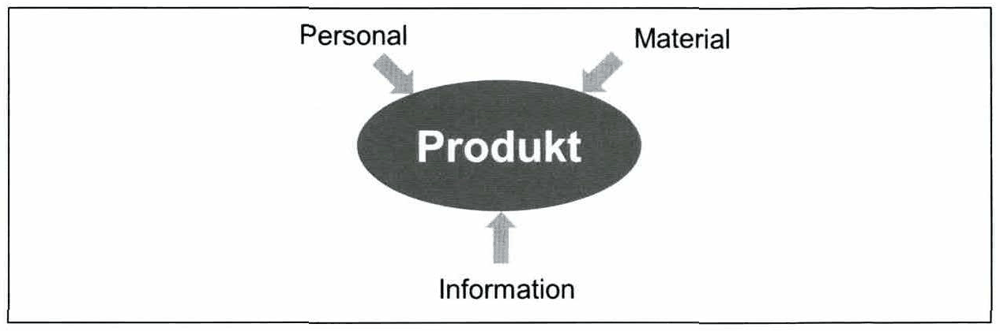

*Abbildung 47: Punktfertigung – Skript S. 121 (PDF 131)* · [Rekonstruktion](../../figures/reconstructed/abb-47.svg) · [Zeichenübung](../../learning/drawing-exercises/abb-47-zeichenuebung.md)

<!-- Seite 122 (PDF 132) -->

Kennzeichnend für die Werkstattfertigung ist die Anordnung der Betriebsmittel entsprechend dem Verrichtungsprinzip. Unabhängig vom Materialfluss werden Betriebsmittel und Arbeitskräfte hier mit gleichen Funktionen zusammengefasst und räumlich zu Gruppen, beispielsweise einer Dreherei oder Fräserei, angeordnet.

Diese als Gruppenfertigung (Nest-, Insel- oder Zellenfertigung, siehe Abbildung 48) bezeichnete Fertigungsform fasst die für die Ausführung gleicher oder verwandter Teilprozesse erforderlichen Maschinen und Arbeitsplätze verschiedener Art und Funktion örtlich zusammen. Die Bearbeitungsmaschinen sind vielfach ringförmig angeordnet und mit flexiblen Transportmitteln verbunden. Die zum Einsatz kommenden Maschinen sind hierbei üblicherweise Universalmaschinen.

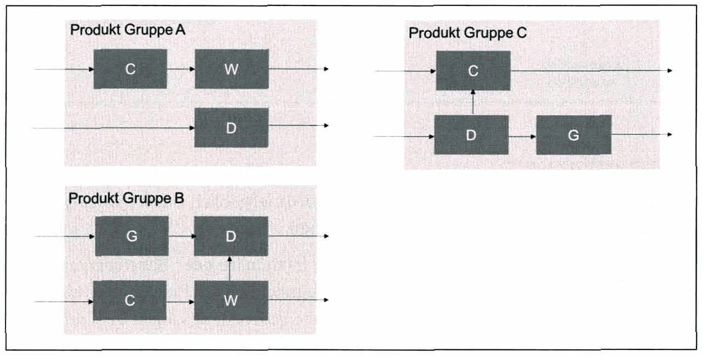

*Abbildung 48: Gruppenfertigung – Skript S. 122 (PDF 132)* · [Rekonstruktion](../../figures/reconstructed/abb-48.svg) · [Zeichenübung](../../learning/drawing-exercises/abb-48-zeichenuebung.md)

Bei dieser Reihenfertigung (siehe Abbildung 49) werden die zur Realisierung der Gesamtarbeitsprozesse erforderlichen Arbeitsplätze anhand der dominierenden Arbeitsvorgangsfolgen des Produktionsprogramms räumlich reihenförmig aufgestellt. Es entsteht ein vorwärts, entlang der Linie gerichteter Materialfluss, bei dem ein Überspringen von Stationen erlaubt ist, Rückläufe jedoch zu vermeiden sind.

<!-- Seite 123 (PDF 133) -->

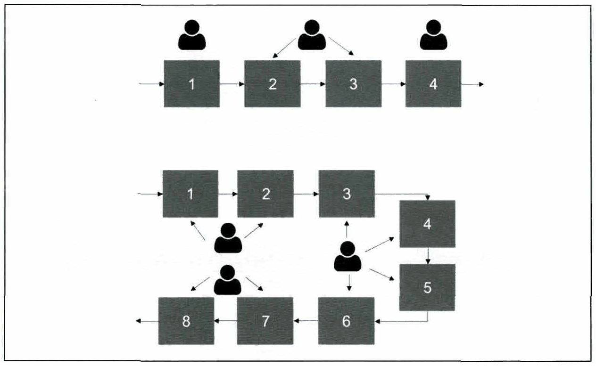

*Abbildung 49: Reihenfertigung – Skript S. 123 (PDF 133)* · [Rekonstruktion](../../figures/reconstructed/abb-49.svg) · [Zeichenübung](../../learning/drawing-exercises/abb-49-zeichenuebung.md)

Ähnlich wie bei der Reihenfertigung orientiert sich die räumliche Anordnung der Fließfertigung an der Reihenfolge der dominierenden Arbeitsvorgangsfolgen der des herzustellenden Produktionsprogramms. Der Produktionsablauf ist jedoch nicht nur örtlich, sondern auch zeitlich gebunden. Dadurch ermöglicht die Fließfertigung sehr kurze Durchlaufzeiten und eine hohe Produktivität. Demgegenüber stehen eine geringe Flexibilität sowie eine starke Störanfälligkeit. Aufgrund der Arbeitsspezialisierung kommen üblicherweise Spezialmaschinen zum Einsatz. Um die Stabilität der Materlalflussbeziehungen zu gewährleisten, werden häufig konstante, automatisierte Fördersysteme eingesetzt.

Nachfolgende Abbildung zeigt den Zusammenhang zwischen Produktionsart und Fertigungsform.

<!-- Seite 124 (PDF 134) -->

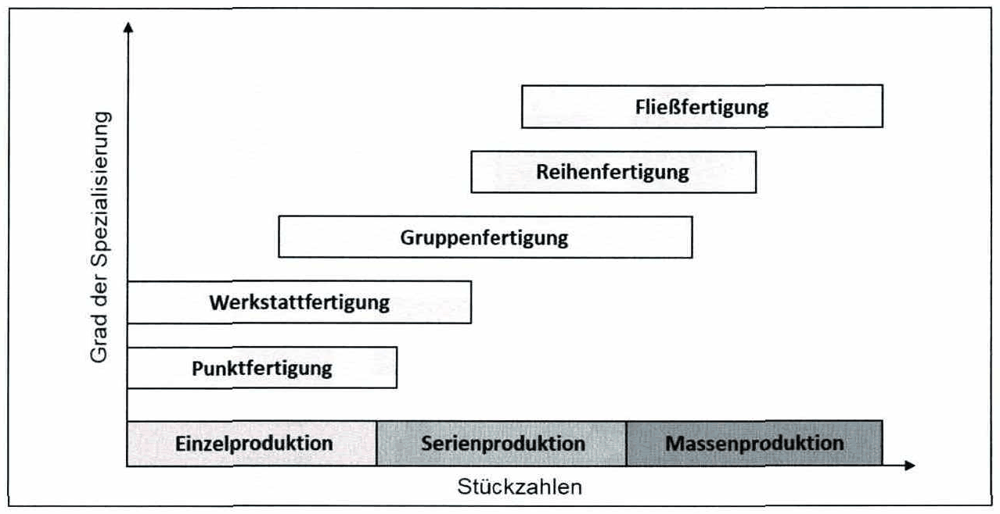

*Abbildung 50: Zusammenhang - Produktionsart & Fertigungsform – Skript S. 124 (PDF 134)* · [Rekonstruktion](../../figures/reconstructed/abb-50.svg) · [Zeichenübung](../../learning/drawing-exercises/abb-50-zeichenuebung.md)

Zusätzlich kann ein Produktionssystem anhand seiner räumlichen Struktur unterscheiden werden. Die 4 Grundtypen sind: Linienstruktur, Ringstruktur, Flächenstruktur und Leitstruktur.

## 8.2.2 Planungsvorgehen

Ein Anstoß für Planungsaktivitäten sind im Normalfall Initiativen der Unternehmensleitung bzw. Projektideen aus Fachabteilungen. [^137]

Die Entscheidung eines Unternehmens zur Umsetzung einer geplanten Fabrik, ist meist das Ergebnis eines längeren (Projekt-)Prozesses, der von vielen Personen sowie Herausforderungen begleitet wird. Dieser Prozess muss gut geplant und gesteuert werden, bildet doch eine Fabrik mit einer Lebensdauer von meist über 30 Jahren einen wichtigen Grundstein für den wirtschaftlichen Erfolg eines produzierenden Unternehmens. Ein strukturiertes Planungsvorgehen (mit definierten Planungsphasen und Teilergebnissen) ist daher von großer Bedeutung. Die einzelnen Planungsphasen lassen sich in eine generalisierte Planungssystematik zusammenfassen. Die Planungsphasen bauen auf den Ergebnissen der vorhergehenden Planungsphase auf.[^138]

In den folgenden Unterkapiteln werden die Zielsetzungen und Inhalte der einzelnen Planungsphasen anhand des Vorgehens nach Grundig ausgeführt.

<!-- Seite 125 (PDF 135) -->

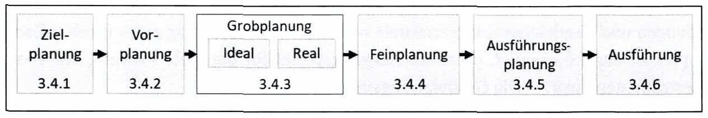

*Abbildung 51: Planungsvorgehen nach Grundig – Skript S. 125 (PDF 135)* · [Rekonstruktion](../../figures/reconstructed/abb-51.svg) · [Zeichenübung](../../learning/drawing-exercises/abb-51-zeichenuebung.md)

## 8.2.3 Zielplanung

In der ersten Phase müssen die Zielvorgaben und Planungsgrundlagen für die anschließenden Planungsphasen des jeweiligen Fabrikplanungsprojektes erarbeitet werden. Grundsätzlich befindet sich die Fabrikplanung und ihre Zielsetzung im Spannungsfeld der operativen Zielgrößen (Kapitel 9). Da Unternehmen insbesondere in den letzten Jahren mit vielen Unsicherheiten und schnell wechselnden Marktanforderungen konfrontiert werden, ergänzt das Ziel einer hohen Flexibilität zunehmend das oftmals dominierende Ziel einer hohen Auslastung. Moderne Produktionsstrategien zielen auf geringe Kosten, kurze Durchlaufzeiten und Prozessstabilität bei gleichzeitig hoher Flexibilität. Die Fabrik soll wandlungsfähig sein, um so auf veränderliche Marktbedingungen schnell und kostenneutral reagieren zu können.

## 8.2.4 Vorplanung

Arbeitsinhalte der Vorplanungsphase können die Fabrik-/ Potentialanalyse, ein Entwurf für Lösungskonzepte, eine Durchführbarkeitsstudie oder Bedarfs- und Aufwandsabschätzungen sein.[^140]

In den meisten Fällen wird eine Fabrik nicht von Grund auf neu geplant und umgesetzt. Ein wesentlicher Bestandteil der Vorplanung ist daher die Analyse des IST-Zustandes, also des derzeitigen Produktionsprogramms, des bestehenden Produktionsverfahrens sowie eingesetzte Produktionstechnologien (z.B. Fertigungsmaschinen). In der Vorplanung muss auch ein SOLL-Produktionsprogramm nach Art und Menge über den Planungszeitraum festgelegt werden. Ein weiterer Punkt ist die Festlegung der wichtigsten Produktionsverfahren und deren Abläufe. [^141]

## 8.2.5 Grobplanung

Nach der Vorplanung gehört die Überprüfung, Ergänzung und Verfeinerung der bisherigen Planungsdaten zu den ersten Aufgaben der Grobplanung. Für den methodischen Ablauf der Grobplanung ist die Herkunft der Daten unerheblich, diese können aus einem vorhandenen Betrieb stammen oder durch Prognosedaten, Voruntersuchungen und Vergleichswerten ermittelt werden. Die Erarbeitung eines idealen Konzeptes ist empfehlenswert, da es als Ausgangspunkt für die reale Planung mit allen Restriktionen dient.!42? Die Grobplanungsphase beinhaltet u.a.:

<!-- Seite 126 (PDF 136) -->

- Dimensionierung der erforderlichen Ressourcen & Bestimmung des Flächenbedarfs
- Erstellung eines idealen Funktionsschemas
- Erstellung eines flächenmaßstäblichen Funktionsschemas =» Erarbeitung eines „idealen“ Block-Layouts = Ableitung des Reallayouts

### 8.2.5.1 Dimensionierung[^142]

Die Grobplanung beinhaltet die Dimensionierung (bzw. Kapazitätsbedarfs-ermittlung) der erforderlichen Ressourcen Personal, Betriebsmittel, Flächen und Medien sowie Ver- und Entsorgungstechnik.[^143]

- Personalbedarf Im Rahmen der Fabrikplanung erfolgt die Ermittlung des Personalbedarfs für Produktions- und Logistikbereiche. Die Ermittlung des benötigten Personals, erfolgt unter Beachtung der Art des Personals (qualitativer Personalbedarf) und der Anzahl des Personals (quantitativer Personalbedarf).[^144]
- Betriebsmittelbedarf Als Betriebsmittel werden alle technischen Ausrüstungen (Maschinen), Anlagen, Vorrichtungen & Werkzeuge bezeichnet, die notwendig sind um verschiedene Fertigungs- und Logistikprozesse ausführen zu können. Während die Entscheidung hinsichtlich notwendiger Betriebsmittel durch die Herstellungsverfahren und der Arbeitsvorbereitung vorgegeben ist, ist die Abschätzung der benötigten Anzahl der Betriebsmittel ein Teil der Dimensionierung. [^145]
- Flächenbedarf Die Dimensionierung der Flächen hat großen Einfluss auf u.a. Investitionen, somit ist die Bestimmung der benötigten Flächen eine Die Basis für solch eine Berechnung ist eine Einteilung aller Flächen. Eine Gliederung der Flächen nach DIN 277 zeigt

<!-- Seite 127 (PDF 137) -->

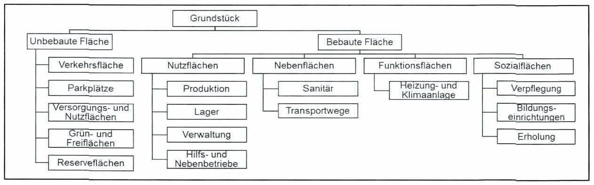

*Abbildung 52: Auszug aus der Gliederung der Flächen – Skript S. 127 (PDF 137)*

Bei der Flächenbedarfsermittlung unterscheidet man zwischen globalen Flächenermittlungsverfahren und detaillierten Flächenermittlungsverfahren.[^147]

### 8.2.5.2 Strukturierung

Im Allgemeinen kann die Strukturierung einer Fabrik in zwei Bereichen erfolgen, der (1) Produktionssegmentierung und (2) Festlegung der Organisationsform.

Die Produktionssegmentierung führt zur Bildung von „Fabriken in der Fabrik“, die durch einen hohen Autonomiegrad gekennzeichnet sind. Die unterschiedlichen Produkte eines heterogenen Produktionsprogramms durchlaufen nicht mehr ein gemeinsames Produktionssystem, sondern werden als homogene Teilgruppen in jeweils darauf ausgelegten Fertigungssystemen bearbeitet. Nicht nur die Wirtschaftlichkeit der Produktions- und Logistikprozesse wird durch die Struktur beeinflusst, sondern auch die Prozesstransparenz kann durch eindeutig definierte Strukturen erhöht werden

Eine weitere Aufgabe der Strukturierung liegt in der Festlegung der Organisationsform. Fertigungs- und Montageformen werden in der Fachliteratur auch als räumliche Strukturtypen oder Layouttypen bezeichnet.

### 8.2.5.3 Layoutplanung

Im Rahmen der Layoutplanung fließen die gewonnenen Erkenntnisse zum Produktionsprozess, den notwendigen Kapazitäten, der angestrebten Segmentierung und Fertigungsform sowie vorherrschende Restriktionen mit ein. Grundlegendes Ziel ist die

<!-- Seite 128 (PDF 138) -->

Erarbeitung des zukünftigen Layouts der Fabrik nach bestimmten Gestaltungskriterien. Meist erfolgt die Layoutplanung zweigeteilt — (1) Idealplanung und (2) Realplanung.

Die Idealplanung hat die beste organisatorische / technische Lösung der Planungsaufgabe zum Ziel, bei welcher bestehende Restriktionen bewusst nicht berücksichtig werden. Der Nutzen der Idealplanung wird vorab oft in Frage gestellt, da das Planungsergebnis in der Praxis ohnehin nicht kompromissfrei umgesetzt werden kann. Dabei wird häufig nicht berücksichtigt, dass die Ideallösung ein wertvolles Leitbild für Praktiker darstellt und einer Betriebsblindheit vorbeugt. Das Ideallayout wird oft als Vergleichsbasis für die Bewertung von Reallayouts herangezogen. [^148]

Es gibt eine Vielzahl an Methoden um ein Ideallayout zu erstellen, die meist dasselbe Ziel verfolgen: Die Minimierung der Transportintensität. Die Transportintensität ist ein Maß für den Transportaufwand innerhalb eines Produktionssystems und gibt die gesamte Anzahl der auszuführenden Transporte im Bezugszeitraum an.

Aufbauend auf den Erkenntnissen der lIdealplanung wird in der Realplanung, unter Berücksichtigung existierender Restriktionen, das Ideallayout in Reallayout-Varianten übergeführt. Die so erhaltenen Layout-Varianten stellen realisierbare räumliche Anordnungen der Struktureinheiten dar und verfolgen das Ziel eines Gesamtoptimums zwischen Zielsetzung und Einschränkungen.[^149]

- Einschränkungen und Randbedingungen

Abbildung 53 zeigt Einflussfaktoren auf die Realplanung, welche frühzeitig erkannt und spezifiziert werden müssen, um Planungsfehler zu vermeiden.

<!-- Seite 129 (PDF 139) -->

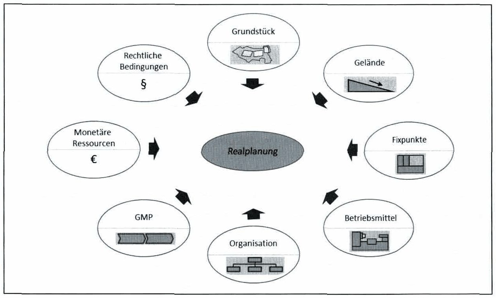

*Abbildung 53: Einschränkungen Realplanung – Skript S. 129 (PDF 139)*

Unter dem Begriff „Good Manufacturing Practice“ (GMP) werden Unternehmensrichtlinien zur Qualitätssicherung in der Produktion verstanden, die häufig zu Anpassungen in der Layoutplanung führen. [^151]

- Bewertung von Planungsalternativen

Bei der Bewertung der Planungsalternativen wird zwischen Wirtschaftlichkeits-, Nutzwert- und Risikoanalysen sowie der einfachen Gegenüberstellung unterschieden. Ziel der Bewertung bzw. Beurteilung ist das Ermitteln der besten Alternative. Als ein mögliches Hilfsmittel kann z.B. die Nutzwertanalyse herangezogen werden.[^152]

## 8.2.6 Feinplanung

Das Ziel der Feinplanungsphase ist, basierend auf den Ergebnissen der vorangegangenen Grobplanung, die Bearbeitung detaillierter Problemstellungen und Erweiterungen, bis die Ausführungsreife des Projektes erreicht ist. Das Spektrum der Arbeitsinhalte kann je nach Fabrikplanungsobjekt unterschiedlich ausfallen, jedoch sollte sichergestellt werden, dass im Fabrikkonzept ein anforderungsgerechtes und störungsfreies Zusammenwirken von Mensch, Maschine und Material an jedem Arbeitsplatz möglich ist.[^153]

<!-- Seite 130 (PDF 140) -->

Ausgewählte Bearbeitungsinhalte in der Feinlayout Phase können sein:

- Feinanordnung der Betriebsmittel (Maschinenaufstellung)

Die Aufstellung der einzelnen Maschinen innerhalb der Raumstrukturen ist in dieser Phase festzulegen, weiters sind neben der benötigten Fläche und der Produktionsform (Linienanordnung, Punktanordnung, usw.) auch andere Aspekte (z.B. Verzweigungen) bezüglich des Materialflusses und der Produktion an sich zu betrachten.

- Arbeitsplatzgestaltung

Die ergonomische Gestaltung von Arbeitsplätzen ist eine Voraussetzung für einen humanen und wirtschaftlichen Einsatz einer Arbeitskraft. Die ungenügende ergonomische Gestaltung beeinträchtigt möglicherweise die Gesundheit der Mitarbeiter, die Arbeitssicherheit und darüber hinaus den effizienten Einsatz von Arbeitskraft.

- Erarbeitung des Feinlayouts

Im Gegensatz zur Grobplanung, muss das Feinlayout eine maßgenaue Darstellung der Raum- und Flächenstrukturen und der Grundrissgeometrie bezogen auf die Arbeitsplätze, Einbauten und anderer Komplexe beinhalten. Weiters sind alle Installationen und Förder- und Lagertechnologien einzuzeichnen. Zusätzlich kann auch die Zuordnung von Arbeitskräften kenntlich gemacht und die Hauptmaterialflussströme können eingetragen werden.

## 8.2.7 Ausführungsplanung und Ausführung

Die Ausführungsplanung beinhaltet alle technischen, organisatorischen und baulichen Planungsaktivitäten die für die Umsetzung des Projekts unumgänglich sind. Zudem sind in dieser Phase alle notwendigen Maßnahmen zur Sicherung der termingerechten und komplikationsfreien Ausführung einzuleiten. Zu den Aufgaben der Ausführungsplanung zählen unter anderem:

- Strukturierung und Definition von Arbeitspaketen
- Festlegung von Ablauf- und Terminplänen
- Umzugsplanung
- Festlegung von Zuständigkeiten und Verantwortungen
- Einholen von Genehmigungen Die letzte Phase der Fabrikplanung, die Ausführung, beschäftigt sich mit der Realisierung der in der vorherigen Ausführungsplanung festgelegten Arbeitspakete,

<!-- Seite 131 (PDF 141) -->

Entsprechend des Inhaltes der Ausführung, kann man sie in drei Phasen gliedern: die eigentliche Ausführung, die Übergabe an den Nutzer und die Inbetriebnahme der geplanten Fabrik. [^154]

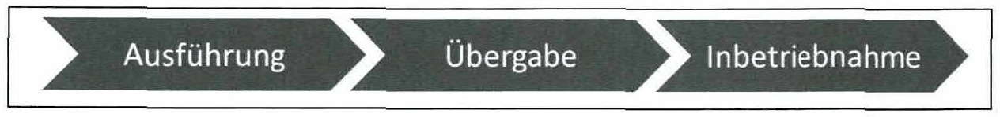

*Abbildung 54: Unterteilung Ausführungsphase – Skript S. 131 (PDF 141)*

Die eigentliche Ausführung beinhaltet alle Bau-, Montage- und Installationsarbeiten sowie Umzugsaktivitäten. Häufig kommt es in dieser Endphase zu Überschneidungen zwischen Baufertigstellung, Montagetätigkeiten, Probeläufen und Einrichtungsaktivitäten. Eine Überwachung des Arbeitsfortschritts und der Einhaltung der Termine ist zwingend notwendig. [^156]

Die Übergabe erfolgt nach den Ausführungsarbeiten und der Abnahme. Sämtliche Planungs- und Ausführungsunterlagen sowie Gewährleistungserklärungen, Wartungsvorschriften und ähnliches werden an den Auftraggeber in dieser Phase übergeben. [^157]

Unter dem Begriff der Inbetriebnahme wird der Produktionsanlauf (Produktionsstart) verstanden. Der Inbetriebnahme-Prozess endet mit dem Erreichen gesetzter Zielgrößen, wie zum Beispiel dem gewünschten Durchsatz. Dies stellt den formalen Projektabschluss dar.[^158]

[^126]: Vgl. VDI 5200:1 (2011) S. 3
[^127]: Vgl. Wiendahl et al. (2014) S. 33
[^128]: s Vgl. VDI 5200:1 (2011) S. 3
[^129]: VDI (2011) S. 3
[^130]: Vgl. Dickmann (2015) S. 217
[^131]: Vgl. Klug (2010) S.3
[^132]: Vlg. Grundig (2018), S. 18f
[^136]: Burggräf (2021), Sı51ff.
[^137]: Vgl. Grundig (2018) S. 53
[^138]: Vgl. ibidem S. 37
[^140]: Vgl. ibidem S. 56
[^141]: Vgl. Ketiner et al. (1984) S. 17
[^142]: Vgl. Kettner et al. (1984) S.19
[^143]: Vgl., Grundig (2018) S. 84
[^144]: Vgl. ibidem S. 94 ff.
[^145]: s Vgl. Grundig (2018) S. 84
[^147]: w7 ]bidem S. 95
[^148]: Vgl. Arnold & Furmans (20009), S.273
[^149]: Vgl. Schenk et al. (2014), S. 341
[^151]: Vgl. Arnold et al. (2008) S. 320
[^152]: Vgl. Götze (2014), S. 193
[^153]: s Vgl. Grundig (2018), S.188
[^154]: Vgl. Grundig (2018) S. 198
[^156]: Vgl. REFA (1985) Teil 5 S. 229
[^157]: Vgl. ibidem Teil 5 S. 230
[^158]: Vgl. Grundig (2018) S. 220f.

## Fußnoten ohne sicheren Textanker

Diese Fußnoten stehen auf den Seiten dieses Abschnitts, ihr Verweiszeichen im Text ließ sich aus dem Scan aber nicht eindeutig zuordnen (oft Quellenangaben zu Abbildungen).

- **133** – Seite 117 (PDF 127): ibidem
- **134** – Seite 119 (PDF 129): Wohinz (2003), S. 227.
- **135** – Seite 119 (PDF 129): Burggräf (2021), S151ff.
- **139** – Seite 125 (PDF 135): Vgl. Grundig (2018) S. 37
- **146** – Seite 127 (PDF 137): 1bidem
- **150** – Seite 129 (PDF 139): Vgl. Wiendahl et al. (2014), S. 501
- **155** – Seite 131 (PDF 141): Vgl. ibidem S.198

## Prüfungsfragen zu diesem Abschnitt

9 Fragen aus der [Prüfungsfragen-Datenbank](../../exams/questions.md): `frage-2024-03-14-2`, `frage-2024-03-14-3`, `frage-2024-06-20-3`, `frage-2024-10-15-3`, `frage-2024-12-10-4`, `frage-2025-04-09-4`, `frage-2025-06-16-4`, `frage-2026-01-22-3`, `frage-2026-04-29-5`
