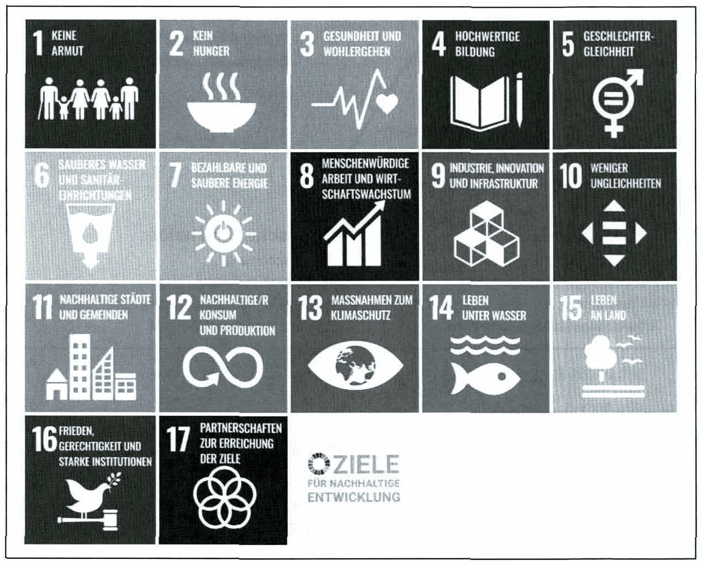
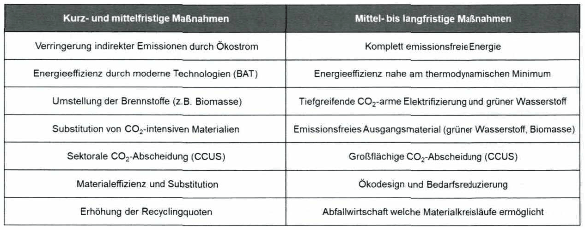
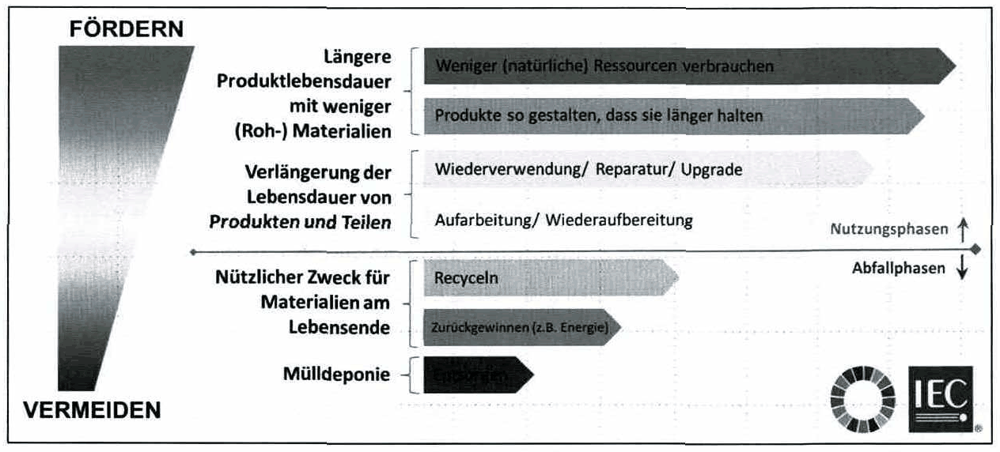

<!-- Seite 132 (PDF 142) -->

# 8.3 Nachhaltigkeit

Der Begriff Nachhaltigkeit (engl. „Sustainability“ bzw. „Sustainable Development“) beschreibt ein Handlungsprinzip zur Ressourcennutzung. Diese muss nach Definition der Brundtland-Kommission so erfolgen, dass heutige Bedürfnisse befriedigt werden, ohne die der zukünftigen Generationen zu beeinträchtigen.

„Sustainable Development is development that meets the needs of the present without compromising the ability of future generations to meet their own needs“.[^159]

Soziale Nachhaltigkeit oder unternehmerische Sozialverantwortung (engl. Corporate Social Responsibility, CSR) umschreibt demnach den freiwilligen Beitrag der Wirtschaft zu einer nachhaltigen Entwicklung, der über die gesetzlichen Forderungen hinausgeht. CSR steht für verantwortliches unternehmerisches Handeln in der eigentlichen Geschäftstätigkeit (Markt), über ökologisch relevante Aspekte (Umwelt) bis hin zu den Beziehungen mit Mitarbeitern (Arbeitsplatz). [^160]

## 8.3.1 Begriffserklärung und Ziele

Um die Regenerationsfähigkeit natürlicher Systeme zu bewahren sind drei Prinzipien von besonderer Bedeutung:[^161]

- Das Verantwortungsprinzip soll dazu beitragen, einerseits das Wohlstandsgefälle zwischen Industrie- und Entwicklungsländern (intragenerative Gerechtigkeit) zu vermindern, andererseits sollen die Bedürfnisse zukünftiger Generationen berücksichtigt werden (intergenerative Gerechtigkeit).
- Das Kooperationsprinzip verdeutlicht die Notwendigkeit, globalen und nationalen Umweltproblemen durch eine enge Zusammenarbeit aller Beteiligten (Bund, Länder, Gemeinden, Wirtschaft und Wissenschaft) zu begegnen. [^162]
- Das Kreislaufprinzip beschreibt, dass Ressourcen mehrmals genutzt werden, bevor sie aus der Produktion oder Nutzung ausgeschieden werden. Klassische Beispiele hierfür ist das Konzept der Kreislaufwirtschaft („circular economy“) in dem ein regeneratives System angestrebt wird das sowohl auf die Vermeidung, wie auch die Verwertung von Abfällen fokussiert.[^163] Der „Abfall“ eines Prozesses wird als Rohstoff für andere Prozesse genutzt. Dieser Ansatz kann etwa bei der

<!-- Seite 133 (PDF 143) -->

Instandhaltung (Refurbishment), Refabrikation/Aufarbeitung (Remanufacturing), Reparatur, langlebige Designs und Konstruktion, sowie im letzten Schritt die Müllverwertung („Recycling“) angewandt werden. 14

Umweltbewusstes Management ist damit nicht nur Sache einer einzelnen Person oder Abteilung, sondert erfordert bereichsübergreifendes Handeln. Konkrete Ziele für Nachhaltigkeit („Sustainable Development Goals“ bzw. „SDGs“) wurden von der Generalversammlung der Vereinten Nationen in der „Agenda 2030“ („Transforming our World: The 2030 Agenda for Sustainable Development“) 2015 verabschiedet. Diese Ziele gliedern sich in 17 Gruppen mit 169 Einzelzielen und umfassen neben humanitären Zielen (z.B. Armut beenden, Bildung, Frieden) auch Ziele die vor allem für die Industrie relevant sind (z.B. Nachhaltige Energie, Nachhaltige Produktion und Sofortmaßnahmen gegen Klimawandel)[^165],

*Abbildung 55: Die SDGs der United Nations – Skript S. 133 (PDF 143)*

<!-- Seite 134 (PDF 144) -->

## 8.3.2 Strategische Bedeutung

Aufgrund sich ändernder Vorgaben und Regulierungen (z.B.: EU Taxonomie- für nachhaltige Wirtschaftsaktivitäten, CO2-Bepreisung, etc.), zunehmender Kundennachfrage nach „nachhaltigen Produkten“ und sich ändernden Mitarbeiterbedürfnissen (z.B. Work-Life-Balance) müssen Unternehmen verstärkt, neben ökonomischen Zielen auch soziale und ökologische Ziele fokussieren. Diese Ziele können z.B. eine Erhöhung der altersgerechten Arbeitsplätze, oder eine gezielte Erhöhung der Arbeitsmotivation und -zufriedenheit (z.B. Fernarbeit, Arbeitszeitregelungen und spezielle Ausbildungsmöglichkeiten) in der sozialen Dimension beinhalten. Im Themenfeld der Ökologie können Ziele neben der Rohstoffschonung vor allem auch die verursachten Emissionen des Unternehmens betreffen (z.B.: Corporate Carbon Footprint Reduktion, Einhaltung bestimmter „SDG“ (siehe Abbildung 56)).

*Abbildung 56: Beispiele für das Spannungsfeld unternehmerischen Wirkens – Skript S. 134 (PDF 144)*

**Ökonomische Dimension**

Ökonomische Nachhaltigkeit beschreibt die Maximierung des ökonomischen Ertrags bei gleichzeitiger Aufrechterhaltung der benötigten Eingangsressourcen. Das Ziel der ökonomischen Nachhaltigkeit ist also die Gestaltung einer Wirtschaft, die dauerhaft gewinnorientiert betrieben werden kann ohne zu einer Ressourcenverknappung oder Ausbeutung zu führen. Die ökonomische Nachhaltigkeit setzt voraus, dass die zur Erreichung einer bestimmten Produktion benötigten Ressourcen auch weiterhin und mindestens in gleichwertiger, vorzugsweise in besserer Güte verfügbar sind. Unter Ressourcen versteht man in diesem Zusammenhang die zu einem bestimmten Zeitpunkt verfügbaren Güter, Waren, Kapital oder Dienste. Die Güte dieser Ressourcen zielt auf deren Verfügbarkeit und Qualität ab, in welcher sie zur Verwendung bereitstehen.[^167]

<!-- Seite 135 (PDF 145) -->

Aus Unternehmenssicht muss eine Strategie verfolgt werden, die anstelle von kurzfristigen Gewinnen die langfristige Existenz des Unternehmens sichert. Zukunftsorientierte Maßnahmen, wie die Schaffung von Produkt- und Prozessinnovationen oder die Entwicklung einer eigenen Markenidentität, tragen zur langfristigen Gewinnsicherung bei. So kaufen Kunden verstärkt Produkte von Unternehmen, die eine nachhaltige Strategie verfolgen, da diese Unternehmen ein besseres Image.

Mit dem Wissen über die eigene Nachhaltigkeit kann ein Unternehmen seine eigenen Produkte, Prozesse und Strategien optimieren. Durch die verbesserten Entscheidungsgrundlagen (auch für Investitionen) können vor allem Kostensenkungen erzielt werden. Vor allem die Verbesserung der Material- und Energieeffizienz kann zu hohen Kosteneinsparungen bei Produkten und Produktionsprozessen führen.

**Ökologische Dimension**

Die ökologische Nachhaltigkeit von Unternehmen spiegelt sich im Energie- und Materialverbrauch sowie in der Menge der produzierten Abfälle und CO₂-Emissionen wider. Nachhaltige Unternehmen streben nach Produkten und Prozessen, die so ressourcenschonend wie möglich sind und vermeiden schädliche Auswirkungen ihrer Geschäftstätigkeit auf Menschen und Umwelt. Daraus ergibt sich die Anforderung nach einem gezielten Energie-, Ressourcen- und Umweltmanagement.

**Soziale Dimension**

Die Produktion ist ein Sektor der viele Arbeitsplätze schafft. Gleichzeitig sind qualifizierte Mitarbeiter (Fachkräfte) eine der wichtigsten Ressourcen in der Produktion. Deshalb muss auf ihre Zufriedenheit und Bedürfnisse geachtet werden. In der sozialen Nachhaltigkeit geht es darum, die positiven und negativen Auswirkungen des Unternehmens auf die Menschen zu ermitteln und zu steuern. Unternehmen beeinflussen direkt oder indirekt, was mit Angestellten, Arbeitern, Kunden und lokalen Gemeinschaften geschieht, und es ist wichtig, die Auswirkungen proaktiv zu steuern. [^168]

Ein Mangel an sozialer Entwicklung (z.B.: Armut, Ungleichheit und fehlende Rechtsstaatlichkeit) kann den Geschäftsbetrieb und das Wachstum eines Unternehmens behindern. Gleichzeitig können Maßnahmen der sozialen Nachhaltigkeit neue Märkte erschließen, neue Geschäftspartner anziehen und die Quelle für innovative Produkte und

<!-- Seite 136 (PDF 146) -->

Dienstleistungen sein. Die Mitarbeiterzufriedenheit und das Engagement der Mitarbeiter können steigen, während sich Produktivität, Risikomanagement und Konflikte zwischen Unternehmen und Gesellschaft verbessern. Somit hängt die soziale Handlungsfähigkeit von Unternehmen und der Unternehmenserfolg auch in hohem Maße von ihren Bemühungen um soziale Nachhaltigkeit ab[^169].

Prinzipien der sozialen Nachhaltigkeit umfassen die Inklusion und Gleichstellung aller Arbeitnehmer in den Erwerbsprozess (z.B.: durch Sicherstellung von Bildung und Gesundheit). Von Unternehmen wird erwartet, dass sie die gebührende Sorgfalt walten lassen, um alle nachteiligen Auswirkungen auf die Mitarbeiterinnen und Mitarbeiter vermeiden. Unternehmen sollen: [^170]

Dazu beitragen das Leben der von ihnen betroffenen Menschen zu verbessern, z. B. durch die Schaffung menschenwürdiger Arbeitsplätze, Waren und Dienstleistungen. Hohe Bedeutung kommen hier Themen wie der flexiblen Gestaltung von Arbeitszeit und -ort, der Sicherung der körperlichen und psychischen Gesundheit, sowie attraktiven Weiterbildungs- oder Freizeitangeboten durch Unternehmen zu.

Die Achtung der Arbeitnehmerechte (z.B. Betriebsräte) und die Einhaltung der Arbeitsnormen durch solide Verfahren für Sicherheit und Gesundheitsschutz am Arbeitsplatz fördern (z.B. Einhaltung von Grenzwerten).

Strategische soziale Investitionen tätigen und eine öffentliche Politik fördern, die soziale Nachhaltigkeit unterstützt (z.B. (Bildungs-)Initiativen für benachteiligte Bevölkerungsgruppen, Gleichstellung/Inklusion, Unterstützung lokaler Kampagnen).

Partnerschaften mit anderen Unternehmen eingehen und ihre Kräfte bündeln, um eine größere positive Wirkung zu erzielen (z.B. gemeinsame Projekte zur Verbesserung der Arbeitsbedingungen innerhalb einer Branche/Region, faire Löhne entlang der Lieferkette).

<!-- Seite 137 (PDF 147) -->

## 8.3.3 Ökologische Nachhaltigkeit im Industriekontext

"Nachhaltige Produktion ist die Herstellung von Produkten durch wirtschaftlich sinnvolle Prozesse, die negative Umweltauswirkungen minimieren und gleichzeitig Energie und natürliche Ressourcen schonen. Eine nachhaltige Fertigung verbessert auch die Sicherheit von Mitarbeitern, Gesellschaft und Produkten“?7!

Im Produktionssystem können dazu die fünf Faktoren (1) Mensch, (2) Prozesse, (3) Betriebsmittel, (4) Arbeitsorganisation und (5) Produkte durch richtiges Management beeinflusst und die Nachhaltigkeit verbessert werden. In der Produktion können die drei Dimensionen der Nachhaltigkeit durch die Anpassung dieser Faktoren beeinflusst werden. [^172]

„Ein Schlüsselfaktor für die Zukunft der Produktion ist die Energieeffizienz. Angesichts steigender Energiepreise und wachsender Umweltauflagen wird es immer wichtiger, den Energieverbrauch in der Produktion zu minimieren. Moderne Fertigungstechnologien setzen daher verstärkt auf energieeffiziente Prozesse und den Einsatz erneuerbarer Energien. Dies geschieht nicht nur aus ökonomischen, sondern auch aus ökologischen Gründen, um den CO2-Fußabdruck zu reduzieren und nachhaltiger zu wirtschaften. “[^173]

In diesem Zusammenhang setzt Effizienz auf eine Verbesserung des Input-Output-Verhältnisses, d.h. eine ökonomische Leistung mit geringstmöglichem Einsatz an Material und Energie zu erstellen. Der Effekt besteht in einer relativen Senkung des Ressourcenverbrauchs. Daneben existiert der Ansatz der Konsistenz (Öko-Effektivität) welche den Fokus auf umweltverträgliche Beschaffenheit von Energie und Materialien beschreibt. Beispiele sind biologisch abbaubare Rohstoffe, erneuerbare Energie und/oder die Kreislaufwirtschaft. Zudem kann über Suffizienz, also einem genügsameren Konsumverhalten, der Ressourcenverbrauch gesenkt werden. Diese lässt sich sowohl über freiwillige Genügsamkeit bzw. Verzicht als auch durch politische Maßnahmen (z.B. Verbote, Beschränkungen) realisieren.[^174]

Wie Abbildung 57 zeigt, kann Effizienz sowohl den wirtschaftlichen Ertrag steigern als auch Ressourcen bzw. die Umwelt schonen, beides jedoch nur in einem begrenzten Umfang (Verschiebung von Ausgangspunkt A zu Punkt B). Der Suffizienz wird eine stärkere Wirkung hin zu einem akzeptablen Ressourcenverbrauch zugetraut, sie verringert aber zwangsläufig auch der Ertrag (Übergang von Punkt A zu C). Das größte

<!-- Seite 138 (PDF 148) -->

Potential wir der (durch technische Innovationen ermöglichten) Konsistenz zugetraut (Punkt D). Das abgebildete Aufwands- und Ertragsdiagramm verdeutlicht, dass Konsistenz der Effizienz in ihrem Wirken ähnlich (höhere Produktivität, kein verringerter Ertrag), aber weitaus radikaler ist. Die Entscheidung, ob und wie intensiv das herausfordernde Streben nach mehr Konsistenz betrieben wird, liegt zumeist bei den Produzenten.!>

*Abbildung 57: Einfluss von Effizienz, Konsistenz und Suffizienz auf Aufwand und Ertrag – Skript S. 138 (PDF 148)* · [Rekonstruktion](../../figures/reconstructed/abb-57.svg) · [Zeichenübung](../../learning/drawing-exercises/abb-57-zeichenuebung.md)

Der Weltklimarat (Intergovernmental Panel on Climate Change, IPCC) kommt in seiner jüngsten Bewertung des Industriesektors zu der Schlussfolgerung, dass mittelfristig emissionsarme bzw. -freie Energie (Konsistenz) und Energieeffizienz den größten Beitrag zur Dekarbonisierung leisten, während langfristig vor allem Materialeffizienz und die Abscheidung und anschließende Nutzung von atmosphärischem CO2 (carbon capture, use & storage, CCUS) relevant sein werden (Abbildung 58).[^177] Derselbe Bericht unterstreicht, dass das ambitionierte Ziel, im Jahr 2050 weltweit keine Treibhausgasmissionen mehr auszustoßen nur durch die Entwicklung und Einführung innovativer Technologien erreicht werden kann. [^178]

<!-- Seite 139 (PDF 149) -->

*Abbildung 58: Möglichkeiten der Industrie zur Dekarbonisierung – Skript S. 139 (PDF 149)*

**Energiemanagement**

Die Produktion ist oft der Haupttreiber des Energieverbrauchs in Industrieunternehmen. Dabei spielen neben der verbrauchten Menge auch die Art bzw. Erneuerbarkeit der Energieform eine wichtige Rolle. Der gezielte Einsatz von Energie im Unternehmen wird durch das betriebliche Energiemanagement geplant und überwacht. Die zugeordneten Aufgaben umfassen die:[^179]

- Energieplanung und Organisation

Basierend auf der Kenntnis des Ausganszustandes werden operative und strategische Maßnahmen abgeleitet, mit deren Hilfe eine optimale energiewirtschaftliche Ausrichtung und organisatorische Eingliederung ins Unternehmen erfolgt.

- Energieinformationsmanagement

Gewinnung und Verarbeitung der relevanten Informationen und Versorgung der Entscheidungsträger mit der geeigneten Information zum richtigen Zeitpunkt. Eine wichtige Kennzahl ist die „Energieintensität“ welche die verbrauchte Energie ins Verhältnis zu damit produziertem Output setzt. Um den Energieverbrauch zu reduzieren ist oft eine Änderung der Produktionsprozesse oder die Anschaffung sparsamerer Maschinen erforderlich. Das kann langfristig auch wirtschaftliche Vorteile haben, da die Ausgaben für den Energieverbrauch reduziert und die Produktivität gesteigert werden können.

<!-- Seite 140 (PDF 150) -->

- Energiekontrolle

Aufgrund der zunehmenden Dynamik bzgl. Planungssicherheit, Preis und Verfügbarkeit des energiewirtschaftlichen Umfelds gewinnt die Kontrolle immer mehr an Bedeutung. Die Abweichungskontrolle im Nachhinein spielte schon immer eine wichtige Rolle.

Ressourcenmanagement Da die Rohstoffe knapper werden, die Preise steigen und die Nachfrage zunimmt, müssen Unternehmen zunehmend Strategien entwickeln um mehr mit weniger herzustellen. Ein Fokus auf Ressourcenproduktivität im Betrieb unterstützt indem 4 Arten der Verschwendung strukturiert vermieden werden:[^180]

- Verschwendete Ressourcen sind Materialien und Energie, die nicht kontinuierlich regeneriert werden können, sondern nach ihrer Verwendung verbraucht werden und für immer verschwinden. Entscheidend für den nötigen Materialeinsatz ist, ob das verwendete Material erneuerbar ist. Verbesserungen können meist nur durch eine Änderung der Prozesse erreicht werden. Das Verhältnis von eingesetztem Material, Menge des anfallenden Abfalls und Output ist die Materialeffizienz. Eine Erhöhung dieser ist durch eine Reduktion des eingesetzten Materials (z.B.: Ausschussreduktion) oder eine Erhöhung des Anteiles weiterverwertbarer Abfälle erreichbar. In der Produktion können zum Beispiel Kühl- und Schmiermittel von den Metallspänen getrennt werden, was die Wiederverwertbarkeit erhöht.
- Produkte mit verschwendeten Lebenszyklen haben eine künstlich verkürzte Lebensdauer oder werden entsorgt, auch wenn es noch eine Nachfrage nach ihnen von anderen Nutzern gibt.
- Produkte mit verschwendeten Fähigkeiten bleiben unnötigerweise ungenutzt; Autos zum Beispiel bleiben in der Regel 90 Prozent ihrer Lebensdauer ungenutzt.
- Verschwendete eingebettete Werte sind Komponenten, Materialien und Energieverbrauch, die nicht aus entsorgten Produkten zurückgewonnen und wiederverwendet werden

<!-- Seite 141 (PDF 151) -->

*Abbildung 59: Maßnahmenhierarchie für Materialeffizienz – Skript S. 141 (PDF 151)*

**Umweltmanagement**

Abgeleitet vom dreidimensionalen Zielsystem (Abbildung 56) lassen sich zwei Hauptaufgaben für die Industriebetriebe darstellen:

Die Produktion „umweltfreundlicher Produkte“ fokussiert auf die Neu- oder Weiterentwicklung von Produkten welche eine möglichst geringe Gesamtbelastung für die Umwelt über ihre gesamte Produktlebensdauer aufweisen. Da jede Produkt- oder Serviceerstellung mit dem Verbrauch von Energie und Ressourcen verbunden ist muss man die daraus abgeleitete Umweltbelastungen kennen und erheben[^181], Eine Aussage zur Umweltfreundlichkeit kann durch Produktvergleiche mit denselben Eigenschaften und unterschiedlicher Umweltbelastung getätigt werden[^182], Die allgemein genutzte Methode zur Bestimmung der Umweltbelastung von Produkten ist die Ökobilanz, auch Lebenszyklusanalyse (engl. Lifecycle Assessment, LCA) genannt.[^183] Obwohl unterschiedliche Ansätze bestehen geht eine LCA normalerweise auf die Phasen der Rohstoffgewinnung („Raw material extraction“), Produktion („Production“), Produkt- oder Servicenutzung („Use Phase“) und der Entsorgung der Produkte („End of Life“) ein[^184],

Bei der „Gestaltung einer umweltbewussten Produktion“ wird die Produktion als Ganzes auf umweltschädliche Emissionen untersucht und deren Ausstoß minimiert. Es gibt eine Reihe von Methoden bzw. Modellen, mit welchen Aussagen über die

<!-- Seite 142 (PDF 152) -->

Umweltfreundlichkeit bzw. Umweltbelastung der Produktion gemacht werden können. Die wichtigsten Modelle sind die Input-Output-Analyse, das Ökobilanzmodell nach IÖW Berlin sowie die CO2-Bilanz:[^185], Neben den genannten Kerngebieten des Umweltmanagements sind auch die Wasser- und Landnutzung von Bedeutung.

Zur Verbesserung der Produktion hinsichtlich der Umwelt sollten alle relevanten Emissionen des Produktionssystems minimiert werden. Dazu unterscheidet man diese in drei sogenannte Scopes. Scope 1 beschreibt Emissionen, die direkt vom Unternehmen erzeugt werden (z. B. Verbrennung fossiler Brennstoffe durch Heizkessel oder eigenem Fuhrpark, chemische Prozesse). Alle Emissionen, die sich auf eingekaufte Energie zurückführen lassen, werden dem Scope 2 zugeordnet. Der Strommix des jeweiligen Landes ist hier oft entscheidend. Scope 3 beschreibt alle indirekten Treibhausgasemissionen, die vor und nach der eigenen Produktion entstehen. Dies können Emissionen sein, die bei der Produktion von Rohstoffen durch Drittunternehmen oder während der Nutzung des Produktes entstehen.[^186]

Bei der Produktion hängt die Gesamtmenge der Emissionen nach Scope 1 stark von den produzierten Gütern ab. Die Möglichkeiten sind daher bis zu einem in gewissem Maße durch den Prozess begrenzt. Zur Verbesserung kann bspw. ein Betriebsmittel bedarfsgerecht abgeschalten, Abwärme von Anlagen zum Heizen genutzt, oder die Logistik elektrifiziert werden. Zur Verbesserung bei Scope 2 kann, der Energiebedarf in der Produktion reduziert werden. Andererseits kann das Unternehmen den allgemeinen Energiebedarf reduzieren, oder durch z.B. Solarstromanlagen zum Teil selbst erzeugen. Bezüglich Scope 3 ist der Handlungsspielraum meist eingeschränkt. Hier kann im Allgemeinen oft nur auf die Beschaffung von Rohstoffen mit niedrigen Emissionen gesetzt werden. Weiters können Unternehmen auf lokale Beschaffung setzen um Transportleistungen und die damit verbundenen Emissionen gering zu halten. Ähnlich kann im Vertrieb vorgegangen werden: das Stahl- und Walzwerk Marienhütte mit Sitz in Graz beliefert beispielsweise bewusst nur Kunden in einem bestimmten Umkreis.

[^159]: Brundtland-Bericht (1987)
[^160]: Vgl. Weber (2014), S. 104 f.
[^161]: Vgl. Meffert & Kirchgeorg (1993) S. 34f.
[^162]: Vgl. Weizsäcker (1990)
[^163]: Vgl. Förtsch & Meinholz (2014) S. 433
[^165]: UN General Assembly (2015)
[^167]: Vgl. Gabler Wirtschaftslexikon (2022)
[^168]: Vgl. Global Sustainability Standards Board (2020) S. 400
[^169]: Vgl. United Nations Golbal Compact (2022) Labour and Decent Work.
[^170]: Vgl. Gerlmaier & Latniak (2019): 5. 359 f.
[^172]: Stark et al. (2017), S. 8
[^173]: Zäh (2024)
[^174]: Schmidt (2008), Behrendt et al. (2018)
[^177]: IPCC (2022), S. 1167
[^178]: Ibidem, S. 1202
[^179]: Vgl. Posch (2011) S. 147 ff.
[^180]: Vgl.l. Lacy, Rutqvist (2015) S. xwii
[^181]: Vgl. Müller-Wenk (1978), S. 13 f.
[^182]: Vgl. Apitz & Gege (1991), S. 102
[^183]: Vgl. ISO 14067:2018
[^184]: Vgl. ETSI ES 203199:2014
[^185]: Siehe ISO 14064-2:2019
[^186]: Vgl. World Resources Institute (2004) S.25

## Fußnoten ohne sicheren Textanker

Diese Fußnoten stehen auf den Seiten dieses Abschnitts, ihr Verweiszeichen im Text ließ sich aus dem Scan aber nicht eindeutig zuordnen (oft Quellenangaben zu Abbildungen).

- **164** – Seite 133 (PDF 143): IEC TC 111 (2022)
- **166** – Seite 134 (PDF 144): Vgl. Hopfenbeck (1990) S. 41
- **171** – Seite 137 (PDF 147): US EPA (2015)
- **175** – Seite 138 (PDF 148): angelehnt an Schmidt (2008), S. 14
- **176** – Seite 138 (PDF 148): ]bidem, S.11

## Prüfungsfragen zu diesem Abschnitt

7 Fragen aus der [Prüfungsfragen-Datenbank](../../exams/questions.md): `frage-2024-06-20-5`, `frage-2024-10-15-5`, `frage-2025-02-04-5`, `frage-2025-03-18-5`, `frage-2025-10-15-3`, `frage-2026-04-29-3`, `frage-2026-04-29-6`
