<!-- Seite 147 (PDF 157) -->

# 9.1 Planung

Planung ist die systematische Suche und Festlegung von Zielen, sowie die Vorbereitung von Aufgaben und Ressourcen, deren Umsetzung zur Erreichung der Ziele notwendig sind (Zielzustand). Die Zielplanung umfasst vor allem wirtschaftliche, soziale und organisatorische Ziele und wird im Rahmen der strategischen Kapazitätsplanung definiert. Die Produktionsplanung auf operativer Ebene legt die täglichen Aufgaben fest, mit denen die Tätigkeiten eines Unternehmens fortlaufend ausgeführt werden.

Die Produktionsplanung befasst sich im weitesten Sinne mit allen Planungsparametern und -ressourcen, die für die Planung und Ausführung aller Produktionsaktivitäten eines Unternehmens erforderlich sind. Das Gesamtziel der Produktionsplanung ist die Minimierung der Produktionskosten pro produzierte Einheit. In Abbildung 60 ist der Produktionsplanungsprozess dargestellt.

<!-- Seite 148 (PDF 158) -->

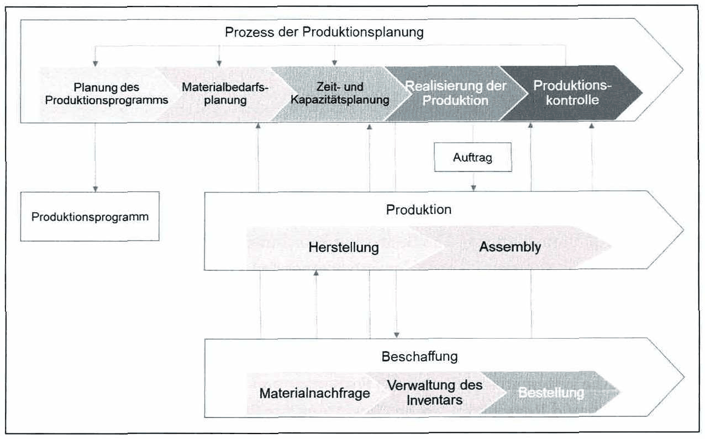

*Abbildung 60: Produktionsprogrammplanung – Skript S. 148 (PDF 158)* · [Rekonstruktion](../../figures/reconstructed/abb-60.svg) · [Zeichenübung](../../learning/drawing-exercises/abb-60-zeichenuebung.md)

Der Produktionsplanungsprozess umfasst folgende Hauptaufgaben:

- Spezifikation von Ergebnissen aus der Absatzplanung, Ermittlung von Produktionsmengen für den Planungszeitraum (Produktionsprogrammplanung)
- Ermittlung und Beschaffung von Materialbedarf (Mengenplanung für Beschaffung und Produktion)
- Planung und Festlegung der notwendigen Kapazitäten zur Realisierung des Produktionsplans sowie Koordination von Bestellmengen und Prozesszeiten mit verfügbaren Kapazitäten (Termin- und Kapazitätsplanung)

Die Aufgaben des Operations Management umfassen demnach:

- Absatzplanung
- kurzfristige Produktionsprogrammplanung
- Materialbedarfsplanung
- Zeit- und Kapazitätsplanung
- Steuerung und Kontrolle der Produktion

<!-- Seite 149 (PDF 159) -->

## 9.1.1 Absatzplanung

Ziel der Absatzplanung ist es, Erkenntnisse über zukünftige Entwicklungen der verkauften Produkte zu gewinnen und somit kurz-, mittel- und langfristige Planungen im Betrieb zu ermöglichen. Die Absatzplanung liegt normalerweise in der Verantwortung der Marketing- oder Verkaufsabteilung. Sie ist jedoch auch ein entscheidender Inputfaktor für operative Entscheidungen. Eine effektive Kapazitätsplanung in der Produktion ist ohne Informationen über das zukünftige Nachfragepotenzial nicht möglich.

Ein grundlegendes Verständnis von Prognosen und ihren Methoden ist daher relevant. Es gibt zwei Hauptansätze für die allgemeine Prognose mit jeweils qualitativen und quantitativen Methoden:

- **Qualitative Methoden** basieren auf früheren Erfahrungen, Meinungen oder sogar Schätzungen. Die Sammlung solcher qualitativen Eingaben und eine verständliche Beurteilung dieser sind notwendig, um eine Vorhersage zu treffen. Beispiele für qualitative Prognosemethoden sind z.B. die Delphi-Methode (für Expertenbewertungen) oder Szenario Planung (für Aufgaben mit größeren Unsicherheiten).
- **Quantitative Methoden** können in Zeitreihenanalyse (siehe Abbildung 61 a) und kausale Modellierung (siehe Abbildung 61 b) eingeteilt werden. Zeitreihenanalysen basieren auf Plots einer Variablen über die Zeit (z.B. verkaufte Einheiten pro Jahr), um zukünftiges Verhalten vorherzusagen. Kausale Modellierung versucht, Zusammenhänge und den Einfluss verschiedener Variablen aufeinander zu verstehen (z.B. der Einfluss der Temperatur auf Eiscremeverkäufe), um zukünftige Verkaufszahlen vorherzusagen.

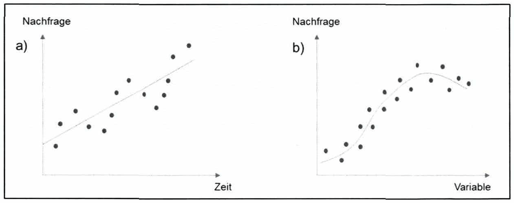

*Abbildung 61: Beispiele für eine Zeitreihenanalyse (a) und ein Kausalmodell (b) – Skript S. 149 (PDF 159)* · [Rekonstruktion](../../figures/reconstructed/abb-61.svg)

<!-- Seite 150 (PDF 160) -->

Prognosemodelle sind in der Industrie notwendig, um die Entscheidungsfindung des Managements zu unterstützen. Die Güte der meisten Prognosen ist jedoch nicht ausreichend. Neuere Ansätze für Prognosen sind Big Data und Data Analytics. Diese Entwicklungen ermöglichen die Analyse von nicht-kausalen Korrelationen innerhalb einer großen Menge und Vielfalt von verschiedenen Datensätzen. Dieser Ansatz erlaubt präzisere Prognosen und erhöht die Qualität von Managemententscheidungen.

Ein Instrument zum Ausgleich von Kundennachfrage und operativer Kapazität ist der Sales & Operations Planning (S&OP) Prozess. Ziel ist es, die Geschäftsstrategie und die operative Planung aufeinander abzustimmen. Der Kernmechanismus besteht darin, die externe Perspektive (Kundennachfrage / Marketing oder Verkauf) mit der internen Perspektive (Produktentwicklung und Produktionsplanung) zu koordinieren.

Das Ergebnis der Absatzplanung (siehe Abbildung 62) ist die Grundlage für die spätere Produktionsprogrammfestlegung, Material- und Personal-entscheidungen sowie für die konkrete Zeit-, Kapazitäts- und Allokationsplanung.

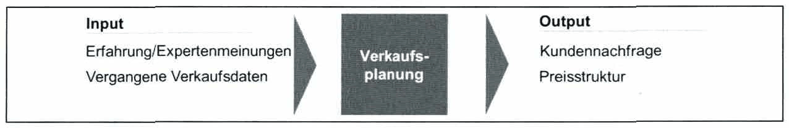

*Abbildung 62: Absatzplanung – Skript S. 150 (PDF 160)* · [Rekonstruktion](../../figures/reconstructed/abb-62.svg)

## 9.1.2 Kurzfristige Produktionsprogrammplanung

Basierend auf den Ergebnissen der Verkaufsplanung müssen die Fragen im Detail beantwortet werden, welche Produkttypen und in welchen Mengen diese im tatsächlichen Planungshorizont (z.B. nächstes Geschäftsjahr oder im dritten Quartal) produziert werden. Ein Produktionsprogramm ist somit gekennzeichnet durch (1) eine qualitative Komponente (welche Produkttypen), (2) eine quantitative Komponente (wie viele Produkte) und (3) eine zeitbasierte Komponente (Zuordnung von Produkten und Mengen innerhalb des Planungshorizonts). Informationen für die Produktionsprogrammplanung sind darüber hinaus Elemente der Unternehmensstrategie, insbesondere im Hinblick auf die erwartete Nachfrage, die erwarteten Verkaufspreisstrukturen, die Produktionskosten pro Einheit und den Bedarfen an Produktionskapazität pro Einheit (Abbildung 63).

<!-- Seite 151 (PDF 161) -->

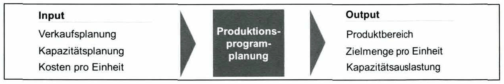

*Abbildung 63: Produktionsprogrammplanung – Skript S. 151 (PDF 161)* · [Rekonstruktion](../../figures/reconstructed/abb-63.svg)

Der Planungsprozess ist in drei Hauptproblembereiche unterteilt, um das Produktionsprogramm zu definieren:

- **Strategische Programmplanung**: Diese umfasst im Prinzip die Ermittlung von Produktfeldern. Diese Produktfelder kennzeichnen das allgemeine Tätigkeitsfeld des Unternehmens.
- **Taktische Programmplanung**: Diese beinhaltet die Definition von Besonderheiten der einzelnen Produktfelder. Strategische Produktfelder unterliegen zwei inhaltlichen Überlegungen:
- Produktionsprogrammumfang: Definition verschiedener Produktgruppen, Arten und Varianten (Unterschiede in Farbe, Qualität oder Dimension).
- Produktionsprogrammtiefe: Unterschiedliche Produktionsschritte, die im Betrieb eines Unternehmens durchgeführt werden, sind dabei festgelegt. Zu entscheiden ist, welche Produkte oder Produktkomponenten vom Unternehmen selbst hergestellt werden oder eher extern an Partnerunternehmen vergeben werden ("make-or-buy"-Entscheidung).

<!-- Seite 152 (PDF 162) -->

In Abbildung 64 wird ein Beispiel für den Aufbau des Produktfeldes "Schuhe" gezeigt.

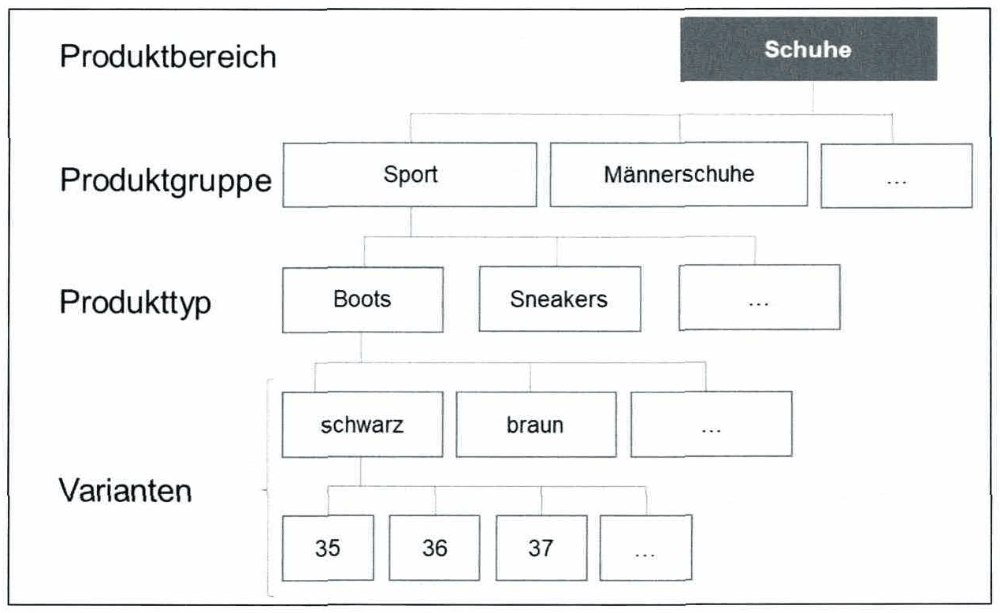

*Abbildung 64: Produktfeld Beispiel – Skript S. 152 (PDF 162)* · [Rekonstruktion](../../figures/reconstructed/abb-64.svg)

Operative Programmplanung: Hinsichtlich der Einschränkungen aus strategischen und taktischen Erwägungen hat die Planung des operativen Programms die Aufgabe, den detaillierten Produktionsplan ("Master-Produktionsplan") für den tatsächlichen (kurzfristigen) Zeithorizont (z.B. für einen Monat) zu bestimmen. Das operative Programm definiert, welche Produkte innerhalb welcher Zeit in welchen Mengen produziert werden.

Ferner werden im Rahmen der Produktionsprogrammplanung folgende zwei Hauptfälle unterschieden:

**Kundenorientiertes Produktionsprogramm**: Das Produktions-programm basiert auf den tatsächlichen eingehenden Bestellungen. Es besteht somit keine Unsicherheit über das tatsächliche Verkaufsvolumen.

**Marktorientiertes Produktionsprogramm**: In diesem Fall basiert die Programmplanung auf Prognosen und damit auf Annahmen. Um die damit verbundenen Unsicherheiten zu bewältigen, sollte das Verkaufsvolumen konstant sein (um die Genauigkeit der Prognosen zu erhöhen). Es besteht ein hoher Standardisierungsgrad innerhalb des Produktbereichs und die Kunden reagieren empfindlich auf Lieferzeiten.

<!-- Seite 153 (PDF 163) -->

In der Realität ist ein Mix beider Fälle üblich. Dies bedeutet, dass Unternehmen ihren Kunden häufig sowohl standardisierte Produkte als auch individuelle (auftragsspezifische) Produkte anbieten. In beiden Fällen muss die Planung des Produktionsprogramms die bestehenden Einschränkungen berücksichtigen: Kapazität und Nachfrage.

Um eine Unternehmung bei maximaler Verarbeitungskapazität zu betreiben, ist eine effektive Produktionsprogrammplanung und Produktionsplanung im Allgemeinen von entscheidender Bedeutung. Die Aufgabe der kurz- und mittelfristigen Planung (taktische und operative Aspekte) besteht darin, die Nachfrage und die Kapazität für allgemeine Managemententscheidungen in Bezug auf den Betrieb zu aggregieren. In diesem Zusammenhang bedeutet "aggregiert” die Zusammenfassung verschiedener Produkte, um einen umfassenden Überblick über die Nachfrage und die Kapazität zu erhalten, die in gewissem Maße angenähert werden müssen. Dennoch ist es in einem ersten Schritt notwendig, die erwarteten Daten hinsichtlich Gewinn und Kosten verschiedener Produktionsprogrammvarianten zu erfassen.

Ein Produktionsprogramm wird letztlich am möglichen Erfolg des Unternehmens gemessen. Die verschiedenen Produktionsprogrammvarianten werden bewertet und verglichen. Als ein vereinfachtes Bild der Realität werden Modelle verwendet, um das beste Ergebnis für das Unternehmen zu bestimmen. Im Allgemeinen ist die Zielfunktion, die maximiert werden soll, der Gewinnbeitrag.

Gewinnbeitrag = Zproaucts (Preis pro Einheit - variable Kosten pro Einheit)

- geplante Produkteinheiten im Planungshorizont

In Abbildung 65 ist beispielhaft die Ermittlung des gewinnoptimierten Produktionsprogramms mit zwei Variablen (Produkten) dargestellt.

<!-- Seite 154 (PDF 164) -->

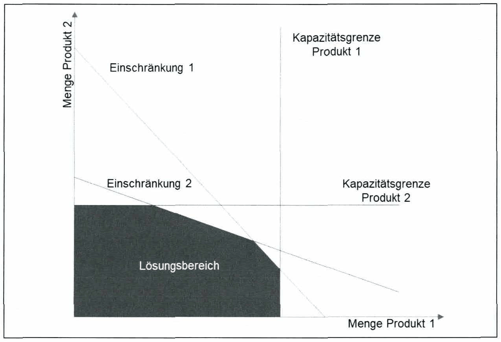

*Abbildung 65: Beispiel einer Produktionsprogrammoptimierung – Skript S. 154 (PDF 164)* · [Rekonstruktion](../../figures/reconstructed/abb-65.svg)

Das Ergebnis des Produktionsprogramms liefert die geplanten Mengen der verschiedenen Produkte und die zu bearbeitenden Produktionsschritte für einen bestimmten Zeitraum.

## 9.1.3 Materialbedarfsplanung

Um vom Produktionsprogramm zur konkreten Produktion auf die Produktionsebene (Shop Floor Level) zu gelangen, müssen Endprodukte in Baugruppen und Komponenten untergliedert werden. Die benötigten Materialien werden anhand der Stückliste identifiziert. Die Stückliste definiert die erforderlichen Mengen an Komponenten (jedes Teil, das extern beschafft wird) sowie Baugruppen (bestehend aus Komponenten, die in der Produktion zusammengebaut werden), um eine Einheit eines Produkts zu erzeugen. Im Folgenden werden relevante Begriffe in der Materialbedarfsplanung definiert:

- Ein Produkt ist ein bearbeitbares Objekt, das durch die Produktion hergestellt wird. Es besteht aus mehreren Teilen und / oder Gruppen und ist das endgültige Produktionsergebnis (DIN 199, Teil 2)
- Eine Baugruppe ist ein Objekt, das aus zwei oder mehr Teilen und / oder Baugruppen niedrigerer Ordnung besteht (DIN 199, Teil 2)

<!-- Seite 155 (PDF 165) -->

- Ein einzelnes Bauteil oder Teil ist ein Gegenstand, der nicht ohne Zerstörung zerlegt werden kann (DIN 109, Teil 2)
- Das Rohmaterial ist das Ausgangsmaterial für eine Komponente oder ein Einzelteil

Zur Veranschaulichung der Stückliste kann ein sogenannter "Gozintograph" gezeichnet werden (siehe Abbildung 66).

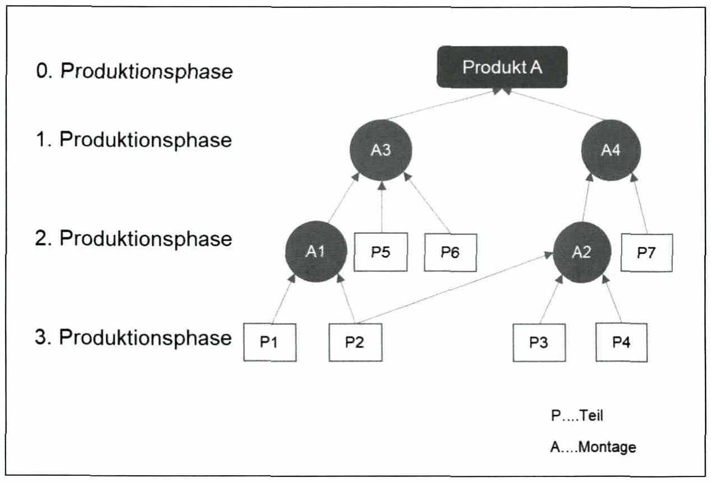

*Abbildung 66: Gozintograph – Skript S. 155 (PDF 165)* · [Rekonstruktion](../../figures/reconstructed/abb-66.svg) · [Zeichenübung](../../learning/drawing-exercises/abb-66-zeichenuebung.md)

Die erforderlichen Materialien für den Betrieb können in Kombination mit dem Ergebnis des Produktionsprogramms bestimmt werden. Das Ergebnis der Materialbedarfsplanung ist die optimale Materialversorgung für jeden Produktionsprozess bezüglich Timing, Qualität und Kosteneffizienz (siehe Abbildung 67).

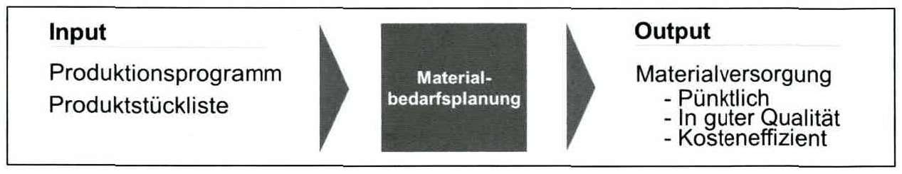

*Abbildung 67: Materialbedarfsplanung – Skript S. 155 (PDF 165)* · [Rekonstruktion](../../figures/reconstructed/abb-67.svg)

<!-- Seite 156 (PDF 166) -->

### 9.1.3.1 Material

Im Allgemeinen gibt es drei Materialklassen (siehe Abbildung 68).

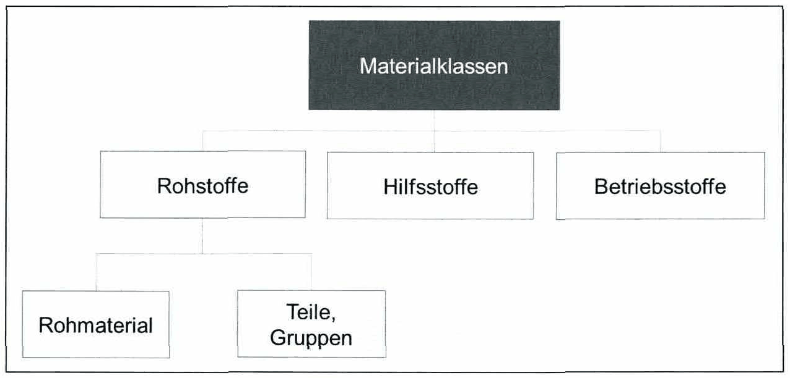

*Abbildung 68: Materialklassen – Skript S. 156 (PDF 166)* · [Rekonstruktion](../../figures/reconstructed/abb-68.svg) · [Zeichenübung](../../learning/drawing-exercises/abb-68-zeichenuebung.md)

- **Rohstoffe** werden direkt für die Herstellung einer Komponente, einer Baugruppe oder eines Produkts benötigt. Material kann unverändert oder in modifizierter Form verwendet werden. Es kann Rohmaterial sein, das weiterverarbeitet wird; es kann aber auch ein halbfertiges oder gekauftes Teil bestimmter Art und Dimension sein.
- **Hilfsstoffe** werden nur indirekt für die Herstellung von Bauteilen, einer Baugruppe oder eines Produktes benötigt. Hilfsstoffe sind nur in Produkten in unbedeutenden Mengen vorhanden (z.B. Klebstoffe, Schweißzusatz).
- **Betriebsstoffe** sind erforderlich, um den Betrieb aufrechtzuerhalten (Nutzung von Produktionsanlagen). Betriebsstoffe gehen nicht mit dem Produkt selbst (z.B. elektrische Energie, Wasser, Schmiermittel) zusammen.

Der Materialbedarf kennzeichnet die Art und Menge des Materials, das für die Herstellung von Produkten oder die Belieferung des Absatzmarktes benötigt wird. Im Allgemeinen werden drei verschiedene Arten von Nachfrage unterschieden (siehe Abbildung 69):

<!-- Seite 157 (PDF 167) -->

- Der **Primärbedarf** ist die Notwendigkeit von Produkten. Dieser wird auch als "Marktbedarf” bezeichnet.
- Der **abhängige (sekundäre) Bedarf** ist die Nachfrage nach Materialien (Baugruppen, Komponenten, Rohmaterial), die für die Herstellung von Primärbedarf? benötigt werden.
- Unter dem **tertiären Bedarf** versteht man Hilfsstoffe, um den Primärbedarf herzustellen.

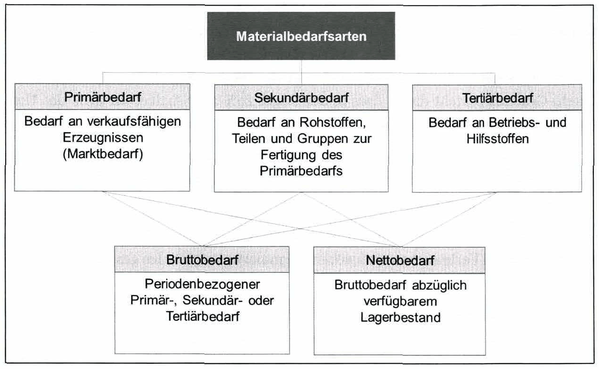

*Abbildung 69: Materialbedarf – Skript S. 157 (PDF 167)* · [Rekonstruktion](../../figures/reconstructed/abb-69.svg) · [Zeichenübung](../../learning/drawing-exercises/abb-69-zeichenuebung.md)

Bei der Bestandsaufnahme wird zusätzlich unterschieden zwischen:

- **Bruttobedarf**: Periodenbezogener Materialbedarf ohne Berücksichtigung von Vorräten (Lager)
- **Nettobedarf**: Differenz zwischen Bruttobedarf und verfügbarem Bestand zu einem bestimmten Zeitpunkt

## 9.1.4 Das Bestandsdilemma

Der Bestand wird im Operations Mangement häufig diskutiert. Lagerbestände dienen grundsätzlich als Sicherheitspolitik für unsichere Zeiten und ermöglichen es Unternehmen, schneller auf Schwankungen der Kundennachfrage zu reagieren. Sie sind jedoch kostspielig, binden einen erheblichen Teil des Betriebskapitals und benötigen viel

<!-- Seite 158 (PDF 168) -->

Platz in den Betrieben. Die Notwendigkeit von Lagerbeständen beruht in vielen Fällen auf der Nichtkonformität von Angebot und Nachfrage.

Wenn mehr als ein Artikel vorrätig ist, sind einige davon für den Betrieb wichtiger als andere. Die wichtigsten Artikel haben sehr hohe Verwendung und wenn sie nicht auf Lager sind, würden sie Lieferprobleme verursachen. Andere Gegenstände haben wahrscheinlich einen hohen Wert und ein großer Sicherheitsbestand wäre mehr als teuer. Daher besteht eine gängige Methode zur Bewertung verschiedener Lagerartikel darin, sie nach ihrem Verwendungswert zu klassifizieren (Verwendungsrate multipliziert mit dem Wert). Gegenstände mit einem hohen Gebrauchswert werden sehr sorgfältig kontrolliert. Dagegen müssen Elemente mit geringem Nutzungswert nicht sehr streng kontrolliert werden. Eine Möglichkeit, Artikel nach ihrer Verwendungsrate zu klassifizieren, ist das sogenannte "Pareto-Gesetz" oder die "80/20-Regel". Das Phänomen des Pareto-Gesetzes besteht darin, dass in der Regel 20% aller Artikel für 80% des Umsatzvolumens verantwortlich sind (siehe Abbildung 70).

- A-Artikel sind Waren, deren jährlicher Verbrauchswert der höchste ist. Die höchsten 80% des jährlichen Verbrauchswerts machen normalerweise 20% des gesamten Lagerbestands aus.
- B-Artikel liegen mit einem mittleren Verbrauchswert im Mittelfeld. Die 10% des jährlichen Verbrauchswert machen normalerweise 30% des gesamten Lagerbestands aus.
- C-Artikel sind vielmehr Artikel mit dem niedrigsten Verbrauchswert. Die unteren 10% des jährlichen Verbrauchswert machen normalerweise 50% des gesamten Lagerbestands aus.

<!-- Seite 159 (PDF 169) -->

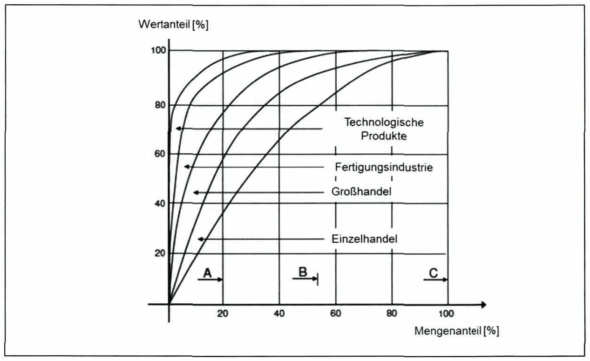

*Abbildung 70: ABC Analyse – Skript S. 159 (PDF 169)* · [Rekonstruktion](../../figures/reconstructed/abb-70.svg) · [Zeichenübung](../../learning/drawing-exercises/abb-70-zeichenuebung.md)

- Wie bereits erwähnt, dienen Vorräte dazu, die Diskrepanz zwischen Angebot und Nachfrage auszugleichen. Daher sind die Bestandsführung und insbesondere die Frage "wann welche Bestellung erfolgt" wichtig. Erstens erschweren die Unvorhersehbarkeit der Nachfrage und die notwendige Bestellzeit die Materialversorgung. Zweitens sind miteinander in Beziehung stehende Variablen, wie Auftragskosten, Bestellhäufigkeit oder Positionsklasse (A, B, C), Herausforderungen in der Bestandsverwaltung. Aus diesem Grund wurden verschiedene Ansätze zur Ermittlung einer optimalen Auftragsgröße und Auftragsplatzierung entwickelt, die Teil von vertiefenden Masterlehrveranstaltungen sind. Darüber hinaus stehen Material Resourse Planning Systeme (MRP-Systeme) zur Unterstützung von Managern im Betrieb zur Verfügung. Diese Systeme helfen bei der Erstellung von Volumen- und Zeitberechnungen. Die Planung im Betrieb erstreckt sich jedoch über "Materialien" hinaus und umfasst unter anderem Zeit-‚ Kapazitäts- und Allokationsplanung.

## 9.1.5 Zeit- und Kapazitätsplanung

Die Zeit- und Kapazitätsplanung von Arbeitsaufträgen besteht aus der Definition von Start- und Endterminen für die Ausführung von Aufgaben in Betrieben unter Berücksichtigung der gegebenen Einschränkung der verfügbaren Kapazitäten. Ziel ist es, die

<!-- Seite 160 (PDF 170) -->

Gesamtaufgabe (Erfüllung der Kundennachfrage) innerhalb des vorgegebenen Zeitraums zu ermöglichen (siehe Abbildung 71).

*Abbildung 71: Zeit- und Kapazitätsplanung – Skript S. 160 (PDF 170)* · [Rekonstruktion](../../figures/reconstructed/abb-71.svg)

### 9.1.5.1 Terminierung

Die Terminierung ist der Vorgang, mit dem die zeitliche Zuordnung von auszuführenden Arbeitsaufgaben geplant wird. Das Ergebnis der Planung ist der auftragsbezogene und einrichtungsspezifische Produktionsplan. Die Festlegung der Fertigungstermine für Baugruppen, Teile- und Produktfertigung erfolgt unter Berücksichtigung der Material- und Kapazitätsanforderungen für festgelegte Bestellmengen und Liefertermine. Der Produktionsplan ist von den Betreibern und der Produktionsstätte als "Zielzustand" zu sehen. Der tatsächliche Zustand variiert in vielen Fällen aufgrund von Störungen.

**Haupttreiber für die Planung sind:**

- Art, Menge, Termine und Qualität der Aufträge
- Personal- und Maschinenkapazitäten
- Geplante Durchlaufzeiten

Die wichtigsten Störungen, die die Planung beeinflussen, sind:

- Änderungen innerhalb des Produktionsprogramms und der Aufträge
- Ungeplanter Ausschuss und Nacharbeit
- Fehlende Mitarbeiter (z.B. Krankheit) oder Maschinenausfälle
- Ungenauigkeit der Planungsmethode

Die Abhängigkeiten der Planung sind in Abbildung 72 dargestellt.

<!-- Seite 161 (PDF 171) -->

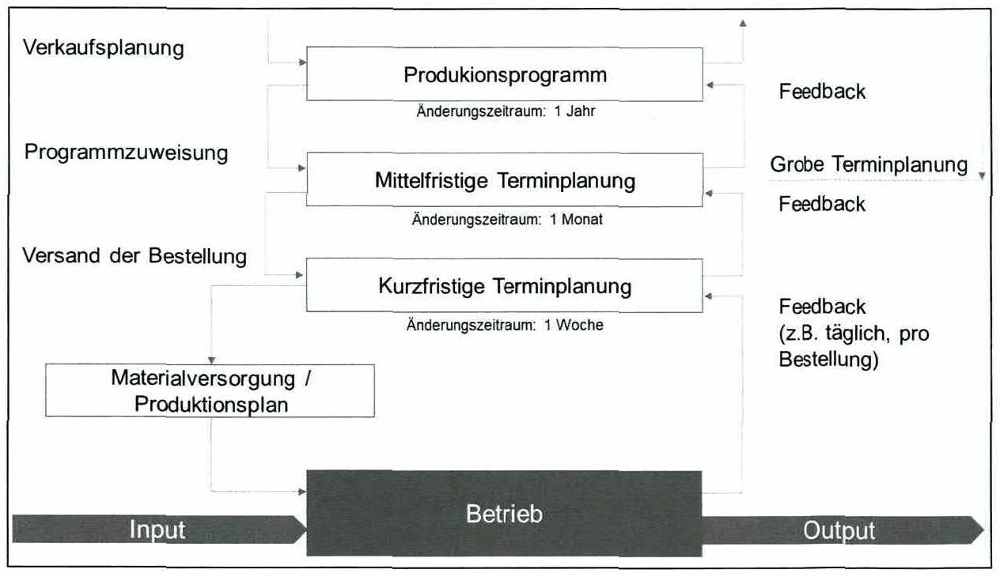

*Abbildung 72: Planungsabhängigkeiten – Skript S. 161 (PDF 171)* · [Rekonstruktion](../../figures/reconstructed/abb-72.svg) · [Zeichenübung](../../learning/drawing-exercises/abb-72-zeichenuebung.md)

## 9.1.6 Kapazitätsplanung

Die Aufgaben der Kapazitätsplanung sind die Erstellung von (1) tatsächlich verfügbarer Kapazität, (2) Kapazitätsbedarfsplanung und (3) Kapazitäts-koordination.

**Tatsächliche verfügbare Kapazität**: Definiert die tatsächlich verfügbare Kapazität zur Verarbeitung von Arbeitsaufträgen in Bezug auf Qualität und Quantität. Es wird einerseits zwischen theoretischer und effektiver Leistungsfähigkeit unterschieden und andererseits zwischen

- einzelne Kapazität (Mitarbeiter bzw. Betriebsmittel)
- Gruppenkapazität (Kostenstelle, Abteilung ...)
- Gesamtkapazität (Produktion).

Die tatsächlich verfügbare Kapazität ermöglicht die Planung der benötigten Kapazitäten hinsichtlich Qualität und Quantität der Mitarbeiter und Betriebsmittel für mittel- und langfristige Zeiträume.

**Kapazitätsbedarfsplanung**: Kapazitätsanforderungen werden an die qualitativen und quantitativen Anforderungen einzelner Aufträge angepasst, die zu Produktionsplänen gebündelt werden. Außerdem sind sie auf das mittel- und langfristige Produktionsprogramm ausgerichtet.

<!-- Seite 162 (PDF 172) -->

- **Kapazitätsplanung**: Ziel der Kapazitätsplanung ist es, einen permanenten Abgleich von Kapazitätsbedarf und tatsächlich verfügbarer Kapazität zu gewährleisten. Somit wird eine (optimale) Kapazitäts-auslastung sichergestellt. Die Kapazitätsausrichtung hängt vom Zeithorizont ab.
- Lang- und mittelfristige Diskrepanzen der verfügbaren Kapazitäten und Kapazitätsbedarf führen zu einer Angleichung der Betriebsmittel (Investition / Kapazitätsabbau), bei der Einstellung oder beim Abbau von Mitarbeitern.
- Kurzfristige Kapazitätsanpassungen konzentrieren sich insbesondere auf den Abgleich mit Beginn, Ende oder Betriebszeiten von Aufträgen oder Verlagerung von Produktionsschritten auf unterschiedliche Betriebsmittel. Kurzfristige Anpassungen können nur durch Erhöhung oder Reduzierung der verfügbaren Arbeitszeit (Überstunden, Extra-Schicht, Leerlaufzeit) erreicht werden.

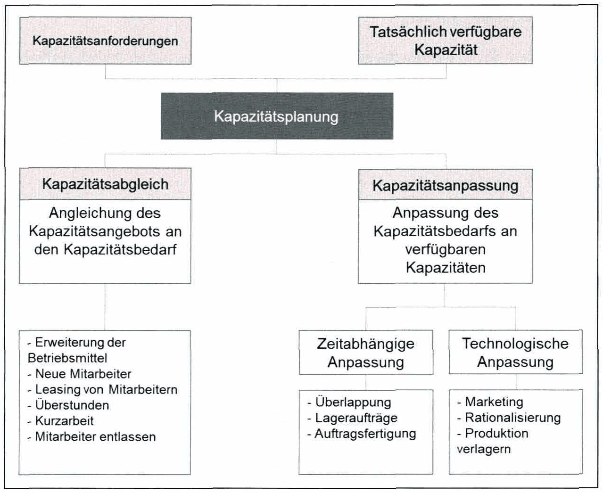

*Abbildung 73: Kapazitätsplanung – Skript S. 162 (PDF 172)* · [Rekonstruktion](../../figures/reconstructed/abb-73.svg) · [Zeichenübung](../../learning/drawing-exercises/abb-73-zeichenuebung.md)

<!-- Seite 163 (PDF 173) -->

## 9.1.7 Gesamtanlageneffektivität

Wie bereits erwähnt, besteht ein Unterschied zwischen der effektiven und der theoretischen Kapazität. Die theoretische Kapazität kann in der Praxis aus verschiedenen Gründen (z.B. Wartung) nicht immer erreicht werden. Die verbleibende Kapazität wird als effektive Kapazität bezeichnet. In der Industrie gibt es wenig Standardisierung für die Messung der effektiven Kapazität. Die Idee der Gesamtanlageneffektivität (GAE) (englisch: Overall Equipment Effectiveness - OEE) wird jedoch häufig als ein nützlicher Weg zur Messung der Kapazitätseffektivität aufgezeigt. Die GAE ist ein Leistungsindikator für die Wirksamkeit von Betriebsausrüstung. Sie basiert auf (1) der verfügbaren Betriebsmittelzeit, (2) der Geschwindigkeit oder der Durchsatzrate und (3) der erreichten Quallität (siehe Abbildung 74). Um die effektive Kapazität zu erhöhen, muss ein Betriebsmittel innerhalb dieser drei Dimensionen ein hohes Leistungsniveau erreichen.

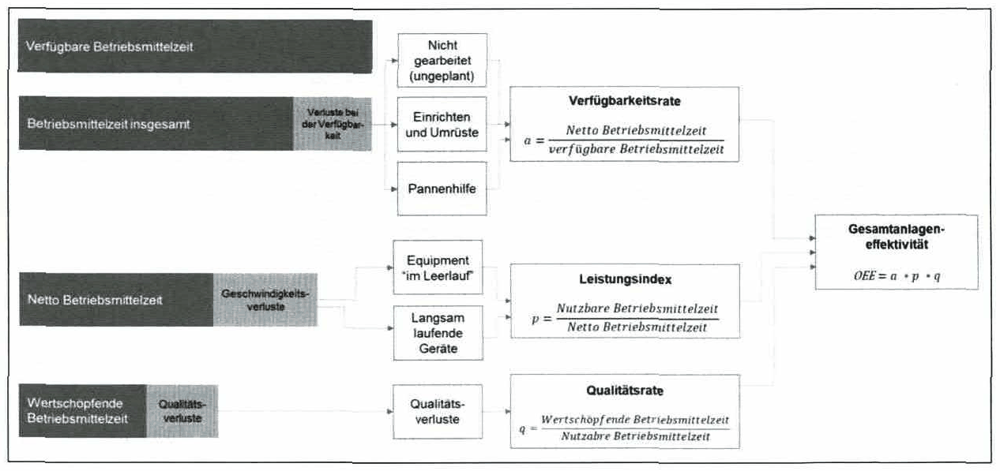

*Abbildung 74: Gesamtanlageneffektivität – Skript S. 163 (PDF 173)* · [Rekonstruktion](../../figures/reconstructed/abb-74.svg) · [Zeichenübung](../../learning/drawing-exercises/abb-74-zeichenuebung.md)

**GAE = Verfügbarkeitsrate \* Leistungsrate \* Qualitätsrate**

Die GAE repräsentiert somit die wertvolle Betriebszeit in Prozent der theoretischen Kapazität.

## 9.1.8 Bewerkstelligung von Zeit- und Kapazitätsplanung

Um die Nachfrage, die Kapazität und die für sie benötigten Informationen zu verwalten, die unter Berücksichtigung von Einschränkungen wie der tatsächlichen Kapazität oder Lieferterminen gewonnen werden, werden sogenannte "Enterprise Resource Planning (ERP)" - Systeme verwendet (siehe Abbildung 75). ERP ist ein unternehmensweites Informationssystem, das Informationen aus relevanten Funktionen enthält, die für die Planung und weitere Steuerung von operativen Tätigkeiten benötigt werden. Der wichtigste Vorteil ist die verfügbare Transparenz aufgrund der ERP-Datenbank.

<!-- Seite 164 (PDF 174) -->

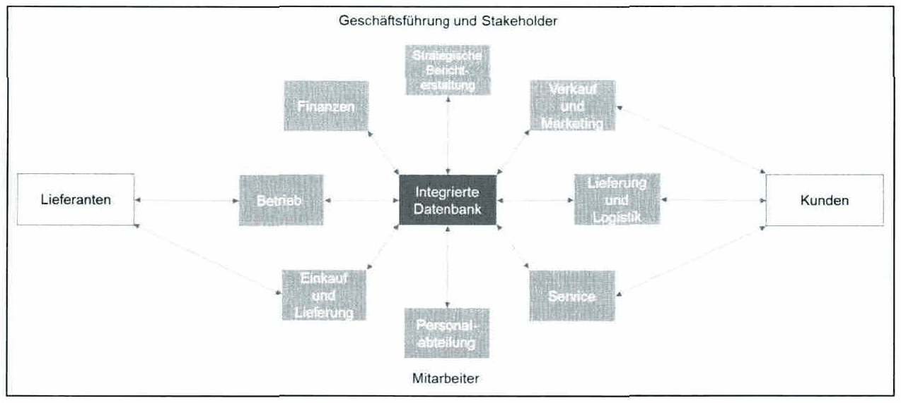

*Abbildung 75: Enterprise resource planning – Skript S. 164 (PDF 174)* · [Rekonstruktion](../../figures/reconstructed/abb-75.svg)

ERP-Systeme sind eine Weiterentwicklung von MRP-Systemen, die seit den 1970er Jahren zur Unterstützung der Materialbedarfsplanung eingesetzt werden. Aufgrund der hohen Integration von Unternehmensfunktionen haben ERP-Systeme das Potenzial, die Performance vieler Organisationen signifikant zu verbessern. Unternehmen, die ERP-Systeme anbieten, sind z.B. SAP und Oracle.

## Prüfungsfragen zu diesem Abschnitt

6 Fragen aus der [Prüfungsfragen-Datenbank](../../exams/questions.md): `frage-2024-10-15-2`, `frage-2025-02-04-2`, `frage-2025-03-18-4`, `frage-2025-06-16-5`, `frage-2025-12-11-5`, `frage-2026-01-22-5`
