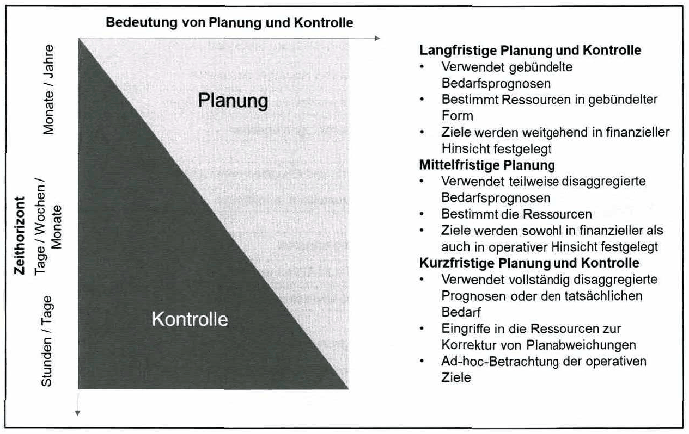
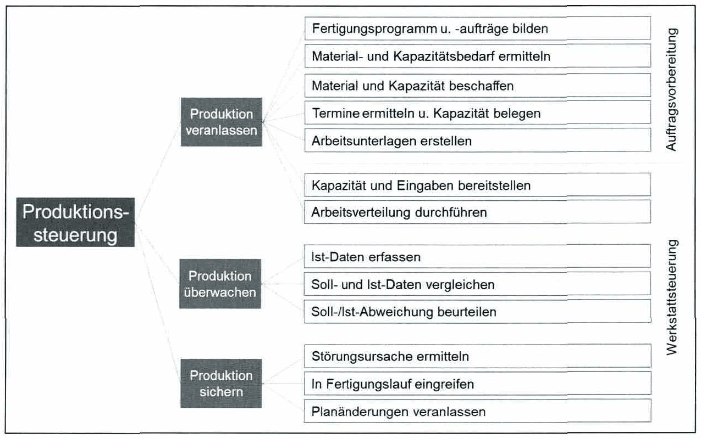
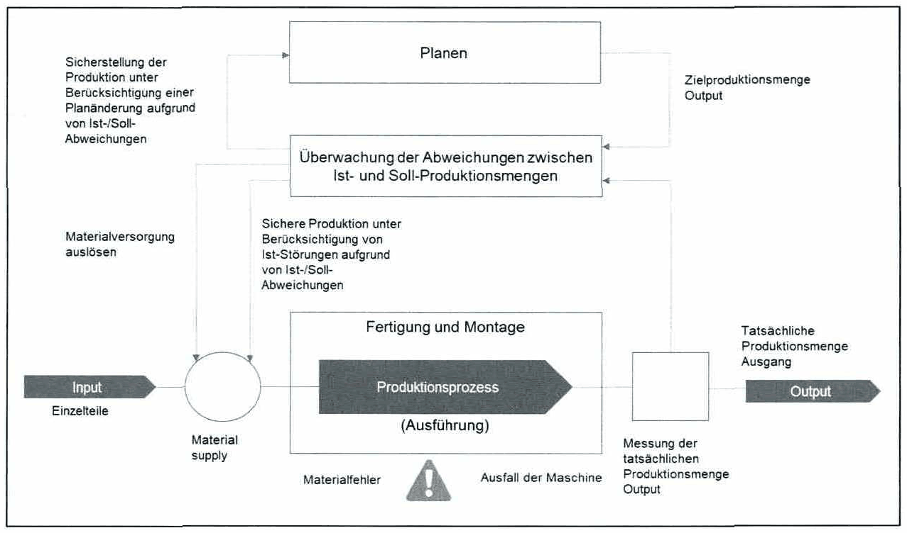
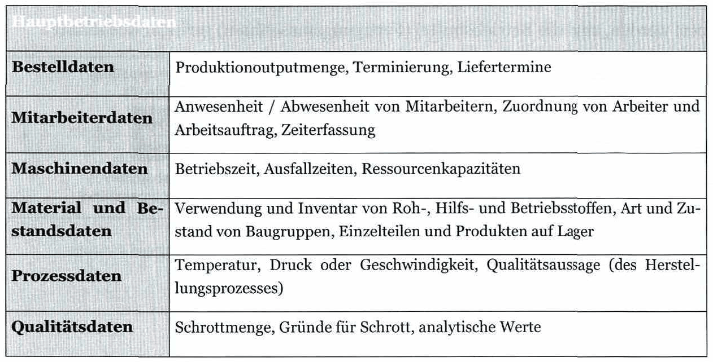
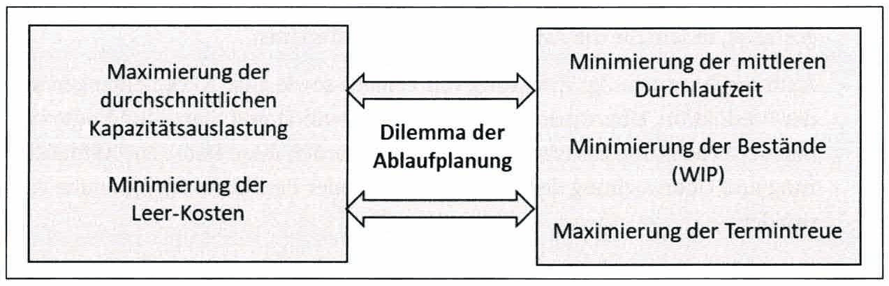
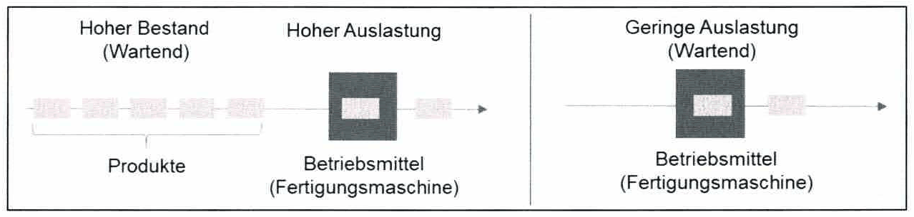
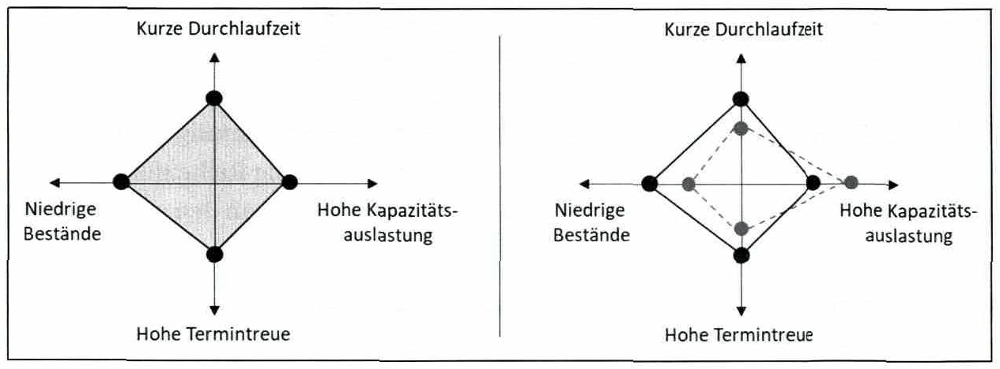
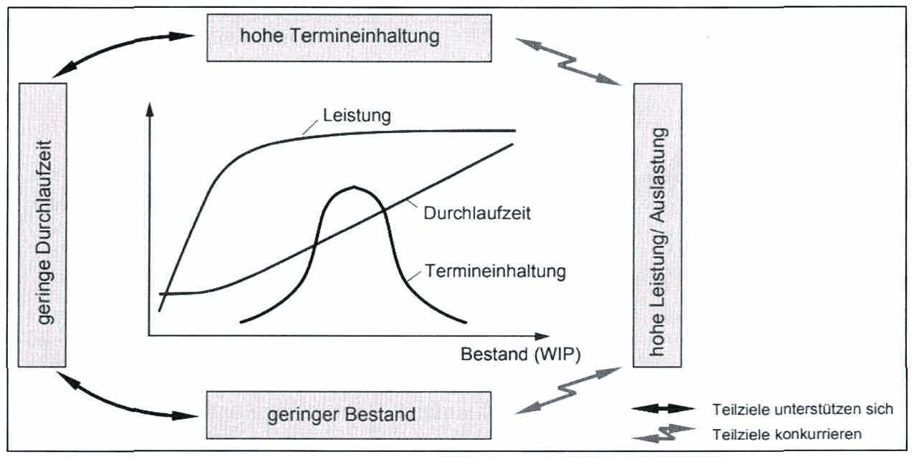

<!-- Seite 164 (PDF 174) -->

# 9.2 Steuerung

Im Allgemeinen ist Planung die Formalisierung dessen, was in der Zukunft passieren könnte. Diese Pläne basieren z.B. Prognosen und Annahmen und hängen von vielen Variablen ab, wie in den vorherigen Kapiteln beschrieben. Steuerung dagegen ist der Prozess der Anpassung von Plänen an Veränderungen dieser Variablen. Die Grenzen zwischen Planung und Kontrolle ändern sich entlang des Zeithorizonts (siehe Abbildung 76).

<!-- Seite 165 (PDF 175) -->

*Abbildung 76: Planung und Steuerung über die Zeit – Skript S. 165 (PDF 175)*

In diesem Kapitel liegt der Schwerpunkt auf kurzfristiger Steuerung. Ziel ist es die Produktion, (1) zu veranlassen, (2) zu überwachen (Ist-Situation) und (3) die Aufgabenausführung hinsichtlich Menge, Termine, Qualität, Kosten und Arbeitsbedingungen zu sichern (siehe Abbildung 77).

<!-- Seite 166 (PDF 176) -->

*Abbildung 77: Produktionssteuerung – Skript S. 166 (PDF 176)*

Das Sichern der Aufgabenausführung beinhaltet das Reagieren in der Form von (1) Interferieren durch Anpassen des tatsächlichen Zustands an den Zielzustand und (2) Anpassen des Plans durch Aktualisieren des Zielzustands mit tatsächlichen Informationen. Somit ergibt sich ein geschlossener Regelkreis (siehe Abbildung 78).

*Abbildung 78: Produktionsregelkreis – Skript S. 166 (PDF 176)*

<!-- Seite 167 (PDF 177) -->

## 9.2.1 Starten und überwachen der Produktion

Das Starten und die Überwachung von Produktionsprozessen umfasst folgende Aspekte:

Bereitstellung von Materialien, Arbeitsunterlagen, Personal und Ausrüstung am Arbeitsplatz. Die Bereitstellung kann nach einem Push-, einem Pull- oder einem kombinierten System erfolgen.

Arbeitsverteilung: Aktualisierung der Planauftragsmengen sowie der Auftragstermine und Abgleich mit der aktuellen Kapazitätsauslastung der Produktion, d.h. Umlagerung von Aufträgen. Anschließend werden die Fertigungsaufträge gestartet, indem Sie die Arbeitsdokumente weiterleiten.

Auftragsüberwachung: Erfassung von Fehlern sowie aller Rückmeldungen aus der Produktion. Überwachung von Mengen, Qualität und Start- und Endterminen der Produktionsaufträge. Anschließend werden diese Daten zur Aktualisierung und Überwachung der Kundenaufträge oder Produktionsprogramme verwendet.

Produktionsdatenerfassung/Maschinendatenerfassung: Betriebsdaten sind alle während der Produktionsprozesse tatsächlich erzeugten Daten. Sie umfassen hauptsächlich Daten, die den Zustand der Operation und die Auftragsverarbeitung beschreiben, die mit dem Produktionsprozess verbunden sind. Diese Daten inkludieren die Bereiche Konstruktion, Produktionsplanung, Teilefertigung, Montage, Lagerhaltung und Qualitätsmanagement. Beispiele für Produktionsdaten sind in Tabelle 6 erläutert.

*Tabelle 6: Beispiel Hauptbetriebsdaten – Skript S. 167 (PDF 177)*

<!-- Seite 168 (PDF 178) -->

## 9.2.2 Dilemma der Ablaufplanung

Der Forderung nach Minimierung der Durchlaufzeit steht die Forderung, die Fertigungsaufträge zeitlich so zu verteilen, dass eine möglichst hohe Auslastung der Betriebsmittel erreicht wird, gegenüber. In dem Maße, in dem es gelingt, arbeitsablaufbedingte Leerzeiten zu minimieren, wird die Forderung nach günstigster Auslastung der Betriebsmittelkapazität erfüllt. Jede Ablaufplanung stellt somit den Versuch dar, diese beiden entgegengesetzten Forderungen miteinander in Einklang zu bringen. Dieses von Gutenberg geprägte „Dilemma der Ablaufplanung“ führt zur Notwendigkeit einer temporären, unterschiedlichen Gewichtung der verschiedenen Ziele.[^187]

*Abbildung 79: Dilemma der Ablaufplanung – Skript S. 168 (PDF 178)*

Am folgenden Beispiel soll das Dilemma der Ablaufplanung veranschaulicht werden. Falls ein hoher Bestand (Work-in-Process - „WIP“) vorliegt, können hohe Auslastungen für die Betriebsmittel (Fertigungsmaschinen) erreicht werden. Die Produkte müssen jedoch eventuell auf Grund der Ablaufplanung vor den Maschinen warten, was die Durchlaufzeiten der Produkte erhöht. Sollen die Durchlaufzeiten und Bestände reduziert werden, sind die Betriebsmittel (Fertigungsmaschinen) geringer ausgelastet.

*Abbildung 80: Dilemma der Ablaufplanung am Bsp. der Maschinenauslastung und Bestand – Skript S. 168 (PDF 178)*

<!-- Seite 169 (PDF 179) -->

*Abbildung 81: Dilemma der Ablaufplanung am Bsp. der Erhöhung der Kapazitätsauslastung – Skript S. 169 (PDF 179)*

Abbildung 81 zeigt eine weitere Visualisierung des Dilemmas der Ablaufplanung auf Basis der 4 Kenngrößen Bestand, Durchlaufzeit, Termintreue und Kapazitätsauslastung. Will ein Unternehmen z.B. die Kapazitätsauslastung der Betriebsmittel (z.B. Fertigungsmaschinen) erhöhen, müssen die Bestände (Work-in-Process) erhöht werden. Dadurch können sich die Durchlaufzeiten erhöhen wodurch auch die Termintreue verschlechtert wird.

*Abbildung 81: Dilemma der Ablaufplanung am Bsp. der Erhöhung der Kapazitätsauslastung – Skript S. 169 (PDF 179)*

Anhand der Produktionskennlinien kann dargestellt werden, wie sich ein Arbeitssystem bei ansonsten unveränderten Randbedingungen verhält, wenn z.B. ein anderer Bestand (WIP) eingestellt wird. Sie charakterisieren somit das logistische Verhalten bezüglich Leistung/Auslastung, Durchlaufzeit und Termintreue einer Fertigung bei einer Bestandsveränderung. Die Linien zeigen, dass es nicht möglich ist, ein gleichzeitiges Optimum für alle genannten Zielgrößen zu definieren. So benötigt die Sicherung einer hohen Auslastung z.B. hohe Bestände, die ihrerseits jedoch lange Durchlaufzeiten verursachen.

<!-- Seite 170 (PDF 180) -->

*Abbildung 82: Visualisierung des Dilemmas der Ablaufplanung mit Produktionskennlinien – Skript S. 170 (PDF 180)*

/

## 9.2.3 Auftragsfreigabe

Im Rahmen der Auftragsfreigabe wird im Wochenrhythmus entschieden, welche der für die kommende Woche eingeplanten Produktionsaufträge freigegeben und somit produziert werden sollen. Für die freigegebenen Produktionsaufträge wird schließlich im Rahmen der Produktionssteuerung zunächst die Aufteilungsplanung (konkrete Zuordnung eines Auftrags an ein Arbeitssystem) und daraufhin die Reihenfolgeplanung (Reihenfolge der Bearbeitung der einzelnen Produktionsaufträge an den einzelnen Arbeitsstationen) vorgenommen.

Wird ein Fertigungsauftrag freigegeben, so tritt er in den Produktionsbereich ein und es werden konkrete Aktivitäten zu seiner Bearbeitung angestoßen. Die Auftragsfreigabe übernimmt von der Terminierung und Kapazitätsplanung alle bisher ermittelten und gespeicherten Auftragsdaten, wie die geplante Durchlaufzeit der zugehörigen Arbeitsgänge sowie früheste/späteste Anfangs- und Endtermine. Weiters erfolgt die Prüfung, ob sämtliche benötigten Ressourcen zur Durchführung des Produktionsauftrags verfügbar sind. Diese Prüfung bezieht sich auf

- benötigte Einzelteile und Baugruppen gemäß Arbeitsplan und Stückliste
- Betriebsmittel, die für die Durchführung der Arbeitsgänge vorgesehen sind
- erforderliches Personal für Bearbeitung und Transport der Produktionaufträge
- zur Produktion benötigte Informationen

<!-- Seite 171 (PDF 181) -->

Bei der statischen Auftragsfreigabe wird ein Produktionsauftrag nur dann frei-gegeben, wenn alle benötigten Ressourcen tatsächlich am Produktionsort vorhanden sind. Im Gegensatz dazu wird ein Auftrag bei der dynamischen Auftragsfreigabe schon freigegeben, wenn zwar noch nicht alle Ressourcen verfügbar sind, man aber erwarten kann, dass die Ressourcen jeweils zu Beginn der sie benötigenden Arbeitsgänge zur Verfügung stehen. Die dynamische Auftragsfreigabe führt zu einer früheren Freigabe übergeordneter Aufträge und soll damit zu einer Verkürzung der Durchlaufzeiten der Produkte beitragen.[^191]

## 9.2.4 Maschinenbelegung

Das Grundproblem der Maschinenbelegung besteht in der terminlichen Zuordnung von mehreren Produktionsaufträgen zu einzelnen Maschinen bzw. Betriebsmittelgruppen, welche die Arbeitsgänge durchführen. Prinzipiell lässt sich hier nach zwei verschiedenen Maschinenbelegungsproblemen unterscheiden: [^192]

- Ein-Maschinen-Problem: Aufträge durchlaufen lediglich eine Produktionsstufe, weshalb die Auftragsreihenfolge nur für eine Maschine zu bestimmen sind
- Mehr-Maschinen-Problem: es müssen n Aufträge m Maschinen zugeordnet werden und eine zielangemessene Maschinenbelegung gefunden werden

Neben Maschinen (Anlagen) können auch alle anderen technischen Ausrüstungen, Vorrichtungen und Werkzeuge, die für die Ausführung von Fertigungs-, Assemblierungs- und Logistikprozesse notwendig sind, bei dieser Priorisierung betroffen sein.

Sofern ein Produktionsprogramm definiert wurde und die benötigten Betriebsmittel bekannt sind, kann die Anzahl der notwendigen Betriebsmittel zur Erfüllung der Stückzahlen berechnet werden. Die Betriebsmittelzeit je Einheit für ein Produkt und Betriebsmittelgruppe ist bei einer losweisenden Produktion an ihre Losgröße anzupassen. [^193]

[^187]: Vgl. Gutenberg (1997) S. 49
[^191]: Hansmann (2006), S. 339
[^192]: »? Hansmann (2006), S. 353
[^193]: w3 Vgl. Kettner et al. (1984), S. 53ff

## Fußnoten ohne sicheren Textanker

Diese Fußnoten stehen auf den Seiten dieses Abschnitts, ihr Verweiszeichen im Text ließ sich aus dem Scan aber nicht eindeutig zuordnen (oft Quellenangaben zu Abbildungen).

- **188** – Seite 168 (PDF 178): Vgl., Gutenberg (1997) S.49
- **189** – Seite 169 (PDF 179): Ramsauer (1997), S. 196
- **190** – Seite 170 (PDF 180): Nyhuis (2008)

## Prüfungsfragen zu diesem Abschnitt

2 Fragen aus der [Prüfungsfragen-Datenbank](../../exams/questions.md): `frage-2024-12-10-5`, `frage-2025-04-09-3`
