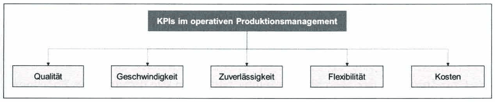
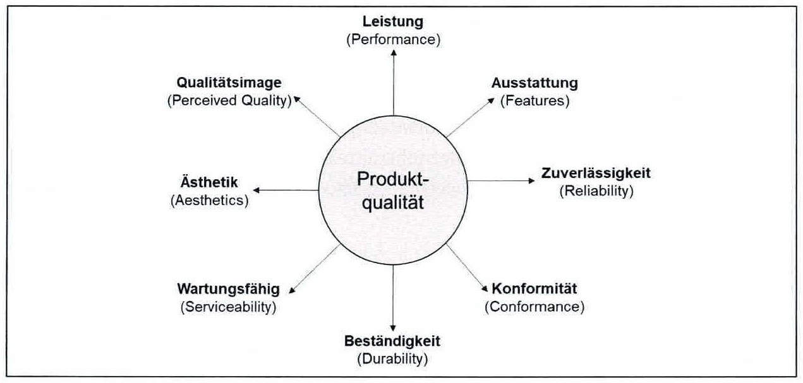
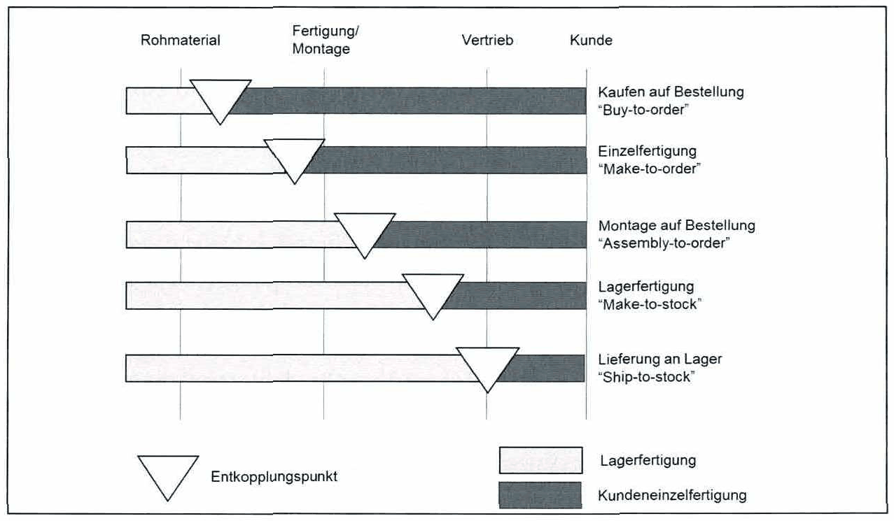
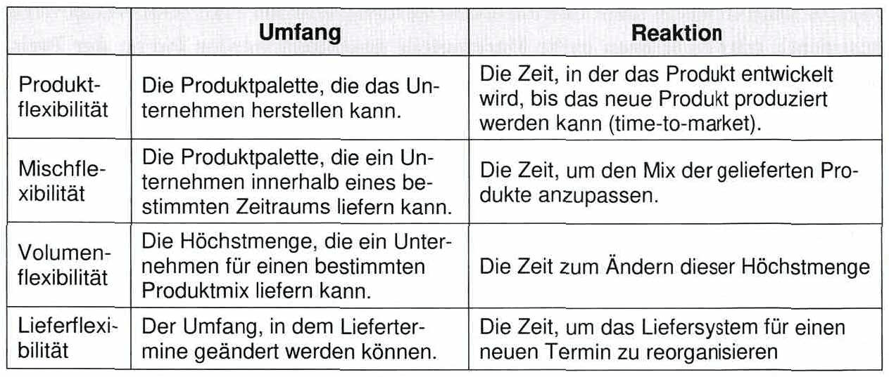

<!-- Seite 171 (PDF 181) -->

# 9.3 Kontrolle (Leistungskennzahlen)

Wie bereits beschrieben, ist das Ergebnis eines Prozesses der Output. Ein Maß für die Güte eines Prozesses ist die Abweichung zwischen Ist- und Sollzustand. Wenn die Differenz zwischen den Zielvorgaben und dem Output groß ist, so müssen so lange Veränderungen bzw. Verbesserungen am Prozess durchgeführt werden, bis die Abweichung unbedeutend ist. Dies gilt auch im Falle von Störungen, oder durch die Vorgabe neuer Ziele durch das Management. 19

<!-- Seite 172 (PDF 182) -->

Die Beurteilung der Prozesse oder des Outputs einer Produktion erfolgt mit Leistungskennzahlen (Key Performance Indicators — KPIs). Eine Auswahl ausgewählter KPIs sind in Abbildung 83 dargestellt und werden im Folgenden näher beschrieben.

*Abbildung 83: Ausgewählte KPIs im operativen Produktionsmanagement – Skript S. 172 (PDF 182)* · [Rekonstruktion](../../figures/reconstructed/abb-83.svg) · [Zeichenübung](../../learning/drawing-exercises/abb-83-zeichenuebung.md)

## 9.3.1 Qualität

9.3.[^194] **Qualität**

Qualität umfasst sowohl die Qualität des Produkts, als auch die Qualität des Prozesses, der zur Herstellung des Produkts erforderlich ist oder die Qualität des Systems[^195]. Aus Sicht der Kunden kann die Produktqualität unterschiedlich beschrieben werden. Der Kunde hat unterschiedliche Bedürfnisse und Anforderungen und damit unterschiedliche Qualitätsansprüche. Die Aspekte bzw. Dimensionen (siehe Abbildung 84) für die Qualität eines Produktes sind[^196]:

*Abbildung 84: Dimensionen der Produktqualität – Skript S. 172 (PDF 182)* · [Rekonstruktion](../../figures/reconstructed/abb-84.svg) · [Zeichenübung](../../learning/drawing-exercises/abb-84-zeichenuebung.md)

<!-- Seite 173 (PDF 183) -->

- **Leistung (Performance)**

Umfang und die Funktionalität des Produktes.

- **Ausstattung (Features)**

Tragen sekundär zur Leistung bei (z.B. Ledersitze in einem Auto). Fließender Übergang zwischen der Dimension Leistung und Ausstattung.

- **Zuverlässigkeit (Reliability)**

Gibt die Wahrscheinlichkeit an, mit der ein Produkt innerhalb einer bestimmten Zeitspanne fehlerhaft funktioniert oder ausfällt.

- **Konformität (Conformance)**

Beschreibt, wie stark die Merkmalswerte mit den zuvor verlangten Anforderungen (z. B. Leitlinien oder Standards) übereinstimmen.

- **Beständigkeit (Durability)**

Beschreibt ein Maß für die Produktlebensdauer. Diese Dimension weist eine naheliegende Gemeinsamkeit mit der prozessbezogenen „Zuverlässigkeit“ auf.

- **Wartungsfähigkeit (Serviceability)**

Bezieht sich auf die Erhaltung von Produkten. Zur Wartungsfähigkeit zählt neben einfacher Reparaturmöglichkeiten unter anderem auch die Schnelligkeit, Höflichkeit und Kompetenz des Servicepersonals.

- **Ästhetik (Aesthetics)**

Beschreibt das äußere Erscheinungsbild von Produkten. In diese Dimension fällt z.B. auch der Geschmack oder der Geruch eines Produktes.

- **Qualitätsimage (Perceived Quality)**

Beschreibt, wie Kunden die Qualität des Produktes tatsächlich wahrnehmen. Es gibt zahlreiche Einflussfaktoren bezüglich der Wahrnehmung eines Produktes wie z. B. die Erfahrung der Kunden oder das Marken-Image.

In einigen Märkten wird unter Qualität eine höhere Leistung als bei vergleichbaren Konkurrenzprodukten verstanden, während in anderen Märkten die Qualität anhand der Zuverlässigkeit eines Produkts bewertet wird. Daher können sich verschiedene Unternehmen auf unterschiedliche Qualitätsaspekte konzentrieren, um sich einen Wettbewerbsvorteil zu schaffen. Für Unternehmen ist es wichtig, die erforderliche Qualität der Kunden zu verstehen, um eine Qualitätsstrategie festzulegen. Das bedeutet zu verstehen, welche Qualitätsaspekte in welchem Umfang erforderlich sind. Ist die Ausprägung der Qualitätsmerkmale für den Kunden zu gering, werden die Produkte als Erzeugnisse mit schlechter Qualität angesehen und somit nicht gekauft. Ist die Qualität höher als verlangt, wird der Kunde nicht bereit sein einen höheren Preis dafür zu zahlen. Dies können z.B. bei zusätzlichen Funktionen der Fall sein, die in der Produktion höhere Kosten verursacht, aber für Kunden keinen Mehrwert bieten. Existieren ähnliche Produkte am Markt, ohne die betreffende Funktion aber zu einem geringeren Preis, wird sich der Kunde wahrscheinlich für dieses Produkt entscheiden.

<!-- Seite 174 (PDF 184) -->

Aus Sicht des Betriebes, mit Fokus auf Prozesse, kann Qualität als die Erfüllung der von der Produktentwicklung vorgegebenen Spezifikationen eines Produktes verstanden werden. Dies könnte mit **Ausschussraten** gemessen werden, die den Anteil von Teilen und Material messen, die durch Bewegung oder Fertigung beschädigt wurden und nach einer Nacharbeit nicht wiederverwendet werden können. Eine weitere Messgröße ist die **Fehlerquote** also bei Teilen, die den Konstruktionsvorgaben nicht entsprechen. Weniger Probleme durch schlechte Qualität bedeuten einen zuverlässigeren Produktionsprozess was wiederrum zu geringeren Kosten führt.

Für Unternehmen wird es somit immer wichtiger, Qualität als hochrangiges Unternehmensziel zu definieren. Daraus ergeben sich die wesentlichen Ziele des Qualitätsmanagements:

- Möglichst hohe Kundenzufriedenheit, und zwar sowohl der externen Kunden am Markt wie auch der internen Kunden im Unternehmen
- Möglichst geringe qualitätsbezogene Kosten
- Kontinuierliche Weiterentwicklung des Qualitätsbewusstseins im Unternehmen als kontinuierlicher Verbesserungsprozess

Einige Methoden des Qualitätsmanagements sind:

- **Total Quality Management (TQM)**: TOM Ist eine Philosophie, die auf hohe Qualität im gesamten Unternehmen abzielt. Jeder Mitarbeiter ist für eine hohe Qualität der Produkte verantwortlich. Die Kunden definieren die gewünschte Qualität und ihre Bedürfnisse müssen erfüllt werden. Außerdem muss eine kontinuierliche Verbesserungskultur entwickelt werden.
- **Six Sigma**: Ist eine Initiative zur Qualitätsverbesserung, um ein hohes Qualitätsniveau zu erreichen. Ziel ist es, durch hohe Prozesseffizienz die Herstellungskosten zu senken und damit den Umsatz eines Unternehmens durch niedrigere Verkaufspreise und hohe Kundenzufriedenheit zu steigern.
- **Statistische Prozesskontrolle (SPC)**: Ist eine operativ orientierte Technik zur Qualitätsverbesserung. Sie kann als Qualitätsprüfung für Prozesse und nicht für das Produktdesign angesehen werden und basiert auf einer inhärenten Variabilität der Prozesse.

<!-- Seite 175 (PDF 185) -->

## 9.3.2 Geschwindigkeit

Die Geschwindigkeit wird durch die Zeit zwischen der Bestellung eines Produkts durch den Kunden und dem Erhalt dieses Produkts definiert. Diese Zeit wird als Auftragserfüllungszeit (lead-time) bezeichnet. Die Auftragserfüllungszeit hängt davon ab, ob ein Lagerfertigungssystem (make-to-stock), oder ein Einzelfertigungssystem (make-to-order) vorhanden ist. Die Auswahl dieses Systems hängt wiederrum von der geforderten Zeit bis zum Erhalt des Produktes eines Kunden ab und von der benötigten Gesamtdurchlaufzeit für die Herstellung und Lieferung dieses Produkts (totalthroughput time

- TPT).

Durch den Einsatz eines Lagersystems können die Produkte bereits vor Erhalt eines Auftrags produziert und im Bestellfall direkt an den Kunden ausgeliefert werden. Daher ist die Auftragserfüllungszeit gering und der Kunde erhält seine Produkte früher.

Durch die Verwendung eines Einzelfertigungssystems muss der Kunde warten, bis das Unternehmen Rohmaterial eingekauft, das Produkt produziert und geliefert hat. Daher ist die Auftragserfüllungszeit höher. Nachteile eines Lagerfertigungssystems sind ein möglicher Altbestand an Waren im Lager und die im Vergleich zu einem Einzelfertigungssystem deutlich höheren Kosten, für die Erhaltung und Bewirtschaftung des Lagers. Wenn ein Unternehmen eine hohe Anzahl von verschiedenen Varianten eines Produktes anbietet, kann nicht vorhergesagt werden, welche Varianten von den Kunden tatsächlich bestellt werden. Daher besteht das Risiko, dass eine große Anzahl veralteter Produkte (Altbestand) im Lager liegen. Letztendlich entscheidet ein Unternehmen, ob die kürzere Lieferzeit durch die Lagerfertigung die höheren Lagerhaltungskosten rechtfertigt und es dennoch ermöglicht, eine hohe Variantenvielfalt effizient zu bewältigen. Wenn die Geschwindigkeit für den Kunden ein wichtiger Faktor ist, kann ein Lagerfertigungssystem von Vorteil sein.

Es gibt auch einen Mittelweg über ein hybrides Lager- und Kundeneinzelfertigungssystem. Dazu wird die Wertschöpfungskette an einem definierten Entkopplungspunkt, der ein Lager darstellt, getrennt. Bis zum Entkopplungspunkt werden Halbzeuge auf Lager (Lagerfertigung) gefertigt und eingelagert (siehe Abbildung 85). Nachgeschaltet wird ein Kundeneinzelfertigungssystem, um eine hohe Variantenvielfalt zu ermöglichen. Dadurch reduziert sich die Auftragserfüllungszeit durch das vorgelagerte System, die Lagerkosten (Bestandskosten) werden durch ein Halbfertigteillager reduziert (im Vergleich zu einem Fertigteillager), aber dennoch kann durch das nachgelagerte System eine hohe Variantenzahl produziert werden.

<!-- Seite 176 (PDF 186) -->

*Abbildung 85: Entkopplungspunkte – Skript S. 176 (PDF 186)* · [Rekonstruktion](../../figures/reconstructed/abb-85.svg) · [Zeichenübung](../../learning/drawing-exercises/abb-85-zeichenuebung.md)

## 9.3.3 Zuverlässigkeit/Liefertreue

Unter Zuverlässigkeit versteht man die konsequente Einhaltung der zugesagten Lieferzeiten für ein Produkt an einen Kunden. Eine höhere Geschwindigkeit führt nicht zu einer höheren Kundenzufriedenheit, wenn die höhere Geschwindigkeit nicht konstant gewährleistet werden kann. Kann ein Kunde jedoch auf eine pünktliche Lieferung für jedes Produkt vertrauen, wird dies zu einer höheren Kundenzufriedenheit führen. Die Zuverlässigkeit kann anhand des prozentualen Anteils der Kunden gemessen werden, die ein Produkt zum vereinbarten Termin erhalten. Eine hohe Zuverlässigkeit 0- der Liefertreue anzustreben kann auch zu niedrigeren unternehmensinternen Kosten führen, da eine hohe Liefertreue ein Unternehmen zwingt, die Produktionsprozesse zu verbessern. Schwerpunkte sind Planungs- und Kontrollmechanismen zur Früherkennung von Problemen und die Liefertreue als Leistungskennzahl.

## 9.3.4 Flexibilität

In der heutigen Zeit lautet das Schlagwort in der Industrie Flexibilität. Flexibilität ist eine Grundvoraussetzung um das zu machen, was der Kunde will, wann er es will. Flexibilität bezeichnet demnach die Fähigkeit eines Unternehmens auf veränderte Kundenbedürfnisse zu reagieren und ist eine Voraussetzung um verschiedene Produktvarianten anbieten zu können oder mit der Produktion eines neuen Produktes zu beginnen. Flexibilität kann auch als Wettbewerbsvorteil in bestimmten Märkten angesehen werden. Besonders im Hinblick auf den Trend zu individualisierten Produkten für jeden Kunden.

<!-- Seite 177 (PDF 187) -->

Es können verschiedene Arten von Flexibilität unterschieden werden (siehe Tabelle 7), wobei eine Kategorisierung in Abhängigkeit der Höhe der Veränderung (Umfang) und der benötigten Zeit für die Änderung (Reaktion) durchgeführt werden kann.

*Tabelle 7: Arten der Flexibilität – Skript S. 177 (PDF 187)* · [Rekonstruktion](../../figures/reconstructed/tab-07.svg)

- Produktflexibilität - die Fähigkeit schnell auf veränderte Kundenbedürfnisse mit neuen Produkten reagieren zu können.
- Mischflexibilität - die Fähigkeit eine breite Palette von Produkten oder Varianten anbieten zu können.
- Volumenflexibilität - die Fähigkeit den Output einer Produktion aufgrund der sich ändernden Kundennachfrage erhöhen oder verringern zu können (auch saisonale Veränderungen).
- Lieferflexibilität - die Fähigkeit auf sich ändernde Liefertermine zu reagieren. Dies würde auch bedeuten, die Prioritäten zwischen den Aufträgen ändern zu können und trotzdem pünktlich zu liefern.

Flexibilität ist in das Produktionssystem integriert. Das heißt, die Flexibilität wird an der Reaktion eines bestehenden Produktionssystems gemessen. Es gibt auch das Konzept der Agilität oder der agilen Produktion. Agile Produktion bedeutet, sich proaktiv auf Unsicherheiten vorzubereiten und auf Veränderungen zu reagieren, um die wirtschaftliche Situation eines Unternehmens unter Nutzung der gesamten Wertschöpfungskette zu optimieren. Der Unterschied zur Flexibilität liegt daher in der proaktiven Vorbereitung, der Nutzung der gesamten Wertschöpfungskette und dem Fokus auf die Profitabilität. Dieses Thema wird in den Vorlesungen des Masterstudiums “Production Science and Management“ vertieft.

<!-- Seite 178 (PDF 188) -->

## 9.3.5 Kosten

Wenn ein Unternehmen über den Produktreis einen Wettbewerbsvorteil erzielen will, muss es niedrigere Kosten als seine Konkurrenten in der Produkterstellung erreichen. Dadurch kann entweder mehr Gewinn erzielt werden (wenn der Preis dem Wettbewerb entspricht), oder es können mehr Marktanteile gewonnen werden (wenn der Preis niedriger als der der Konkurrenten ist). Die Hauptkategorien für die Kosten sind:

- Personalkosten
- Anlagekosten (inkl. Overhead)
- Materialkosten Die Kosten hängen vom Volumen und der Produktvielfalt ab. Durch ein höheres Volumen, sinken die Kosten pro Einheit im Allgemeinen, da die Fixkosten auf eine höhere Anzahl von Einheiten verteilt werden können. Dieser Skaleneffekt kann aber auch reduziert werden, wenn bei zunehmender Stückzahl die Komplexität in der Produktion zu stark ansteigt. Die Produktvielfalt kann auch die Komplexität und damit die Kosten erhöhen. Die Komplexität kann durch Designvereinfachungen und Standardisierungen reduziert oder die Flexibilität der Mischung erhöht werden. Schließlich hängen die Kosten auch von den anderen Leistungszielen ab. Zum Beispiel kann eine höhere verlangte Qualität zu höheren Kosten führen. Im Allgemeinen führen aber Verbesserungen in jedem Leistungsziel zu einer Kostensenkung für das Unternehmen.

[^194]: Vgl. Grabner (2017), S. 156
[^195]: Vgl. DIN EN ISO 9000 (2015)
[^196]: Vgl. Garvin (1988), S. 49 ff

## Prüfungsfragen zu diesem Abschnitt

5 Fragen aus der [Prüfungsfragen-Datenbank](../../exams/questions.md): `frage-2024-03-14-5`, `frage-2024-06-20-4`, `frage-2025-02-04-3`, `frage-2025-06-16-1`, `frage-2026-01-22-4`
