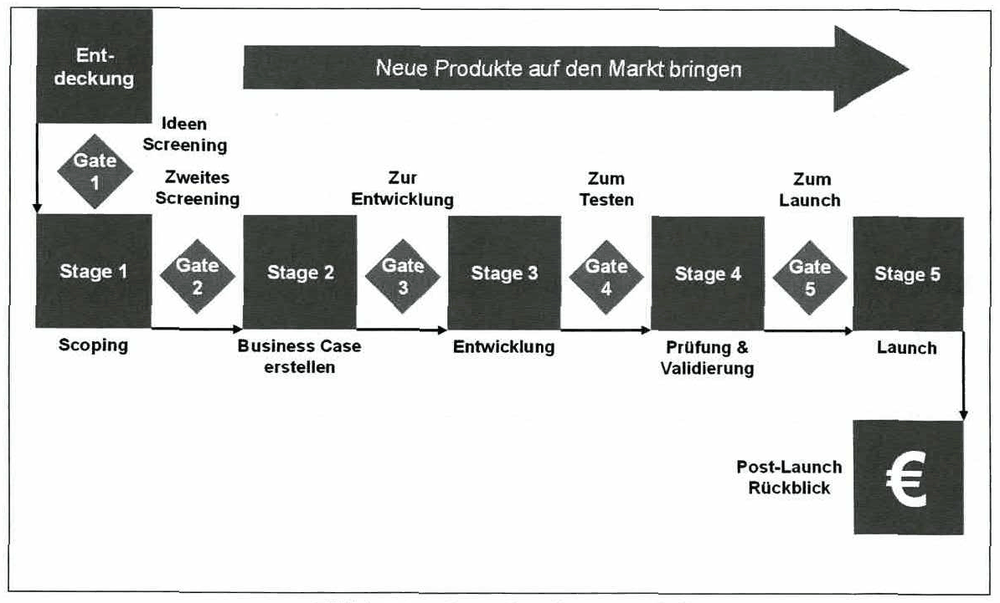
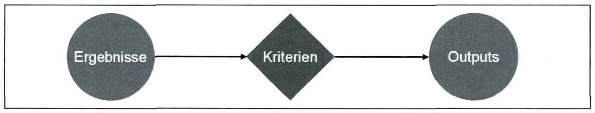
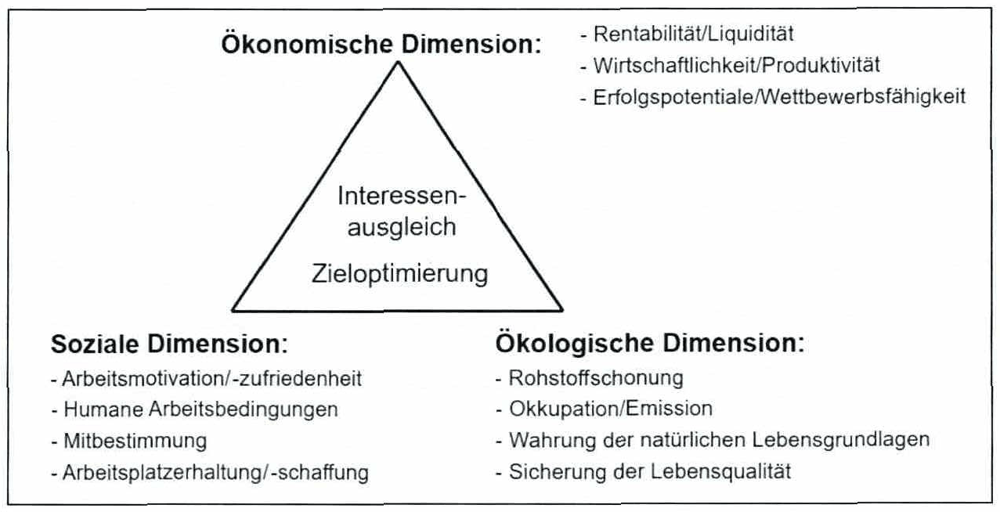
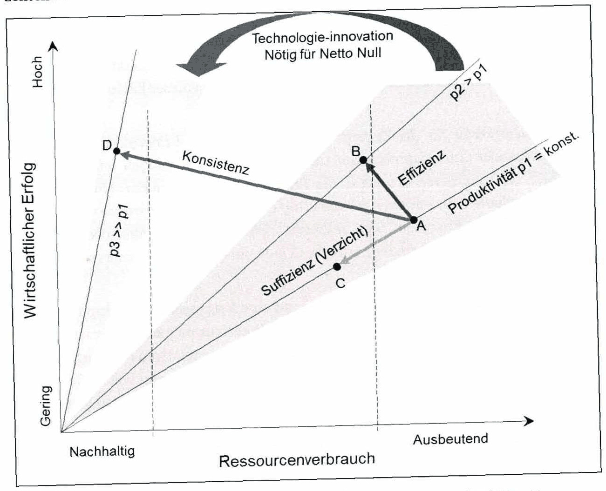

# Karteikarten: Abbildungen skizzieren

32 Karten, eine je prüfungsrelevanter Abbildung des Skripts (keine Tabellen, keine Formeln). Vorderseite: „Skizziere …“; Rückseite: die Originalabbildung, die Merkpunkte aus der Zeichenübung und die Prüfungsfragen dazu.

Das importierbare Anki-Paket (`.apkg`) liegt im Release dieses Repositorys; es wird mit `python -m pipeline anki` nach `build/anki/` erzeugt. Die Prüfungsfragen stammen aus Studierenden-Quellen und sind nicht verifiziert.

## Skizziere: Drei generische Strategien, die Unternehmen verfolgen können

*Abbildung 5 · Abschnitt 2.1 · Skript S. 22 (PDF 32)*

Lösung

**Gefragt in Prüfungen:**

- 14.03.2024: Strategien nach Porter beschreiben
- 15.10.2025: Strategien von Unternehmen: Differenzierung, Kostenführerschaft, Fokussierung

## Skizziere: Produktlebenszyklus

*Abbildung 8 · Abschnitt 2.5.1 · Skript S. 31 (PDF 41)*

Lösung

[Zeichenübung](../drawing-exercises/abb-08-zeichenuebung.md)

**Das musst du können:**

- Achsen beschriften: y = Umsatz, x = Zeit (mit Pfeilspitzen)
- Fünf Phasen in der richtigen Reihenfolge: Einführung, Wachstum, Reife, Sättigung, Abschwung
- Phasen durch senkrechte (gestrichelte) Linien trennen
- Umsatzkurve: flach – steil steigend – Maximum zwischen Reife und Sättigung – fallend
- Je Phase zwei bis drei Stichpunkte zu Umsatz und Marketing

**Gefragt in Prüfungen:**

- 10.12.2024: Produktlebenszyklus
- 09.04.2025: Produktlebenszyklus Diagramm
- 29.04.2026: Erklären Sie die Phasen in die sich der Produktlebenszyklus am Markt untergliedert. Stellen sie den typischen Verlauf als Diagramm dar.

## Skizziere: Ansoff Matrix

*Abbildung 11 · Abschnitt 2.5.1 · Skript S. 38 (PDF 48)*

Lösung

[Zeichenübung](../drawing-exercises/abb-11-zeichenuebung.md)

**Das musst du können:**

- 2×2-Raster mit Spaltenköpfen „Bestehende Produkte“ / „Neue Produkte“
- Zeilenköpfe „Bestehende Märkte“ / „Neue Märkte“
- Feld oben links: Marktdurchdringungsstrategie
- Feld oben rechts: Produktentwicklungsstrategie
- Feld unten links: Marktentwicklungsstrategie
- Feld unten rechts: Diversifizierungsstrategie

**Gefragt in Prüfungen:**

- 04.02.2025: Ansoff-Matrix
- 29.04.2026: Wozu dient die Ansoff-Matrix? Skizzieren Sie diese.

## Skizziere: Industriebetriebe im System der Wirtschaftseinheiten

*Abbildung 12 · Abschnitt 3.1 · Skript S. 47 (PDF 57)*

Lösung

**Gefragt in Prüfungen:**

- 18.03.2025: Wie ist der Begriff „Industrieunternehmen“ definiert und wo liegen die Unterschiede zu anderen Wirtschaftseinheiten?

## Skizziere: Abgrenzung zwischen Industrie- und Dienstleistungsbetrieb

*Abbildung 13 · Abschnitt 3.1.1 · Skript S. 49 (PDF 59)*

Lösung

**Gefragt in Prüfungen:**

- 18.03.2025: Wie ist der Begriff „Industrieunternehmen“ definiert und wo liegen die Unterschiede zu anderen Wirtschaftseinheiten?

## Skizziere: Abgrenzung zwischen Industriebetrieben und Werkstätten

*Abbildung 14 · Abschnitt 3.1.1 · Skript S. 49 (PDF 59)*

Lösung

**Gefragt in Prüfungen:**

- 18.03.2025: Wie ist der Begriff „Industrieunternehmen“ definiert und wo liegen die Unterschiede zu anderen Wirtschaftseinheiten?

## Skizziere: Industriebetrieb als Arbeitssystem

*Abbildung 15 · Abschnitt 3.1.2 · Skript S. 50 (PDF 60)*

Lösung

[Zeichenübung](../drawing-exercises/abb-15-zeichenuebung.md)

**Das musst du können:**

- Systemgrenze (gestrichelt) mit innerem Arbeitssystem
- Eingabe links hinein, Ausgabe rechts hinaus
- Mensch und Betriebsmittel als Kreise im Inneren, verbunden durch einen Doppelpfeil
- Prozess (Eingabe → Mensch/Betriebsmittel) und Arbeitsablauf (→ Ausgabe) beschriften
- Arbeitsaufgabe von oben, abgeleitet aus dem Unternehmensziel
- Umwelteinflüsse als Doppelpfeil an der Grenze

**Gefragt in Prüfungen:**

- 11.12.2025: Arbeitssystem nach REFA und Umwelteinflüsse dabei
- 29.04.2026: Skizzieren Sie das Arbeitssystem nach REFA und erklären sie seine Komponenten kurz.

## Skizziere: Entrepreneurship-Prozess

*Abbildung 22 · Abschnitt 4.2.4 · Skript S. 69 (PDF 79)*

Lösung

**Gefragt in Prüfungen:**

- 16.06.2025: Drei Phasen des Entrepreneurship-Prozess

## Skizziere: Arten der Integration

*Abbildung 28 · Abschnitt 5.6 · Skript S. 83 (PDF 93)*

Lösung

**Gefragt in Prüfungen:**

- 15.10.2025: 4 Methoden der integrierten Produktentwicklung (methodisch, organisatorisch, technologisch, menschlich)

## Skizziere: Systematik des Simultaneous Engineering

*Abbildung 30 · Abschnitt 5.6 · Skript S. 85 (PDF 95)*

Lösung

**Gefragt in Prüfungen:**

- 09.04.2025: 3 Prinzipien von Simultaneous Engineering aufzählen und erklären

## Skizziere: Integrationsbereiche der Themen Innovationsprozess & Produktentwicklung

*Abbildung 35 · Abschnitt 5.6 · Skript S. 93 (PDF 103)*

Lösung

[Zeichenübung](../drawing-exercises/abb-35-zeichenuebung.md)

**Das musst du können:**

- Drei überlappende Kreise: Strategische Produktplanung (oben), Produktentwicklung (unten links), Produktionssystementwicklung (unten rechts)
- Integrationsbereich Planung ∩ Produktentwicklung: Strategische Produktentwicklung
- Integrationsbereich Planung ∩ Produktionssystem: Strategische Produktionssystementwicklung
- Integrationsbereich Produkt ∩ Produktionssystem: Integrierte Produkt- und Produktionssystementwicklung
- Mitte (alle drei): Kooperationskern „Systems Engineering“

**Gefragt in Prüfungen:**

- 18.03.2025: Skizzieren und bennen Sie die Integrationsbereiche von Innovationsprozess und Produktentwicklung (Venn-Diagramm)

## Skizziere: Stage-Gate-Prozess nach Cooper

*Abbildung 37 · Abschnitt 6.2 · Skript S. 99 (PDF 109)*

Lösung

[Zeichenübung](../drawing-exercises/abb-37-zeichenuebung.md)

**Das musst du können:**

- Beginn mit der Entdeckung, dann abwechselnd Gate und Stage (Gate 1, Stage 1 … Gate 5, Stage 5)
- Gates als Rauten (Entscheidung), Stages als Kästen (Arbeit)
- Gate-Entscheidungen: Ideen Screening, Zweites Screening, Zur Entwicklung, Zum Testen, Zum Launch
- Stage-Inhalte: Scoping, Business Case erstellen, Entwicklung, Prüfung & Validierung, Launch
- Abschluss: Post-Launch Rückblick
- Richtungspfeil „Neue Produkte auf den Markt bringen“

**Gefragt in Prüfungen:**

- 16.06.2025: Innovationsprozess nach Cooper (Stage-Gate)
- 11.12.2025: Stage-Gate-Prozess Cooper zeichnen und erklären

## Skizziere: Aufbau eines Gates

*Abbildung 38 · Abschnitt 6.2 · Skript S. 100 (PDF 110)*

Lösung

[Zeichenübung](../drawing-exercises/abb-38-zeichenuebung.md)

**Das musst du können:**

- Drei Bausteine in Reihenfolge: Ergebnisse → Kriterien → Outputs
- Kriterien als Raute (Entscheidung) in der Mitte
- Outputs: go / kill / hold / recycle, Aktionsplan, Ergebnisse und Termin für das nächste Gate

**Gefragt in Prüfungen:**

- 11.12.2025: Stage-Gate-Prozess Cooper zeichnen und erklären

## Skizziere: 5-Step Prozess des Design Thinking

*Abbildung 39 · Abschnitt 6.3 · Skript S. 102 (PDF 112)*

Lösung

**Gefragt in Prüfungen:**

- 20.06.2024: Design Thinking Methode (IDEO)
- 10.12.2024: Design Thinking Methode (IDEO)
- 15.10.2025: Design Thinking Methode (IDEO)

## Skizziere: Funktionen des Industrie Management

*Abbildung 40 · Abschnitt 7.1 · Skript S. 107 (PDF 117)*

Lösung

**Gefragt in Prüfungen:**

- 11.12.2025: Funktionen des Industriemanagements

## Skizziere: Interne und externe Treiber für standortbezogene Reaktionen

*Abbildung 43 · Abschnitt 8.1.1 · Skript S. 115 (PDF 125)*

Lösung

**Gefragt in Prüfungen:**

- 15.10.2025: Strategische Standortplanung: externe und interne Faktoren

## Skizziere: Planungsgrundfälle nach Grundig

*Abbildung 44 · Abschnitt 8.2 · Skript S. 117 (PDF 127)*

Lösung

[Zeichenübung](../drawing-exercises/abb-44-zeichenuebung.md)

**Das musst du können:**

- Zentraler Begriff „Planungsgrundfälle“
- Fünf Fälle: Neubau, Um- und Neugestaltung, Erweiterung, Rückbau, Revitalisierung
- Je Fall ein Stichwort: Greenfield, Brownfield-Daueraufgabe, Kapazitätserweiterung, Fertigungstiefe/Umsatzrückgang, Nachnutzung stillgelegter Fabriken

**Gefragt in Prüfungen:**

- 14.03.2024: Grundfälle der Fabrikplanung nennen
- 15.10.2024: Planungsgrundfälle in der Fabrikplanung
- 16.06.2025: Planungsgrundfälle

## Skizziere: Typologisierung von Produktionssystemen

*Abbildung 45 · Abschnitt 8.2.1 · Skript S. 119 (PDF 129)*

Lösung

[Zeichenübung](../drawing-exercises/abb-45-zeichenuebung.md)

**Das musst du können:**

- Zwei Äste: Produktionsart und Fertigungsform
- Kriterien: mengenmäßiger Auftragsumfang + Wiederholhäufigkeit bzw. räumliche Anordnung
- 4 Produktionsarten in Reihenfolge steigender Stückzahl
- 5 Fertigungsformen von Punkt- bis Fließfertigung

**Gefragt in Prüfungen:**

- 14.03.2024: Produktionsarten beschreiben
- 10.12.2024: Typologien der Produktionsprozesse
- 09.04.2025: Fertigungsarten aufzählen + erklären

## Skizziere: Einordnung der Produktionsarten

*Abbildung 46 · Abschnitt 8.2.1 · Skript S. 121 (PDF 131)*

Lösung

[Zeichenübung](../drawing-exercises/abb-46-zeichenuebung.md)

**Das musst du können:**

- Drei Dimensionen beschriften: Variabilität, Volumen, Prozessablauf
- Pole richtig: Variabilität hoch → gering, Volumen niedrig → hoch, Prozessablauf unregelmäßig → regelmäßig
- 4 Produktionsarten als Treppe von links oben nach rechts unten

**Gefragt in Prüfungen:**

- 14.03.2024: Produktionsarten beschreiben
- 10.12.2024: Typologien der Produktionsprozesse
- 22.01.2026: Wie hängen die Produktionsarten (unterschiedliche Losgrößen) mit Variabilität, Volumen und Prozessablauf zusammen? Fertigen Sie eine Skizze an und erklären Sie jede Produktionsart kurz.

## Skizziere: Punktfertigung

*Abbildung 47 · Abschnitt 8.2.1 · Skript S. 121 (PDF 131)*

Lösung

[Zeichenübung](../drawing-exercises/abb-47-zeichenuebung.md)

**Das musst du können:**

- Produkt in der Mitte, ortsfest
- Drei Pfeile zum Produkt hin: Personal, Material, Information

## Skizziere: Gruppenfertigung

*Abbildung 48 · Abschnitt 8.2.1 · Skript S. 122 (PDF 132)*

Lösung

[Zeichenübung](../drawing-exercises/abb-48-zeichenuebung.md)

**Das musst du können:**

- Je Produktgruppe eine abgegrenzte Insel
- In jeder Insel unterschiedliche Maschinentypen in Flussrichtung verbunden

## Skizziere: Reihenfertigung

*Abbildung 49 · Abschnitt 8.2.1 · Skript S. 123 (PDF 133)*

Lösung

[Zeichenübung](../drawing-exercises/abb-49-zeichenuebung.md)

**Das musst du können:**

- Stationen in Reihenfolge der Arbeitsvorgänge
- Materialfluss nur vorwärts (Überspringen erlaubt, keine Rückläufe)

## Skizziere: Zusammenhang - Produktionsart & Fertigungsform

*Abbildung 50 · Abschnitt 8.2.1 · Skript S. 124 (PDF 134)*

Lösung

[Zeichenübung](../drawing-exercises/abb-50-zeichenuebung.md)

**Das musst du können:**

- Achsen: Stückzahlen (x), Grad der Spezialisierung (y)
- Drei Produktionsarten auf der x-Achse
- Fünf Fertigungsformen als Treppe in richtiger Reihenfolge

## Skizziere: Planungsvorgehen nach Grundig

*Abbildung 51 · Abschnitt 8.2.2 · Skript S. 125 (PDF 135)*

Lösung

[Zeichenübung](../drawing-exercises/abb-51-zeichenuebung.md)

**Das musst du können:**

- Sechs Phasen in richtiger Reihenfolge
- Grobplanung mit Ideal- und Realplanung
- Je Phase ein Stichwort zum Inhalt

**Gefragt in Prüfungen:**

- 20.06.2024: Planungsvorgehen – Layoutplanung und Realplanung und erklären von Fabrik
- 29.04.2026: Nennen Sie die Schritte das Planungsvorgehen der Fabrikplanung nach Grundig und beschreiben Sie jede Phase kurz.

## Skizziere: Einschränkungen Realplanung

*Abbildung 53 · Abschnitt 8.2.5.3 · Skript S. 129 (PDF 139)*

Lösung

**Gefragt in Prüfungen:**

- 20.06.2024: Planungsvorgehen – Layoutplanung und Realplanung und erklären von Fabrik

## Skizziere: Beispiele für das Spannungsfeld unternehmerischen Wirkens

*Abbildung 56 · Abschnitt 8.3.2 · Skript S. 134 (PDF 144)*

Lösung

**Gefragt in Prüfungen:**

- 20.06.2024: Beschreibung Spannungsfeld unternemerischen Wirkens
- 29.04.2026: Beschreiben Sie die drei Dimensionen der Nachhaltigkeit („Sustainability"). Skizzieren Sie das Spannungsfeld des unternehmerischen Wirkens.

## Skizziere: Einfluss von Effizienz, Konsistenz und Suffizienz auf Aufwand und Ertrag

*Abbildung 57 · Abschnitt 8.3.3 · Skript S. 138 (PDF 148)*

Lösung

[Zeichenübung](../drawing-exercises/abb-57-zeichenuebung.md)

**Das musst du können:**

- Achsen: Ressourcenverbrauch (Nachhaltig → Ausbeutend), Wirtschaftlicher Erfolg (Gering → Hoch)
- Produktivitätsgeraden p1 < p2 < p3 aus dem Ursprung
- Ausgangspunkt A und die drei Pfeile Effizienz (B), Suffizienz (C), Konsistenz (D)
- Suffizienz senkt den Erfolg, Effizienz und Konsistenz nicht

**Gefragt in Prüfungen:**

- 18.03.2025: Effizienz, Suffizienz, Konsistenz
- 15.10.2025: Suffizienz, Effizienz und Konsistenz (+Skizze)
- 29.04.2026: Erklären Sie die Begriffe Effizienz, Konsistenz und Suffizienz im Kontext der ökologischen Nachhaltigkeit.

## Skizziere: Gozintograph

*Abbildung 66 · Abschnitt 9.1.3 · Skript S. 155 (PDF 165)*

Lösung

**Gefragt in Prüfungen:**

- 04.02.2025: Gozintograph

## Skizziere: Materialbedarf

*Abbildung 69 · Abschnitt 9.1.3.1 · Skript S. 157 (PDF 167)*

Lösung

**Gefragt in Prüfungen:**

- 16.06.2025: Primär, sekundär, tertiät, brutto, nettobedarf

## Skizziere: ABC Analyse

*Abbildung 70 · Abschnitt 9.1.4 · Skript S. 159 (PDF 169)*

Lösung

[Zeichenübung](../drawing-exercises/abb-70-zeichenuebung.md)

**Das musst du können:**

- Achsen: Mengenanteil [%] (x), Wertanteil [%] (y), jeweils 0–100
- Konkave Kurve vom Ursprung nach (100/100)
- Klassen A (~20 % Menge, ~80 % Wert), B (~30 % Menge, ~10 % Wert), C (~50 % Menge, ~10 % Wert)

**Gefragt in Prüfungen:**

- 15.10.2024: ABC-Analyse
- 11.12.2025: ABC und Bestandsdilemma

## Skizziere: Gesamtanlageneffektivität

*Abbildung 74 · Abschnitt 9.1.7 · Skript S. 163 (PDF 173)*

Lösung

**Gefragt in Prüfungen:**

- 18.03.2025: Gesamtanlageneffektivität
- 22.01.2026: Gesamtanlageneffektivität

## Skizziere: Dilemma der Ablaufplanung

*Abbildung 79 · Abschnitt 9.2.2 · Skript S. 168 (PDF 178)*

Lösung

**Gefragt in Prüfungen:**

- 10.12.2024: Dilemma der Ablaufplanung
- 09.04.2025: Dilemma der Ablaufplanung erklären

