# Karteikarten: Abbildungen skizzieren

32 Karten, eine je prüfungsrelevanter Abbildung des Skripts (keine Tabellen, keine Formeln). Vorderseite: „Skizzieren Sie …“; Rückseite: unsere eigene Nachzeichnung der Abbildung (bisher für 16 Abbildungen, sonst eine Beschreibung in Worten), die Merkpunkte aus der Zeichenübung und die Prüfungsfragen dazu. Die Bilder des Skripts selbst sind nie auf den Karten (Urheberrecht); hier im Repository ist das Original zum Vergleich verlinkt.

Die Karten sind Teil der Anki-Karteikarten im Release (Unterdeck „4 Abbildungen skizzieren“ je Kapitel), erzeugt mit `python -m pipeline anki`. Die Prüfungsfragen stammen aus Studierenden-Quellen und sind nicht verifiziert.

## Skizzieren Sie „Drei generische Strategien, die Unternehmen verfolgen können“ (Abbildung 5).

*Abbildung 5 · Abschnitt 2.1 · Skript S. 22 (PDF 32)*

Lösung

*Bild des Skripts hier nicht abgedruckt (Urheberrecht) – siehe Original-Skript.*

**Gefragt in Prüfungen (Studierenden-Quellen, unverifiziert):**

- 14.03.2024: Beschreiben Sie die drei Wettbewerbsstrategien nach Porter.
- 15.10.2025: Beschreiben Sie die drei Wettbewerbsstrategien nach Porter: Differenzierung, Kostenführerschaft und Fokussierung.

[Original im Skript](../../figures/originals/abb-05.png)

## Skizzieren Sie „Produktlebenszyklus“ (Abbildung 8).

*Abbildung 8 · Abschnitt 2.5.1 · Skript S. 31 (PDF 41)*

Lösung

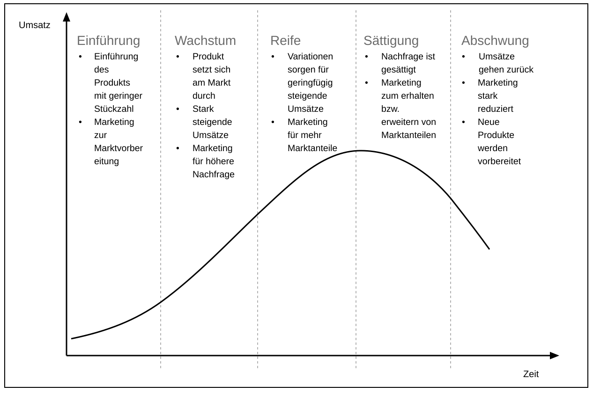

**Das müssen Sie können:**

- Achsen beschriften: y = Umsatz, x = Zeit (mit Pfeilspitzen)
- Fünf Phasen in der richtigen Reihenfolge: Einführung, Wachstum, Reife, Sättigung, Abschwung
- Phasen durch senkrechte (gestrichelte) Linien trennen
- Umsatzkurve: flach – steil steigend – Maximum zwischen Reife und Sättigung – fallend
- Je Phase zwei bis drei Stichpunkte zu Umsatz und Marketing

**Gefragt in Prüfungen (Studierenden-Quellen, unverifiziert):**

- 10.12.2024: Beschreiben Sie die Phasen des Produktlebenszyklus und skizzieren Sie seinen typischen Verlauf als Diagramm.
- 09.04.2025: Skizzieren Sie den typischen Verlauf des Produktlebenszyklus als Diagramm und kennzeichnen Sie darin seine Phasen.
- 29.04.2026: Erklären Sie die Phasen, in die sich der Produktlebenszyklus am Markt untergliedert. Stellen Sie den typischen Verlauf als Diagramm dar.

[Original im Skript](../../figures/originals/abb-08.png) · [Zeichenübung](../drawing-exercises/abb-08-zeichenuebung.md)

## Skizzieren Sie „Ansoff Matrix“ (Abbildung 11).

*Abbildung 11 · Abschnitt 2.5.1 · Skript S. 38 (PDF 48)*

Lösung

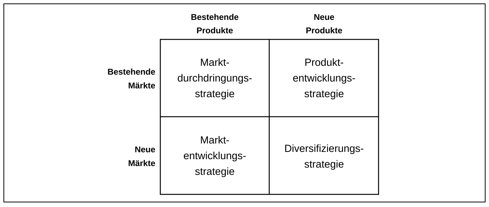

**Das müssen Sie können:**

- 2×2-Raster mit Spaltenköpfen „Bestehende Produkte“ / „Neue Produkte“
- Zeilenköpfe „Bestehende Märkte“ / „Neue Märkte“
- Feld oben links: Marktdurchdringungsstrategie
- Feld oben rechts: Produktentwicklungsstrategie
- Feld unten links: Marktentwicklungsstrategie
- Feld unten rechts: Diversifizierungsstrategie

**Gefragt in Prüfungen (Studierenden-Quellen, unverifiziert):**

- 04.02.2025: Skizzieren Sie die Ansoff-Matrix und erklären Sie die vier Strategieoptionen, die sich aus ihr ergeben.
- 29.04.2026: Erklären Sie, wozu die Ansoff-Matrix dient, und skizzieren Sie diese.

[Original im Skript](../../figures/originals/abb-11.png) · [Zeichenübung](../drawing-exercises/abb-11-zeichenuebung.md)

## Skizzieren Sie „Industriebetriebe im System der Wirtschaftseinheiten“ (Abbildung 12).

*Abbildung 12 · Abschnitt 3.1 · Skript S. 47 (PDF 57)*

Lösung

*Bild des Skripts hier nicht abgedruckt (Urheberrecht) – siehe Original-Skript.*

**Gefragt in Prüfungen (Studierenden-Quellen, unverifiziert):**

- 18.03.2025: Definieren Sie den Begriff Industrieunternehmen. Grenzen Sie Industrieunternehmen von anderen Wirtschaftseinheiten ab.

[Original im Skript](../../figures/originals/abb-12.png)

## Skizzieren Sie „Abgrenzung zwischen Industrie- und Dienstleistungsbetrieb“ (Abbildung 13).

*Abbildung 13 · Abschnitt 3.1.1 · Skript S. 49 (PDF 59)*

Lösung

*Bild des Skripts hier nicht abgedruckt (Urheberrecht) – siehe Original-Skript.*

**Gefragt in Prüfungen (Studierenden-Quellen, unverifiziert):**

- 18.03.2025: Definieren Sie den Begriff Industrieunternehmen. Grenzen Sie Industrieunternehmen von anderen Wirtschaftseinheiten ab.

[Original im Skript](../../figures/originals/abb-13.png)

## Skizzieren Sie „Abgrenzung zwischen Industriebetrieben und Werkstätten“ (Abbildung 14).

*Abbildung 14 · Abschnitt 3.1.1 · Skript S. 49 (PDF 59)*

Lösung

*Bild des Skripts hier nicht abgedruckt (Urheberrecht) – siehe Original-Skript.*

**Gefragt in Prüfungen (Studierenden-Quellen, unverifiziert):**

- 18.03.2025: Definieren Sie den Begriff Industrieunternehmen. Grenzen Sie Industrieunternehmen von anderen Wirtschaftseinheiten ab.

[Original im Skript](../../figures/originals/abb-14.png)

## Skizzieren Sie „Industriebetrieb als Arbeitssystem“ (Abbildung 15).

*Abbildung 15 · Abschnitt 3.1.2 · Skript S. 50 (PDF 60)*

Lösung

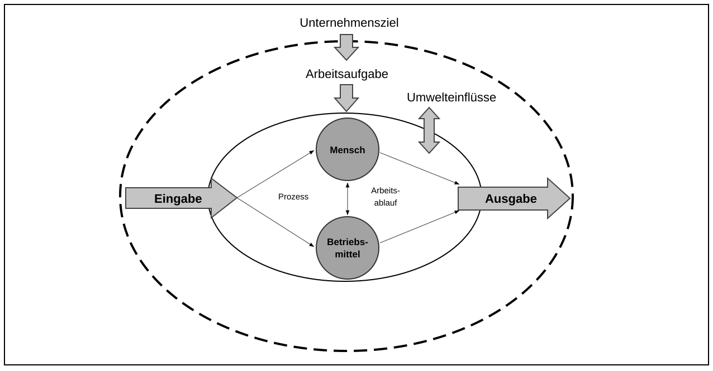

**Das müssen Sie können:**

- Systemgrenze (gestrichelt) mit innerem Arbeitssystem
- Eingabe links hinein, Ausgabe rechts hinaus
- Mensch und Betriebsmittel als Kreise im Inneren, verbunden durch einen Doppelpfeil
- Prozess (Eingabe → Mensch/Betriebsmittel) und Arbeitsablauf (→ Ausgabe) beschriften
- Arbeitsaufgabe von oben, abgeleitet aus dem Unternehmensziel
- Umwelteinflüsse als Doppelpfeil an der Grenze

**Gefragt in Prüfungen (Studierenden-Quellen, unverifiziert):**

- 11.12.2025: Erklären Sie das Arbeitssystem nach REFA mit seinen Komponenten. Beschreiben Sie die Umwelteinflüsse, die auf das Arbeitssystem wirken.
- 29.04.2026: Skizzieren Sie das Arbeitssystem nach REFA und erklären Sie seine Komponenten kurz.

[Original im Skript](../../figures/originals/abb-15.png) · [Zeichenübung](../drawing-exercises/abb-15-zeichenuebung.md)

## Skizzieren Sie „Entrepreneurship-Prozess“ (Abbildung 22).

*Abbildung 22 · Abschnitt 4.2.4 · Skript S. 69 (PDF 79)*

Lösung

*Bild des Skripts hier nicht abgedruckt (Urheberrecht) – siehe Original-Skript.*

**Gefragt in Prüfungen (Studierenden-Quellen, unverifiziert):**

- 16.06.2025: Nennen und beschreiben Sie die drei Phasen des Entrepreneurship-Prozesses.

[Original im Skript](../../figures/originals/abb-22.png)

## Skizzieren Sie „Arten der Integration“ (Abbildung 28).

*Abbildung 28 · Abschnitt 5.6 · Skript S. 83 (PDF 93)*

Lösung

*Bild des Skripts hier nicht abgedruckt (Urheberrecht) – siehe Original-Skript.*

**Gefragt in Prüfungen (Studierenden-Quellen, unverifiziert):**

- 15.10.2025: Nennen und erklären Sie die vier Arten der Integration in der integrierten Produktentwicklung: die methodische, organisatorische, technologische und menschliche Integration.

[Original im Skript](../../figures/originals/abb-28.png)

## Skizzieren Sie „Systematik des Simultaneous Engineering“ (Abbildung 30).

*Abbildung 30 · Abschnitt 5.6 · Skript S. 85 (PDF 95)*

Lösung

*Bild des Skripts hier nicht abgedruckt (Urheberrecht) – siehe Original-Skript.*

**Gefragt in Prüfungen (Studierenden-Quellen, unverifiziert):**

- 09.04.2025: Nennen und erklären Sie die drei Prinzipien des Simultaneous Engineering.

[Original im Skript](../../figures/originals/abb-30.png)

## Skizzieren Sie „Integrationsbereiche der Themen Innovationsprozess & Produktentwicklung“ (Abbildung 35).

*Abbildung 35 · Abschnitt 5.6 · Skript S. 93 (PDF 103)*

Lösung

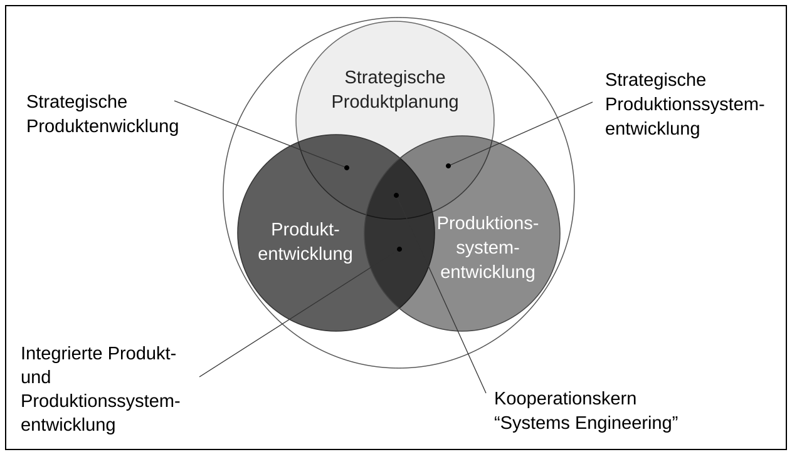

**Das müssen Sie können:**

- Drei überlappende Kreise: Strategische Produktplanung (oben), Produktentwicklung (unten links), Produktionssystementwicklung (unten rechts)
- Integrationsbereich Planung ∩ Produktentwicklung: Strategische Produktentwicklung
- Integrationsbereich Planung ∩ Produktionssystem: Strategische Produktionssystementwicklung
- Integrationsbereich Produkt ∩ Produktionssystem: Integrierte Produkt- und Produktionssystementwicklung
- Mitte (alle drei): Kooperationskern „Systems Engineering“

**Gefragt in Prüfungen (Studierenden-Quellen, unverifiziert):**

- 18.03.2025: Skizzieren Sie die Integrationsbereiche von Innovationsprozess und Produktentwicklung als Venn-Diagramm und benennen Sie die einzelnen Bereiche.

[Original im Skript](../../figures/originals/abb-35.png) · [Zeichenübung](../drawing-exercises/abb-35-zeichenuebung.md)

## Skizzieren Sie „Stage-Gate-Prozess nach Cooper“ (Abbildung 37).

*Abbildung 37 · Abschnitt 6.2 · Skript S. 99 (PDF 109)*

Lösung

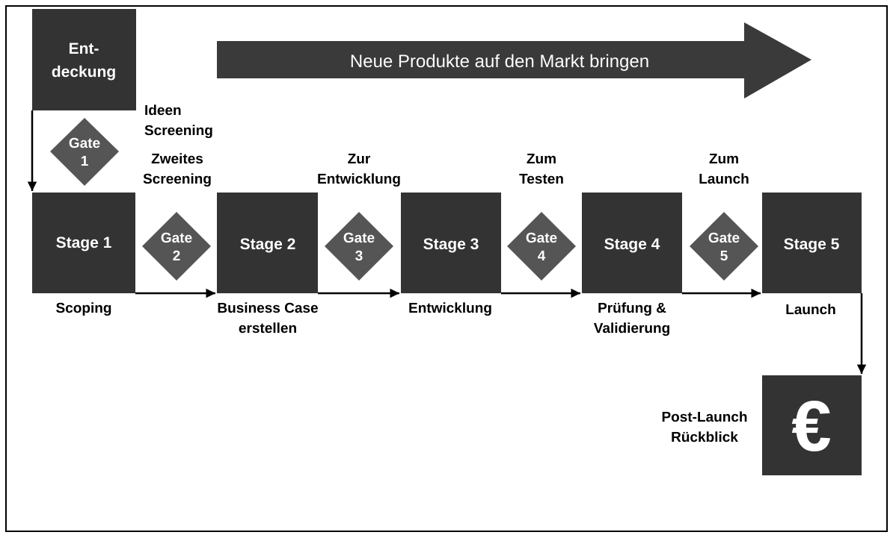

**Das müssen Sie können:**

- Beginn mit der Entdeckung, dann abwechselnd Gate und Stage (Gate 1, Stage 1 … Gate 5, Stage 5)
- Gates als Rauten (Entscheidung), Stages als Kästen (Arbeit)
- Gate-Entscheidungen: Ideen Screening, Zweites Screening, Zur Entwicklung, Zum Testen, Zum Launch
- Stage-Inhalte: Scoping, Business Case erstellen, Entwicklung, Prüfung & Validierung, Launch
- Abschluss: Post-Launch Rückblick
- Richtungspfeil „Neue Produkte auf den Markt bringen“

**Gefragt in Prüfungen (Studierenden-Quellen, unverifiziert):**

- 16.06.2025: Skizzieren Sie den Innovationsprozess nach Cooper als Stage-Gate-Prozess und erklären Sie die Funktionen der Stages und der Gates.
- 11.12.2025: Skizzieren Sie den Stage-Gate-Prozess nach Cooper und erklären Sie die Funktionen der Stages und der Gates.

[Original im Skript](../../figures/originals/abb-37.png) · [Zeichenübung](../drawing-exercises/abb-37-zeichenuebung.md)

## Skizzieren Sie „Aufbau eines Gates“ (Abbildung 38).

*Abbildung 38 · Abschnitt 6.2 · Skript S. 100 (PDF 110)*

Lösung

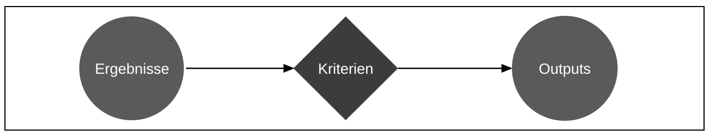

**Das müssen Sie können:**

- Drei Bausteine in Reihenfolge: Ergebnisse → Kriterien → Outputs
- Kriterien als Raute (Entscheidung) in der Mitte
- Outputs: go / kill / hold / recycle, Aktionsplan, Ergebnisse und Termin für das nächste Gate

**Gefragt in Prüfungen (Studierenden-Quellen, unverifiziert):**

- 11.12.2025: Skizzieren Sie den Stage-Gate-Prozess nach Cooper und erklären Sie die Funktionen der Stages und der Gates.

[Original im Skript](../../figures/originals/abb-38.png) · [Zeichenübung](../drawing-exercises/abb-38-zeichenuebung.md)

## Skizzieren Sie „5-Step Prozess des Design Thinking“ (Abbildung 39).

*Abbildung 39 · Abschnitt 6.3 · Skript S. 102 (PDF 112)*

Lösung

*Bild des Skripts hier nicht abgedruckt (Urheberrecht) – siehe Original-Skript.*

**Gefragt in Prüfungen (Studierenden-Quellen, unverifiziert):**

- 20.06.2024: Beschreiben Sie die Design-Thinking-Methode nach IDEO und erklären Sie die fünf Phasen ihres Prozesses.
- 10.12.2024: Beschreiben Sie die Design-Thinking-Methode nach IDEO und erklären Sie die fünf Phasen ihres Prozesses.
- 15.10.2025: Beschreiben Sie die Design-Thinking-Methode nach IDEO und erklären Sie die fünf Phasen ihres Prozesses.

[Original im Skript](../../figures/originals/abb-39.png)

## Skizzieren Sie „Funktionen des Industrie Management“ (Abbildung 40).

*Abbildung 40 · Abschnitt 7.1 · Skript S. 107 (PDF 117)*

Lösung

*Bild des Skripts hier nicht abgedruckt (Urheberrecht) – siehe Original-Skript.*

**Gefragt in Prüfungen (Studierenden-Quellen, unverifiziert):**

- 11.12.2025: Nennen und erläutern Sie die Funktionen des Industriemanagements nach Bleicher.

[Original im Skript](../../figures/originals/abb-40.png)

## Skizzieren Sie „Interne und externe Treiber für standortbezogene Reaktionen“ (Abbildung 43).

*Abbildung 43 · Abschnitt 8.1.1 · Skript S. 115 (PDF 125)*

Lösung

*Bild des Skripts hier nicht abgedruckt (Urheberrecht) – siehe Original-Skript.*

**Gefragt in Prüfungen (Studierenden-Quellen, unverifiziert):**

- 15.10.2025: Nennen und erläutern Sie die externen und internen Faktoren, die Auslöser für eine strategische Standortplanung sein können.

[Original im Skript](../../figures/originals/abb-43.png)

## Skizzieren Sie „Planungsgrundfälle nach Grundig“ (Abbildung 44).

*Abbildung 44 · Abschnitt 8.2 · Skript S. 117 (PDF 127)*

Lösung

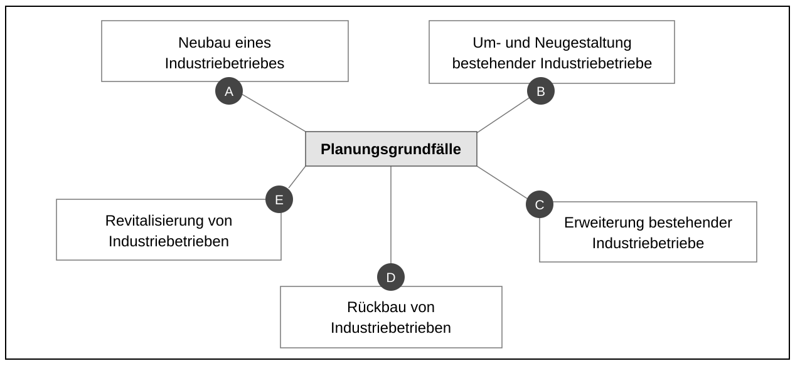

**Das müssen Sie können:**

- Zentraler Begriff „Planungsgrundfälle“
- Fünf Fälle: Neubau, Um- und Neugestaltung, Erweiterung, Rückbau, Revitalisierung
- Je Fall ein Stichwort: Greenfield, Brownfield-Daueraufgabe, Kapazitätserweiterung, Fertigungstiefe/Umsatzrückgang, Nachnutzung stillgelegter Fabriken

**Gefragt in Prüfungen (Studierenden-Quellen, unverifiziert):**

- 14.03.2024: Nennen Sie die fünf Planungsgrundfälle der Fabrikplanung nach Grundig.
- 15.10.2024: Nennen Sie die fünf Planungsgrundfälle der Fabrikplanung nach Grundig.
- 16.06.2025: Nennen Sie die fünf Planungsgrundfälle der Fabrikplanung nach Grundig.

[Original im Skript](../../figures/originals/abb-44.png) · [Zeichenübung](../drawing-exercises/abb-44-zeichenuebung.md)

## Skizzieren Sie „Typologisierung von Produktionssystemen“ (Abbildung 45).

*Abbildung 45 · Abschnitt 8.2.1 · Skript S. 119 (PDF 129)*

Lösung

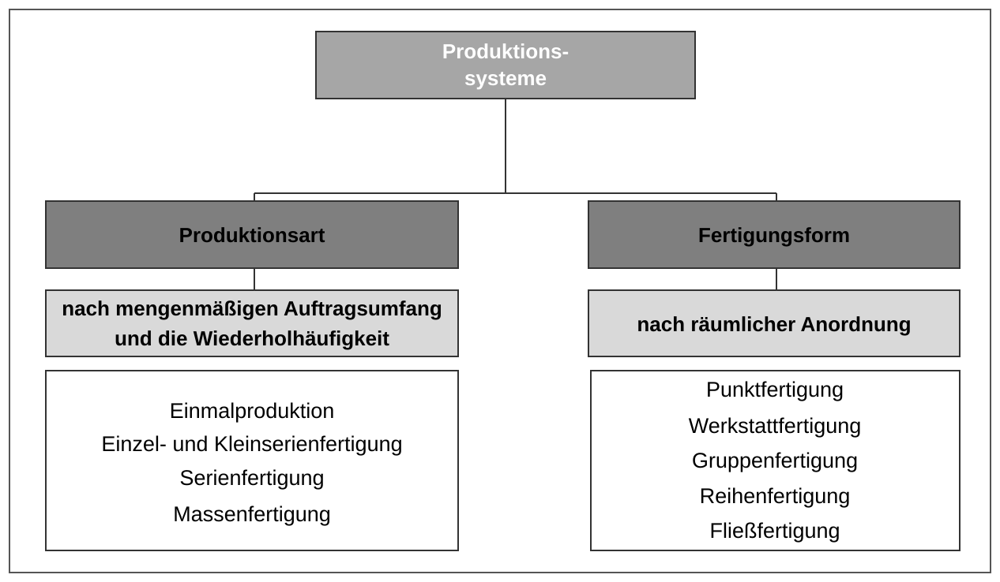

**Das müssen Sie können:**

- Zwei Äste: Produktionsart und Fertigungsform
- Kriterien: mengenmäßiger Auftragsumfang + Wiederholhäufigkeit bzw. räumliche Anordnung
- 4 Produktionsarten in Reihenfolge steigender Stückzahl
- 5 Fertigungsformen von Punkt- bis Fließfertigung

**Gefragt in Prüfungen (Studierenden-Quellen, unverifiziert):**

- 14.03.2024: Nennen und beschreiben Sie die Produktionsarten.
- 10.12.2024: Nennen und beschreiben Sie die Typologien von Produktionsprozessen nach Produktionsart und Fertigungsform.
- 09.04.2025: Nennen Sie die Fertigungsarten und erklären Sie diese.

[Original im Skript](../../figures/originals/abb-45.png) · [Zeichenübung](../drawing-exercises/abb-45-zeichenuebung.md)

## Skizzieren Sie „Einordnung der Produktionsarten“ (Abbildung 46).

*Abbildung 46 · Abschnitt 8.2.1 · Skript S. 121 (PDF 131)*

Lösung

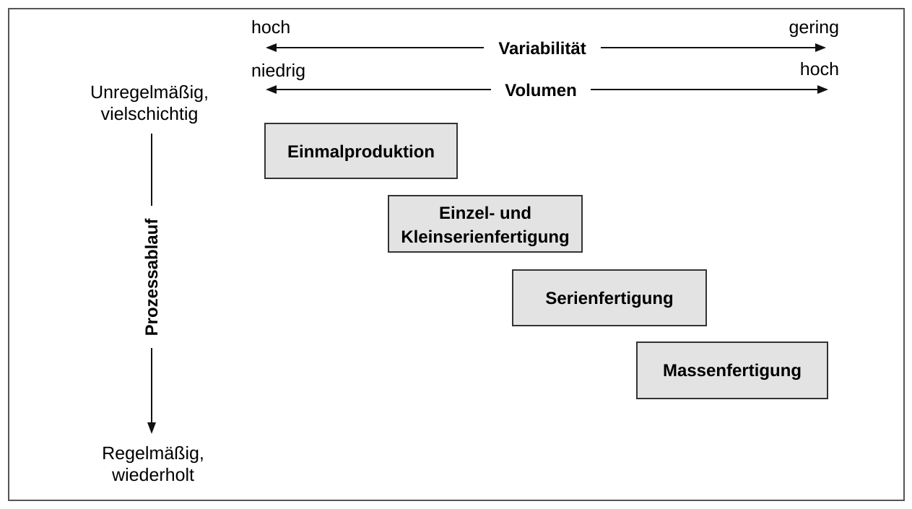

**Das müssen Sie können:**

- Drei Dimensionen beschriften: Variabilität, Volumen, Prozessablauf
- Pole richtig: Variabilität hoch → gering, Volumen niedrig → hoch, Prozessablauf unregelmäßig → regelmäßig
- 4 Produktionsarten als Treppe von links oben nach rechts unten

**Gefragt in Prüfungen (Studierenden-Quellen, unverifiziert):**

- 14.03.2024: Nennen und beschreiben Sie die Produktionsarten.
- 10.12.2024: Nennen und beschreiben Sie die Typologien von Produktionsprozessen nach Produktionsart und Fertigungsform.
- 22.01.2026: Erklären Sie, wie die Produktionsarten mit ihren unterschiedlichen Losgrößen mit Variabilität, Volumen und Prozessablauf zusammenhängen. Skizzieren Sie diesen Zusammenhang und erklären Sie jede Produktionsart kurz.

[Original im Skript](../../figures/originals/abb-46.png) · [Zeichenübung](../drawing-exercises/abb-46-zeichenuebung.md)

## Skizzieren Sie „Punktfertigung“ (Abbildung 47).

*Abbildung 47 · Abschnitt 8.2.1 · Skript S. 121 (PDF 131)*

Lösung

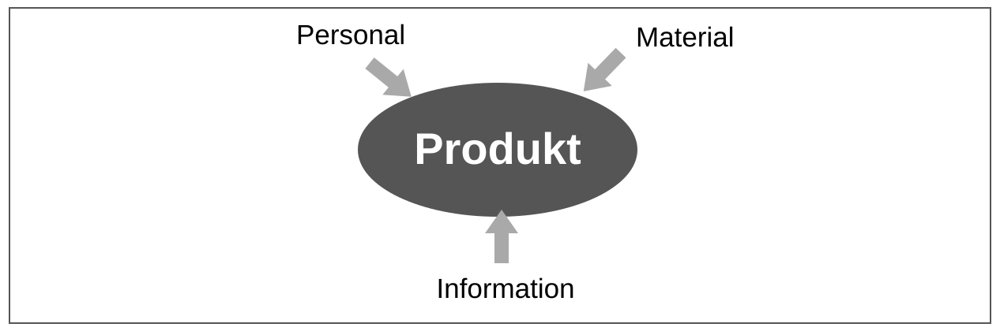

**Das müssen Sie können:**

- Produkt in der Mitte, ortsfest
- Drei Pfeile zum Produkt hin: Personal, Material, Information

[Original im Skript](../../figures/originals/abb-47.png) · [Zeichenübung](../drawing-exercises/abb-47-zeichenuebung.md)

## Skizzieren Sie „Gruppenfertigung“ (Abbildung 48).

*Abbildung 48 · Abschnitt 8.2.1 · Skript S. 122 (PDF 132)*

Lösung

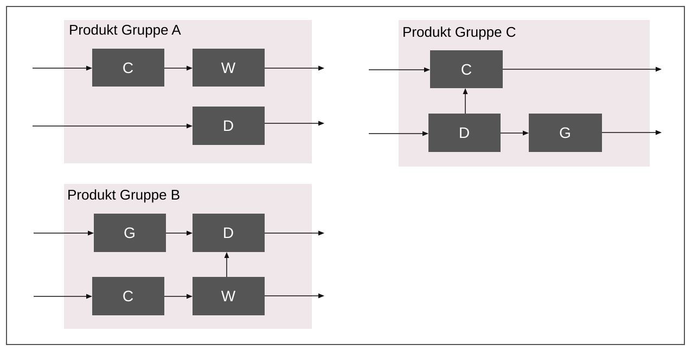

**Das müssen Sie können:**

- Je Produktgruppe eine abgegrenzte Insel
- In jeder Insel unterschiedliche Maschinentypen in Flussrichtung verbunden

[Original im Skript](../../figures/originals/abb-48.png) · [Zeichenübung](../drawing-exercises/abb-48-zeichenuebung.md)

## Skizzieren Sie „Reihenfertigung“ (Abbildung 49).

*Abbildung 49 · Abschnitt 8.2.1 · Skript S. 123 (PDF 133)*

Lösung

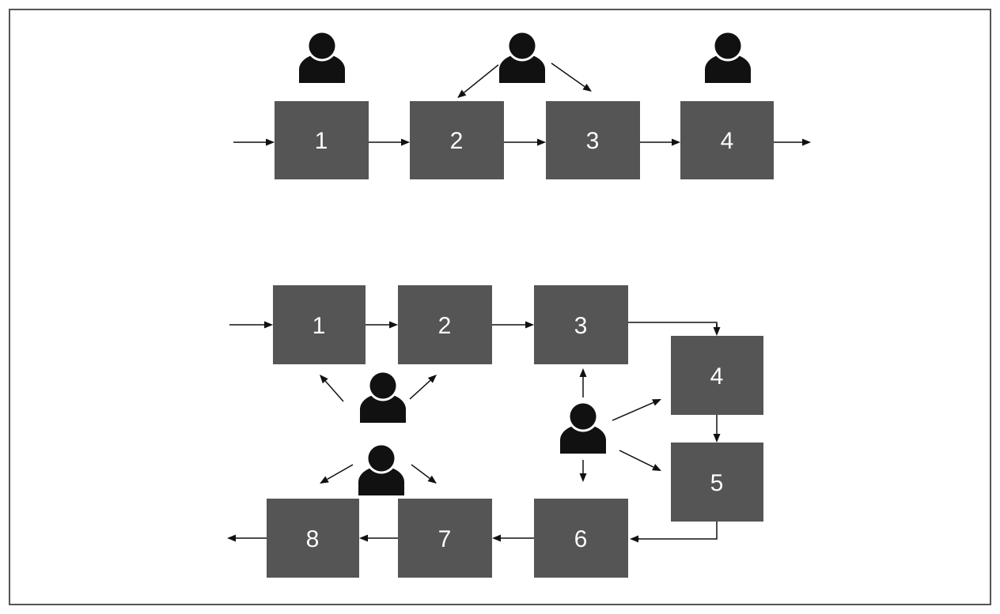

**Das müssen Sie können:**

- Stationen in Reihenfolge der Arbeitsvorgänge
- Materialfluss nur vorwärts (Überspringen erlaubt, keine Rückläufe)

[Original im Skript](../../figures/originals/abb-49.png) · [Zeichenübung](../drawing-exercises/abb-49-zeichenuebung.md)

## Skizzieren Sie „Zusammenhang - Produktionsart & Fertigungsform“ (Abbildung 50).

*Abbildung 50 · Abschnitt 8.2.1 · Skript S. 124 (PDF 134)*

Lösung

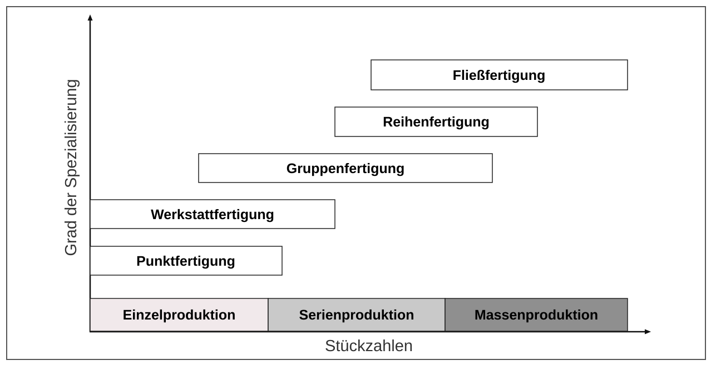

**Das müssen Sie können:**

- Achsen: Stückzahlen (x), Grad der Spezialisierung (y)
- Drei Produktionsarten auf der x-Achse
- Fünf Fertigungsformen als Treppe in richtiger Reihenfolge

[Original im Skript](../../figures/originals/abb-50.png) · [Zeichenübung](../drawing-exercises/abb-50-zeichenuebung.md)

## Skizzieren Sie „Planungsvorgehen nach Grundig“ (Abbildung 51).

*Abbildung 51 · Abschnitt 8.2.2 · Skript S. 125 (PDF 135)*

Lösung

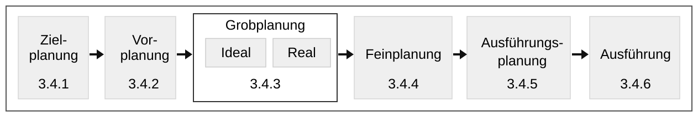

**Das müssen Sie können:**

- Sechs Phasen in richtiger Reihenfolge
- Grobplanung mit Ideal- und Realplanung
- Je Phase ein Stichwort zum Inhalt

**Gefragt in Prüfungen (Studierenden-Quellen, unverifiziert):**

- 20.06.2024: Definieren Sie den Begriff Fabrik. Beschreiben Sie das Planungsvorgehen der Fabrikplanung nach Grundig und erklären Sie dabei die Layoutplanung mit Ideal- und Realplanung.
- 29.04.2026: Nennen Sie die Schritte des Planungsvorgehens der Fabrikplanung nach Grundig und beschreiben Sie jede Phase kurz.

[Original im Skript](../../figures/originals/abb-51.png) · [Zeichenübung](../drawing-exercises/abb-51-zeichenuebung.md)

## Skizzieren Sie „Einschränkungen Realplanung“ (Abbildung 53).

*Abbildung 53 · Abschnitt 8.2.5.3 · Skript S. 129 (PDF 139)*

Lösung

*Bild des Skripts hier nicht abgedruckt (Urheberrecht) – siehe Original-Skript.*

**Gefragt in Prüfungen (Studierenden-Quellen, unverifiziert):**

- 20.06.2024: Definieren Sie den Begriff Fabrik. Beschreiben Sie das Planungsvorgehen der Fabrikplanung nach Grundig und erklären Sie dabei die Layoutplanung mit Ideal- und Realplanung.

[Original im Skript](../../figures/originals/abb-53.png)

## Skizzieren Sie „Beispiele für das Spannungsfeld unternehmerischen Wirkens“ (Abbildung 56).

*Abbildung 56 · Abschnitt 8.3.2 · Skript S. 134 (PDF 144)*

Lösung

*Bild des Skripts hier nicht abgedruckt (Urheberrecht) – siehe Original-Skript.*

**Gefragt in Prüfungen (Studierenden-Quellen, unverifiziert):**

- 20.06.2024: Beschreiben Sie das Spannungsfeld des unternehmerischen Wirkens und skizzieren Sie es.
- 29.04.2026: Beschreiben Sie die drei Dimensionen der Nachhaltigkeit („Sustainability“). Skizzieren Sie das Spannungsfeld des unternehmerischen Wirkens.

[Original im Skript](../../figures/originals/abb-56.png)

## Skizzieren Sie „Einfluss von Effizienz, Konsistenz und Suffizienz auf Aufwand und Ertrag“ (Abbildung 57).

*Abbildung 57 · Abschnitt 8.3.3 · Skript S. 138 (PDF 148)*

Lösung

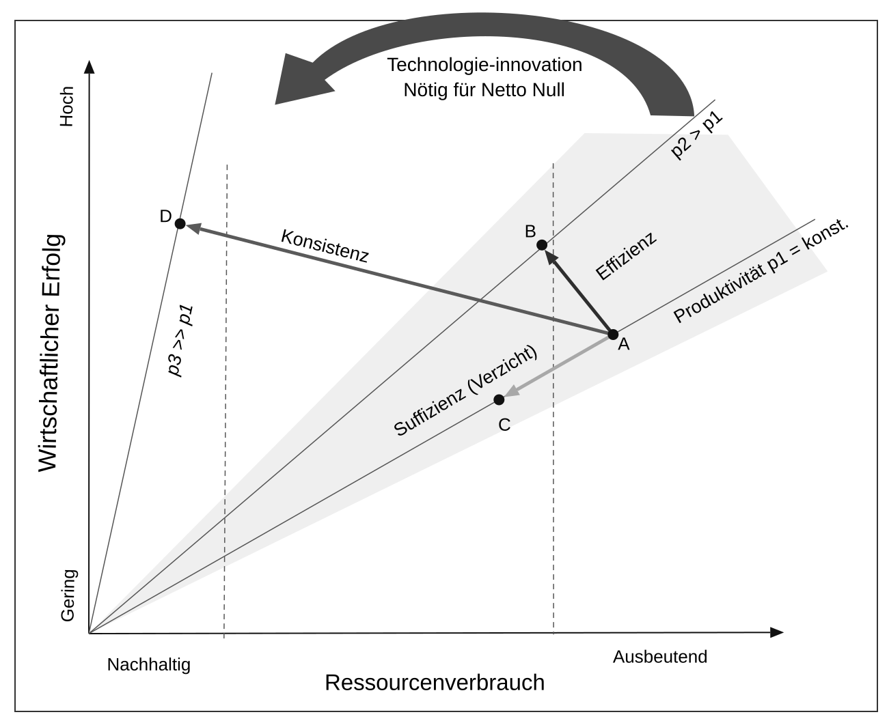

**Das müssen Sie können:**

- Achsen: Ressourcenverbrauch (Nachhaltig → Ausbeutend), Wirtschaftlicher Erfolg (Gering → Hoch)
- Produktivitätsgeraden p1 < p2 < p3 aus dem Ursprung
- Ausgangspunkt A und die drei Pfeile Effizienz (B), Suffizienz (C), Konsistenz (D)
- Suffizienz senkt den Erfolg, Effizienz und Konsistenz nicht

**Gefragt in Prüfungen (Studierenden-Quellen, unverifiziert):**

- 18.03.2025: Erklären Sie die Begriffe Effizienz, Suffizienz und Konsistenz im Kontext der ökologischen Nachhaltigkeit und skizzieren Sie ihren Einfluss auf Aufwand und Ertrag.
- 15.10.2025: Erklären Sie die Begriffe Suffizienz, Effizienz und Konsistenz im Kontext der ökologischen Nachhaltigkeit. Skizzieren Sie ihren Einfluss auf Aufwand und Ertrag in einem Diagramm.
- 29.04.2026: Erklären Sie die Begriffe Effizienz, Konsistenz und Suffizienz im Kontext der ökologischen Nachhaltigkeit.

[Original im Skript](../../figures/originals/abb-57.png) · [Zeichenübung](../drawing-exercises/abb-57-zeichenuebung.md)

## Skizzieren Sie „Gozintograph“ (Abbildung 66).

*Abbildung 66 · Abschnitt 9.1.3 · Skript S. 155 (PDF 165)*

Lösung

*Bild des Skripts hier nicht abgedruckt (Urheberrecht) – siehe Original-Skript.*

**Gefragt in Prüfungen (Studierenden-Quellen, unverifiziert):**

- 04.02.2025: Erklären Sie, was ein Gozintograph darstellt und wozu er in der Materialbedarfsplanung eingesetzt wird.

[Original im Skript](../../figures/originals/abb-66.png)

## Skizzieren Sie „Materialbedarf“ (Abbildung 69).

*Abbildung 69 · Abschnitt 9.1.3.1 · Skript S. 157 (PDF 167)*

Lösung

*Bild des Skripts hier nicht abgedruckt (Urheberrecht) – siehe Original-Skript.*

**Gefragt in Prüfungen (Studierenden-Quellen, unverifiziert):**

- 16.06.2025: Definieren Sie die Begriffe Primärbedarf, Sekundärbedarf und Tertiärbedarf sowie Bruttobedarf und Nettobedarf.

[Original im Skript](../../figures/originals/abb-69.png)

## Skizzieren Sie „ABC Analyse“ (Abbildung 70).

*Abbildung 70 · Abschnitt 9.1.4 · Skript S. 159 (PDF 169)*

Lösung

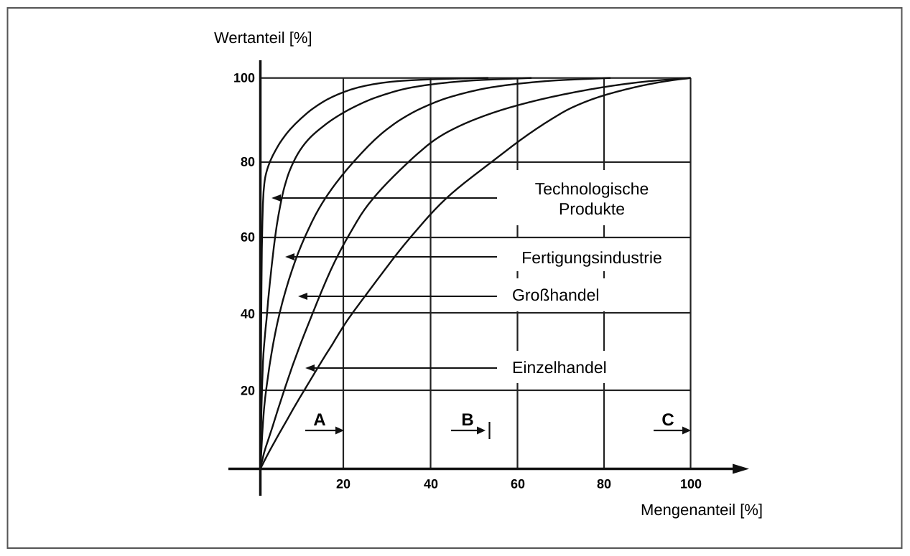

**Das müssen Sie können:**

- Achsen: Mengenanteil [%] (x), Wertanteil [%] (y), jeweils 0–100
- Konkave Kurve vom Ursprung nach (100/100)
- Klassen A (~20 % Menge, ~80 % Wert), B (~30 % Menge, ~10 % Wert), C (~50 % Menge, ~10 % Wert)

**Gefragt in Prüfungen (Studierenden-Quellen, unverifiziert):**

- 15.10.2024: Erklären Sie die ABC-Analyse und skizzieren Sie das zugehörige Diagramm.
- 11.12.2025: Erklären Sie das Bestandsdilemma und die ABC-Analyse. Skizzieren Sie das Diagramm der ABC-Analyse.

[Original im Skript](../../figures/originals/abb-70.png) · [Zeichenübung](../drawing-exercises/abb-70-zeichenuebung.md)

## Skizzieren Sie „Gesamtanlageneffektivität“ (Abbildung 74).

*Abbildung 74 · Abschnitt 9.1.7 · Skript S. 163 (PDF 173)*

Lösung

*Bild des Skripts hier nicht abgedruckt (Urheberrecht) – siehe Original-Skript.*

**Gefragt in Prüfungen (Studierenden-Quellen, unverifiziert):**

- 18.03.2025: Definieren Sie die Gesamtanlageneffektivität und erklären Sie, aus welchen Kenngrößen sie sich zusammensetzt und wie sie berechnet wird.
- 22.01.2026: Definieren Sie die Gesamtanlageneffektivität und erklären Sie, aus welchen Kenngrößen sie sich zusammensetzt und wie sie berechnet wird.

[Original im Skript](../../figures/originals/abb-74.png)

## Skizzieren Sie „Dilemma der Ablaufplanung“ (Abbildung 79).

*Abbildung 79 · Abschnitt 9.2.2 · Skript S. 168 (PDF 178)*

Lösung

*Bild des Skripts hier nicht abgedruckt (Urheberrecht) – siehe Original-Skript.*

**Gefragt in Prüfungen (Studierenden-Quellen, unverifiziert):**

- 10.12.2024: Erklären Sie das Dilemma der Ablaufplanung.
- 09.04.2025: Erklären Sie das Dilemma der Ablaufplanung.

[Original im Skript](../../figures/originals/abb-79.png)

